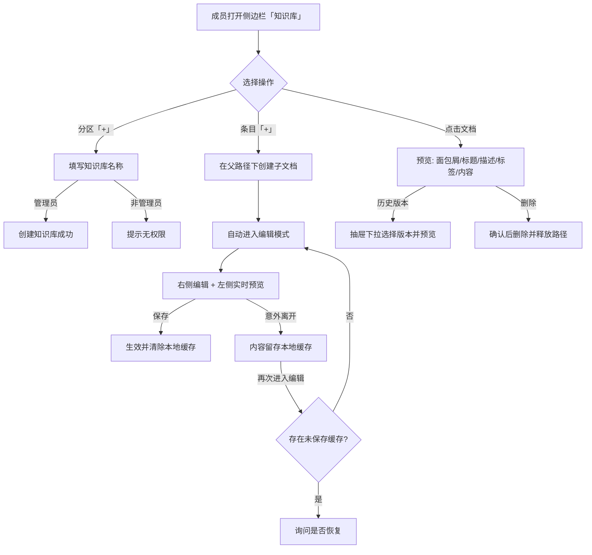
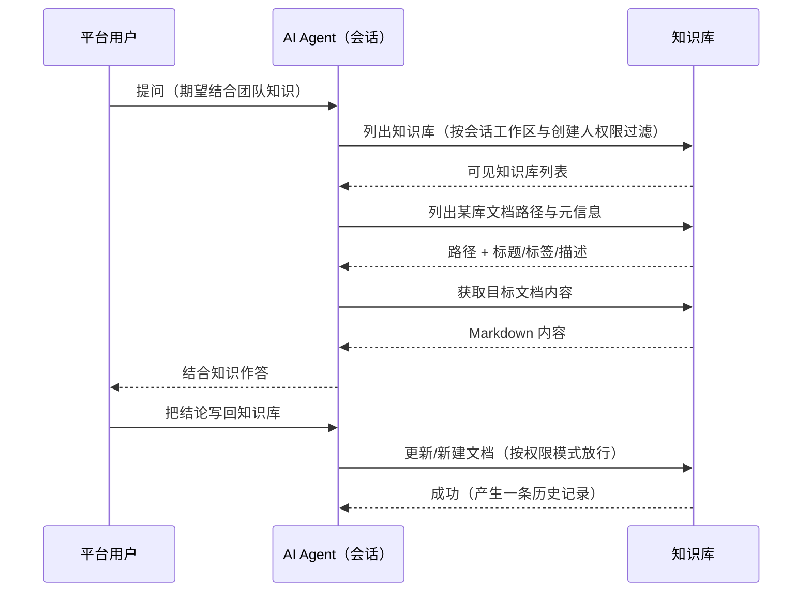

# 知识库

**功能名称**: 知识库
**PRD 版本**: v1.0
**创建日期**: 2026-11-15
**作者**: z-agent-bot

## 背景与目标

### 1.1 背景

平台已具备多租户与工作区体系（见 [[20261028-multi-tenant-phase2.md]]），团队内的经验、规范、FAQ 等知识缺少统一的沉淀场所：成员之间靠口口相传，AI 会话每次都要在提示词里重复粘贴背景资料。需求来源：[GitHub Issue Deliay/z-agent-gear#495](https://github.com/Deliay/z-agent-gear/issues/495)。

本期提供「知识库」能力：每个工作区可以建立若干 wiki 风格的知识库，库内文档以路径组织、带标题/标签/描述/Markdown 内容；文档的创建、编辑、删除全程留痕可回看；知识库按权限模式对非管理员开放；同时向 AI 会话注入知识库工具，让 Agent 能按权限查阅与维护知识。

### 1.2 目标

- 工作区可以创建多个知识库，知识库内以路径唯一标识文档，形成树形 wiki 结构。
- 文档从创建、每次编辑到删除的全生命周期都留有历史版本，删除文档不抹除历史，同路径重建后历史延续可见。
- 知识库提供四种权限模式，工作区管理员可控制非管理员成员的读、写范围；全局工作区的知识库对同租户其他工作区可见，读写同样受该知识库的权限设置约束。
- 会话中的 AI 可以通过知识库工具查阅与维护知识，可见范围由会话创建人的权限与会话所在工作区决定。

### 1.3 成功标准

- 工作区管理员可以创建知识库并设置权限模式；非管理员成员只能在被授权的模式内访问知识库。
- 成员可以浏览知识库树、预览文档、编辑文档、删除文档；编辑中意外离开时未保存内容可从本地缓存恢复。
- 任意文档的历史版本（含已删除路径的历史）可按时间倒序查看并预览。
- AI 会话中可以列出、查阅、更新、删除其权限内的知识库与文档，四种典型会话场景（见功能点 5）的可见范围与权限矩阵完全一致。

## 用户分析

### 2.1 目标用户

- **工作区管理员（租户管理员）**：创建知识库、设置权限模式、维护全部文档。
- **工作区普通成员（开发角色）**：在权限允许的范围内阅读、创建、更新、删除知识库文档。
- **AI Agent（会话中的最终消费者）**：通过知识库工具检索知识、把结论沉淀回知识库。

### 2.2 用户场景

| 场景 | 用户角色 | 目标 | 痛点 |
|--|--|--|--|
| 沉淀团队开发规范 | 工作区管理员 | 建一个全员可读的知识库，集中维护规范文档 | 规范散落在聊天记录与个人笔记中，新人无从查阅 |
| 记录项目决策与 FAQ | 工作区普通成员 | 在权限允许的知识库中新建/更新文档 | 没有统一入口，文档版本无从追溯 |
| 追溯文档变更 | 任意有读权限的成员 | 查看某文档的历史版本与全库操作历史 | 覆盖式编辑丢失历史，误删无法回看 |
| 让 AI 回答问题 | 平台用户 | AI 先查知识库再作答，并把新结论写回 | 每次会话都要手工粘贴背景资料 |
| 让 AI 维护知识 | 工作区管理员 | AI 在会话中直接创建/更新知识库文档 | AI 无法触达平台内的知识资产 |

## 功能需求

### 3.1 功能概述

知识库是归属于工作区的 wiki 文档库：一个知识库由多份知识库文档组成，每份文档以「路径」唯一标识（路径以 `/` 开头，根目录为 `/`），并带有标题、标签、描述与 Markdown 内容。知识库支持四种权限模式控制非管理员访问，文档全生命周期留痕可回看，并以 MCP 工具形式注入 AI 会话。

### 3.2 功能列表

#### 功能点 1: 知识库管理

- **描述**: 工作区管理员可以创建知识库（仅需命名，同一工作区内名称唯一）、重命名、调整权限模式、删除知识库。知识库归属于创建时所在的工作区；普通成员可以看到自己有读权限的知识库列表（本工作区的知识库 + 本租户全局工作区中对自己可见的知识库）。
- **用户价值**: 知识按工作区边界组织，团队各建各的库，互不干扰。
- **验收标准**:
  - [ ] 仅工作区管理员（租户管理员）可以创建知识库；普通成员发起创建被拒绝并给出明确提示。
  - [ ] 同一工作区内知识库名称唯一，重名时给出明确提示。
  - [ ] 知识库列表 = 本工作区知识库 ∪ 全局工作区中对当前用户可见的知识库；权限模式为「仅管理员可见」的知识库不出现在非管理员视野中（包括列表与按名称/标识直接访问）。
  - [ ] 删除知识库需二次确认；删除后其下文档与历史一并清除。

#### 功能点 2: 知识库文档管理

- **描述**: 在知识库内以路径组织文档：路径以 `/` 开头，每个路径在库内唯一对应一份文档。文档包含标题、标签（多个）、描述与 Markdown 内容。侧边栏「知识库」折叠分区以树形展示知识库与文档（按路径层级归组，展示标题）；知识库分区标题行的「+」弹出创建知识库对话框；树中每个条目（知识库、文档节点）带「+」按钮，点击后在其路径下创建一份名为「新文档-{随机后缀}」的子文档并自动进入编辑模式；知识库条目带设置齿轮入口。文档路径体现在浏览器地址栏路径中。点击文档条目进入预览页：纵向路径面包屑、标题、描述（灰色小字）、标签、Markdown 渲染的内容；预览区限制最大宽度并靠左排列，长文本正常换行。有编辑/删除权限时展示对应按钮。删除文档需确认，删除后该路径被释放（可立即重建）。
- **用户价值**: 树形结构 + 路径直达，像 wiki 一样组织与定位知识；随手建文档、即时编辑。
- **验收标准**:
  - [ ] 侧边栏出现「知识库」折叠分区，树中知识库按名称、文档按路径层级展示标题；全局工作区来源的知识库带有来源标识。
  - [ ] 「+」创建的子文档路径 = 父条目路径 + 「新文档-{随机后缀}」段，创建后地址栏跳转到新文档路径并处于编辑模式。
  - [ ] 同一知识库内路径唯一；路径必须以 `/` 开头、不允许空路径段；非法路径给出明确提示。
  - [ ] 预览页依次呈现面包屑、标题、描述、标签、Markdown 内容；内容区有最大宽度限制且靠左，超长内容正常换行、不出现横向溢出。
  - [ ] 无编辑/删除权限的成员不展示对应操作按钮；直接访问无权限的知识库/文档路径时给出明确的无权限提示（不泄露内容）。
  - [ ] 删除文档后该路径从树中消失，可立即以同路径新建；历史记录仍可查看（见功能点 3）。

#### 功能点 3: 文档编辑与本地缓存

- **描述**: 点击「编辑」进入编辑模式：类似 VSCode 的分栏 Markdown 编辑——左侧为实时预览，右侧为标题、描述、标签与 Markdown 内容的可编辑视图；右侧任何修改即时反映到左侧预览。点击「保存」后生效；未保存的编辑内容按文档键值写入浏览器本地存储做缓存，保存成功后清除对应缓存。进入编辑模式时若存在该文档的未保存缓存，弹出对话框询问是否恢复；选择恢复则载入缓存内容，选择放弃则丢弃缓存并加载当前已保存内容。
- **用户价值**: 分栏即时预览降低 Markdown 编辑门槛；意外刷新/离开不丢草稿。
- **验收标准**:
  - [ ] 编辑模式左右分栏：右侧编辑标题/描述/标签/内容，左侧实时渲染同一份内容。
  - [ ] 编辑过程中未保存内容持续写入本地缓存；保存成功后缓存被清除。
  - [ ] 再次进入同一文档编辑模式且存在缓存时，弹出「恢复未保存的内容？」对话框；恢复与放弃两种选择行为符合预期。
  - [ ] 不同文档的缓存互不干扰；无写权限的用户不进入编辑模式。

#### 功能点 4: 版本历史

- **描述**: 知识库采用类似 git 的版本化存储：文档的创建、每次更新、删除都会记录一条带完整内容快照与操作人、操作时间的历史。删除文档（释放路径）不删除历史；同路径再次创建后，该路径的历史记录依然完整可见。文档预览页提供「历史版本」入口，打开抽屉后通过下拉框选择历史版本并预览该版本内容（只读）。知识库设置中可以集中查看全库所有页面按时间倒序的操作历史（操作类型、路径、操作人、时间）。
- **用户价值**: 任何修改可追溯，误删误改可找回原文。
- **验收标准**:
  - [ ] 创建/更新/删除文档各产生一条历史记录，含操作类型、完整内容快照（删除记录保留删除前最后内容）、操作人与时间。
  - [ ] 文档历史下拉框按时间倒序列出该路径的全部版本（含删除前的版本与历次重建后的版本），选择后可在抽屉内预览对应快照。
  - [ ] 知识库设置页展示全库操作历史，按时间倒序排列。
  - [ ] 无读权限的用户无法查看任何历史记录。

#### 功能点 5: 知识库权限控制

- **描述**: 知识库的创建需要工作区管理员权限。每个知识库可设置四种权限模式，控制非管理员成员的访问范围：
  - **None（仅管理员可见）**：非管理员完全不可见（不出现在列表、不可直接访问）。
  - **Read Only（非管理员只读）**：非管理员可读（列表、预览、历史），不可创建/更新/删除。
  - **Update Only（只允许更新和创建）**：非管理员可读，且可创建新文档、更新既有文档，不可删除。
  - **Full Access（所有人都可以 CRUD）**：非管理员可读、可创建、可更新、可删除。
  管理员在任何模式下都拥有全部权限。全局工作区的知识库对同租户其他工作区可见，其他工作区成员对它的读写权限同样遵照该知识库的权限设置执行。全局工作区的知识库默认模式为「Read Only」（与全局工作区「所有人读、管理员写」的默认口径一致）；普通工作区的知识库默认模式为「None」。
- **用户价值**: 简单四档开关覆盖常见共享诉求，管理员一把锁管住敏感库。
- **验收标准**:
  - [ ] 四种模式对非管理员的读/创建/更新/删除放行矩阵与描述完全一致。
  - [ ] 普通工作区成员访问全局工作区知识库时，按该知识库的权限模式判定；管理员不受模式限制。
  - [ ] 权限模式调整后立即生效（后续访问按新模式判定）。
  - [ ] 全局工作区新建知识库默认 Read Only；普通工作区新建默认 None。

#### 功能点 6: 知识库 MCP 工具

- **描述**: 平台向 AI 会话注入知识库工具，提供以下能力：
  - 创建知识库（仅当会话创建人是当前工作区的管理员时该工具可见）；
  - 获取知识库列表（会话所在工作区的知识库 + 全局工作区的知识库，按权限过滤）；
  - 获取知识库文档路径列表（需对该知识库有读权限）：获取某路径下的文档列表，只返回路径与元信息（标题/标签/描述/更新时间），不返回内容；
  - 获取/更新/删除知识库文档内容（传入知识库 + 路径；更新可用于新建文档）。
  工具能操作的知识库范围由会话创建人的权限与会话对应的工作区共同决定，与界面访问口径完全一致。例如：
  - 会话是全局工作区的会话，发起人是管理员，则工具可见全局工作区的所有知识库；
  - 会话是自定义工作区的会话，发起人是自定义工作区管理员 + 全局工作区管理员，则工具可见会话所在自定义工作区 + 全局工作区的所有知识库；
  - 会话是自定义工作区，发起人是自定义工作区管理员，但不是全局工作区的管理员，则工具只可见会话所在自定义工作区的知识库；
  - 会话是自定义工作区，发起人是自定义工作区普通成员，则工具只可见权限模式中对该成员开放的知识库，且操作范围受模式约束。
- **用户价值**: AI 可以按需检索知识、沉淀知识，且永远碰不到不该看的库。
- **验收标准**:
  - [ ] 会话中可发现知识库工具；非管理员会话的工具列表中不出现「创建知识库」工具。
  - [ ] 知识库列表工具返回的范围与同一用户在界面上的可见范围一致（四种示例场景逐一核对）。
  - [ ] 文档路径列表工具只返回路径与元信息，不返回内容；对无读权限的知识库调用任何文档工具都被拒绝并给出明确提示。
  - [ ] 更新/删除文档工具按知识库权限模式放行或拒绝（Update Only 模式下删除被拒绝）。

### 3.3 用户操作流程

### 3.4 页面/界面描述

| 页面 | 描述 | 关键元素 |
|------|------|---------|
| 侧边栏「知识库」分区 | 折叠分区，展示知识库树（知识库 → 文档路径层级），展示文档标题 | 分区「+」（创建知识库）、条目「+」（创建子文档）、知识库设置齿轮、全局来源标识 |
| 知识库文档预览页 | 点击文档条目进入；地址栏路径体现文档路径 | 纵向路径面包屑、标题、描述（灰色小字）、标签、Markdown 内容（限宽靠左）、编辑/删除/历史版本按钮（按权限显示） |
| 知识库文档编辑页 | 分栏 Markdown 编辑模式 | 左侧实时预览、右侧标题/描述/标签/内容编辑、保存按钮、未保存缓存恢复对话框 |
| 历史版本抽屉 | 预览页「历史版本」打开 | 版本下拉框（时间倒序）、所选版本只读预览 |
| 知识库设置 | 齿轮入口打开 | 重命名、权限模式选择、全库操作历史（时间倒序）、删除知识库 |
| 创建知识库对话框 | 分区「+」打开 | 名称输入、创建/取消 |

### 3.5 异常与边界情况

| 情况 | 预期行为 |
|------|---------|
| 非管理员创建知识库 | 拒绝并提示需要管理员权限 |
| 同工作区知识库重名 | 拒绝并提示名称已存在 |
| 路径不以 `/` 开头 / 含空路径段 / 超长 | 拒绝并提示路径非法 |
| 同库同路径并发创建 | 仅一个创建成功，另一个提示路径已存在 |
| 更新一个已被他人删除的文档 | 提示文档不存在；该路径可重新创建（历史仍延续） |
| 无权限访问知识库或文档 | 明确无权限提示，不泄露任何内容、标题或存在性以外的信息 |
| 权限模式被收紧后 | 新访问按新模式判定；已打开页面刷新后隐藏越权内容 |
| 编辑中浏览器刷新/误关闭 | 本地缓存保留未保存内容，重进编辑模式询问恢复 |
| 本地缓存损坏或与文档路径不匹配 | 忽略损坏缓存，不阻塞进入编辑 |
| 全局工作区知识库 | 其他工作区成员可见性与其读写权限完全按该知识库权限模式判定 |
| 会话创建人权限变化（角色被降级） | 新会话工具范围按最新权限判定；既有会话中新发起的工具调用同样按最新权限拒绝 |

## 四、非功能需求

### 4.1 性能要求

- 知识库树（库列表 + 各库文档元信息）一次拉取，常规规模（单库数百文档内）即时呈现；文档内容仅在预览/编辑时按需加载。
- 历史列表按时间倒序分页加载，避免一次性拉取全量历史。
- 编辑预览的实时渲染跟随输入无明显卡顿。

### 4.2 安全性要求

- 所有读、写、历史查看操作均以平台侧权限校验为权威；界面隐藏仅作体验收敛，不作为安全边界。
- 知识库内容归属租户，任何访问不得跨租户泄露；无权限时不泄露文档内容。
- AI 工具调用的权限口径与界面完全一致，且每次调用实时校验。

### 4.3 兼容性要求

- 文档内容为 Markdown，与平台既有 Markdown 渲染口径一致（含代码块、Mermaid 图）。
- 不支持 MCP 的旧会话/旧客户端不受影响；平台既有功能零回归。

## 五、依赖与约束

### 5.1 依赖

- 多租户与工作区体系（租户角色、全局/普通工作区、工作区可见性口径），见 [[20261028-multi-tenant-phase2.md]]。
- 平台 MCP 注入机制（会话内工具发现与调用），见 [[20260804-integrated-mcp-registry.md]] 及后续迭代。
- 平台既有 Markdown 渲染能力。

### 5.2 约束

- 知识库文档路径创建后不可改名/移动（更换路径通过删除 + 新建完成，历史按各自路径独立留存）。
- 本期提供历史版本的查看与预览，不提供一键回滚（可人工复制历史内容另行保存）。
- 权限模式仅四档，不支持按成员/按路径的细粒度授权。
- 知识库归属工作区；删除工作区的既有保护口径不变（知识库计入工作区持有资源）。

## 六、相关文档

- [[20261028-multi-tenant-phase2.md]] — 多租户二期（工作区与角色体系）
- [[20261027-multi-tenant-phase1.md]] — 多租户一期（三层帐号模型）
- [[20261104-mcp-valut-iteration.md]] — MCP+Valut 功能迭代（平台 MCP 注入先例）
- 需求来源 Issue：https://github.com/Deliay/z-agent-gear/issues/495
