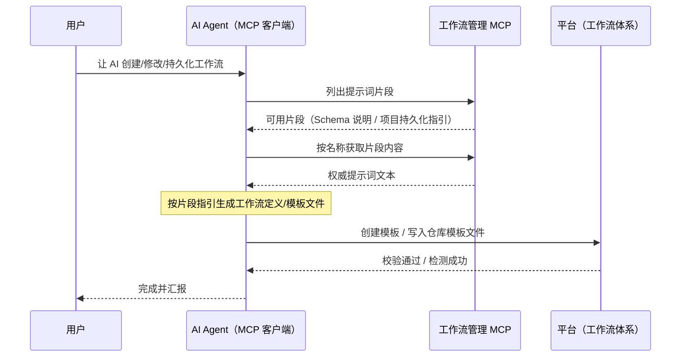

# 工作流MCP提供提示词片段

**功能名称**: 工作流MCP提供提示词片段
**PRD 版本**: v1.0
**创建日期**: 2026-11-15
**作者**: ZeroAsh Agent

## 背景与目标

### 1.1 背景

平台已具备完整的 Agent 工作流体系：工作流模板 → 已配置工作流 → 实例化的三级结构（见 [[released/20260808-agent-workflow.md]]、[[20260811-agent-workflow-phase2.md]]），并向 AI 开放了工作流管理工具集（MCP），AI 可以在会话中创建模板、配置工作流、实例化执行。同时平台已支持把工作流模板持久化到项目仓库（见 [[20261107-workflow-template-project-persistence.md]]），模板随仓库分发与版本管理。

但 AI 在使用这些能力时缺少权威的「说明书」：

1. **不知道工作流本身的 Schema**：工作流的节点类型、节点字段、依赖图约束（首节点必须唯一且为人类节点、不允许环、AI 节点必须有提示词等）只沉淀在平台实现与文档中。AI 凭猜测生成的工作流定义经常被规则校验拒绝，需要多轮试错，体验差、效率低。
2. **不知道如何将工作流持久化到项目中**：项目模板应放置在仓库约定目录、一个 JSON 文件对应一个模板、文件有大小与数量约束、放置后如何被平台检测与配置——这些规则 AI 无从得知，无法主动引导用户把有价值的工作流沉淀进项目仓库。

需求来源：GitHub Issue Deliay/z-agent-gear#523。

### 1.2 目标

- 工作流管理 MCP 以「提示词片段」（MCP prompts）形式提供两段权威说明：**工作流 Schema 说明** 与 **工作流项目持久化指引**，AI 可发现并随时获取。
- 提示词片段的内容与平台实际执行的工作流规则**同源同步**：平台规则演进时，提示词片段随版本一并更新，永不过期。
- 按需获取：不主动占用 AI 的常态上下文；AI 仅在需要创建/修改/持久化工作流时获取对应片段。

### 1.3 成功标准

- 连接工作流管理 MCP 的客户端可以列出并获取两个提示词片段：「工作流 Schema 说明」与「工作流项目持久化指引」。
- 获取到的内容与平台实际校验口径一致：按「工作流 Schema 说明」生成的工作流定义能一次性通过平台校验（在内容合法的前提下）；按「项目持久化指引」放置的模板文件能被平台正常检测与配置。
- 不支持 prompts 能力的 MCP 客户端行为与现状完全一致（工具调用不受影响），无回归。
- 请求不存在的提示词片段时，得到明确错误提示与可用片段列表，不产生误导性内容。

## 用户分析

### 2.1 目标用户

- **平台用户（借助 AI 管理工作流）**：让 AI 为自己创建、调整工作流模板，或把模板实例化执行。
- **项目维护者（借助 AI 沉淀项目流程）**：让 AI 把设计好的工作流模板写入项目仓库，随仓库分发给团队。
- **AI Agent（最终消费者）**：在会话中通过 MCP 获取提示词片段，指导自己产出符合平台规则的工作流定义与持久化文件。

### 2.2 用户场景

| 场景 | 用户角色 | 目标 | 痛点 |
|--|--|--|--|
| 让 AI 创建一个工作流模板 | 平台用户 | AI 生成的节点图一次通过平台校验 | AI 不了解节点字段与图约束，生成内容被反复拒绝，靠试错摸索规则 |
| 让 AI 调整现有工作流结构 | 平台用户 | AI 在增删节点、调整依赖时不破坏图规则 | AI 不知道「首节点唯一且为人类节点」等约束，调整后的模板不可用 |
| 让 AI 把工作流沉淀到项目仓库 | 项目维护者 | AI 按约定目录与格式生成模板文件并放入仓库 | AI 不知道放置路径、文件格式与约束，产出的文件平台检测不到 |
| 团队新成员了解项目工作流 | 项目维护者 | AI 读取项目模板并能解释其结构含义 | AI 缺少工作流结构的概念说明，无法准确解读模板内容 |

## 功能需求

### 3.1 功能概述

工作流管理 MCP 提供两个可被发现的提示词片段（MCP prompts）：「工作流 Schema 说明」描述工作流本身的结构定义与全部校验规则；「工作流项目持久化指引」描述如何把模板以 JSON 文件形式放入项目仓库并被平台识别。AI 客户端可列出可用片段、按名称获取内容，获取到的内容作为 AI 生成与修改工作流时的权威依据。

### 3.2 功能列表

#### 功能点 1: 提示词片段「工作流 Schema 说明」

- **描述**: 提供一段完整的提示词文本，说明工作流本身的结构定义，内容包括：
  - 顶层结构：工作流模板由名称、描述与节点图组成；
  - 节点类型：人类节点、AI 节点、旗帜节点各自的语义与分工；
  - 节点字段：节点标识、名称、描述、所属阶段、上游依赖、提示词、产物标题、Worktree 隔离、联动上游 Pull Request 等字段的含义与适用节点类型；
  - 图约束规则：节点标识唯一、依赖必须引用存在的节点、不允许循环依赖、首节点（无上游依赖的节点）有且仅有一个且必须为人类节点、AI 节点必须至少有一条提示词、仅人类节点可开启「联动上游 Pull Request」；
  - AI 节点 Agent 配置：在配置/实例化阶段需要为 AI 节点指定 Harness 工具（可选模式与模型）的说明。
- **用户价值**: AI 拿到权威、完整的结构说明，生成与修改工作流一次到位，不再试错。
- **验收标准**:
  - [ ] 客户端获取该片段后，文本覆盖上述全部结构要点与图约束规则。
  - [ ] 片段描述的规则与平台实际校验行为一致：按片段指引生成的合法工作流定义能通过平台创建校验。
  - [ ] 平台校验规则演进时，片段内容在同一版本中同步更新。

#### 功能点 2: 提示词片段「工作流项目持久化指引」

- **描述**: 提供一段完整的提示词文本，指导 AI 把工作流模板持久化到项目仓库，内容包括：
  - 放置约定：模板文件放置在仓库根目录的 `.zag/workflow/templates/` 下，一个 `.json` 文件对应一个工作流模板；
  - 文件格式：模板文件为 JSON，内容描述一个工作流模板（名称、描述、节点图），节点图规则与「工作流 Schema 说明」一致，模板文件不含 Agent 配置（配置发生在平台侧）；
  - 文件约束：仅识别该目录直下的 `.json` 文件（不递归子目录），单个文件与文件总量存在上限，超出部分不生效；
  - 生效方式：文件随仓库提交后，在云电脑新增工作目录（含完成 GitHub 项目设置）时平台自动检测并提示配置，也可在云电脑设置中随时检测与配置；配置时对模板做快照，仓库后续修改不影响已配置的工作流。
- **用户价值**: AI 可以主动、正确地把工作流沉淀进项目仓库，并引导用户完成平台侧配置。
- **验收标准**:
  - [ ] 客户端获取该片段后，文本覆盖放置路径、文件格式、文件约束与生效方式。
  - [ ] 按片段指引放置的合法模板文件能被平台正常检测、列出与配置。
  - [ ] 片段明确说明模板文件与平台校验规则的关系（内容不合法的文件会被标记并给出原因）。

#### 功能点 3: 提示词片段的发现与按需获取

- **描述**: 支持 MCP 协议的提示词发现与获取语义：客户端可列出工作流管理 MCP 当前提供的全部提示词片段（名称与简介），并按名称获取某一片段的完整内容。列表与内容来自同一份权威来源，保证「所列即所得」。
- **用户价值**: AI 能自行发现可用说明并按需取用，不依赖人类把规则贴进对话；不获取时零上下文开销。
- **验收标准**:
  - [ ] 客户端能列出两个提示词片段，各自带名称与一句话简介。
  - [ ] 按名称获取返回该片段的完整文本内容。
  - [ ] 请求不存在的片段名称时返回明确错误，并在错误信息中列出可用片段名称。

### 3.3 用户操作流程

### 3.4 页面/界面描述

本功能无平台界面变更。提示词片段的消费发生在 AI 客户端一侧：支持 MCP prompts 的客户端（如以斜杠命令/提示词选择器形式呈现）可让用户显式引用片段；不支持该能力的客户端不受影响。

| 页面 | 描述 | 关键元素 |
|------|------|---------|
| 无 | 平台前端无新增或修改的界面 | - |

### 3.5 异常与边界情况

| 情况 | 预期行为 |
|------|---------|
| MCP 客户端不支持 prompts 能力 | 完全不感知该能力，既有工具调用行为零变化 |
| 请求不存在的提示词片段名称 | 返回明确错误，并列出当前可用的片段名称 |
| 平台工作流规则演进 | 提示词片段内容随同一版本同步更新，保持与实际校验口径一致 |
| 片段内容体积 | 单片段为纯文本说明，控制在可一次性消费的篇幅内，不截断 |
| 节点执行会话（非管理场景） | 本期仅工作流管理 MCP 提供片段；节点执行工具集不提供，节点会话行为不变 |

## 四、非功能需求

### 4.1 性能要求

- 列出与获取提示词片段为轻量读取操作，响应应在毫秒级完成，不引入外部依赖调用。
- 不主动注入会话常态上下文，仅在客户端显式获取时产生传输。

### 4.2 安全性要求

- 提示词片段为公开的规则说明文本，不含任何用户数据、密钥或内部敏感信息。
- 获取片段不改变任何平台状态（纯只读），权限口径与既有工作流管理工具集一致。

### 4.3 兼容性要求

- 遵循 MCP 协议的 prompts 能力约定；不支持该能力的既有客户端与平台行为完全兼容。
- 既有工作流模板、已配置工作流与实例不受任何影响。

## 五、依赖与约束

### 5.1 依赖

- 既有工作流体系（模板校验规则、项目模板检测与配置链路）作为提示词内容的事实来源。
- 既有工作流管理 MCP（平台内置服务）作为片段的承载与分发通道。

### 5.2 约束

- 提示词片段内容必须与平台实际规则同源维护：规则变更时必须同步更新片段文本，禁止出现两份口径。
- 本期仅提供上述两个片段；更多片段（如最佳实践、示例集）不在本期范围。
- 片段文本为中文为主、结构化的说明文本，面向 AI 消费优化。

## 六、相关文档

- [[released/20260808-agent-workflow.md]] — Agent 工作流
- [[20260811-agent-workflow-phase2.md]] — Agent 工作流二期
- [[20261107-workflow-template-project-persistence.md]] — 工作流模板项目持久化
- 需求来源 Issue：https://github.com/Deliay/z-agent-gear/issues/523
