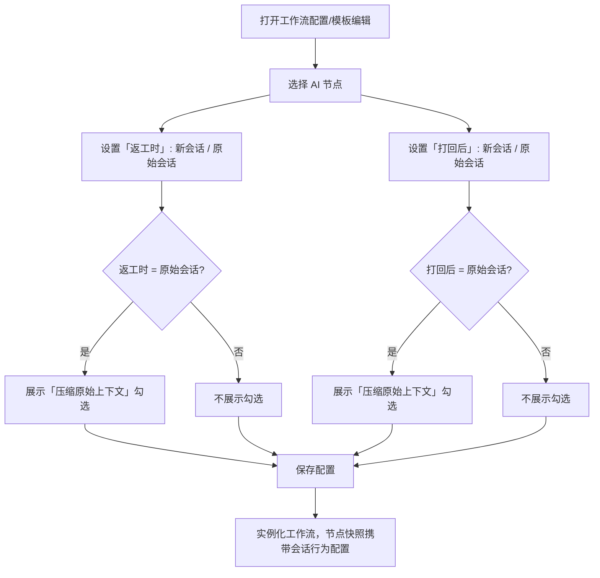
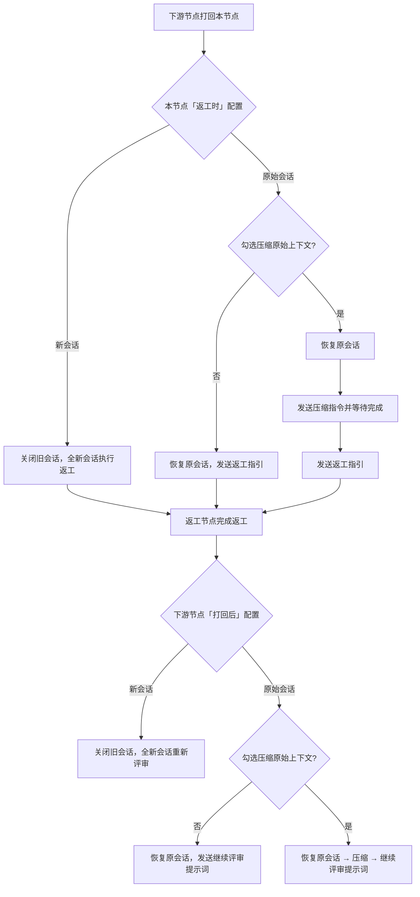
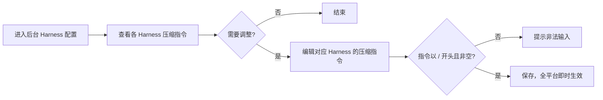

# 工作流打回/返工会话行为优化

**功能名称**: 工作流打回/返工会话行为优化
**PRD 版本**: v1.0
**创建日期**: 2026-11-15
**作者**: z-agent-bot
**需求来源**: GitHub Issue [Deliay/z-agent-gear#525](https://github.com/Deliay/z-agent-gear/issues/525)

## 背景与目标

### 1.1 背景

工作流节点在被打回/返工时，现有会话处理逻辑是固定的：

1. **返工时**：被打回的节点（返工节点）会保留上下文，从之前的会话继续执行；
2. **打回后**：发起打回的节点在返工节点完成后，走一个全新的上下文重新进行评审。

固定行为无法满足不同工作流编排场景：

- 有的场景希望返工节点保留全部上下文（了解之前的产出与打回原因的关联），有的场景希望返工节点以全新会话重新执行（避免旧上下文中的错误路径干扰）；
- 有的场景希望发起打回的评审节点保留上下文重新评审（记得自己此前的评审意见与标准），有的场景希望评审节点以全新会话重新评审（获得无偏见的独立视角）；
- 保留原始会话时上下文会随返工轮次不断膨胀，存在超长上下文导致效果下降或失败的风险，需要可选择的上下文压缩能力。

### 1.2 目标

- 工作流编排者可以为每个 AI 节点独立配置「返工时」与「打回后」的会话行为：「新会话」或「原始会话」；
- 选择「原始会话」时，可选配「压缩原始上下文」：恢复原始会话后先执行上下文压缩指令，再发送继续提示词；
- 上下文压缩指令与 Harness 工具相关，平台管理员可在后台为各类支持的 Harness 分别配置压缩指令，默认为 `/compact`；
- 已有工作流模板、已配置工作流与运行中实例在升级后行为与现状完全一致（零回归）。

### 1.3 成功标准

- 工作流配置界面中，AI 节点可分别设置「返工时」「打回后」的会话行为，选择「原始会话」后出现「压缩原始上下文」勾选项；
- 返工触发时，节点按配置进入新会话或恢复原始会话；配置压缩时先执行压缩指令再继续；
- 打回节点在返工完成重新流转回本节点时，按配置进入新会话或恢复原始会话；配置压缩时先执行压缩指令再继续；
- 后台可为每种 Harness 配置压缩指令并即时生效；未配置时使用默认指令 `/compact`；
- 未修改任何配置的存量工作流，打回/返工行为与升级前完全一致。

## 用户分析

### 2.1 目标用户

- **工作流编排者**：在平台上设计、配置工作流模板与已配置工作流的用户，希望按节点特点定制打回/返工时的会话策略；
- **工作流使用者**：实例化并运行工作流的用户，关注打回/返工链路的执行效果与上下文质量；
- **平台管理员**：在后台维护 Harness 工具相关平台级配置（压缩指令）的管理员。

### 2.2 用户场景

| 场景 | 用户角色 | 目标 | 痛点 |
|--|--|--|--|
| 评审节点打回产出节点，希望产出节点带完整上下文返工 | 工作流编排者 | 返工节点理解此前产出与打回原因的关联，精准修订 | 现状恰好保留上下文，但上下文逐轮膨胀，长链路返工后效果下降 |
| 评审节点打回产出节点，希望产出节点推倒重来 | 工作流编排者 | 返工节点不受旧思路干扰，全新执行 | 现状固定保留上下文，无法配置新会话 |
| 返工完成后评审节点重新评审 | 工作流编排者 | 评审节点带着自己的评审标准与历史意见复审，或以全新视角独立复审 | 现状固定新会话，无法保留评审上下文 |
| 多轮返工后上下文膨胀 | 工作流使用者 | 保留会话的同时控制上下文长度，保证效果稳定 | 无压缩手段，只能忍受膨胀或放弃上下文 |
| 不同 Harness 的压缩指令不同 | 平台管理员 | 按 Harness 配置各自的压缩指令，一次配置全局生效 | 压缩指令与 Harness 强相关，硬编码无法扩展 |

## 功能需求

### 3.1 功能概述

为工作流 AI 节点提供「返工时」与「打回后」两个维度的会话行为配置（新会话 / 原始会话），选择「原始会话」时可勾选「压缩原始上下文」（恢复会话后先发送压缩指令再发送继续提示词）；压缩指令由后台按 Harness 类型统一配置，默认 `/compact`。

### 3.2 功能列表

#### 功能点 1: 节点级「返工时」会话行为配置

- **描述**: 在工作流模板节点、已配置工作流节点与实例化时的节点设置中，AI 节点可配置「返工时」行为：「新会话」或「原始会话」。节点被打回进入返工状态触发会话时：选「新会话」则关闭旧会话并以全新会话执行返工；选「原始会话」则恢复原会话继续执行返工。默认值为「原始会话」（与现状一致）。
- **用户价值**: 编排者可按节点性质决定返工是「带着记忆修订」还是「推倒重来」。
- **验收标准**:
  - [ ] AI 节点配置中「返工时」可在「新会话 / 原始会话」间选择，默认「原始会话」；
  - [ ] 配置「新会话」的节点被打回后，以全新会话执行返工，旧会话被关闭；
  - [ ] 配置「原始会话」的节点被打回后，恢复原会话并收到打回原因与返工指引（与现状一致）；
  - [ ] 人类节点与 FLAG 节点不提供该配置（无会话概念）。

#### 功能点 2: 节点级「打回后」会话行为配置

- **描述**: AI 节点可配置「打回后」行为：「新会话」或「原始会话」。节点打回上游、上游返工完成后再次流转回本节点时：选「新会话」则关闭旧会话并以全新会话重新执行（与现状一致）；选「原始会话」则恢复原会话继续执行。默认值为「新会话」（与现状一致）。
- **用户价值**: 评审类节点可保留自己的评审口径与历史意见进行复审，也可按需切换为全新独立视角。
- **验收标准**:
  - [ ] AI 节点配置中「打回后」可在「新会话 / 原始会话」间选择，默认「新会话」；
  - [ ] 配置「新会话」的节点在返工完成后以全新会话执行（与现状一致，提示词含最新上游产物）；
  - [ ] 配置「原始会话」的节点在返工完成后恢复原会话，并收到「上游已完成返工、产物已更新」的继续提示词；
  - [ ] 原会话已不可恢复（会话丢失/无法恢复）时，自动降级为新会话执行，不阻断流程。

#### 功能点 3: 「压缩原始上下文」勾选项

- **描述**: 「返工时」「打回后」各自选择「原始会话」后，展示对应的「压缩原始上下文」勾选（两者独立，默认不勾选）。勾选后：恢复原始会话成功 → 先发送该节点 Harness 对应的压缩指令 → 压缩完成后再发送继续提示词（返工指引或继续评审提示词）。压缩指令执行失败或超时降级为直接发送继续提示词，不阻断流程。
- **用户价值**: 在保留会话记忆与控制上下文长度之间取得平衡，多轮返工场景下效果更稳定。
- **验收标准**:
  - [ ] 仅当对应行为选择「原始会话」时展示「压缩原始上下文」勾选；选择「新会话」时隐藏且不生效；
  - [ ] 勾选后恢复原始会话，先执行压缩指令再发送继续提示词，顺序可验证；
  - [ ] 压缩过程中会话不产生「停滞提醒」等干扰动作；
  - [ ] 压缩失败/超时后仍发送继续提示词，节点流程正常推进；
  - [ ] 未勾选时恢复原始会话的行为与现状完全一致。

#### 功能点 4: 后台 Harness 压缩指令配置

- **描述**: 管理后台新增 Harness 配置能力：对平台支持的每种 Harness 工具（如 OpenCode / Kimi Code / DeepSeek Harness）分别配置「压缩指令」，默认均为 `/compact`。配置对全平台生效，节点会话按其使用的 Harness 类型取对应指令。
- **用户价值**: 压缩指令随 Harness 演进可配置、可扩展，新增 Harness 时无需改动功能代码。
- **验收标准**:
  - [ ] 后台可查看全部支持的 Harness 及其压缩指令，默认 `/compact`；
  - [ ] 后台可修改某种 Harness 的压缩指令，保存后新触发的压缩流程使用新指令；
  - [ ] 指令需以 `/` 开头且非空，非法输入被拒绝并提示；
  - [ ] 某 Harness 未配置过指令时，按默认 `/compact` 执行；
  - [ ] 节点所用 Harness 无对应配置项时，按默认 `/compact` 执行。

### 3.3 用户操作流程

#### 配置节点会话行为（工作流编排者）

#### 打回/返工执行链路（运行时）

#### 后台配置压缩指令（平台管理员）

### 3.4 页面/界面描述

| 页面 | 描述 | 关键元素 |
|------|------|---------|
| 工作流节点配置（模板编辑 / 已配置工作流 / 实例化节点设置） | AI 节点新增「会话行为」配置区 | 「返工时」二选一（新会话/原始会话）；「打回后」二选一（新会话/原始会话）；各自选择「原始会话」时展示「压缩原始上下文」勾选 |
| 管理后台 Harness 配置页 | 平台级 Harness 压缩指令管理 | Harness 列表（名称/类型）、每种 Harness 的压缩指令输入框（默认 `/compact`）、保存入口、非法输入提示 |

### 3.5 异常与边界情况

| 情况 | 预期行为 |
|------|---------|
| 选择「原始会话」但原会话已丢失/不可恢复 | 自动降级为新会话执行，不阻断流程 |
| 压缩指令执行失败或超时 | 降级为直接发送继续提示词，节点流程正常推进 |
| 压缩指令发送后压缩回合结束（turn 完成） | 视为压缩完成，继续发送继续提示词；不触发会话停滞提醒 |
| 多轮打回/返工 | 每次触发均按节点当前配置执行；实例节点配置以实例化快照为准，未开始节点可在实例中编辑 |
| 人类节点/FLAG 节点 | 无会话概念，不展示也不应用上述配置 |
| 存量模板/已配置工作流/运行中实例（无新配置字段） | 按默认行为执行（返工时=原始会话不压缩、打回后=新会话），与升级前完全一致 |
| 节点所用 Harness 在后台无配置项 | 按默认 `/compact` 执行压缩 |
| 实例接续（更换控制器）后触发打回/返工 | 会话行为配置随节点快照保留；「原始会话」在原会话不可达时降级为新会话 |

## 四、非功能需求

### 4.1 性能要求

- 压缩指令执行设等待上限，超时自动降级，不无限阻塞节点流转；
- 后台压缩指令配置的读取不影响工作流引擎主链路性能（允许短周期缓存）。

### 4.2 安全性要求

- 后台 Harness 配置仅平台管理员可写，前台只读使用；
- 压缩指令仅作为会话消息发送至对应 Harness 会话，不做 shell 执行。

### 4.3 兼容性要求

- 存量工作流模板、已配置工作流与运行中实例零迁移、零行为变化；
- 不支持压缩指令的 Harness 在勾选压缩后按降级策略执行（跳过压缩直接继续），不报错阻断。

## 五、依赖与约束

### 5.1 依赖

- 依赖现有工作流打回/返工状态机（打回 → 返工 → 返工完成 → 复工）与节点会话管理能力；
- 依赖各 Harness 对压缩指令（如 `/compact`）的原生支持。

### 5.2 约束

- 「返工时」「打回后」会话行为仅对 AI 节点生效；
- 压缩指令的平台默认值为 `/compact`；
- 实例化后的节点配置以快照为准，已开始执行的节点不可修改配置。

## 六、相关文档

- 需求来源：[GitHub Issue #525 工作流打回/返工会话行为优化](https://github.com/Deliay/z-agent-gear/issues/525)
- 关联技术提案：[[../engineering/proposals/20261115-feat-workflow-reject-rework-session-behavior.md]]
- 相关产品文档：[[20261023-workflow-github-pr-callback.md]]、[[20261114-workflow-instance-continuation.md]]、[[20261103-workflow-node-interrupt-retry.md]]
