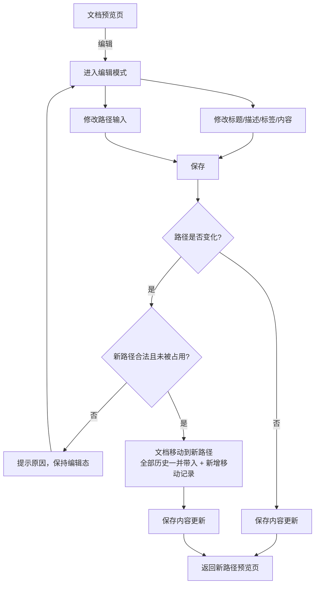
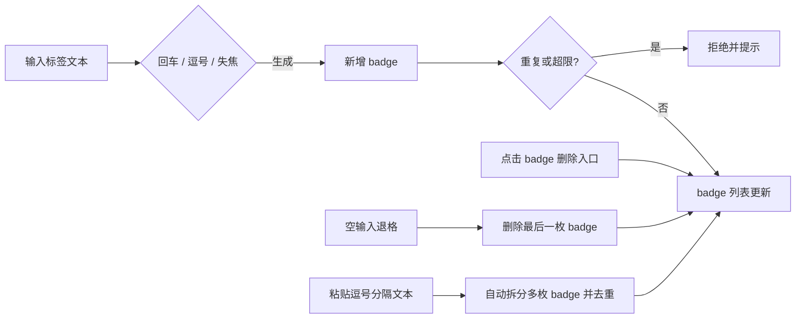

# 知识库优化

**功能名称**: 知识库优化
**PRD 版本**: v1.0
**创建日期**: 2026-11-16
**作者**: z-agent-bot

## 背景与目标

### 1.1 背景

知识库功能已上线（见 [[20261115-knowledge-base.md]]）：文档以路径唯一标识、全生命周期历史留痕、四档权限模式、AI 会话可经知识库工具维护文档。初版有两个显式取舍在使用中成为痛点：

- 文档路径创建后不可改名/移动，调整路径只能「删除 + 新建」，历史按各自路径独立留存、随重建而断裂；
- 标签在编辑时以「逗号分隔文本」录入，不直观、易产生重复与笔误（展示侧已是 badge 徽章形式）。

需求来源：[GitHub Issue Deliay/z-agent-gear#541](https://github.com/Deliay/z-agent-gear/issues/541)：

1. 知识库路径在创建时确定，并且可以修改，修改时将历史也一并带入；
2. 知识库的 tag 变为 badge 形式进行展示（编辑侧）。

### 1.2 目标

- 文档路径创建时确定（现状不变），创建后仍可修改（重命名或移动到任意合法新路径）；修改路径时该文档的全部历史版本一并带入新路径，新路径下历史完整延续可见。
- 原路径在移动后立即释放，可立即创建新文档；新文档历史从其创建时刻独立起算，不继承已迁走的历史。
- 标签编辑从逗号分隔文本升级为 badge 徽章编辑器：标签逐枚可视、可单独删除、回车/逗号/失焦即新增、粘贴自动拆分、自动去重。

### 1.3 成功标准

- 有更新权限的成员在编辑文档时可以修改路径；保存后新路径生效并可访问，历史版本完整（含移动前全部版本与一条「移动」记录）；原路径可立即创建新文档且历史独立。
- 目标路径被占用、路径非法、无权限时均给出明确提示，原文档不受影响。
- AI 会话中的知识库工具同样可以修改文档路径，权限口径与界面完全一致。
- 标签编辑全程 badge 化操作；预览页、历史版本、实时预览的既有 badge 展示零回归。

## 用户分析

### 2.1 目标用户

- **工作区管理员与普通成员（文档维护者）**：整理知识库结构、修正路径、维护标签。
- **AI Agent（会话中的知识消费者与维护者）**：经知识库工具移动文档路径，口径与界面一致。
- **任意有读权限的成员**：在新路径下追溯文档完整历史（含移动记录）。

### 2.2 用户场景

| 场景 | 用户角色 | 目标 | 痛点 |
|--|--|--|--|
| 调整文档归类 | 文档维护者 | 把文档移动到更合适的目录层级 | 路径不可改，只能删除重建，历史断裂 |
| 修正路径笔误 | 文档维护者 | 改掉路径中的错别字 | 同上，重建成本高 |
| 追溯文档来龙去脉 | 有读权限成员 | 在新路径下看到移动前的全部历史 | 重建后历史丢失，无从追溯 |
| 录入与整理标签 | 文档维护者 | 直观逐枚增删标签、避免重复 | 逗号文本不直观，重复与笔误难发现 |

## 功能需求

### 3.1 功能概述

本期对知识库做两项优化：① 文档路径可修改（重命名/移动），修改时全部历史版本随文档一并带入新路径并留下「移动」记录；② 标签编辑改为 badge 徽章编辑器，逐枚可视化管理。

### 3.2 功能列表

#### 功能点 1: 文档路径修改与历史跟随

- **描述**: 文档路径在创建时确定（现状不变）；进入编辑模式后，路径与标题、描述、标签、内容一样可以直接修改。保存时若路径发生变化：文档移动到新路径，浏览器地址栏同步到新路径；该文档的全部历史版本（创建、历次更新、删除前记录）在新路径下完整可见，历史中新增一条「移动」记录（原路径 → 新路径、操作人、时间）。原路径立即释放，可立即创建新文档，新文档的历史从其创建时刻独立起算。新路径必须通过既有路径合法性校验（以 `/` 开头、无空路径段等）；目标路径已存在文档时拒绝保存并明确提示，原文档不受影响。修改路径的权限口径与「更新文档」一致（凡可更新该文档者即可修改其路径）；AI 会话中的知识库工具同样支持修改路径，口径与界面一致。
- **用户价值**: 路径组织可随认知演进随时调整，且任何调整都不丢失追溯能力——历史跟着文档走，而不是跟着路径走。
- **验收标准**:
  - [ ] 编辑模式下可修改文档路径；保存后新路径生效，地址栏同步跳转到新路径。
  - [ ] 新路径下「历史版本」完整列出移动前全部历史版本，并含一条「移动」记录（原路径、新路径、操作人、时间）。
  - [ ] 多次移动（A→B→C）后，历史始终跟随文档，最终路径下可见全量历史（含每次移动记录）。
  - [ ] 原路径被释放：以其创建新文档成功；新文档历史仅包含其自身记录，不含已迁走的历史。
  - [ ] 目标路径已存在文档时保存被拒绝并给出明确提示，原文档内容与历史不受影响。
  - [ ] 非法路径（不以 `/` 开头、含空路径段等）保存被拒绝并给出明确提示。
  - [ ] 无更新权限的成员不能修改路径（编辑入口本身按既有口径收敛）。
  - [ ] 编辑中修改路径但未保存时意外离开，未保存草稿（含修改中的路径输入）仍可恢复。
  - [ ] AI 会话工具修改路径时历史同样跟随，且按会话创建人权限判定，与界面口径一致。

#### 功能点 2: 标签 badge 化编辑

- **描述**: 编辑文档时，标签由「逗号分隔文本输入框」改为「badge 徽章编辑器」：已添加的标签逐枚以 badge 呈现，每枚 badge 带删除入口；在输入框中键入后按回车或逗号（含中文逗号）即生成新 badge；输入框失焦时未提交的输入自动生成 badge；粘贴逗号分隔的文本自动拆分为多枚 badge；重复标签（去空格后相同）自动去重。既有约束不变：最多 16 个标签、每个 1~32 个字符，超出时拒绝并给出明确提示。展示侧（预览页、历史版本抽屉、编辑实时预览）维持既有 badge 展示不变。
- **用户价值**: 标签逐枚可视、逐枚可删，录入过程即时确认，告别逗号文本的重复与笔误。
- **验收标准**:
  - [ ] 编辑模式下标签区域呈现为「badge 列表 + 输入框」；回车、逗号（含中文逗号）、失焦均可将输入生成 badge。
  - [ ] 每枚 badge 带删除入口可单独移除；输入框为空时按退格键删除最后一枚 badge。
  - [ ] 粘贴「a, b，c」类文本自动拆分为 a / b / c 三枚 badge，且与已有标签去重。
  - [ ] 标签总数达 16 个或单标签超 32 字符时拒绝并给出明确提示。
  - [ ] 未保存草稿包含 badge 化后的标签，恢复草稿时标签完整还原。
  - [ ] 实时预览、预览页、历史版本抽屉中的标签 badge 展示零回归。

### 3.3 用户操作流程

### 3.4 页面/界面描述

| 页面 | 描述 | 关键元素 |
|------|------|---------|
| 知识库文档编辑页 | 新增可编辑的路径输入（预填当前路径）；标签区改为 badge 徽章编辑器 | 路径输入、badge 列表 + 标签输入框、实时预览（不变） |
| 历史版本抽屉 / 全库历史 | 新增「移动」操作类型记录 | 移动记录：原路径 → 新路径、操作人、时间 |
| 知识库文档预览页 | 不变（标签 badge 展示维持现状） | — |

### 3.5 异常与边界情况

| 情况 | 预期行为 |
|------|---------|
| 目标路径已存在文档 | 拒绝保存并提示「该路径已存在文档」，原文档不受影响 |
| 新路径与原路径相同 | 视为未修改路径，正常保存内容，不产生移动记录 |
| 新路径非法（不以 `/` 开头 / 空路径段 / 超长） | 拒绝并提示路径非法 |
| 移动后原路径重建新文档 | 创建成功；新文档历史从其创建起算，不含已迁走历史 |
| 移动后再次移动（A→B→C） | 历史始终跟随文档，C 路径下可见全量历史与每次移动记录 |
| 移动带删除历史的文档 | 该路径全部历史（含删除前记录）一并带入新路径 |
| 编辑中修改路径后意外离开 | 未保存草稿（含路径输入）保留，重进编辑模式可恢复 |
| 无更新权限的成员 | 无法进入编辑模式，也就无法修改路径；直接访问无权限路径仍不泄露内容 |
| 标签达上限 / 单标签超长 / 重复 | 拒绝并给出明确提示，已有 badge 不受影响 |
| AI 会话修改路径 | 与界面同口径校验与历史跟随；越权明确拒绝 |

## 四、非功能需求

### 4.1 性能要求

- 路径修改为低频操作，保存响应与既有文档更新相当；历史版本查询不因移动引入可感知劣化。
- 标签 badge 编辑器在 16 枚上限内交互即时响应。

### 4.2 安全性要求

- 路径修改的权限判定与「更新文档」完全一致，以平台侧服务端校验为权威；界面收敛仅作体验优化。
- AI 会话工具修改路径按会话创建人权限实时校验，口径与界面一致。
- 历史跟随不改变既有可见性口径：无读权限者依旧无法查看任何历史。

### 4.3 兼容性要求

- 既有文档与历史版本零迁移、零影响；仅发生移动的文档其历史归属随之更新。
- 预览页、历史抽屉、侧边栏树等既有展示零回归；不支持知识库工具的旧会话不受影响。

## 五、依赖与约束

### 5.1 依赖

- 知识库功能（路径唯一标识、版本历史、四档权限、知识库 MCP 工具），见 [[20261115-knowledge-base.md]]。

### 5.2 约束

- 仅支持单文档路径修改；不提供批量移动、不提供按目录整体移动。
- 移动操作的权限档与「更新文档」一致，不为移动单独增设权限档。
- 历史版本仍只读查看，不提供一键回滚（沿用既有口径）。
- 标签约束不变：最多 16 个、每个 1~32 字符。

## 六、相关文档

- [[20261115-knowledge-base.md]] — 知识库 PRD（shipping）
- 需求来源 Issue：https://github.com/Deliay/z-agent-gear/issues/541
