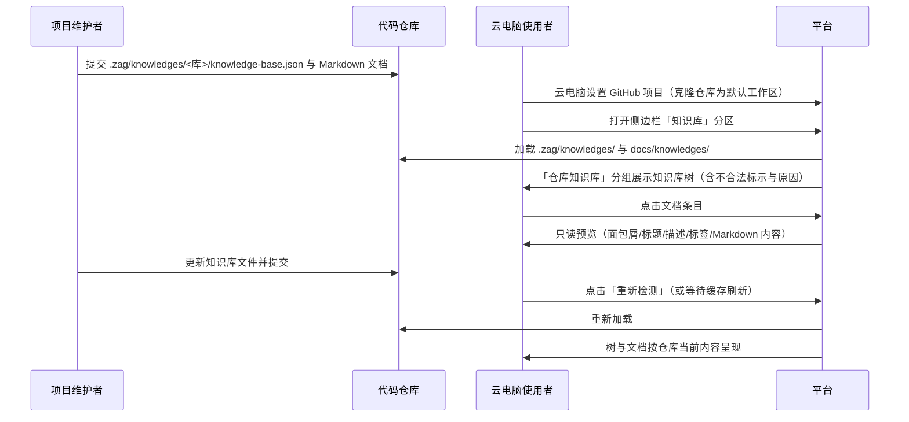
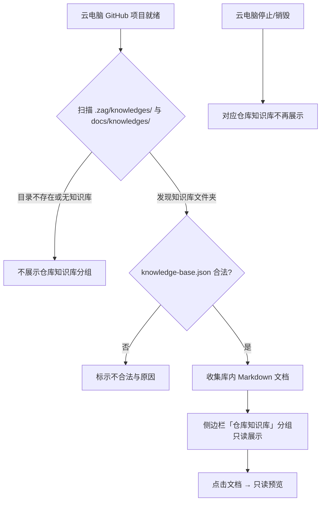

# 仓库内建知识库

**功能名称**: 仓库内建知识库（知识库支持在代码仓库中内建）
**PRD 版本**: v1.0
**创建日期**: 2026-11-16
**作者**: z-agent-bot

## 背景与目标

### 1.1 背景

平台已提供「知识库」能力（见 [[../shipping/20261115-knowledge-base.md]]）：工作区可以建立 wiki 风格的知识库，文档按路径组织、全程留痕，并以 MCP 工具注入 AI 会话。同时，工作流模板已支持「项目持久化」（见 [[20261107-workflow-template-project-persistence.md]]）：模板放置在项目仓库的 `.zag/workflow/templates/` 目录中，随仓库分发，平台从仓库中读取。

项目的知识（开发规范、架构说明、上手指引、FAQ）与工作流一样天然属于项目本身：最合理的存放位置是项目的代码仓库——随仓库分发、随仓库版本演进、团队成员克隆仓库即获得。目前这类知识只能散落在仓库的 README 与 docs 目录中，平台内无法以知识库的形态浏览；要想在平台知识库中查看，只能手工誊抄一份，仓库与平台两边逐渐脱节。需求来源：[GitHub Issue Deliay/z-agent-gear#545](https://github.com/Deliay/z-agent-gear/issues/545)。

本期让知识库也支持在代码仓库中内建：项目把知识库放置在仓库约定目录中，平台前端以只读方式展示这些「仓库知识库」。

### 1.2 目标

- 项目可以把知识库内建在仓库的两个约定目录（`.zag/knowledges/` 与 `docs/knowledges/`）中：每个知识库是一个文件夹，文件夹下存在 `knowledge-base.json` 标识文件即视为一个知识库，知识库的内容为该文件夹内的 Markdown 文档文件。
- 平台前端展示仓库知识库：侧边栏「知识库」分区中以独立分组呈现，树形浏览文档、阅读文档内容（只读）。
- 仓库知识库**不出现在知识库 MCP 工具中**（AI 在会话工作目录中本就可以直接读取这些仓库文件）；仓库知识库**不允许在平台内修改**（修改知识应走仓库的代码协作流程）。
- 平台托管的知识库（工作区知识库）行为完全不变。

### 1.3 成功标准

- 在云电脑 GitHub 项目（默认工作区）的仓库中按规范放置知识库后，侧边栏「知识库」分区能看到该仓库的知识库，并可浏览其全部文档。
- 仓库知识库只读：不展示新建、编辑、删除、设置、历史版本等任何写入口；直接访问其文档路径也不会进入编辑模式。
- 知识库 MCP 工具的列表与任何调用结果中均不出现仓库知识库；平台托管知识库的功能与可见范围零回归。
- 不合法的知识库（`knowledge-base.json` 无法解析或不满足规范）不会被静默忽略：用户能看到哪个知识库不合法以及原因。
- 未在仓库中放置知识库的项目，行为与现状完全一致，无回归。

## 用户分析

### 2.1 目标用户

- **项目维护者**：在仓库中维护项目专属知识（开发规范、架构决策、上手指引），希望知识随仓库分发给所有协作者。
- **云电脑使用者**：为项目拉起云电脑工作，希望克隆仓库后直接以知识库形态浏览项目文档，而不必在文件树中翻找。
- **团队协作者**：加入同一项目的不同成员，希望各自云电脑上看到同一套项目知识，保证认知一致。

### 2.2 用户场景

| 场景 | 用户角色 | 目标 | 痛点 |
|--|--|--|--|
| 在仓库中沉淀项目知识 | 项目维护者 | 把规范/指南以知识库形式写进仓库，随版本演进 | 知识只能写 README 或散落 docs 目录，平台内无法以 wiki 形态浏览 |
| 克隆项目后查阅知识 | 云电脑使用者 | 设置 GitHub 项目后直接在平台浏览项目自带的知识库 | 只能在编辑器文件树里翻文档，没有目录化的阅读入口 |
| 对照知识工作 | 云电脑使用者 | 一边与 AI 会话一边在前端查阅项目规范 | 知识在仓库里、会话在平台里，来回切换成本高 |
| 统一团队认知 | 团队协作者 | 各自云电脑上浏览同一套项目知识 | 口头传递或截图分享，版本不一致 |
| 更新项目知识 | 项目维护者 | 通过仓库正常的提交/评审流程更新知识 | 平台内若能改，会与仓库产生两份事实源 |

## 功能需求

### 3.1 功能概述

知识库支持在代码仓库中内建：项目把知识库放置在仓库的 `.zag/knowledges/` 或 `docs/knowledges/` 目录中，每个包含 `knowledge-base.json` 标识文件的子文件夹即为一个知识库，库内文档为该文件夹（含子目录）下的 Markdown 文件。平台从云电脑的 GitHub 项目（默认工作区）中加载这些知识库，在侧边栏「知识库」分区以独立分组只读展示：树形浏览、点击阅读。仓库知识库不进入知识库 MCP 工具、不允许在平台内修改；其版本历史即仓库的 Git 历史，平台不另行提供历史功能。

### 3.2 功能列表

#### 功能点 1: 仓库知识库放置规范

- **描述**: 约定仓库知识库的放置位置为仓库根目录下的 `.zag/knowledges/` 与 `docs/knowledges/` 两个目录。目录下的每一个**子文件夹**，当其内存在 `knowledge-base.json` 文件时，即被识别为一个知识库；该文件是知识库的标识与 schema（包含知识库名称，可选描述）。知识库文件夹内（含任意层级子目录）的每一个 Markdown 文件（`.md`）即为一份知识库文档，文档路径由文件在知识库文件夹内的相对位置决定（如 `guides/git.md` 对应文档路径 `/guides/git`）。文档的标题、标签、描述可经文件头部的 front matter 声明；未声明时，标题取文档第一个一级标题，仍无则取文件名。`knowledge-base.json` 无法解析或不满足规范时，该知识库被标记为不合法并给出原因。
- **用户价值**: 项目知识以普通文件夹与 Markdown 文件的形式沉淀在仓库中，编写、评审、版本演进、团队分发全部沿用既有的代码协作方式，零平台学习成本。
- **验收标准**:
  - [ ] `.zag/knowledges/` 与 `docs/knowledges/` 两个目录均被识别；目录下含 `knowledge-base.json` 的子文件夹被识别为一个知识库。
  - [ ] `knowledge-base.json` 中声明的名称成为知识库展示名；未合法声明名称时该知识库标记为不合法并展示原因。
  - [ ] 知识库文件夹内（含子目录）的 `.md` 文件成为文档，文档路径与文件相对位置一致；非 Markdown 文件不成为文档。
  - [ ] 文档 front matter 声明的标题/标签/描述被采用；未声明时按「首个一级标题 → 文件名」回退得到标题。
  - [ ] 目录不存在、目录为空、或没有任何含 `knowledge-base.json` 的子文件夹时，视为项目无仓库知识库，前端不出现对应分组。

#### 功能点 2: 侧边栏「仓库知识库」分组

- **描述**: 侧边栏「知识库」分区在平台知识库列表之后追加「仓库知识库」分组：按云电脑归组展示各自加载到的仓库知识库（知识库条目带云电脑名称与来源目录标识），树形展开文档路径层级（展示文档标题，与平台知识库的树形态一致）。分组标题行提供「重新检测」入口：仓库文件更新后可手动刷新；平台按短时间缓存自动保持相对新鲜。知识库条目不带「+」与设置齿轮；文档条目不带「+」。点击文档条目进入只读预览页（见功能点 3）。云电脑不在运行中时不展示其仓库知识库；云电脑工作组件版本过旧不支持加载时，该云电脑不产生仓库知识库（不报错、不影响其他云电脑）。
- **用户价值**: 项目自带知识在统一的「知识库」分区中呈现，与平台知识库同形态浏览；来源（哪台云电脑、哪个目录）一目了然。
- **验收标准**:
  - [ ] 侧边栏「知识库」分区出现「仓库知识库」分组，按云电脑归组；知识库条目展示名称、云电脑名称与来源目录标识，文档按路径层级展示标题。
  - [ ] 仓库知识库条目与文档条目不展示任何新建/设置入口；分组提供「重新检测」入口，点击后按仓库当前文件刷新。
  - [ ] 云电脑非运行中（停止/销毁/未就绪）时其仓库知识库不展示；全部云电脑均无仓库知识库时不展示该分组。
  - [ ] 同一仓库两个来源目录中的知识库都展示，以来源标识区分；同一来源目录内知识库按文件夹名排序。

#### 功能点 3: 仓库知识库文档只读预览

- **描述**: 点击仓库知识库的文档条目进入预览页：与平台知识库文档一致的阅读体验——纵向路径面包屑、标题、描述（灰色小字）、标签、Markdown 渲染的内容，内容区限宽靠左、长文本正常换行。预览页不提供编辑、删除、历史版本按钮；地址栏直达链接可分享。仓库知识库无「历史版本」功能：其历史即仓库的 Git 提交历史，需要追溯时通过仓库的代码托管平台查看。
- **用户价值**: 项目知识的阅读体验与平台知识库一致；只读语义明确，不会误以为可以在平台内修改。
- **验收标准**:
  - [ ] 预览页依次呈现面包屑、标题、描述、标签、Markdown 内容；内容区限宽靠左、超长内容正常换行不横向溢出。
  - [ ] 页面无编辑/删除/历史版本/设置等写入口；以编辑模式参数直接访问时不进入编辑模式（按只读预览呈现）。
  - [ ] 文档地址栏链接可直接分享；无访问条件（云电脑不在运行中等）时访问给出明确提示，不泄露内容。

#### 功能点 4: 仓库知识库不进入知识库 MCP 工具

- **描述**: 平台向 AI 会话注入的知识库工具维持现状：工具的可见范围只包含平台托管的知识库（本工作区 ∪ 全局工作区，按权限模式过滤）。仓库知识库不出现在任何知识库工具的返回结果中，也不能通过知识库工具按名称/标识访问。AI 需要项目知识时，可直接读取会话工作目录中的仓库文件（这些文件本来就在其工作目录内）。
- **用户价值**: 知识库工具的语义保持单一（平台托管、可写、带权限），不混入只读的外部来源；AI 与仓库知识之间没有中间层，读到的一定是仓库当前内容。
- **验收标准**:
  - [ ] 知识库列表工具、文档路径列表工具、文档读写删工具的返回与作用范围均不含仓库知识库。
  - [ ] 以仓库知识库的名称/标识调用任何知识库工具按「不存在」处理，与工具现有错误口径一致。
  - [ ] 平台托管知识库的 MCP 行为零回归。

### 3.3 用户操作流程

### 3.4 页面/界面描述

| 页面 | 描述 | 关键元素 |
|------|------|---------|
| 侧边栏「知识库」分区 - 仓库知识库分组 | 平台知识库列表之后的独立分组，按云电脑归组 | 分组标题与「重新检测」按钮、知识库条目（名称 + 云电脑名称 + 来源目录标识）、文档树（路径层级、标题）、不合法知识库的标示与原因 |
| 仓库知识库文档预览页 | 点击文档条目进入，地址栏路径直达 | 纵向路径面包屑、标题、描述（灰色小字）、标签、Markdown 内容（限宽靠左）、无编辑/删除/历史版本按钮 |
| 仓库知识库不可访问提示 | 云电脑不在运行中等场景访问直达链接 | 明确提示文案，不泄露内容 |

### 3.5 异常与边界情况

| 情况 | 预期行为 |
|------|---------|
| 仓库中两个约定目录均不存在 | 视为无仓库知识库，不展示分组，行为与现状一致 |
| 目录存在但没有含 `knowledge-base.json` 的子文件夹 | 视为无仓库知识库 |
| `knowledge-base.json` 非法（无法解析、缺名称等） | 该知识库不作为可浏览条目；分组中单独标示其不合法与原因 |
| 文档文件无 front matter 且无一级标题 | 标题回退为文件名（去扩展名） |
| 两个来源目录中存在同名知识库文件夹 | 均展示，以来源目录标识区分 |
| 同一知识库内文档路径推导冲突（大小写/扩展名差异等） | 冲突文档均不收录，该知识库标示不合法与原因 |
| 文档或知识库数量/体积超过平台上限 | 按上限截断并标示，不影响其余内容加载 |
| 仓库文件被修改/删除 | 缓存刷新或「重新检测」后按当前文件呈现；平台不留存历史 |
| 云电脑停止/销毁/未就绪 | 其仓库知识库不展示；直达链接访问给出不可访问提示 |
| 云电脑工作组件版本过旧 | 该云电脑不加载仓库知识库（静默降级，不影响其他云电脑与平台功能） |
| 本地控制器（非云电脑）的工作目录 | 本期不提供仓库知识库加载 |
| 以知识库工具（MCP）按名称/标识访问仓库知识库 | 按「不存在」处理（工具范围不含仓库知识库） |

## 四、非功能需求

### 4.1 性能要求

- 仓库知识库树（含分组聚合）常规规模下秒级呈现；平台对加载结果做短时间缓存，避免每次浏览都重新读取仓库。
- 「重新检测」后的刷新在秒级完成；单台云电脑加载失败或超时不影响其他云电脑与平台知识库的展示。
- 文档内容仅在预览时按需呈现，树形浏览不携带文档正文。

### 4.2 安全性要求

- 平台只读取仓库约定目录（`.zag/knowledges/`、`docs/knowledges/`）内的标识文件与 Markdown 文档，不读取仓库其他内容；内容作为数据对待，仅做解析与渲染，不产生任何执行。
- 仓库知识库对「能看到该云电脑的成员」可见，与云电脑既有可见性口径一致；不可访问时不泄露文档内容。
- 仓库知识库全程只读：平台不提供任何写入口，也就不存在越权写入仓库的路径。

### 4.3 兼容性要求

- 未放置知识库目录的项目、未运行云电脑的环境，行为与现状完全一致。
- 平台托管知识库（列表、树、预览、编辑、历史、设置、MCP 工具）零回归。
- 旧版本工作组件的云电脑不支持加载时优雅降级：该云电脑不展示仓库知识库，其余功能不受影响。

## 五、依赖与约束

### 5.1 依赖

- 知识库（工作区级 wiki 文档库）：[[../shipping/20261115-knowledge-base.md]]。
- 工作流模板项目持久化（仓库约定目录读取的先例与形态对齐）：[[20261107-workflow-template-project-persistence.md]]。
- 云电脑与 GitHub 项目设置（默认工作区即项目仓库）：[[20261021-github-workload.md]]、[[20261023-cloud-container-optimization-phase2.md]]。
- 云电脑生命周期（创建即启动、停止即销毁）：[[20261025-cloud-container-unlimited-lifetime.md]]。

### 5.2 约束

- 加载路径固定为 `.zag/knowledges/` 与 `docs/knowledges/` 两个目录；仅识别其直接子文件夹中的知识库（不在更深层级中继续发现知识库）。
- 知识库标识文件固定为 `knowledge-base.json`；文档仅收录 Markdown 文件（`.md`）。
- 本期仅覆盖云电脑的 GitHub 项目（默认工作区）；本地控制器及云电脑上的其他工作目录不在本期范围。
- 仓库知识库只读且不进知识库 MCP 工具；不提供平台内编辑、历史版本、权限设置等能力（历史即 Git 历史）。
- 仓库知识库为读取时刻的内容快照（带短缓存），不提供与仓库的实时同步；以「重新检测」手动刷新。

## 六、相关文档

- [[../shipping/20261115-knowledge-base.md]] — 知识库（工作区级 wiki 文档库）
- [[20261107-workflow-template-project-persistence.md]] — 工作流模板项目持久化
- [[20261021-github-workload.md]] — Github 工作负载与云主机 Git 项目设置
- 技术提案：`docs/engineering/proposals/20261116-feat-knowledge-base-repo-built-in.md`
- 需求来源：GitHub Issue [Deliay/z-agent-gear#545](https://github.com/Deliay/z-agent-gear/issues/545)
