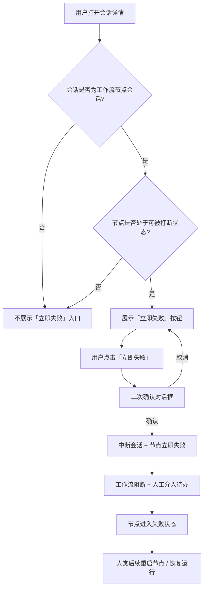

# 工作流支持打断

**功能名称**: 工作流支持打断
**PRD 版本**: v1.0
**创建日期**: 2026-11-16
**作者**: ZeroAsh Agent（需求来源：[Deliay/z-agent-gear#512](https://github.com/Deliay/z-agent-gear/issues/512)）

## 背景与目标

### 1.1 背景

工作流 AI 节点在会话异常中断（会话意外结束 / 停滞空闲）时，平台会自动重试——最多 10 次、指数退避（首次立即，之后 1/2/4/8/16/30/30/30/30 分钟，总窗口约 2 小时），10 次用尽后才进入「重试失败」状态等待人工介入。

该机制保证了绝大多数瞬时故障能自愈，但也带来一个问题：**当人类已经明确判断「这个节点无法继续 / 不必再等」时，没有任何办法立刻停止重试**——只能干等约 2 小时让重试预算耗尽，或在会话页手动关闭会话（该关闭仍会被计为一次中断并触发下一次重试，无法真正打断）。在以下场景中，这种等待是不可接受的：

- 节点产出明显跑偏，人类已决定放弃本轮、直接重启或改方案；
- 上游需求已变更，当前节点的继续执行已无意义；
- Agent 陷入死循环或反复停滞，人类判断无需再给机会；
- 需要立即让工作流进入失败状态以触发人工介入流程或释放资源。

现状唯一的「立即失败」入口是 AI 侧工具 `failCurrentNode`（由 Agent 自己调用标记失败），人类侧缺少一个**主动、即时、绕过重试**的打断手段。

### 1.2 目标

1. 在**会话详情**中为人类提供一个「立即失败」操作入口，一键中断会话并让工作流节点立即进入失败状态。
2. 该操作**绕过中断自动重试机制**——不消耗重试预算、不触发排期重试、不等待退避窗口，立即失败。
3. 失败后工作流阻断并提醒人类介入，沿用既有「失败」恢复路径（重启节点 / 恢复运行）。
4. 操作可追溯：失败原因与来源明确记录，人类可辨识「主动打断」与「自动重试用尽 / Agent 报告失败」。

### 1.3 成功标准

- 会话详情中存在「立即失败」入口，仅对**工作流节点会话**且节点处于**可被打断状态**（执行中 / 返工中 / 重试失败）时可见可用。
- 点击后：会话被中断、节点立即进入失败状态、工作流阻断、产生人工介入待办——全程无需等待自动重试。
- 该操作**不消耗**中断自动重试预算（`retryCount` 不因打断而递增），也不触发任何新的重试排期。
- 失败来源可被人类辨识（区别于 `RETRY_EXHAUSTED` 与 `LLM_REPORTED`）。
- 既有自动重试机制零回归：非人工打断的中断场景仍按原 10 次重试逻辑运转。
- 操作有二次确认，防止误触导致工作流立即失败。

## 用户分析

### 2.1 目标用户

- **工作流的使用者 / 管理者**：在 Agent 工作流运行过程中，需要主动干预、终止某个节点的执行，立即让工作流进入失败状态以便人工介入。
- 该用户已具备工作流实例的归属权限（与既有「重启节点」「完成人类节点」等人工操作同口径）。

### 2.2 用户场景

| 场景 | 用户角色 | 目标 | 痛点 |
|------|---------|------|------|
| 节点产出跑偏，决定放弃本轮 | 工作流管理者 | 立即终止当前节点，不再重试，进入失败待人工处理 | 只能等约 2 小时重试预算耗尽，期间无法让工作流失败 |
| 上游需求已变更 | 工作流管理者 | 立即终止已无意义的节点执行 | 节点仍在反复重试，无法即时停止 |
| Agent 死循环 / 反复停滞 | 工作流管理者 | 立即打断，不再给重试机会 | 重试机制持续拉起会话，无法人为叫停 |
| 需立即触发人工介入 / 释放资源 | 工作流管理者 | 让工作流立即进入失败状态 | 缺少人类侧的即时失败入口 |

### 2.3 用户操作流程

## 功能需求

### 3.1 功能概述

在会话详情中为工作流节点会话提供「立即失败」入口：人类一键中断会话并让工作流节点立即进入失败状态，绕过中断自动重试机制，工作流阻断并产生人工介入待办。

### 3.2 功能列表

#### 功能点 1: 「立即失败」入口展示

- **描述**: 在会话详情的会话标题栏操作区，仅当当前会话为**工作流节点会话**（`workflowInstanceId` 非空）且其绑定节点处于**可被打断状态**（执行中 / 返工中 / 重试失败）时，展示「立即失败」按钮。非工作流会话、节点已结束 / 已完成 / 已打回等不可打断状态均不展示。
- **用户价值**: 让人类在需要立即终止节点执行时，能直接找到操作入口，无需等待重试预算耗尽。
- **验收标准**:
  - [ ] 工作流节点会话且节点处于 RUNNING / REWORK / RETRY_FAILED 时，会话详情可见「立即失败」按钮
  - [ ] 非工作流会话（普通会话）不展示该按钮
  - [ ] 节点处于 DONE / REJECT / FAILED / INITIALIZING / READY 等不可打断状态时不展示该按钮
  - [ ] 实例不可用（控制器离线 / 已删除）时按钮置灰并提示「实例不可用，请先接续」

#### 功能点 2: 二次确认与执行

- **描述**: 点击「立即失败」弹出二次确认对话框，说明该操作会立即中断会话、让工作流进入失败状态且不再自动重试；确认后执行。取消则返回。
- **用户价值**: 防止误触导致工作流立即失败，避免不可逆的误操作。
- **验收标准**:
  - [ ] 点击按钮弹出确认对话框，文案明确告知后果（立即中断会话、工作流失败、绕过自动重试）
  - [ ] 确认后执行打断，取消不执行
  - [ ] 执行中按钮置灰防重复提交

#### 功能点 3: 立即失败执行（绕过自动重试）

- **描述**: 确认后：中断节点会话（受控关闭，不触发中断自动重试排期）→ 节点立即转入失败状态 → 工作流阻断 → 产生人工介入待办。全程**不消耗**中断自动重试预算、不触发任何新的重试排期、不等待退避窗口。
- **用户价值**: 真正实现「立即」失败，不再受 10 次 / 约 2 小时自动重试约束。
- **验收标准**:
  - [ ] 会话被中断（ACP 会话停止）
  - [ ] 节点立即进入 FAILED 状态（非 RETRY_FAILED）
  - [ ] 工作流阻断（非 DONE 下游不激活）
  - [ ] `retryCount` 不因本次打断而递增，不新增重试排期（`nextRetryAt` 保持 null / 不排期）
  - [ ] `failInfo.source` 记录为可辨识的「主动打断」来源
  - [ ] 产生人工介入待办

#### 功能点 4: 失败来源可辨识与恢复

- **描述**: 失败信息记录明确来源，人类在节点详情 / 会话详情可辨识「主动打断」区别于「自动重试用尽（RETRY_FAILED）」与「Agent 报告失败（LLM_REPORTED）」。失败后沿用既有恢复路径：重启节点（拉起全新会话）或恢复运行（会话内给出指示后恢复）。
- **用户价值**: 人类介入时能准确判断失败原因，选择正确恢复手段；操作可追溯。
- **验收标准**:
  - [ ] `failInfo.source` 为独立来源值，区别于 `RETRY_EXHAUSTED` / `LLM_REPORTED` / `SESSION_STUCK` / `SESSION_START_FAILED` / `CONTROLLER_UNAVAILABLE`
  - [ ] 节点详情 / 会话详情展示该失败来源文案
  - [ ] FAILED 节点开放「重启节点」入口（与既有 FAILED 恢复口径一致）

### 3.3 用户操作流程

见 2.3 用户操作流程（mermaid 流程图）。关键步骤：打开会话详情 → 判定工作流节点会话 + 可打断状态 → 展示「立即失败」→ 二次确认 → 中断会话 + 节点立即失败 + 工作流阻断 + 人工介入待办 → 人类后续重启节点 / 恢复运行。

### 3.4 页面/界面描述

| 页面 | 描述 | 关键元素 |
|------|------|---------|
| 会话详情标题栏 | 工作流节点会话的操作区 | 「立即失败」按钮（仅工作流节点会话 + 可打断状态可见） |
| 二次确认对话框 | 点击「立即失败」后弹出 | 后果说明文案 +「确认 / 取消」按钮 |
| 节点详情失败信息 | 节点详情抽屉 / 卡片 | `failInfo` 来源文案（主动打断）+「重启节点」入口 |
| 会话详情只读提示 | 打断后会话进入只读 | 历史消息只读回看，输入/发送/继续/恢复入口隐藏 |

### 3.5 异常与边界情况

| 情况 | 预期行为 |
|------|---------|
| 非工作流会话（普通会话） | 不展示「立即失败」按钮 |
| 节点已 DONE / REJECT / FAILED / INITIALIZING / READY | 不展示按钮（不可打断状态） |
| 实例不可用（控制器离线 / 已删除） | 按钮置灰并提示「实例不可用，请先接续」 |
| 实例已删除 / 已归档 | 按钮不展示或置灰（与既有流转类操作同口径） |
| 点击后确认前会话已自然结束 | 仍执行失败转移（幂等，会话已结束则跳过关闭直接失败） |
| 并发点击 / 重复提交 | 执行中按钮置灰；服务端 CAS 保证单次失败转移 |

## 四、非功能需求

### 4.1 性能要求

- 打断操作为人工触发的低频操作，无额外性能要求；失败转移需在确认后秒级完成（会话停止 + 状态转移 + 待办创建）。
- 不新增轮询 / 订阅通道；状态刷新沿用既有 5s 实例轮询与 15s 首页聚合轮询。

### 4.2 安全性要求

- 操作归属校验与既有「重启节点」等人工操作同口径（`actorFilter` 归属 + 工作区上下文）。
- 实例不可用（控制器离线 / 已删除）拒绝流转类操作（置灰 + 提示先接续）。
- 二次确认防止误触。

### 4.3 兼容性要求

- 既有中断自动重试机制（10 次 + 指数退避）零回归：仅人工打断走新路径，其余中断场景仍按原逻辑。
- 既有失败恢复路径（`resumeFailedNode` / `restartNode`）复用，不新增恢复入口。
- 失败来源新增值不破坏既有 `RETRY_FAILED` / `LLM_REPORTED` 语义。

## 五、依赖与约束

### 5.1 依赖

- 依赖既有工作流状态机（`fail` 转移）与 `failInfo.source` 字段。
- 依赖既有会话关闭能力（`sessionService.close` 受控关闭 + `suppressFallback`）。
- 依赖既有「重启节点」恢复入口（`restartNode`）与人工介入待办（`createWorkflowInterventionTodo`）。
- 依赖中断自动重试机制（`interrupt-retry.ts`）的排期 CAS 与前置过滤，确保人工打断不被误判为中断重试。

### 5.2 约束

- 仅 AI / HUMAN 节点会话中，AI 节点会话可被打断；HUMAN 节点无 ACP 会话，打断语义不适用（本功能聚焦 AI 节点会话）。
- `failInfo.source` 新增来源值须同步契约注释与前端展示。
- 单实例部署口径与既有 `KeyedMutex` / 中断重试调度器一致。

## 六、相关文档

- 需求来源：[Deliay/z-agent-gear#512](https://github.com/Deliay/z-agent-gear/issues/512)
- 关联 PRD：[[20261103-workflow-node-interrupt-retry.md]] — 工作流节点中断处理迭代（10 次自动重试基线）
- 关联提案：[[20261103-feat-workflow-node-interrupt-retry.md]]
- 关联契约：`contracts/workflow.graphql`
