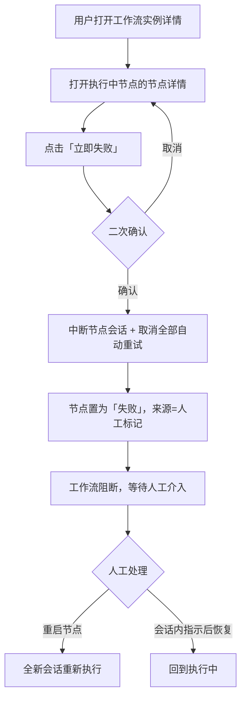
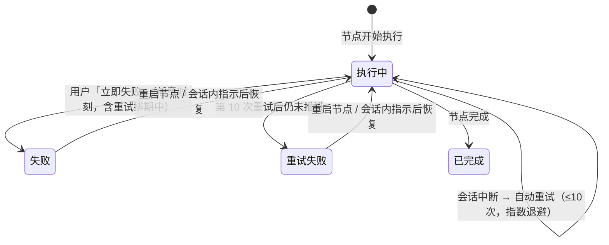

# 工作流节点「立即失败」（Workflow Node Fail Immediately）

**功能名称**: 工作流节点立即失败
**PRD 版本**: v1.0
**创建日期**: 2026-11-16
**作者**: ZeroAsh Agent

## 一、背景与目标

### 1.1 背景

Agent 工作流的 AI 节点由平台拉起的 Agent 会话执行。节点会话发生中断（Agent 进程异常退出、审批超时、会话意外结束等）时，平台会自动重试最多 **10 次**：首次立即重试，之后按指数退避，单次间隔封顶 30 分钟，10 次用尽后节点才转入「重试失败」、阻断工作流等待人工处理（见 [[20261103-workflow-node-interrupt-retry.md]]）。

这套机制提升了偶发故障的自愈率，但也带来一个新的体验问题：**单个节点从首次中断到最终「重试失败」，最长需要约 2 小时**。当用户已经明确知道节点不可能成功时——例如发现节点配置有误、任务方向跑偏、外部环境已不可用、或者干脆想放弃这条路径——只能做两种选择：

1. **干等**：看着系统进行明知会失败的重试，最长空等约 2 小时；
2. **删除整个工作流实例**：连同其他节点与已完成产物一起放弃，代价过大。

平台缺少一个「人工主动止损」的入口：让用户在确认节点无望时，立刻终止当前节点的执行与重试，让工作流即刻进入失败阻断状态，转而走既有的失败恢复路径（重启节点或人工指示后恢复）。

### 1.2 目标

1. **提供「立即失败」入口**：在工作流节点详情中，为执行中（含中断自动重试排期/重试进行中）的 AI 节点提供「立即失败」操作。
2. **立即生效**：操作一经确认，立即中断节点会话、取消该节点全部待执行与进行中的自动重试安排，不再发生任何后续自动重试。
3. **语义与既有「失败」一致**：节点进入「失败」状态、阻断工作流（下游节点不激活），失败信息中可区分「人工标记失败」与其他失败来源；恢复路径与既有「失败」节点完全一致（重启节点 / 会话内指示后恢复）。

### 1.3 成功标准

- 用户对执行中的 AI 节点执行「立即失败」后，节点状态立即变为「失败」，界面同步展示，无需等待任何重试周期。
- 操作后该节点不再发生任何自动重试（已排期的重试不执行、进行中的重试动作被放弃）。
- 节点的会话被中断，不再继续产生执行活动。
- 工作流被阻断：下游节点保持等待、不被激活；实例不会被判定完成。
- 失败节点详情中可见失败来源为「人工标记」，可与系统自动失败区分。
- 用户可通过既有入口（重启节点 / 在会话中给出指示后恢复）将节点恢复回执行中。

## 二、用户分析

### 2.1 目标用户

- **个人开发者**：使用工作流自动串联需求开发流程，希望在发现节点方向错误时能立即止损，而不是空等重试耗尽。
- **进阶用户**：自定义工作流模板与节点编排，需要对节点状态有直接的控制权，快速处理确认无望的执行路径。

### 2.2 用户场景

| 场景 | 用户角色 | 目标 | 痛点 |
|--|--|--|--|
| 节点配置有误（选错模型/工具），已反复中断重试 | 开发者 | 立即终止重试，修正配置后重启节点 | 必须等 10 次重试（约 2 小时）耗尽才能恢复控制 |
| 观察会话输出发现任务方向跑偏 | 开发者 | 立即叫停当前节点，人工接管 | 没有叫停入口，只能干等或删除整个工作流 |
| 外部依赖（仓库权限、凭据）已确认失效 | 开发者 | 立即判失败，修复后重跑 | 系统在注定失败的重试上浪费时间与调用额度 |
| 想放弃某条执行路径但保留工作流其他成果 | 开发者 | 仅将当前节点置为失败并阻断 | 只能删除整个实例，已完成节点的成果一并丢失 |

## 三、功能需求

### 3.1 功能概述

在工作流节点详情中为执行中的 AI 节点新增「立即失败」操作：经二次确认后，立即中断节点会话、取消该节点全部自动重试安排，并将节点置为「失败」状态阻断工作流，失败来源标记为「人工标记」。

### 3.2 功能列表

#### 功能点 1：节点详情新增「立即失败」操作

- **描述**: 工作流节点详情中，当 AI 节点处于「执行中」或「返工中」（含已排期自动重试、重试进行中）时，展示「立即失败」操作按钮。该操作具有破坏性，点击后需二次确认方可执行。非执行状态的节点（未开始、已完成、已打回、失败、重试失败）不展示该操作；人类节点与旗帜节点无会话与自动重试，不展示该操作。实例不可用（控制器离线/已删除）时操作禁用并提示先接续。
- **用户价值**: 用户在确认节点无望时有一个明确、即时的止损入口，不再被自动重试节奏绑架。
- **验收标准**:
  - [ ] AI 节点处于「执行中/返工中」时，节点详情中可见「立即失败」操作。
  - [ ] 节点处于自动重试排期中或重试进行中时，该操作同样可见可用。
  - [ ] 点击后弹出二次确认，说明后果（中断会话、取消重试、节点置为失败并阻断工作流），确认后才执行。
  - [ ] 其他状态（未开始/已完成/已打回/失败/重试失败）与人类、旗帜节点不展示该操作。
  - [ ] 实例不可用（控制器离线/已删除）时操作禁用，并提示先接续工作流。

#### 功能点 2：立即中断会话并取消全部自动重试

- **描述**: 「立即失败」确认执行后：
  1. 立即中断当前节点会话，会话不再继续执行；
  2. 取消该节点已排期的自动重试（到点不再执行）；
  3. 进行中的自动重试动作（会话恢复、等待空闲、重发提示词）被放弃，不再发送提示词；
  4. 操作完成后，该节点不再发生任何自动重试。
- **用户价值**: 操作效果干净彻底——不会出现在用户判失败后系统仍继续重试、浪费调用额度的现象。
- **验收标准**:
  - [ ] 执行后节点会话被中断，不再产生新的执行活动。
  - [ ] 执行前已排期的自动重试到期不再触发。
  - [ ] 执行时正在进行中的重试动作被放弃，不再向会话发送提示词。
  - [ ] 执行后任何会话事件（会话结束、空闲）都不会再为该节点排期自动重试。

#### 功能点 3：节点置为「失败」并阻断工作流

- **描述**: 操作成功后节点进入「失败」状态，语义与既有「失败」完全一致：工作流阻断（非完成态的下游节点永不激活），实例保持未完成，等待人工介入。失败记录包含失败原因与失败来源；来源为「人工标记」，与「中断重试用尽」「会话停滞」「AI 主动标记」等系统自动来源可明确区分。节点详情与列表/图形视图按既有「失败」样式展示。
- **用户价值**: 失败语义统一，恢复路径熟悉；失败来源可区分，便于事后回顾与统计。
- **验收标准**:
  - [ ] 操作后节点状态为「失败」，界面按既有失败样式展示。
  - [ ] 下游节点保持等待、不被激活；工作流实例不被判定为完成。
  - [ ] 失败信息中失败来源为「人工标记」，与其他失败来源可区分。
  - [ ] 节点原有的重试进度展示随失败收敛（不再展示「下次重试时间」）。

#### 功能点 4：失败后的恢复路径

- **描述**: 「立即失败」后的节点与既有「失败」节点恢复路径一致：可「重启节点」（关闭旧会话、以全新会话重新执行，支持调整执行配置）；也可在节点会话中给出指示后恢复执行。恢复后节点回到「执行中」，中断自动重试预算重新计算。
- **用户价值**: 止损不等于终结——修正问题后可以低成本地让节点重新跑起来。
- **验收标准**:
  - [ ] 「立即失败」的节点可执行「重启节点」，重启后回到「执行中」。
  - [ ] 「立即失败」的节点可在会话中经人工指示后恢复执行。
  - [ ] 恢复后再次中断时，自动重试按新的 10 次预算重新开始。

### 3.3 用户操作流程

「立即失败」操作流程：

与中断自动重试的关系：

### 3.4 页面/界面描述

| 页面 | 描述 | 关键元素 |
|------|------|---------|
| 工作流节点详情 | 执行中/返工中的 AI 节点展示「立即失败」操作 | 「立即失败」按钮（破坏性样式）、二次确认对话框（说明中断会话与取消重试的后果） |
| 工作流实例详情（列表/图形视图） | 操作后节点按既有「失败」样式展示 | 失败状态徽标；失败信息中失败来源为「人工标记」 |
| 节点详情-失败信息 | 展示失败原因与来源 | 失败来源「人工标记」与其他来源可区分；不再展示下次重试时间 |

### 3.5 异常与边界情况

| 情况 | 预期行为 |
|------|---------|
| 点击「立即失败」时节点恰好在自动重试执行中 | 重试动作被放弃（不再向会话发送提示词），节点直接置为「失败」 |
| 执行「立即失败」的瞬间节点恰好完成或状态变化 | 以服务端校验为准：节点已不在可失败状态时操作被拒绝并提示刷新；不产生半中间态 |
| 会话中断动作本身失败（控制器暂不可达等） | 节点仍进入「失败」状态；会话中断按尽力而为处理并记录，不影响失败结果 |
| 实例不可用（控制器离线/已删除） | 操作禁用并提示先接续；接续后可正常使用 |
| 工作流实例被删除/已归档 | 已删除实例拒绝一切流转；已归档实例的节点操作与既有规则一致 |
| 节点处于「重试失败」 | 已是阻断状态，不展示「立即失败」；走既有重启/恢复入口 |
| 人类节点、旗帜节点 | 无会话与自动重试，不展示该操作，行为不变 |
| 连续重复点击「立即失败」 | 二次确认后仅执行一次有效转移；重复请求被拒绝并提示节点状态已变化 |

## 四、非功能需求

### 4.1 性能要求

- 「立即失败」操作为即时操作，从确认到节点状态变更应在秒级完成；会话中断为尽力而为，不阻塞状态变更的反馈。

### 4.2 安全性要求

- 操作仅对工作流实例归属用户（含工作区成员口径）开放，与既有「重启节点」等流转操作同一权限口径。
- 操作具有破坏性，必须二次确认；失败信息保留操作来源（人工标记）以便审计。

### 4.3 兼容性要求

- 存量「失败」「重试失败」语义与恢复路径不变。
- 存量中断自动重试机制（10 次、指数退避、封顶 30 分钟）不变，「立即失败」只是新增的人工短路入口。
- 历史实例数据不受影响；失败来源新增「人工标记」取值，历史失败记录来源不变。

## 五、依赖与约束

### 5.1 依赖

- 现有 Agent 工作流（节点状态机、「失败/重试失败」状态与恢复路径）。
- 现有中断自动重试机制（[[20261103-workflow-node-interrupt-retry.md]]）。
- 现有「重启节点」与「失败后恢复」人工处理入口。

### 5.2 约束

- 本功能仅适用于 AI 节点；人类节点与旗帜节点不涉及。
- 「立即失败」仅作用于「执行中/返工中」节点；其他状态不提供该操作。
- 「立即失败」不产生新的人工介入待办（操作者即人工本人）；「重试失败」的待办提醒机制不变。

## 六、相关文档

- 技术提案：[[../../engineering/proposals/20261116-feat-workflow-node-manual-fail.md]]
- 关联 PRD：[[20261103-workflow-node-interrupt-retry.md]] — 工作流节点中断处理迭代
- 关联 PRD：[[../released/20260808-agent-workflow.md]] — Agent 工作流
- 关联 PRD：[[20261114-workflow-instance-continuation.md]] — 已实例化的工作流接续
