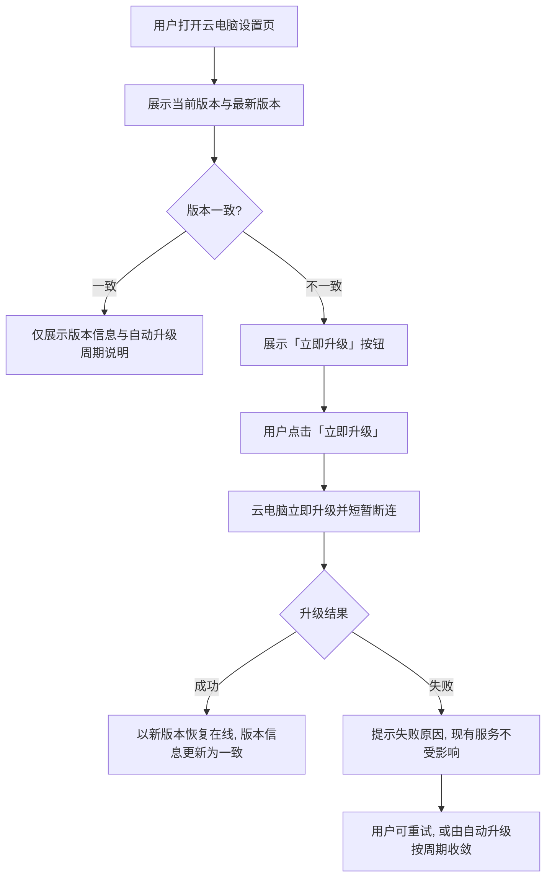
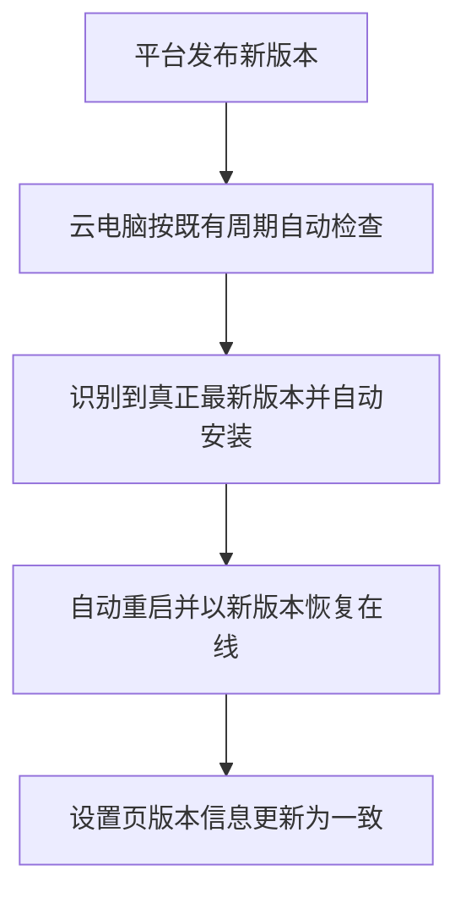

# 云电脑控制器包升级优化

**功能名称**: 云电脑控制器包升级优化
**PRD 版本**: v1.0
**创建日期**: 2026-11-17
**作者**: ZeroAsh

## 背景与目标

### 1.1 背景

云端工作容器（云电脑）已具备 agent-gear 运行期自动升级能力：容器运行期间每 10 分钟检查一次新版本，发现新版即安装并重启服务（见 [[../shipping/20261113-cloud-agent-gear-auto-upgrade.md]]）。该能力上线后暴露两类问题：

1. **新版本发布后无法及时更新到位**：软件来源对刚发布的版本设有保护期，新发布版本在保护期内对自动升级不可见，自动升级实际安装到的仍是保护期前的旧版本。因此新版本发布后，存量云电脑最长要等保护期结束（约一天）才会自动更新到最新版，新能力与修复无法及时送达。
2. **版本不可见、无法主动升级**：用户无法得知云电脑当前运行的工作组件版本，也无从判断是否落后于最新版本；想立即升级只能等待下一个自动检查周期，或销毁重建云电脑。

来源：GitHub Issue [Deliay/z-agent-gear#551](https://github.com/Deliay/z-agent-gear/issues/551)。

### 1.2 目标

- 新版本发布后，运行中的云电脑在一个自动检查周期（10 分钟）内即可自动升级到真正最新版，不再受发布源保护期延迟影响。
- 云电脑设置页展示当前运行的版本与最新版本，版本状态对用户透明。
- 版本不一致时提供「立即升级」入口，点击后立即完成升级，无需等待自动周期、无需销毁重建。
- 页面以一行小字标注自动升级的检查周期（多少分钟检查一次），用户对自动行为有明确预期。

### 1.3 成功标准

- 新版本发布后，运行中的云电脑在一个检查周期（10 分钟）加上安装与重启耗时内自动切换到新版本，全程无人工介入（此前该延迟最长约一天）。
- 云电脑设置页可看到当前版本与最新版本；两者一致时无升级入口，不一致时出现「立即升级」按钮。
- 点击「立即升级」后，云电脑在短时间内完成升级并恢复在线，页面版本信息随之更新为一致。
- 设置页可见自动升级检查周期说明；检查/升级失败时现有服务不受影响，下一周期自动重试（沿用既有自动升级的失败收敛语义）。
- 既有能力不回归：云电脑创建、初始化、会话、保活、版本门禁与销毁流程行为与现状一致。

## 用户分析

### 2.1 目标用户

- **前台用户（云电脑使用者）**：长时间使用同一台云电脑，期望环境及时获得最新能力与修复，并能清楚看到当前版本状态、需要时立即升级。
- **平台维护人员**：发布新版本后，期望存量运行环境快速、自动收敛到真正最新版，并能通过用户侧可见的版本信息排查版本分化问题。

### 2.2 用户场景

| 场景 | 用户角色 | 目标 | 痛点 |
|--|--|--|--|
| 平台刚发布新版本 | 平台维护人员 | 存量云电脑在一个检查周期内自动升级到最新版 | 新版本保护期内自动升级安装的仍是旧版，最长延迟约一天 |
| 用户查看云电脑设置 | 前台用户 | 看到当前版本与最新版本，了解自动升级节奏 | 版本完全不可见，无法判断是否落后 |
| 用户发现版本落后 | 前台用户 | 一键立即升级到最新版 | 只能等下一个检查周期或销毁重建，工作现场被迫等待/放弃 |
| 升级源暂时不可用 | 平台维护人员 | 现有服务不受影响，恢复后自动继续 | 担心升级机制把健康环境变成不可用 |

## 功能需求

### 3.1 功能概述

优化云电脑工作组件（agent-gear）的升级体验：自动升级在新版本发布后直达最新版（不受发布源新版本保护期延迟）；云电脑设置页展示当前版本与最新版本，版本不一致时提供「立即升级」按钮，点击后立即升级；页面以小字标注自动升级的检查周期。

### 3.2 功能列表

#### 功能点 1: 自动升级直达最新版

- **描述**: 新版本发布后，云电脑既有的每 10 分钟自动升级检查能够识别并安装真正最新发布的版本，不再因发布源的新版本保护期而停留在旧版本。检查节奏、失败收敛、升级后自动重启恢复等既有自动升级语义保持不变。
- **用户价值**: 新版本发布后一个检查周期内全量存量环境即可收敛，新能力与修复及时送达，版本分化窗口从「最长约一天」缩短到「十分钟级」。
- **验收标准**:
  - [ ] 新版本发布后，运行中的云电脑在一个检查周期（10 分钟）加安装与重启耗时内自动切换到新版本。
  - [ ] 无新版本时不产生任何安装或重启动作。
  - [ ] 检查或安装失败时仅记录、下一周期重试，当前运行服务不受影响。
  - [ ] 升级重启后云电脑自动恢复在线，用户会话与工作环境继续使用。

#### 功能点 2: 设置页版本展示

- **描述**: 云电脑的设置页面（云电脑配置页）展示工作组件的「当前版本」与「最新版本」。当前版本为云电脑内正在运行的版本；最新版本为发布源中的最新版本，由平台按 10 分钟节奏从发布源刷新。版本信息仅在云电脑运行中可读取；非运行状态（启动中/停止中/已销毁/失败）下当前版本按最近已知展示或显示为不可用。
- **用户价值**: 用户随时可核对云电脑版本状态，平台维护人员可据此定位版本分化。
- **验收标准**:
  - [ ] 运行中的云电脑设置页展示当前版本与最新版本两个字段。
  - [ ] 最新版本与发布源实际最新版一致，刷新延迟不超过 10 分钟。
  - [ ] 最新版本获取失败时不阻断页面，既有信息继续展示。

#### 功能点 3: 版本不一致时「立即升级」

- **描述**: 当前版本与最新版本不一致时，版本展示区域出现「立即升级」按钮；点击后云电脑立即执行升级并自动恢复在线，期间短暂断连（秒级）。版本一致时按钮不出现。升级过程中按钮进入处理中状态，完成后页面版本信息更新为一致。
- **用户价值**: 用户需要最新能力时无需等待自动周期、无需销毁重建，一键完成升级。
- **验收标准**:
  - [ ] 仅当当前版本与最新版本不一致且云电脑运行中时展示「立即升级」按钮。
  - [ ] 点击后云电脑在短时间内完成升级并以新版本恢复在线，不重复执行初始化。
  - [ ] 升级失败（如升级源不可达）时给出可读提示，现有服务不受影响，可重试或由自动升级后续收敛。
  - [ ] 升级过程中用户停止云电脑或平台销毁指令到达时，升级让位于销毁流程。

#### 功能点 4: 自动升级周期标注

- **描述**: 版本展示区域增加一行小字，标注自动升级的检查周期（如「自动升级每 10 分钟检查一次」）。标注内容与平台实际生效的自动检查周期一致。
- **用户价值**: 用户对自动升级节奏有明确预期，理解「立即升级」只是提前触发，不点击也会自动收敛。
- **验收标准**:
  - [ ] 版本展示区域可见自动升级检查周期说明（以分钟为单位）。
  - [ ] 说明文案与平台实际配置的检查周期一致。

### 3.3 用户操作流程

### 3.4 页面/界面描述

| 页面 | 描述 | 关键元素 |
|------|------|---------|
| 云电脑设置页（配置页）版本信息区 | 展示工作组件当前版本与最新版本；版本不一致时出现「立即升级」按钮；区域下方一行小字标注自动升级检查周期 | 当前版本、最新版本、「立即升级」按钮、检查周期说明 |
| 云电脑列表/详情 | 升级重启期间云电脑短暂断连后自动恢复在线（与既有自动升级一致） | 云电脑状态 |

### 3.5 异常与边界情况

| 情况 | 预期行为 |
|------|---------|
| 发布源不可达或最新版本获取失败 | 页面展示最近一次已知的最新版本或显示不可用；自动升级按既有失败语义下一周期重试；不阻断设置页其余功能 |
| 云电脑处于启动中/停止中/已销毁/失败状态 | 「立即升级」按钮不出现；当前版本按最近已知展示或显示为不可用 |
| 点击「立即升级」时云电脑恰好离线或退出 | 给出可读提示，不执行升级动作；云电脑恢复在线后版本信息按实际更新 |
| 「立即升级」执行失败 | 提示失败原因，云电脑继续运行原版本；用户可重试，自动升级仍按周期收敛 |
| 升级进行中收到停止/销毁指令 | 销毁优先：停止升级动作，云电脑按既有销毁流程退出 |
| 用户连续点击「立即升级」 | 重复的升级请求被合并为一次，不产生并发升级 |
| 存量旧云电脑（早期创建、长期未重建） | 保持现状可继续使用；其自动升级仍存在发布保护期延迟，「立即升级」入口在其工作组件升级到支持版本后可用；重建后的新云电脑获得完整能力 |

## 四、非功能需求

### 4.1 性能要求

- 最新版本的刷新节奏固定为 10 分钟一次，全平台共享同一份结果，不随在线云电脑数量增长而增加对发布源的请求压力。
- 「立即升级」触发的升级与重启造成的连接中断为秒级，不影响其他云电脑。

### 4.2 安全性要求

- 升级来源与云电脑既有安装口径完全一致，不引入新的下载渠道。
- 版本信息与升级链路不输出密钥、令牌等敏感信息。

### 4.3 兼容性要求

- 云电脑创建、初始化、保活、版本门禁、会话与销毁等既有功能行为不回归。
- 自动升级始终安装「最新版」，与平台最低版本门禁方向一致（向上升级），不引入降级行为；发布侧回滚最新版指针后，云电脑按同一机制自然回落到该版本。
- 存量运行中的旧云电脑维持现状（见 3.5），重建（停止后重新创建）后的新云电脑自动获得完整能力，不涉及数据迁移。

## 五、依赖与约束

### 5.1 依赖

- 依赖既有云环境 agent-gear 自动升级能力（[[../shipping/20261113-cloud-agent-gear-auto-upgrade.md]]）及其失败收敛与恢复语义。
- 依赖平台可按固定节奏访问发布源获取最新版本信息。
- 依赖云电脑断线重连与初始化去重能力，保证升级重启后状态正确恢复。

### 5.2 约束

- 本期仅覆盖云端工作容器（云电脑）的工作组件升级优化，不改变本地控制器的行为。
- 自动升级检查周期保持 10 分钟，本期不提供用户级调整入口。
- 「立即升级」仅针对工作组件本身，不扩展为云电脑内其他软件（工作负载、Harness 工具等）的升级入口。

## 六、相关文档

- 需求来源：[GitHub Issue Deliay/z-agent-gear#551 — 云电脑控制器包升级优化](https://github.com/Deliay/z-agent-gear/issues/551)
- 技术提案：[[../../engineering/proposals/20261117-feat-cloud-agent-gear-upgrade-optimization.md]]
- [[../shipping/20261113-cloud-agent-gear-auto-upgrade.md]] — 云环境 agent-gear 自动升级
- [[20261025-cloud-host-keepalive.md]] — 云电脑保活与 worker 用户
