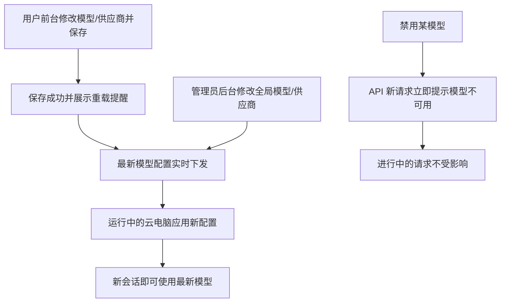

# 模型下发优化与云电脑配置实时下发

**功能名称**: 模型下发优化与云电脑配置实时下发
**PRD 版本**: v1.0
**创建日期**: 2026-11-17
**作者**: z-agent-bot

## 背景与目标

### 1.1 背景

来源：GitHub Issue [Deliay/z-agent-gear#533](https://github.com/Deliay/z-agent-gear/issues/533)。

用户在「设置」中配置自定义模型，或管理员在后台修改模型后，**已经运行的云电脑中的模型不会更新**——云电脑只在创建时拿到一份模型快照，之后的任何调整都需要销毁重建云电脑才能生效。同时存在两个模型来源展示问题：

1. 用户自己绑定的模型，在云电脑内被统一挂在 `zag` 前缀下，丢失了用户自己的供应商标识；
2. 平台内置模型的 vendor id `zag` 直接裸展示，没有人类可读的显示名称。

### 1.2 目标

1. 管理员后台、用户前台对模型与供应商的修改，实时下发到所有运行中的云电脑，无需销毁重建；
2. 云电脑内模型按真实来源分组：用户自绑定模型归属用户自己的供应商，平台内置模型归属平台；
3. 模型的任何修改对模型调用 API 立即生效。

### 1.3 成功标准

- 前台或后台修改模型（新增/删除/启停/改供应商信息）后，运行中的云电脑在秒级内应用最新模型清单，且保存操作本身不被下发过程阻塞、不因个别云电脑下发失败而失败；
- 云电脑内用户自绑定模型以「用户绑定的供应商」为前缀与显示名展示，平台内置模型显示名称为「Agent Gear」；
- 禁用某个模型后，模型调用 API 收到的新请求立即提示模型不可用，进行中的请求不受影响正常完成。

## 用户分析

### 2.1 目标用户

- **平台用户**：在「设置」中维护自己的供应商与自定义模型，并使用云电脑工作的个人/团队成员；
- **平台管理员**：在管理后台维护全局（系统内置）供应商与模型；
- **云电脑内的 Agent 运行环境（Harness）**：模型配置的最终消费方。

### 2.2 用户场景

| 场景 | 用户角色 | 目标 | 痛点 |
|--|--|--|--|
| 新增/修改自定义模型后继续工作 | 平台用户 | 运行中的云电脑立刻用上最新模型 | 必须销毁重建云电脑，会话与工作环境丢失 |
| 后台调整全局模型 | 管理员 | 全部云电脑同步最新模型清单 | 存量云电脑一直使用过期清单 |
| 前台保存模型配置 | 平台用户 | 知道部分运行环境不会热重载，需要重启会话 | 无任何提示，以为已生效实际未生效 |
| 临时禁用某个模型 | 管理员/平台用户 | 新调用立即被拒绝 | 禁用后云电脑仍展示该模型为可用 |
| 辨认模型来源 | 平台用户 | 分清平台模型与自己绑定的供应商模型 | 全部显示 `zag` 前缀，无法区分 |

## 功能需求

### 3.1 功能概述

模型与供应商的配置变更（无论来自用户前台还是管理后台）实时推送到所有运行中的云电脑，云电脑内模型按真实供应商归属分组展示；模型禁用等修改对模型调用 API 立即生效。

### 3.2 功能列表

#### 功能点 1: 模型变更实时下发到运行中的云电脑

- **描述**: 管理后台修改的全局模型/供应商、用户前台修改的自有模型/供应商，在保存成功后立即下发到所有处于运行状态的云电脑；云电脑内的模型清单与配置同步更新，无需销毁重建。非运行状态（停止/销毁/创建失败）的云电脑不下发。
- **用户价值**: 配置调整后立刻继续工作，不再为同步模型而重建环境、丢失会话。
- **验收标准**:
  - [ ] 前台新增/修改/删除/启停自定义模型或供应商后，运行中的云电脑在秒级内应用最新配置，新会话即可选择最新模型；
  - [ ] 后台新增/删除/启停全局模型或供应商、修改模型上下文长度后，所有运行中的云电脑同样实时生效；
  - [ ] 保存操作正常返回，不因个别云电脑下发失败而失败；下发失败可观测；
  - [ ] 非运行状态的云电脑不接收下发，也不会因此产生错误。

#### 功能点 2: 前台保存时提醒「部分 Harness 不会重载模型配置」

- **描述**: 部分 Harness 运行时在启动后不会重新读取模型配置，实时下发对已启动的运行实例不一定生效。用户在前台「设置」中点击保存模型/供应商配置时，提醒用户这一点；管理后台不做该提醒。
- **用户价值**: 用户明确知道「保存成功 ≠ 所有运行实例已生效」，必要时主动重启会话或云电脑，避免误判。
- **验收标准**:
  - [ ] 前台设置页保存模型/供应商配置时，向用户展示「部分 Harness 运行时不会重载模型配置，已运行的会话可能需要重启后生效」语义的提醒；
  - [ ] 管理后台保存时不展示该提醒。

#### 功能点 3: 用户自绑定模型按自有供应商展示

- **描述**: 云电脑内用户自绑定的模型不再统一挂在 `zag` 前缀下，改为以用户自己绑定的供应商为准：vendor id 为用户绑定的供应商 id，显示名称为用户在系统中填写的供应商名称。平台内置（全局）模型仍归属平台前缀。
- **用户价值**: 一眼分清模型来自哪个自有供应商，多供应商并存时不再混淆。
- **验收标准**:
  - [ ] 云电脑内用户自绑定模型的 vendor id 为其绑定的供应商 id，不再显示为 `zag`；
  - [ ] 该 vendor 的显示名称为用户在系统中填写的供应商名称；
  - [ ] 同一用户的多个供应商各自成组展示，互不混合。

#### 功能点 4: 平台内置模型显示名称为「Agent Gear」

- **描述**: 平台内置模型的 vendor id 保持 `zag` 不变，但增加显示名称「Agent Gear」，不再把 `zag` 直接作为展示名。
- **用户价值**: 平台模型有正式、可读的品牌名称。
- **验收标准**:
  - [ ] 云电脑内平台内置模型的供应商显示名称为「Agent Gear」；
  - [ ] vendor id `zag` 本身保持不变（仅作为标识符）。

#### 功能点 5: 模型修改对模型调用 API 立即生效

- **描述**: 任何对模型的修改（如禁用某个模型）立即生效：模型调用 API 再次收到请求时提示模型不可用；已经在进行中的请求不做处理（不中断、正常完成）。
- **用户价值**: 禁用/启用等管控操作即时生效，无需等待缓存过期或重建环境。
- **验收标准**:
  - [ ] 禁用某模型后，对该模型的新 API 请求立即返回「模型不可用」语义的错误；
  - [ ] 禁用时已在进行中的请求（含流式）不被中断，正常完成；
  - [ ] 重新启用后，新请求恢复正常；
  - [ ] 供应商被禁用/删除时，其下模型的行为与上述口径一致。

### 3.3 用户操作流程

### 3.4 页面/界面描述

| 页面 | 描述 | 关键元素 |
|------|------|---------|
| 前台「设置」模型/供应商区 | 保存模型/供应商配置 | 保存成功后展示「部分 Harness 运行时不会重载模型配置」提醒 |
| 云电脑内 Harness 模型选择界面 | 模型按供应商分组展示 | 平台组显示「Agent Gear」；用户组显示用户填写的供应商名称 |
| 管理后台模型/供应商管理 | 全局模型维护 | 保存即下发；不展示重载提醒 |

### 3.5 异常与边界情况

| 情况 | 预期行为 |
|------|---------|
| 云电脑处于停止/销毁/失败等非运行状态 | 不下发、不报错；云电脑下次创建/运行时自然获取最新配置 |
| 云电脑内工作组件版本过旧、不支持实时下发 | 该云电脑保持创建时的模型快照，静默降级，其余能力不受影响 |
| 单台云电脑下发失败（网络、容器异常等） | 不影响保存操作与其他云电脑的下发；失败留有记录可观测 |
| 保存时没有任何运行中的云电脑 | 直接成功，无需下发 |
| 禁用模型时存在进行中的调用 | 进行中的调用不中断、正常完成；新调用立即被拒绝 |
| 用户模型与平台模型同名 | 平台模型优先的既有口径不变 |

## 四、非功能需求

### 4.1 性能要求

- 配置变更从保存成功到云电脑应用完成，常态为秒级；大批量云电脑场景下逐台下发不阻塞保存操作本身。

### 4.2 安全性要求

- 模型调用凭据的既有安全口径不变：不因实时下发新增凭据落盘点，不在日志/提醒中泄露密钥。

### 4.3 兼容性要求

- 旧版本工作组件的云电脑优雅降级（保持创建时快照），不报错、不中断；
- 新建云电脑的既有创建流程与模型下发口径不变。

## 五、依赖与约束

### 5.1 依赖

- 云电脑运行环境（Harness）对配置重写的支持能力；
- 模型调用 API 对模型状态的实时判定口径。

### 5.2 约束

- 已停止/销毁的云电脑不做补发；
- 进行中的模型调用不做中断处理；
- 管理后台不展示重载提醒。

## 六、相关文档

- 需求来源：GitHub Issue [Deliay/z-agent-gear#533](https://github.com/Deliay/z-agent-gear/issues/533)
- 技术提案：`docs/engineering/proposals/20261117-feat-cloud-host-model-config-sync.md`
