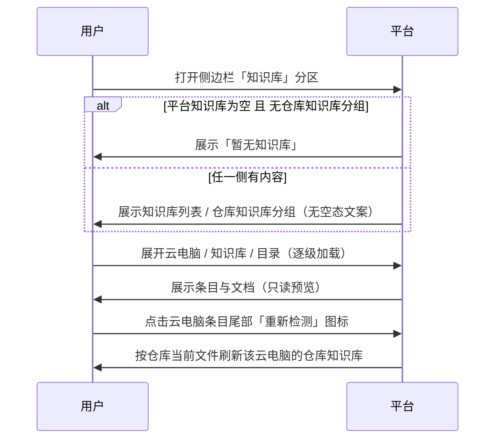
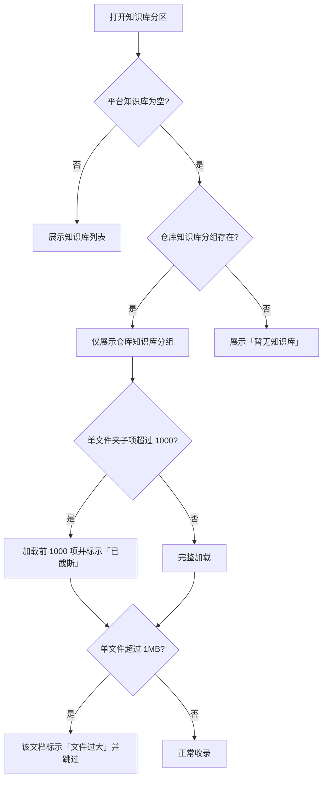

# 知识库优化二期

**功能名称**: 知识库优化二期
**PRD 版本**: v1.0
**创建日期**: 2026-11-17
**作者**: z-agent-bot

## 背景与目标

### 1.1 背景

知识库能力已上线并经历多轮迭代（见 [[../shipping/20261115-knowledge-base.md]]、[[20261116-knowledge-base-optimization.md]]、[[20261116-knowledge-base-repo-built-in.md]]）：平台托管知识库与内建在代码仓库中的「仓库知识库」在侧边栏「知识库」分区中统一呈现。实际使用中暴露出三个体验与容量问题：

1. **空态文案与内容自相矛盾**：平台知识库为空而仓库知识库有内容时，分区先显示「暂无知识库」，紧接着又展示仓库知识库，让人误以为该分区没有内容；
2. **仓库知识库加载受限**：仓库知识库加载时存在文档数量与内容体积的总量限制，规模稍大的知识库（文档多、体积大）就会被截断，排在后面的文档无法浏览，用户无从获得完整的项目知识；
3. **「重新检测」入口形态不佳**：「重新检测」在展开云电脑后单独占一行、附带文字说明，与列表其他操作入口的形态不一致，还占据宝贵的纵向空间。

需求来源：[GitHub Issue Deliay/z-agent-gear#559](https://github.com/Deliay/z-agent-gear/issues/559)。

### 1.2 目标

- 「暂无知识库」只在**平台知识库与仓库知识库都为空**时展示；任一侧有内容即不展示空态文案。
- 仓库知识库**取消总量限制**：文档数量与内容体积不再设总量上限，大规模知识库可完整加载浏览；仅保留两个结构性上限——**单个文件夹的子项数量最多 1000**、**单个文件最大 1MB**。
- 「重新检测」移动到知识库折叠条目（云电脑条目）的**尾部**，与条目同行呈现，**仅保留图标、省略文字描述**；折叠与展开状态均可使用。

### 1.3 成功标准

- 平台知识库为空、仓库知识库有内容时，侧边栏「知识库」分区不出现「暂无知识库」，直接呈现仓库知识库分组；两类知识库**都为空**时才出现「暂无知识库」。
- 一份含上百篇文档、合计体积数 MB 的仓库知识库可完整加载与逐篇浏览，不再因数量或体积总量被截断。
- 单个文件夹内子项超过 1000 个时，仅加载按名称排序的前 1000 项，并对该知识库给出「已截断」标示；单个文件超过 1MB 时不收录该文档并标示文件过大；两者均不影响其余内容的加载与浏览。
- 「重新检测」以图标形式位于云电脑条目尾部（与条目同行），悬停可见「重新检测」说明；折叠、展开状态均可点击，点击后按仓库当前文件刷新该云电脑的仓库知识库，展开中的内容随之更新。
- 平台托管知识库（列表、预览、编辑、历史、设置）与知识库工具（AI 会话）行为零回归；面向 AI 的仓库知识库编写指引与新的上限口径保持一致。

## 用户分析

### 2.1 目标用户

- **云电脑使用者**：为项目拉起云电脑工作，一边与 AI 会话一边在侧边栏查阅项目自带的知识库。
- **项目维护者**：在仓库中维护项目专属知识（开发规范、架构说明、上手指引），希望知识被完整加载、不打折扣地呈现给所有协作者。
- **团队协作者**：加入同一项目的成员，各自云电脑上浏览同一套项目知识，保证认知一致。

### 2.2 用户场景

| 场景 | 用户角色 | 目标 | 痛点 |
|--|--|--|--|
| 浏览项目知识 | 云电脑使用者 | 打开侧边栏「知识库」直接看到仓库知识库 | 平台知识库为空时先看到「暂无知识库」，误以为分区为空 |
| 浏览大型知识库 | 云电脑使用者 | 完整浏览数十上百篇项目文档 | 总量限制导致排后的文档加载不到，也看不到任何提示 |
| 沉淀成体系的项目知识 | 项目维护者 | 把整套手册/规范放进仓库知识库 | 知识库稍大就被截断，维护者被迫删减内容 |
| 更新知识后刷新 | 项目维护者 | 仓库提交后在平台立即看到新内容 | 「重新检测」藏在展开区域单独一行，入口不显眼 |
| 紧凑浏览 | 团队协作者 | 侧边栏一屏内看到更多知识库条目 | 「重新检测」独占一行，挤占条目展示空间 |

## 功能需求

### 3.1 功能概述

本期对知识库分区做三项优化：其一，收敛空态文案的展示条件——「暂无知识库」只在平台知识库与仓库知识库都为空时出现，任一侧有内容即隐藏；其二，放宽仓库知识库的加载上限——取消数量与体积的总量限制，仅保留「单文件夹子项最多 1000」与「单文件最大 1MB」两个结构性上限，大规模知识库可完整浏览；其三，调整「重新检测」入口——移到云电脑折叠条目的尾部、与条目同行、仅保留图标，折叠与展开状态均可使用。平台托管知识库与知识库工具的行为完全不变。

### 3.2 功能列表

#### 功能点 1: 知识库分区空态收敛

- **描述**: 侧边栏「知识库」分区在平台知识库为空时展示的「暂无知识库」空态文案，展示条件收紧为「**平台知识库与仓库知识库都为空**」。只要分区中存在内容（平台知识库列表非空，或「仓库知识库」分组出现）即不展示「暂无知识库」。「仓库知识库」分组是否出现沿用现状口径：存在可加载仓库知识库的云电脑时分组出现；分组内容按需加载，分组出现即视为仓库知识库不为空。空态判定期间（候选云电脑尚在加载中）不展示「暂无知识库」，避免文案闪烁。
- **用户价值**: 空态文案只在真正无内容时出现，不再与紧随其后的仓库知识库自相矛盾，用户对分区状态一目了然。
- **验收标准**:
  - [ ] 平台知识库为空、仓库知识库分组存在时，分区不出现「暂无知识库」，仓库知识库正常展示。
  - [ ] 平台知识库为空且无仓库知识库分组（没有可加载仓库知识库的云电脑）时，分区展示「暂无知识库」。
  - [ ] 平台知识库非空时照常展示知识库列表，不出现「暂无知识库」。
  - [ ] 候选云电脑加载期间不展示「暂无知识库」（不闪烁）；平台知识库的展示与操作零回归。

#### 功能点 2: 仓库知识库加载上限放宽

- **描述**: 仓库知识库的加载上限调整为：
  - **取消总量限制**：原有的「每个来源目录最多 20 个知识库」「每个知识库最多 50 篇文档」「单个知识库内容累计 1MB」「单来源内容累计 2MB」等数量与体积的**总额限制全部取消**，知识库内有多少文档就加载多少、体积多大就加载多大；
  - **单文件夹子项数量最大 1000**：每个文件夹的直接子项（子目录与文件合计）最多 1000 个，按名称排序取前 1000 个，超出部分不加载，并对该知识库给出「已截断」标示；
  - **单文件 1MB 限制保留**：单个文件最大 1MB；超过 1MB 的知识库文档不收录并标示「文件过大」，不影响同库其他文档；`knowledge-base.json` 标识文件同样按单文件 1MB 约束，超限时该知识库不读取并标示「文件过大」。
  面向 AI 的「仓库知识库编写指引」同步反映新的上限口径，与实际加载规则保持一致。
- **用户价值**: 规模化项目知识可完整加载与浏览，不再被总量限制腰斩；上限规则简单好记（每文件夹 1000 项、每文件 1MB），维护者按此组织内容即可。
- **验收标准**:
  - [ ] 文档数量超过 50 篇、内容累计超过 1MB 的知识库可完整加载，全部文档可浏览，无因总量导致的截断。
  - [ ] 两个来源目录中的知识库数量超过 20 个时全部展示（受单文件夹 1000 项上限约束），不再截断到 20 个。
  - [ ] 单个文件夹子项超过 1000 个时，仅加载按名称排序的前 1000 项，该知识库带「已截断」标示，其余文件夹与文档不受影响。
  - [ ] 单个文档超过 1MB 时不收录该文档并标示「文件过大」，同库其他文档正常；`knowledge-base.json` 超过 1MB 时该知识库标示「文件过大」且不加载其文档。
  - [ ] 「仓库知识库编写指引」中说明的上限与实际加载规则一致；平台托管知识库的文档大小上限等行为零回归。

#### 功能点 3: 「重新检测」入口移至条目尾部并省略文字

- **描述**: 云电脑条目（「仓库知识库」分组中折叠展示该云电脑知识库的条目）尾部（标题行右侧）放置「重新检测」按钮：**仅保留图标、省略文字描述**，悬停可见「重新检测」说明；点击后按仓库当前文件重新加载该云电脑的仓库知识库，展开中的知识库/文档随之更新。「重新检测」不再在展开区域单独占一行展示；**折叠与展开状态均可点击**（云电脑条目默认折叠时也能刷新）。云电脑工作组件版本过旧、不支持加载的条目不展示「重新检测」（与不发起加载一致）。
- **用户价值**: 刷新入口常驻条目尾部、形态与其他操作入口一致，紧凑不占行；刷新操作在任何折叠状态下都触手可及。
- **验收标准**:
  - [ ] 「重新检测」以图标按钮呈现在云电脑条目标题行尾部，与条目同行，无文字描述，悬停可见「重新检测」说明。
  - [ ] 展开区域不再出现单独一行的「重新检测」入口。
  - [ ] 折叠状态点击「重新检测」即按仓库当前文件刷新该云电脑的仓库知识库；展开状态点击后展开中的内容按新结果更新。
  - [ ] 重复点击不产生异常；加载中有明确反馈（按钮禁用或加载态）。
  - [ ] 版本过旧的云电脑条目不展示「重新检测」；其余条目形态与只读语义零回归。

### 3.3 用户操作流程

### 3.4 页面/界面描述

| 页面 | 描述 | 关键元素 |
|------|------|---------|
| 侧边栏「知识库」分区 | 平台知识库列表 + 「仓库知识库」分组 | 空态文案「暂无知识库」（仅两侧皆空时展示）；仓库知识库分组及各云电脑条目 |
| 云电脑条目（折叠条目） | 折叠展示该云电脑的仓库知识库，可展开逐级浏览 | 标题行（名称 + 展开箭头）、**尾部「重新检测」图标按钮**（悬停显示说明、无文字）；版本过旧展示升级提示且无「重新检测」 |
| 仓库知识库条目 | 知识库（含来源标识、文档数） | 「已截断」标示（单文件夹子项超上限时）；不合法知识库灰显与原因 |
| 仓库知识库文档条目 | 文档（点击进入只读预览） | 「文件过大」标示（单文件超 1MB 时，该条目不进入预览） |

### 3.5 异常与边界情况

| 情况 | 预期行为 |
|------|---------|
| 平台知识库为空、仓库知识库分组存在 | 不展示「暂无知识库」，直接呈现仓库知识库分组 |
| 平台知识库为空且无仓库知识库分组 | 展示「暂无知识库」 |
| 平台知识库非空 | 展示知识库列表，不展示「暂无知识库」（无论仓库知识库是否存在） |
| 候选云电脑尚在加载中 | 不展示「暂无知识库」（避免闪烁），加载完成后再按上列口径决定 |
| 「仓库知识库」分组中的云电脑均未检测到知识库 | 分组按现状呈现各云电脑条目（展开后提示未检测到），不展示「暂无知识库」（分组存在即视为仓库知识库不为空） |
| 知识库文档数量或内容体积很大（远超原总量上限） | 完整加载与浏览，不截断、不降速提示；加载耗时随规模增长属预期 |
| 单个文件夹子项超过 1000 个 | 仅加载按名称排序的前 1000 项，该知识库带「已截断」标示，其余内容不受影响 |
| 单个文档超过 1MB | 不收录该文档并标示「文件过大」，同库其他文档正常加载 |
| `knowledge-base.json` 超过 1MB | 该知识库标示「文件过大」，不加载其文档，不影响其他知识库 |
| 点击「重新检测」时云电脑正在加载 | 以本次检测结果为准，加载中有明确反馈，不产生并发异常 |
| 仓库文件被修改/删除 | 「重新检测」后按当前文件呈现；平台不留存历史（历史即 Git 历史） |
| 云电脑停止/销毁/未就绪 | 该云电脑不出现在分组中（现状不变） |
| 云电脑工作组件版本过旧 | 条目展示升级提示、不发起加载、不展示「重新检测」（现状口径延伸） |
| 以知识库工具（MCP）访问仓库知识库 | 按「不存在」处理（现状不变） |

## 四、非功能需求

### 4.1 性能要求

- 侧边栏初始加载仍**不读取任何仓库内容**（仅列出候选云电脑）；展开时逐级按需加载的形态不变。
- 取消总量限制后，单次加载的耗时与数据量随知识库规模线性增长，常规规模（数百篇文档）下保持秒级呈现；单台云电脑加载失败或超时不影响其他云电脑与平台知识库。
- 「重新检测」的刷新在秒级完成；文档内容仍仅在预览时按需加载。

### 4.2 安全性要求

- 平台仍只读取仓库约定目录内的标识文件与 Markdown 文档，内容仅做解析与渲染，不产生任何执行；仓库知识库全程只读（现状不变）。
- 单文件 1MB 与单文件夹 1000 项上限兼作体量护栏，避免异常大的单文件/单文件夹拖垮加载体验；总量不设限是本期明确的产品取舍。

### 4.3 兼容性要求

- 平台托管知识库（列表、树、预览、编辑、历史、设置、MCP 工具）零回归。
- 未放置知识库目录的项目、未运行云电脑的环境，行为与现状完全一致。
- 旧版本工作组件的云电脑仍按旧上限加载（结果可能截断），展示侧口径不变、不报错；升级工作组件后自动获得新上限。

## 五、依赖与约束

### 5.1 依赖

- 知识库（工作区级 wiki 文档库）：[[../shipping/20261115-knowledge-base.md]]。
- 仓库内建知识库（「暂无知识库」与「重新检测」所在分组、加载上限的宿主功能）：[[20261116-knowledge-base-repo-built-in.md]]。
- 知识库优化（一期）：[[20261116-knowledge-base-optimization.md]]。

### 5.2 约束

- 仓库知识库的放置规范、识别规则、只读语义、不进入知识库工具等口径均不变；本期只调整「加载上限」「空态文案」「重新检测入口」三处。
- 「仓库知识库为空」的判定以「仓库知识库分组是否存在（有无可加载仓库知识库的云电脑）」为准：分组内容按需加载，平台不做全量探测。
- 加载上限仅作用于仓库知识库；平台托管知识库的文档大小上限等约束不变。
- 「重新检测」仍为云电脑级（刷新该云电脑的仓库知识库），不提供跨云电脑的一键刷新。

## 六、相关文档

- [[../shipping/20261115-knowledge-base.md]] — 知识库（工作区级 wiki 文档库）
- [[20261116-knowledge-base-repo-built-in.md]] — 仓库内建知识库
- [[20261116-knowledge-base-optimization.md]] — 知识库优化（一期）
- 技术提案：`docs/engineering/proposals/20261117-feat-knowledge-base-optimization-phase2.md`
- 需求来源：GitHub Issue [Deliay/z-agent-gear#559](https://github.com/Deliay/z-agent-gear/issues/559)
