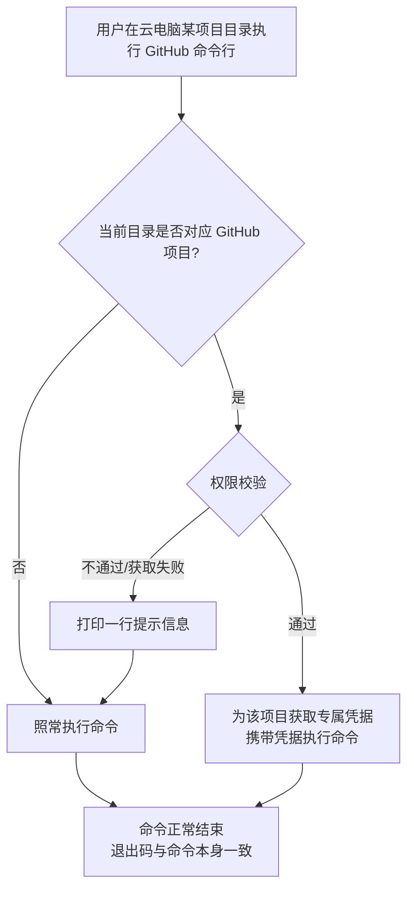
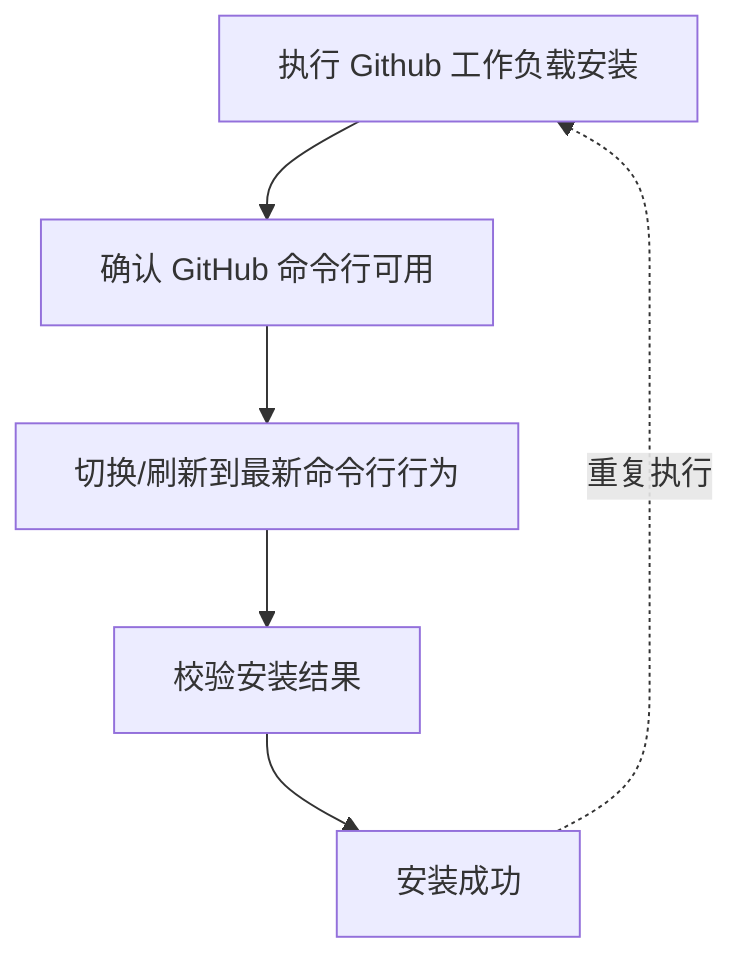

# 云电脑为不同项目获取不同的 Token

**功能名称**: 云电脑为不同项目获取不同的 Token
**PRD 版本**: v1.0
**创建日期**: 2026-11-18
**作者**: ZeroAsh

## 背景与目标

### 1.1 背景

云电脑（云端工作容器）中的 GitHub 访问凭据目前是**整台容器一次性统一发放**的：无论用户在哪个项目目录里执行 GitHub 命令行（`gh`），实际生效的都是同一个、面向单一项目的凭据。当一台云电脑上存在多个 GitHub 项目时，这套机制无法匹配「当前所在项目」：

1. **凭据与项目错位**：在项目 A 的目录里操作项目 B（或反之）时，命令行拿到的凭据并不属于当前项目，操作因权限不符而失败；
2. **无法按项目授权**：每个项目应有自己的访问范围与权限，统一凭据无法体现「当前用户对当前项目是否有权限」；
3. **管理困难**：用户在不同项目间切换时，需要自行理解凭据归属并手动处理，容易出错。

来源：GitHub Issue [Deliay/z-agent-gear#566](https://github.com/Deliay/z-agent-gear/issues/566)。

### 1.2 目标

- 在云电脑内的任一 GitHub 项目目录中执行 GitHub 命令行时，**自动识别当前项目并使用该项目专属的 GitHub 凭据**执行，用户全程无感知、无需手动配置。
- 凭据发放前进行**权限校验**：只有经平台「设置 Github 项目」初始化、且当前账号确有权限的项目才能获得凭据。
- **兼容降级**：任何无法获得项目凭据的场景（旧版本运行组件、非 GitHub 项目目录、权限不通过、网络异常等），命令照常执行、行为与现状一致，仅打印提示信息，绝不因此失败退出。
- Github 工作负载的安装**支持在已有云电脑上重复执行**：重复执行后容器始终使用最新的命令行行为，且不破坏已有环境。

### 1.3 成功标准

- 在一台云电脑的两个不同 GitHub 项目目录中分别执行 GitHub 命令行，各自使用的是**本项目专属**的凭据（凭据范围与所属项目一致），跨项目操作不再因凭据错位失败。
- 在未通过平台初始化的目录（非 GitHub 项目）中执行 GitHub 命令行，行为与现状一致，不产生报错退出。
- 权限校验不通过（账号无该项目权限）时，不发放项目凭据，命令行按降级路径执行并打印提示。
- 旧版本运行组件的云电脑上，GitHub 命令行照常工作（沿用现状凭据），每次调用至多打印一行提示，退出码不受影响。
- 对已有云电脑重复执行 Github 工作负载安装后，容器内 GitHub 命令行为与新装一致，可反复执行不报错、不叠加副作用。
- 既有能力不回归：Github 项目设置（克隆、复用、建会话）、凭据自动续期、提交身份、Issue/PR 联动行为与现状一致。

## 用户分析

### 2.1 目标用户

在一台云电脑上开发多个 GitHub 项目的开发者，以及通过工作流 / Issue 联动在云电脑内操作多个仓库的自动化场景。

### 2.2 用户场景

| 场景 | 用户角色 | 目标 | 痛点 |
|--|--|--|--|
| 一台云电脑上开发多个 GitHub 项目 | 开发者 | 在每个项目目录里直接使用 GitHub 命令行，自动获得该项目的凭据 | 统一凭据与当前项目错位，跨项目操作失败或越权 |
| 自动化任务在特定项目目录执行 GitHub 操作 | 自动化任务执行者 | 无需人工配置凭据，按当前项目自动取得授权 | 需要人工辨认凭据归属并手动注入，易错 |
| 在非项目目录使用 GitHub 命令行 | 开发者 | 命令照常执行 | 期望不因凭据识别失败而中断 |
| 对已有云电脑补装/重装 Github 工作负载 | 开发者 | 一次操作即获得最新命令行行为，可重复执行 | 安装脚本重复执行报错或行为不一致 |

## 功能需求

### 3.1 功能概述

改造云电脑容器内的 GitHub 命令行：执行时自动识别当前目录所属的 GitHub 项目，通过权限校验后为该项目获取专属 GitHub 凭据并携带凭据执行；无法获取凭据时打印提示并照常执行原命令。

### 3.2 功能列表

#### 功能点 1: 按当前项目自动获取专属凭据

- **描述**: 在云电脑容器内执行 GitHub 命令行时，自动判断当前工作目录是否对应一个 GitHub 项目（即是否为经平台「设置 Github 项目」直接初始化的项目）。若对应，则为该项目获取其专属的 GitHub 凭据，并携带该凭据执行本次命令；同一台云电脑上不同项目各用各的凭据。
- **用户价值**: 多项目开发时无需任何手动配置，每个项目的 GitHub 操作都使用正确、最小范围的授权。
- **验收标准**:
  - [ ] 在项目 A 目录执行 GitHub 命令行，实际使用的是项目 A 的凭据；在项目 B 目录执行，使用项目 B 的凭据
  - [ ] 当前目录不属于任何 GitHub 项目时，命令照常执行且不发放项目凭据
  - [ ] 用户无需设置任何环境变量或配置文件即可生效

#### 功能点 2: 凭据发放前的权限校验

- **描述**: 获取项目凭据前校验权限：该项目须为经平台「设置 Github 项目」初始化的项目，且当前用户（绑定的 GitHub 账号）确有该项目的访问权限；任一条件不满足则不发放该项目凭据。
- **用户价值**: 确保凭据发放始终遵循授权范围，不会向无权限的项目发放凭据。
- **验收标准**:
  - [ ] 未经平台初始化的目录不会获得项目凭据
  - [ ] 账号无对应仓库权限时不发放凭据，并按降级路径执行（见功能点 3）
  - [ ] 同一项目在权限变化后，按最新授权结果发放

#### 功能点 3: 无法获取凭据时的兼容降级

- **描述**: 任何原因导致无法获得项目凭据时（运行组件版本过旧不支持、非 GitHub 项目目录、权限校验不通过、平台不可达等），GitHub 命令行**依然照常执行**（沿用现状的凭据行为），仅打印一行错误提示信息，**不以错误状态退出**、不中断用户的命令。
- **用户价值**: 新能力永远不会让原本可用的操作变得不可用；用户最多看到一条提示。
- **验收标准**:
  - [ ] 旧版本运行组件的云电脑上，GitHub 命令行行为与现状一致，附带提示但不影响退出码
  - [ ] 平台侧异常（超时、无网络等）时命令照常执行
  - [ ] 提示信息不包含任何凭据内容

#### 功能点 4: Github 工作负载可重复执行

- **描述**: Github 工作负载的安装脚本对已有云电脑再次执行时，能够切换到最新下发的命令行行为（包含本需求的自动凭据能力），并允许重复执行：多次执行结果一致，不报错、不产生叠加副作用；已安装过旧版的容器同样能升级到新行为。
- **用户价值**: 存量云电脑无需重建即可获得新能力，安装操作可放心反复执行。
- **验收标准**:
  - [ ] 已安装旧版 Github 工作负载的云电脑重复执行安装后，命令行为与全新安装一致
  - [ ] 连续多次执行安装均成功且结果一致
  - [ ] 安装过程不破坏容器内已有的项目与配置

### 3.3 用户操作流程

工作负载安装（含对已有云电脑重复执行）：

### 3.4 页面/界面描述

| 页面 | 描述 | 关键元素 |
|------|------|---------|
| 无 | 本需求无新增页面与界面变更，能力完全在云电脑容器内命令行层面生效 | — |

### 3.5 异常与边界情况

| 情况 | 预期行为 |
|------|---------|
| 当前目录不是 Git 项目 / 不是 GitHub 项目 | 不发放项目凭据，命令照常执行，无提示或仅极简提示 |
| 项目未经平台「设置 Github 项目」初始化（如手动克隆的仓库） | 不发放项目凭据，打印提示后照常执行 |
| 账号对该仓库无权限 | 不发放项目凭据，打印提示后照常执行 |
| 运行组件为旧版本（不支持项目凭据能力） | 命令照常执行（现状行为），打印提示，不影响退出码 |
| 平台侧暂时不可达 / 请求超时 | 打印提示后照常执行，不重试阻塞、不失败退出 |
| 平台返回的凭据与当前项目不匹配 | 视为获取失败，按降级路径执行 |
| Github 工作负载重复执行 | 成功且幂等，命令行为收敛到最新版本 |
| 命令本身执行失败 | 退出码保持命令本身的语义，不被凭据获取逻辑改写 |

## 四、非功能需求

### 4.1 性能要求

- 凭据获取在命令执行前完成，单次命令的额外耗时应控制在用户无明显感知的范围内（亚秒级~秒级）；不因凭据获取引入明显等待。

### 4.2 安全性要求

- 项目凭据仅在单次命令执行期间有效，**不落盘、不写入日志、不出现在命令行参数或提示信息中**。
- 凭据发放遵循最小授权：仅发放当前项目所需范围，且先校验权限后发放。
- 提示信息不得泄露任何凭据内容。

### 4.3 兼容性要求

- **新旧兼容**：新命令行行为 + 旧运行组件、旧命令行行为 + 新平台、以及混合版本并存期间，GitHub 命令行均照常可用（详见功能点 3）。
- **可重复执行**：Github 工作负载安装在任意状态下可重复执行并收敛到最新行为。
- **不回归**：Github 项目设置、凭据自动续期、提交身份、Issue/PR 联动等既有能力行为保持不变。

## 五、依赖与约束

### 5.1 依赖

- 云电脑的 Github 工作负载（GitHub 命令行安装）。
- 平台的 GitHub 账号绑定与仓库授权体系（「设置 Github 项目」及其权限校验）。
- 云电脑运行组件的升级/更新机制（存量容器获得新行为的途径）。

### 5.2 约束

- 仅对经平台「设置 Github 项目」初始化的项目发放项目凭据；手动克隆的仓库不在本期范围内（按降级路径执行）。
- 无法获得凭据时必须降级为现状行为，**只提示、不报错退出**（硬性约束）。
- 工作负载安装脚本必须支持已有容器重复执行且幂等（硬性约束）。

## 六、相关文档

- 来源：[GitHub Issue Deliay/z-agent-gear#566](https://github.com/Deliay/z-agent-gear/issues/566)
- [[20261021-github-workload.md]]（Github 工作负载与「设置 Github 项目」）
- [[20261104-github-project-setup-optimization.md]]（Github 项目设置优化）
