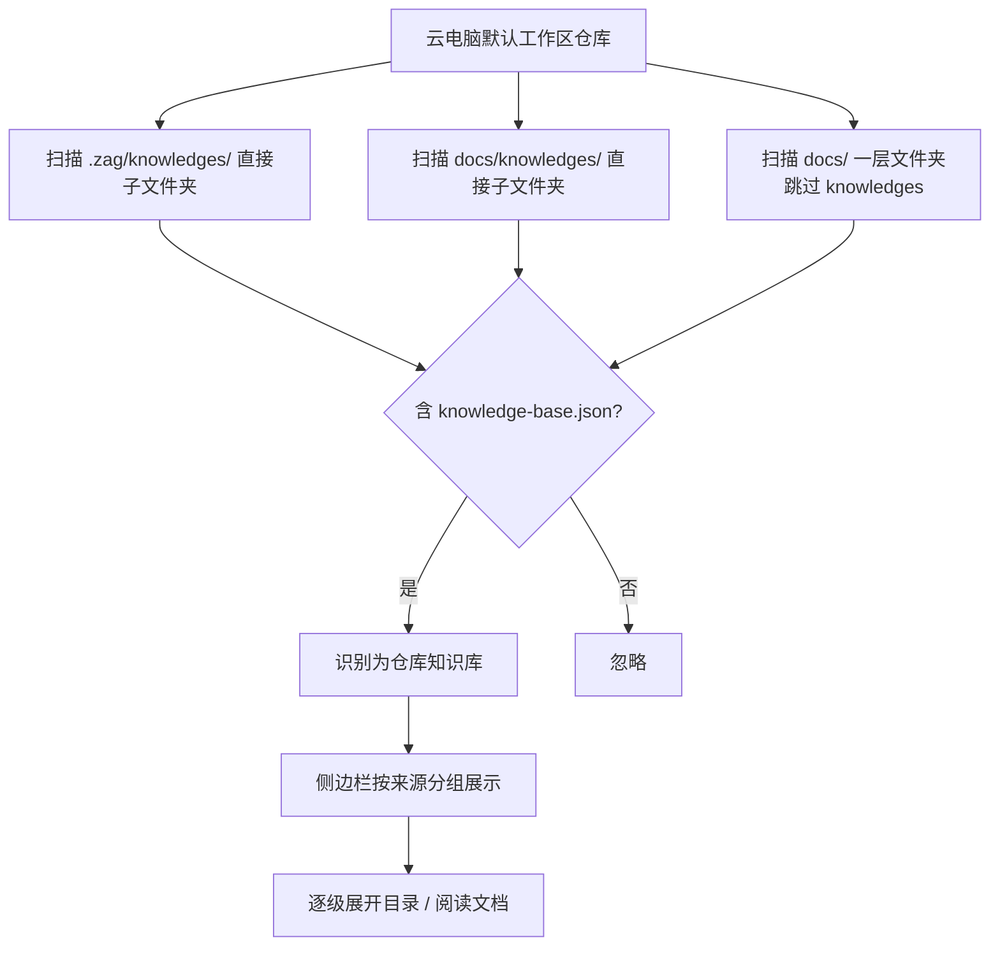

# 仓库知识库搜索路径扩展（docs 一层文件夹）

**功能名称**: 仓库知识库搜索路径扩展（docs 一层文件夹）
**PRD 版本**: v1.0
**创建日期**: 2026-11-21
**作者**: z-agent-bot

## 背景与目标

### 1.1 背景

仓库知识库能力已上线（见 [[20261116-knowledge-base-repo-built-in.md]]、[[20261117-knowledge-base-optimization-phase2.md]]）：项目把知识库以「文件夹 + `knowledge-base.json` + Markdown 文档」的形式放在 `.zag/knowledges/` 或 `docs/knowledges/` 两个约定目录中，平台从云电脑的默认工作区只读加载并在侧边栏展示。

实际项目中，大量文档已经按 `docs/<主题>/` 的方式组织（例如 `docs/guides/`、`docs/architecture/`），这些目录里往往已经有 `knowledge-base.json` 标识文件，但因为不在两个约定目录内，平台无法识别，用户需要把内容复制或移动到 `docs/knowledges/` 下，破坏了仓库原有的文档结构。

需求来源：[GitHub Issue Deliay/z-agent-gear#572](https://github.com/Deliay/z-agent-gear/issues/572)。

### 1.2 目标

- 仓库 `docs/` 下的**一层文件夹**（`docs/<文件夹>/`）只要包含 `knowledge-base.json`，即被识别为一个仓库知识库。
- 已有的 `.zag/knowledges/` 与 `docs/knowledges/` 两个约定目录继续按原规则工作，行为零回归。
- 新来源在侧边栏中与现有来源可区分展示，不与其他来源的知识库混淆。
- 面向 AI 的仓库知识库编写指引同步说明新的放置位置。

### 1.3 成功标准

- 在仓库 `docs/guides/` 放置 `knowledge-base.json` 与 Markdown 文档后，云电脑存活时侧边栏「仓库知识库」分组中出现该知识库，可逐级展开并阅读文档。
- 同一仓库同时存在 `.zag/knowledges/<库>`、`docs/knowledges/<库>` 与 `docs/<库>` 三种形态时，三者都被识别且互不覆盖；来源标识清晰可辨。
- `docs/knowledges/` 容器目录本身不会被误识别为一个知识库。
- `docs/` 下更深层级（如 `docs/a/b/knowledge-base.json`）不触发识别，保持「发现不递归」。
- 既有两个约定目录的来源标识、加载上限、只读语义与 MCP 工具行为零回归。

## 用户分析

### 2.1 目标用户

- **项目维护者**：维护仓库文档结构，希望已有 `docs/<主题>/` 目录直接作为知识库被平台识别，无需搬迁内容。
- **云电脑使用者**：在工作过程中从侧边栏查阅项目知识，期望项目原有文档结构即可被发现。
- **团队协作者**：共享同一套仓库知识，来源标识帮助区分知识库的放置位置。

### 2.2 用户场景

| 场景 | 用户角色 | 目标 | 痛点 |
|--|--|--|--|
| 直接复用现有文档目录 | 项目维护者 | `docs/guides/` 直接成为知识库 | 必须把内容移动到 `docs/knowledges/`，破坏原有结构 |
| 多来源并存 | 项目维护者 | `.zag/knowledges/`、`docs/knowledges/` 与 `docs/<主题>/` 同时生效 | 只支持两个固定目录，无法覆盖已有文档 |
| 来源辨识 | 云电脑使用者 | 知道某个知识库放在仓库哪个位置 | 新增来源后无法区分展示 |
| AI 编写知识库 | AI 会话 | 按指引把知识库放到正确位置 | 指引只提到两个旧目录 |

## 功能需求

### 3.1 功能概述

在 `.zag/knowledges/` 与 `docs/knowledges/` 之外，增加第三个仓库知识库来源：仓库 `docs/` 目录下的**一层文件夹**。只要 `docs/<文件夹>/knowledge-base.json` 存在，该文件夹即是一个仓库知识库；`docs/knowledges/` 作为既有容器目录被跳过；不向更深层级递归发现。

### 3.2 功能列表

#### 功能点 1: `docs/` 一层文件夹识别

- **描述**: 扫描仓库 `docs/` 的直接子文件夹（不含 `knowledges`），其内存在常规文件 `knowledge-base.json` 时识别为知识库。库内文档仍按递归收集 `.md` 处理，路径规则与既有来源一致。
- **用户价值**: 复用仓库既有 `docs/<主题>/` 目录结构，无需搬迁文档。
- **验收标准**:
  - [ ] `docs/guides/knowledge-base.json` + `docs/guides/a.md` 被识别为一个知识库，文档路径为 `/a`。
  - [ ] `docs/knowledges/` 容器目录即使直接包含 `knowledge-base.json` 也不被识别为「docs 一层」知识库。
  - [ ] `docs/a/b/knowledge-base.json` 不被识别（发现不递归）。
  - [ ] 没有 `knowledge-base.json` 的 `docs/<文件夹>` 不产生知识库条目。

#### 功能点 2: 独立来源展示

- **描述**: 新增来源在侧边栏中作为独立来源标识展示，与 `.zag/knowledges`、`docs/knowledges` 两个来源并列；列表顺序保持既有来源在前、新来源在后。
- **用户价值**: 用户能区分知识库来自仓库哪个位置。
- **验收标准**:
  - [ ] 三个来源各有独立标识（含悬停说明来源目录）。
  - [ ] 同一仓库的三种来源知识库同时展示、互不覆盖。
  - [ ] 知识库 ID、逐级展开与文档预览行为与既有来源一致。

#### 功能点 3: 编写指引同步

- **描述**: 知识库 MCP 的「仓库知识库编写指引」提示词补充新放置位置、目录结构示例与跳过规则，并保留既有上限口径。
- **用户价值**: AI 按最新放置约定编写知识库，避免继续引导用户使用旧目录。
- **验收标准**:
  - [ ] 指引说明 `docs/<文件夹>/knowledge-base.json` 的识别规则。
  - [ ] 指引说明跳过 `docs/knowledges` 容器与不递归发现。
  - [ ] 指引中的上限（单文件 1MB、单文件夹 1000 子项、无总量上限）与实现一致。

### 3.3 用户操作流程

### 3.4 页面/界面描述

| 页面 | 描述 | 关键元素 |
|------|------|---------|
| 侧边栏「知识库」分区 | 仓库知识库按来源展示，默认全部折叠，展开云电脑后才加载 | 云电脑条目、来源标识、知识库条目、文档数、已截断徽标 |
| 文档只读预览 | 展示 Markdown 文档，front matter 渲染为键值表格 | 标题、front matter 表格、正文 |

### 3.5 异常与边界情况

| 情况 | 预期行为 |
|------|---------|
| `docs/` 目录不存在 | 该来源为空列表，不影响其他来源与整体成功 |
| `docs/knowledges/` 直接含 `knowledge-base.json` | 不识别为「docs 一层」知识库；其子文件夹仍按既有 `docs/knowledges` 来源识别 |
| `docs/<文件夹>/knowledge-base.json` 为目录或符号链接指向目录 | 不识别 |
| `docs/<文件夹>/knowledge-base.json` 超过 1MB | 该知识库标示「文件过大」，不加载文档 |
| `docs/<文件夹>` 内文档超过 1MB | 该文档标示「文件过大」，同库其他文档正常 |
| `docs/` 直接子项超过 1000 | 按名称排序取前 1000，来源标示「已截断」 |
| 同一名称文件夹同时出现在 `docs/knowledges/` 与 `docs/` | 两个知识库独立展示，互不覆盖 |

## 四、非功能需求

### 4.1 性能要求

- 新增来源的扫描与既有来源同批完成，不额外增加扫描轮次；单文件夹 1000 子项上限沿用既有口径。

### 4.2 安全性要求

- 仍为只读扫描，仅读取仓库约定范围内文件，不写、不执行、不进入知识库 MCP 工具。

### 4.3 兼容性要求

- 旧版工作组件不认识新来源时，既有两个来源行为零回归；新版组件接入旧版服务端时，新来源被忽略，不影响其他来源。

## 五、依赖与约束

### 5.1 依赖

- 既有仓库知识库扫描、中继与展示链路。

### 5.2 约束

- 知识库发现仍不递归；仅新增 `docs/` 的一层文件夹。
- `docs/knowledges/` 容器目录不参与新来源识别。
- 来源在内部以独立标识表达，保证知识库 ID 不冲突。
- 仓库知识库仍只读展示，不进入知识库 MCP 六工具。

## 六、相关文档

- [[20261116-knowledge-base-repo-built-in.md]]
- [[20261117-knowledge-base-optimization-phase2.md]]
- [[../../engineering/proposals/20261121-feat-knowledge-base-docs-root.md]]
- [[../../engineering/plan/20261121-feat-knowledge-base-docs-root.md]]
