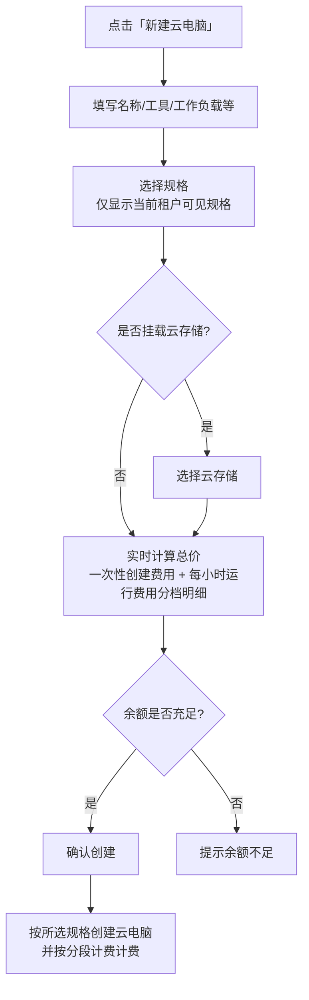
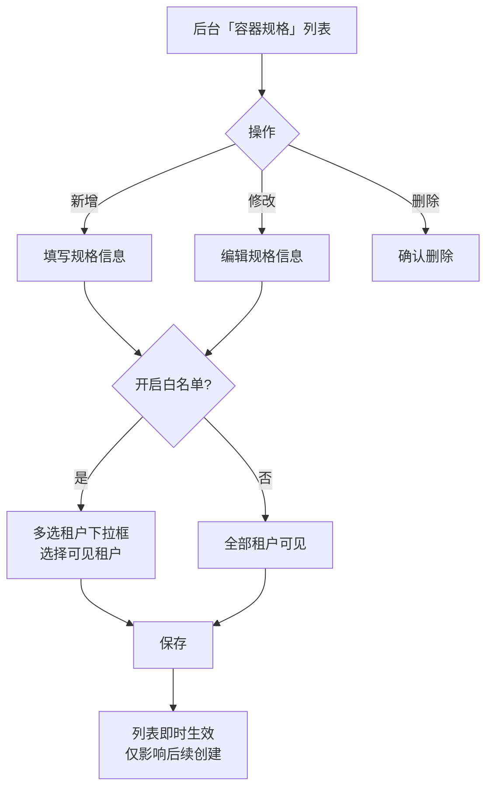

# 容器规格管理与云电脑分段计费

**功能名称**: 容器规格管理与云电脑分段计费
**PRD 版本**: v1.0
**创建日期**: 2026-11-24
**作者**: z-agent-bot

## 背景与目标

### 1.1 背景

目前云电脑的容器资源是平台统一固定的一套配置：无论用户想运行多轻量或多重量的任务，拿到的 CPU、内存与临时存储上限完全相同，费用也只有一种与资源无关的固定计费口径。这带来三个问题：

1. **用户无法按需选择算力**：轻量任务用不到高配，重载任务又受限于固定上限，资源与需求错配；
2. **费用与资源不对齐**：用多少算力付多少钱是最自然的预期，固定计费无法体现差异，也无法支撑更丰富的规格档位；
3. **平台无法运营规格**：规格一旦调整即全局生效，无法灰度、无法按租户开放高配或特殊规格（例如不限制资源的规格只应开放给特定租户）。

来源：GitHub Issue [Deliay/z-agent-gear#574](https://github.com/Deliay/z-agent-gear/issues/574)。

### 1.2 目标

- 后台提供**容器规格（Spec）列表与管理**能力：可新增、修改、删除规格；规格可配置**租户白名单**，控制哪些租户能看到该规格。
- 平台内置 **6 款预制规格**，开箱可用；其中「0C 0G」规格展示为「不限制容器，随时可能会被系统销毁」，默认开启白名单（即默认没有任何租户可见，需管理员显式开放）。
- **创建云电脑时展示可用规格列表**，用户选定规格后**实时计算总价**，确认花费后再创建。
- 新版本云电脑采用**分段计费**（按 CPU、内存、临时存储分档累计），费用与所选规格精确对应；**旧版本云电脑计费保持不变**。

### 1.3 成功标准

- 后台可对规格完成增删改查；新建/编辑规格时可开启白名单并多选租户，仅所选租户可见该规格；开启白名单但未选任何租户时，任何租户都看不到该规格。
- 预制规格就位且与下表一致；「0C 0G」规格默认开启白名单（默认无租户可见），前台展示文案为「不限制容器，随时可能会被系统销毁」。
- 创建云电脑界面只展示当前租户可见的规格，选择规格后展示总价（一次性创建费用 + 按规格算出的每小时运行费用，如挂载云存储则一并计入）。
- 新版云电脑按分段计费出账正确：例如「8C 16G 20G」规格每小时费用 = CPU 180 + 内存 540 + 临时存储 100 = **820 credits/小时**（明细见 3.2 计费规则），账单明细可核对到分档。
- 旧版本云电脑（本功能上线前已存在）的账单与计费节奏与现状完全一致，零回归。
- 越权校验有效：修改白名单后，未授权租户在创建列表中立即看不到对应规格；直接指定不可见规格创建时被拒绝。

## 用户分析

### 2.1 目标用户

- **租户用户（开发者）**：创建云电脑、按任务负载选择算力档位、关注费用。
- **平台管理员（运营）**：维护规格目录、按租户开放规格、调整价格。

### 2.2 用户场景

| 场景 | 用户角色 | 目标 | 痛点 |
|--|--|--|--|
| 创建云电脑跑轻量任务 | 开发者 | 选一个够用的小规格，费用尽可能低 | 固定配置下无法选择，费用与用量脱节 |
| 创建云电脑跑重载构建/测试 | 开发者 | 选高配规格（如 8C 16G），避免资源不足 | 固定上限无法满足重载需求 |
| 试用/临时场景使用不限制规格 | 受限租户用户 | 使用「0C 0G」不限制规格并知悉其随时可能被销毁 | 不限制规格必须可控开放，不能全员可见 |
| 运营高配/特殊规格 | 平台管理员 | 新增规格、按租户开放、下线过时规格 | 无规格管理入口，调整即全局生效 |
| 创建前确认费用 | 开发者 | 选定规格即看到总价构成 | 费用不透明，创建后才知道花多少 |

## 功能需求

### 3.1 功能概述

平台引入「容器规格（Spec）」作为云电脑的算力档位目录：管理员在后台维护规格（含租户白名单），用户创建云电脑时从当前租户可见的规格中选择，系统实时计算总价；新版云电脑按所选规格的 CPU、内存、临时存储分段计费。

### 3.2 功能列表

#### 功能点 1: 后台容器规格列表与管理

- **描述**: 后台新增「容器规格」管理页，以列表展示全部规格（含预制与自定义），支持**新增、修改、删除**。规格字段：名称、CPU（核）、内存（GiB）、临时存储（GiB）、白名单设置。
  - **白名单**：编辑/新建规格时提供「开启白名单」勾选项；勾选后展示**多选租户下拉选择框**，仅所选租户能看到该规格；勾选但未选任何租户时，**没有任何租户能看到该规格**；未勾选白名单时全部租户可见。
  - **0C 0G 规格默认开启白名单**：新建「0C 0G（不限制）」规格时白名单默认勾选；预制的 0C 0G 规格默认开启白名单且不选任何租户（即默认无租户可见）。
  - 普通规格的取值范围：CPU 1~64 核、内存 1~256 GiB、临时存储 1~512 GiB（均为整数）；「不限制」规格为 CPU/内存/临时存储全为 0 的唯一组合，其余含 0 的组合非法。
  - 规格可被修改；修改与白名单调整**只影响后续创建**，已创建云电脑不受影响。
- **用户价值**: 平台可运营规格目录，按租户灰度开放高配/特殊规格。
- **验收标准**:
  - [ ] 列表展示全部规格的名称、CPU、内存、临时存储、白名单状态与可见租户数，预制规格带「预制」标识。
  - [ ] 新增/编辑/删除可用；名称唯一；非法数值组合被拒绝并提示。
  - [ ] 勾选白名单后出现多选租户下拉框；仅所选租户可见；开启白名单未选租户时无任何租户可见；未开启白名单时全部租户可见。
  - [ ] 0C 0G 规格新建时白名单默认勾选；预制 0C 0G 规格默认无租户可见。
  - [ ] 删除规格后创建列表不再出现，已创建云电脑不受影响。

#### 功能点 2: 预制规格

- **描述**: 平台内置以下 6 款预制规格，随功能上线自动就位（已被管理员修改或删除的预制规格不被覆盖、不被重建）：

  | 名称（示例） | CPU | 内存 | 临时存储 | 说明 |
  |--|--|--|--|--|
  | 8C 16G 20G | 8 核 | 16 GiB | 20 GiB | 重载 |
  | 8C 8G 20G | 8 核 | 8 GiB | 20 GiB | 重载 |
  | 4C 8G 20G | 4 核 | 8 GiB | 20 GiB | 中配 |
  | 2C 4G 10G | 2 核 | 4 GiB | 10 GiB | 轻量 |
  | 1C 2G 5G | 1 核 | 2 GiB | 5 GiB | 入门 |
  | 0C 0G 0G | 不限制 | 不限制 | 不限制 | 前台展示为「**不限制容器，随时可能会被系统销毁**」；默认开启白名单、默认无租户可见 |

- **用户价值**: 开箱即用的规格档位，无需运营配置。
- **验收标准**:
  - [ ] 功能上线后 6 款预制规格出现在规格列表并带「预制」标识。
  - [ ] 「0C 0G」规格在前台创建界面展示为「不限制容器，随时可能会被系统销毁」，且默认无租户可见。
  - [ ] 管理员修改/删除预制规格后，系统不覆盖修改、不重建删除。

#### 功能点 3: 创建云电脑选择规格与总价计算

- **描述**: 创建云电脑时新增「规格」选择区，展示当前租户可见的规格列表（按算力从高到低排列），每档展示资源明细；用户选定规格后实时计算并展示**总价**：
  - **一次性创建费用**（维持现状口径）；
  - **运行费用**：按所选规格分段计费规则算出的**每小时费用**，并给出 CPU/内存/临时存储分档明细；
  - 如挂载云存储，存储费用一并计入并单独列示。
  - 「0C 0G（不限制）」规格每小时费用为 0，并展示「不限制容器，随时可能会被系统销毁」提示。
- **用户价值**: 创建前费用完全透明，按需选档。
- **验收标准**:
  - [ ] 规格列表只包含当前租户可见的规格；无可用规格时明确提示且不允许创建。
  - [ ] 切换规格即刷新每小时费用与分档明细，总价计算正确（与 3.2 计费规则一致）。
  - [ ] 创建时服务端校验所选规格对当前租户可见，不可见/不存在的规格被拒绝。

#### 功能点 4: 新版云电脑分段计费

- **描述**: 新版本云电脑（本功能上线后创建、选定规格的云电脑）运行费用按所选规格的资源量**分段计费**，各资源独立分档、超额累进：

  **CPU**（credits/核/小时）：

  | 分段 | 单价 |
  |--|--|
  | 小于等于 4 CPU 部分 | 15 |
  | 大于 4 CPU 部分 | 30 |

  **内存**（credits/GiB/小时）：

  | 分段 | 单价 |
  |--|--|
  | 小于等于 4 GiB 部分 | 15 |
  | 大于 4 GiB 且小于等于 8 GiB 部分 | 30 |
  | 大于 8 GiB 且小于等于 16 GiB 部分 | 45 |
  | 大于 16 GiB 部分 | 60 |

  **临时存储**（credits/GiB/小时）：

  | 分段 | 单价 |
  |--|--|
  | 小于等于 10 GiB 部分 | 不收费 |
  | 大于 10 GiB 部分 | 10 |

  - 计费示例（8C 16G 20G）：CPU = 4×15 + 4×30 = 180；内存 = 4×15 + 4×30 + 8×45 = 540；临时存储 = 10×10 = 100；合计 **820 credits/小时**。
  - 计费按小时结算，运行不足 1 小时的尾段按实际运行分钟折算；0 费用规格（0C 0G）不产生运行费用。
  - **旧版本云电脑（上线前已存在）计费方式不变**，仍按现行口径结算，不受本次重构影响。
- **用户价值**: 费用与算力精确对应，多用多付、少用少付。
- **验收标准**:
  - [ ] 新版云电脑按小时产生分档明细账单，金额与所选规格一致（含上表计费示例）。
  - [ ] 尾段不足 1 小时按分钟折算，不重复计费、不漏计。
  - [ ] 0C 0G 规格云电脑运行费用为 0。
  - [ ] 旧版本云电脑账单金额、节奏与现状一致。
  - [ ] 价格（各分段单价）可在后台价目中调整，调整只影响其生效后的计费。

### 3.3 用户操作流程

**创建云电脑（租户用户）**：

**管理规格（平台管理员）**：

### 3.4 页面/界面描述

| 页面 | 描述 | 关键元素 |
|------|------|---------|
| 后台 · 容器规格列表 | 规格目录管理 | 规格表格（名称/CPU/内存/临时存储/白名单状态/可见租户数/预制标识）、新增按钮、行内编辑/删除 |
| 后台 · 规格新建/编辑 | 规格信息表单 | 名称、CPU、内存、临时存储输入；「开启白名单」勾选；多选租户下拉选择框（勾选白名单后出现）；非法组合校验提示 |
| 前台 · 新建云电脑 | 创建对话框新增规格区 | 规格列表（资源明细、「预制」标识、「0C 0G」特殊文案「不限制容器，随时可能会被系统销毁」）、规格选择、总价区（一次性创建费用、每小时运行费用及 CPU/内存/临时存储分档明细、云存储费用） |

### 3.5 异常与边界情况

| 情况 | 预期行为 |
|------|---------|
| 当前租户无任何可见规格 | 创建对话框明确提示无可用规格，不允许创建；引导联系管理员 |
| 指定不可见/不存在的规格创建 | 拒绝创建并提示规格不可用 |
| 规格被删除 | 创建列表不再出现；已创建云电脑（含运行中）不受影响，仍按创建时规格计费展示 |
| 规格被修改（资源/白名单） | 只影响后续创建与可见性；已创建云电脑保持创建时的规格与计费 |
| 白名单开启但未选任何租户 | 任何租户都看不到该规格（仅后台可见） |
| 租户被移出白名单 | 该租户后续创建看不到此规格；已有云电脑不受影响 |
| 「0C 0G」规格 | 展示「不限制容器，随时可能会被系统销毁」；每小时费用为 0；默认开启白名单（默认无租户可见） |
| 余额不足 | 沿用现行欠费处置口径（宽限后强制销毁），不因计费重构变化 |
| 尾段不足 1 小时 | 按实际运行分钟折算收费 |
| 分段单价被后台调整 | 只影响调整生效之后的计费，已出账单不变 |

## 四、非功能需求

### 4.1 性能要求

- 创建对话框的规格列表与总价计算为即时交互（选择即刷新），不产生可感知延迟。
- 规格列表与租户下拉支持分页/搜索（租户数量增长后仍可用）。

### 4.2 安全性要求

- 白名单可见性判定以服务端为准：不可见规格在创建校验中被强制拒绝，前端隐藏不作为安全边界。
- 规格管理仅限平台管理员；前台租户用户不可见规格管理入口与未授权规格。

### 4.3 兼容性要求

- 旧版本云电脑计费完全不受影响（金额、节奏、账单口径零变化）。
- 创建云电脑的既有能力（名称、Harness、预装工作负载、云存储、Github 项目、默认会话）保持不变，规格为新增必选项。
- 计费账单中新增的分档明细不改变既有账单/流水/收据的查看方式。

## 五、依赖与约束

### 5.1 依赖

- **计费体系**：分段单价依赖平台价目管理能力（可后台调整）；欠费处置沿用现行机制。
- **租户体系**：白名单依赖现有租户（Tenant）目录。
- **云存储计费**：挂载存储的费用维持现行口径，与规格费用并列展示。

### 5.2 约束

- 创建云电脑必须选择一个规格，且该规格必须对当前租户可见。
- 「不限制」规格仅允许 CPU/内存/临时存储全为 0 这一种组合；其风险提示文案必须随展示出现。
- 计费重构不得改写旧版本云电脑的历史账单与进行中结算。
- 预制规格的落地不得覆盖管理员已做的修改、不重建管理员已删除的规格。

## 六、相关文档

- 需求来源：[GitHub Issue #574 增加新容器spec](https://github.com/Deliay/z-agent-gear/issues/574)
- 技术提案：[[../../engineering/proposals/20261124-feat-container-spec-tiered-billing.md]]
- 既有产品文档：[[draft/20261027-unlimited-cloud-hosts.md]]（云电脑创建收费口径）、[[draft/20261102-cloud-storage.md]]（云存储计费口径）
