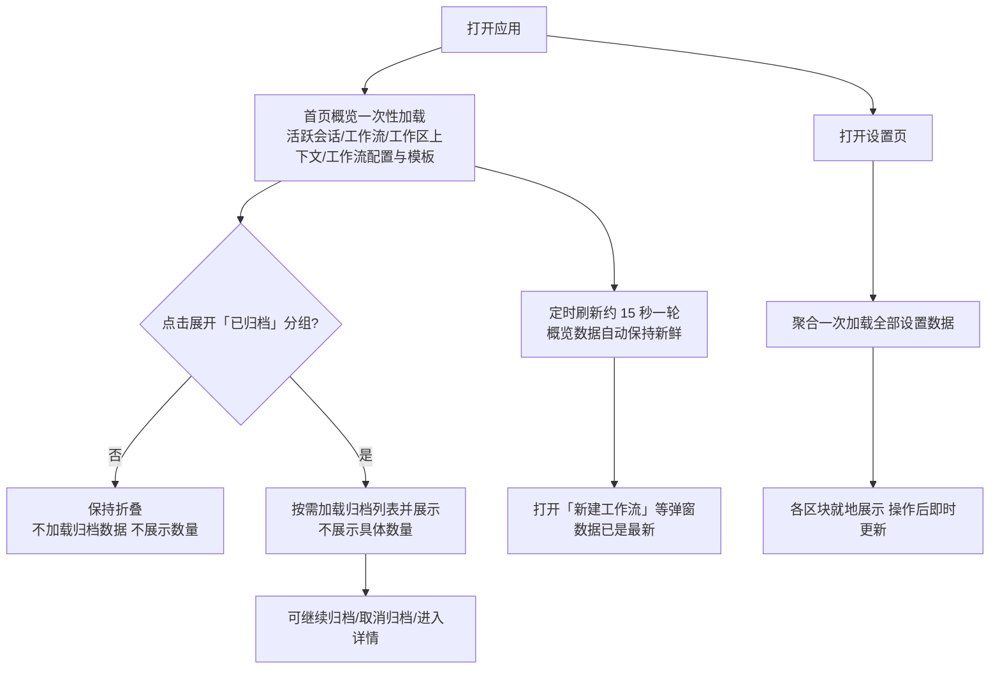

# 接口性能优化

**功能名称**: 接口性能优化
**PRD 版本**: v1.0
**创建日期**: 2026-11-26
**作者**: z-agent-bot

## 背景与目标

### 1.1 背景

随着用户积累的会话、工作流与归档记录增多，以及设置页功能区块不断扩充，当前产品在打开应用与定时刷新时会一次性加载大量「暂不可见」的数据，产生四类问题：

1. **归档数据被提前加载**：已归档会话与已归档工作流的完整列表在打开应用时就被加载，但它们默认折叠在侧边栏「已归档」分组中，用户极少展开查看；数据越多，打开越慢。
2. **常用数据分散加载**：工作流配置、工作流模板、工作区上下文（工作区切换器等）各自独立加载、各自刷新，同屏数据来源不统一，重复请求多、新鲜度参差。
3. **失效条目干扰选择**：项目工作区列表中仍展示已删除控制器或已离线控制器下的条目，这些条目当前不可用，混在列表中既拖慢加载又干扰用户选择。
4. **设置页逐区块加载**：打开设置页时每个区块各自发起数据加载，一次打开产生十余次请求，首屏等待时间长。

来源：GitHub Issue [Deliay/z-agent-gear#584](https://github.com/Deliay/z-agent-gear/issues/584)。

### 1.2 目标

- 归档会话与归档工作流列表**按需加载**：仅在用户点击展开「已归档」分组时才获取，并**取消归档数量展示**。
- 工作流配置、工作流模板、工作区上下文**并入首页概览统一数据**，随既定节奏**定时刷新**，页面始终展示较新数据。
- 项目工作区列表**不再返回已删除或已离线控制器下的条目**。
- 设置页数据**聚合加载**，把逐区块的多次请求收敛为一次聚合获取，**显著减少请求数量**。

### 1.3 成功标准

- 打开应用时**不再加载**归档会话、归档工作流列表；仅在点击展开「已归档」分组时加载；「已归档」分组标题及展开后的列表**均不再展示具体数量**。
- 工作流配置、工作流模板、工作区上下文随首页概览**定时刷新**（沿用现有刷新节奏，约 15 秒一轮），任一入口看到的数据滞后不超过一个刷新周期；打开「新建工作流」等弹窗时数据已是最新。
- 项目工作区列表（设置中的工作区管理、新建工作流等处）**不再出现**已删除或已离线控制器下的条目；控制器恢复在线后对应条目**自动重新可见**（数据不丢失）。
- 打开设置页的数据加载次数较现状**显著减少**：由逐区块十余次请求收敛为一次聚合加载加少量按需加载（目标为个位数）；功能与展示内容零缺失。

## 用户分析

### 2.1 目标用户

- **平台用户（开发者）**：日常使用会话、工作流、多控制器与多项目工作区，关注打开速度与列表干净度。
- **平台管理员**：维护设置项（供应商、模型、控制器、MCP 等），频繁进出设置页。

### 2.2 用户场景

| 场景 | 用户角色 | 目标 | 痛点 |
|--|--|--|--|
| 打开应用查看今日会话与工作流 | 平台用户 | 首屏尽快可交互 | 归档数据量大时首屏加载慢，但归档区默认折叠根本用不到 |
| 偶尔回看归档记录 | 平台用户 | 需要时能立刻看到归档列表 | 归档列表被提前加载反而拖慢常驻页面；数量角标无实际用途 |
| 在「新建工作流」中选模板/配置 | 平台用户 | 列表是最新且可直接使用 | 数据分散加载、刷新不及时，弹窗里还要再等一轮加载 |
| 在工作区列表中选择目标项目 | 平台用户 | 只看到当前可用的项目工作区 | 已删除/离线控制器的条目混在列表中，无法直接判断是否可用 |
| 进入设置页修改供应商/模型/MCP | 平台管理员 | 设置页秒开 | 每个区块各自请求，十余次请求串行等待 |

## 功能需求

### 3.1 功能概述

在**不改变任何功能语义**的前提下优化数据加载方式：不可见的数据按需加载、常用数据统一承载定时刷新、失效条目不再展示、设置页聚合加载，全面提升打开应用、侧边栏交互与设置页的响应速度。

### 3.2 功能列表

#### 功能点 1: 归档列表按需加载并取消数量展示

- **描述**: 侧边栏「会话」「工作流」分区中的「已归档」分组默认折叠且**常驻显示**（不再隐藏）；归档会话与归档工作流列表**只在点击展开时**才加载，展开后就地展示列表；「已归档」分组标题**不展示数量**，展开后的列表**也不展示具体数量**（去掉「已归档（N）」样式，仅显示「已归档」）。
- **用户价值**: 打开应用不再为看不见的归档数据买单，首屏更快；展示更干净。
- **验收标准**:
  - [ ] 打开应用时不加载归档会话、归档工作流列表（仅加载活跃数据）。
  - [ ] 点击「已归档」展开时加载并展示对应归档列表；再次折叠后重新展开保持已加载内容或按需刷新。
  - [ ] 「已归档」分组标题与展开后的列表均不展示数量。
  - [ ] 归档列表为空时展示空态文案（如「暂无归档」），分组仍可展开。
  - [ ] 归档/取消归档操作行为不变，展开列表内容与现状一致。

#### 功能点 2: 首页概览并入工作流配置、工作流模板与工作区上下文并定时刷新

- **描述**: 工作流配置列表、工作流模板列表、工作区上下文（工作区切换器所属的租户/工作区信息）并入**首页概览统一数据**，随统一的定时刷新（约 15 秒一轮）自动更新；工作流相关弹窗（如「新建工作流」）与设置中的工作流区块直接使用这份数据，打开时即为最新。
- **用户价值**: 同屏数据来源统一、自动保持新鲜，减少重复加载与「打开后还要再等一轮」的体验。
- **验收标准**:
  - [ ] 工作流配置、工作流模板、工作区上下文随首页概览定时刷新，滞后不超过一个刷新周期。
  - [ ] 「新建工作流」弹窗、设置-工作流区块、工作区切换器展示的数据与首页概览一致且为最新。
  - [ ] 工作区上下文（切换器、只读标识等）行为与现状一致，仅数据来源统一。

#### 功能点 3: 项目工作区不再展示已删除或已离线控制器的条目

- **描述**: 所有展示项目工作区列表的位置（设置-工作区管理、「新建工作流」选择等），**不再返回/展示**已删除控制器或当前已离线（不可用）控制器下的项目工作区条目；控制器恢复在线后条目自动重新出现，数据不受影响。
- **用户价值**: 列表只包含当前可用条目，选择不踩坑。
- **验收标准**:
  - [ ] 已删除控制器的项目工作区不再出现在任何工作区列表中。
  - [ ] 已离线（当前不可用）控制器的项目工作区不再出现在任何工作区列表中。
  - [ ] 控制器恢复在线后条目重新可见，内容与之前一致。
  - [ ] 在线控制器的项目工作区展示零变化。

#### 功能点 4: 设置页数据聚合加载

- **描述**: 打开设置页时，各区块（账号安全、GitHub、Git、供应商、模型、控制器、MCP、Valut、自定义 MCP、自定义工具、云存储等）的只读数据**聚合为一次加载**统一下发；共享数据（如控制器、供应商）只加载一次；去掉设置页内多余的重复加载与常驻定时刷新（控制器在线状态由首页概览统一刷新覆盖）。
- **用户价值**: 设置页显著提速，等待时间大幅下降。
- **验收标准**:
  - [ ] 打开设置页的加载请求数较现状显著减少（十余次 → 个位数），功能区块内容零缺失。
  - [ ] 同一数据（控制器、供应商等）不被多个区块重复请求。
  - [ ] 设置页不再有自己独立的常驻定时刷新；控制器在线状态展示与首页概览一致。
  - [ ] 各区块的新增/编辑/删除操作后列表即时更新，行为与现状一致。

### 3.3 用户操作流程

### 3.4 页面/界面描述

| 页面 | 描述 | 关键元素 |
|------|------|---------|
| 侧边栏（会话分区） | 活跃会话列表 + 常驻「已归档」折叠分组 | 「已归档」标题（无数量）、展开箭头、展开后的归档会话列表/空态 |
| 侧边栏（工作流分区） | 活跃工作流列表 + 常驻「已归档」折叠分组 | 「已归档」标题（无数量）、展开箭头、展开后的归档工作流列表/空态 |
| 首页 | 概览数据定时刷新 | 会话、工作流、工作区上下文、工作流配置与模板随统一节奏刷新 |
| 「新建工作流」弹窗 | 展示模板与工作流配置来源 | 列表数据来自首页概览，打开即最新 |
| 设置页 | 各区块聚合加载 | 账号/GitHub/Git/供应商/模型/控制器/MCP/Valut/自定义 MCP/自定义工具/云存储等区块；共享数据单次加载 |
| 项目工作区列表（设置-工作区、「新建工作流」选择等） | 仅展示可用控制器下的条目 | 不含已删除/已离线控制器条目 |

### 3.5 异常与边界情况

| 情况 | 预期行为 |
|------|---------|
| 归档列表加载中 | 展开区域展示加载态，不阻塞其他分区 |
| 归档列表加载失败 | 就地展示错误提示并提供重试，不影响其他数据 |
| 无归档条目 | 「已归档」分组仍可展开，展示空态文案（如「暂无归档」） |
| 归档数量很多 | 列表正常滚动展示，不展示总数；加载耗时不阻塞应用其他部分 |
| 控制器由离线恢复在线 | 对应项目工作区条目在一个刷新周期内自动重新出现 |
| 控制器被删除/离线时其工作区正在被使用 | 列表不展示该条目；不影响已打开的详情页等既有只读行为 |
| 设置页某一类数据获取失败 | 仅对应区块展示错误/空态，其他区块正常（局部失败不拖垮整页） |
| 旧数据 | 归档记录、工作区记录均不做数据迁移，历史数据行为一致 |

## 四、非功能需求

### 4.1 性能要求

- 打开应用的首屏数据量显著下降（不再包含全部归档会话与归档工作流列表）。
- 定时刷新每轮的请求与数据量较现状减少（归档清单退出轮询；工作区上下文并入统一刷新）。
- 展开「已归档」分组在单次加载内完成，就地渲染。
- 打开设置页的加载请求数由十余次收敛为个位数（一次聚合 + 少量按需）。

### 4.2 安全性要求

- 数据可见范围不变：聚合加载仅合并请求，不放宽任何用户/租户/工作区权限过滤，不暴露越权数据。

### 4.3 兼容性要求

- 功能语义零变化：归档/取消归档、工作流配置与模板管理、设置各区块的增删改行为均与现状一致。
- 归档数量展示取消后不提供替代计数入口。
- 前后端同版本发布；旧数据无需迁移，回滚不丢数据。

## 五、依赖与约束

### 5.1 依赖

- 首页概览统一刷新机制（定时刷新节奏沿用现状）。
- 控制器在线状态的判定口径（已删除/已离线均视为不可用）。

### 5.2 约束

- 不改变归档数据本身及其生命周期；仅改变获取时机与展示。
- 不减少设置页任何功能区块与字段展示。
- 「已删除或已离线不返回」为展示/查询口径，底层数据保留，可随控制器恢复而重新可见。

## 六、相关文档

- [Deliay/z-agent-gear#584 接口性能优化](https://github.com/Deliay/z-agent-gear/issues/584)
- 技术提案：`docs/engineering/proposals/20261126-feat-api-performance-optimization.md`
- 领域模型：`docs/knowledges/domain/`（30-控制器、50-会话与交互、60-工作流同步更新）
