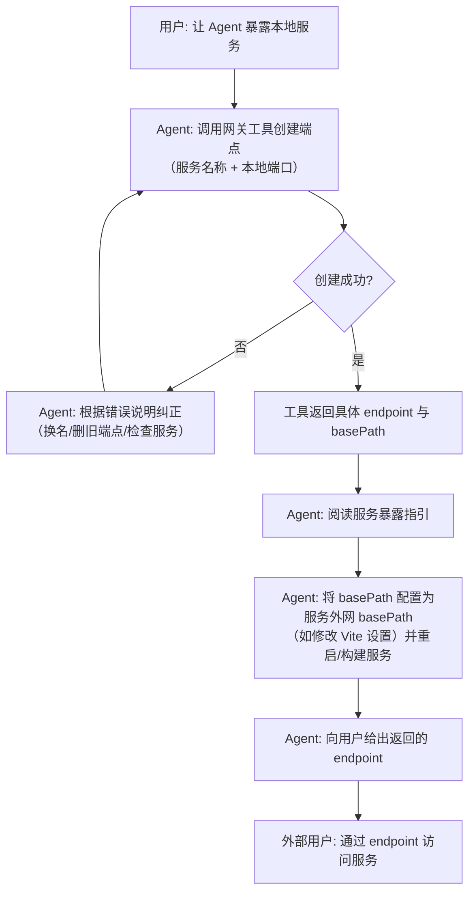

# 网关功能更新

**功能名称**: 网关端点返回与服务暴露指引
**PRD 版本**: v1.0
**创建日期**: 2026-11-26
**作者**: ZeroAsh

## 背景与目标

### 1.1 背景

统一网关（Gateway）已支持把 Controller 所在服务器上的本地服务（Web 应用、API 服务等）暴露为带鉴权的公网可访问地址，但当前能力只服务「人」：用户在界面上创建端点、复制地址。当 **Agent（AI 助手）在会话中替用户开发服务** 时，暴露链路无法闭环：

1. **Agent 无法自己暴露服务**：会话中的 Agent 没有可用的网关工具，无法创建/管理服务端点，只能建议用户去界面手工操作；
2. **拿不到可直接使用的地址**：即使端点创建成功，Agent 也拿不到具体的对外访问地址，容易向用户给出凭空拼接的错误地址（如 `localhost`），外部根本无法访问；
3. **不知道如何把服务「接」到地址上**：Agent 不了解应把对外地址作为服务的外网访问基础路径（basePath）配置进服务本身（例如前端开发服务器的 `base` 设置），导致通过地址访问时页面资源加载失败、路由错乱。

来源：GitHub Issue [Deliay/z-agent-gear#565](https://github.com/Deliay/z-agent-gear/issues/565)。

### 1.2 目标

1. **Agent 可自助暴露服务**：Agent 在会话中即可通过网关工具创建服务端点，并在创建成功后**立即获得具体的对外访问地址**（含完整地址与访问基础路径）。
2. **提供「服务暴露指引」**：平台向 Agent 提供暴露指引提示词，引导 Agent 将返回的地址作为外网 basePath 配置到服务中（例如修改 Vite 设置），使外部用户通过该地址即可正常访问服务。
3. **地址口径唯一**：界面展示的访问地址与 Agent 工具返回的地址始终一致，任何一方都不再自行拼接地址。

### 1.3 成功标准

- Agent 在会话中调用网关工具创建端点成功后，工具结果中包含**具体的对外访问地址**（完整可访问 URL 与 basePath），Agent 无需自行拼接任何地址。
- Agent 阅读暴露指引后，能把返回地址正确配置为服务的外网 basePath（例如 Vite `base`），外部用户通过返回地址访问服务时页面与静态资源加载正常。
- 界面「网关」面板展示的访问地址与 Agent 工具返回的地址**逐字一致**，不存在两处不一致的地址。
- 暴露指引明确告知 Agent 访问前提与限制（需登录访问、长连接/HMR 不可用等），Agent 不再向用户承诺无法兑现的访问方式。
- 既有网关能力零回归：界面创建/删除端点、代理访问、鉴权与超时行为与现状一致。

## 用户分析

### 2.1 目标用户

在云电脑/本地开发环境中使用 Agent 开发 Web 应用、API 服务，并希望把开发中的服务临时分享给他人访问的开发者；以及通过工作流/自动化任务需要对外暴露服务的场景。

### 2.2 用户场景

| 场景 | 用户角色 | 目标 | 痛点 |
|--|--|--|--|
| 让 Agent 暴露正在开发的前端应用 | 开发者 | 一句话让 Agent 把开发服务器暴露出去，拿到可分享的地址 | Agent 无法创建端点，用户被迫手工操作；地址易拼错 |
| 让 Agent 配置服务以适配对外访问 | 开发者 | 通过地址访问时页面资源正常加载 | Agent 不知道要把地址配置为服务 basePath，访问出现资源 404/路由错乱 |
| 分享开发中的 API 服务给他人调试 | 开发者 | 快速获得带鉴权的对外地址 | 不确定地址是否真实可用，分享后对方打不开 |
| 自动化任务对外暴露产物服务 | 自动化任务执行者 | 任务内自助完成暴露并输出地址 | 链路缺失只能输出 localhost 地址，外部不可用 |

## 功能需求

### 3.1 功能概述

为 Agent 提供网关工具：在会话中即可创建、查看、删除服务端点；创建成功后立即返回具体的对外访问地址与访问基础路径；并随工具提供「服务暴露指引」提示词，引导 Agent 以该地址为外网 basePath 完成服务配置（如修改 Vite 设置），实现「Agent 自助暴露服务 → 拿到地址 → 按指引配置服务 → 外部可访问」的完整闭环。

### 3.2 功能列表

#### 功能点 1: 网关工具创建端点并返回具体 endpoint

- **描述**: Agent 可通过网关工具在会话所属的 Controller 上创建服务端点（指定服务名称与本地端口），也可查看、删除已有端点。**创建成功后，结果中必须返回具体的对外访问信息**：完整可访问地址（endpoint）与访问基础路径（basePath，即地址的路径部分），Agent 直接使用返回值即可，无需、也不应自行拼接地址。
- **用户价值**: Agent 自助完成服务暴露闭环，不再打断用户去界面手工操作；返回真实可用地址，杜绝 `localhost` 幻觉地址。
- **验收标准**:
  - [ ] Agent 可在会话中通过网关工具创建端点，指定名称与本地端口；创建成功后返回值包含完整的对外访问地址与 basePath。
  - [ ] 返回的地址与界面「网关」面板展示的访问地址逐字一致。
  - [ ] Agent 可通过工具查看当前已暴露的端点列表（含各自地址）与删除端点。
  - [ ] 名称不合规、重名、超出端点数量上限、Controller 不在线等异常场景返回可读的错误说明，指导 Agent 纠正。

#### 功能点 2: 服务暴露指引提示词

- **描述**: 平台提供「服务暴露指引」提示词，随网关工具提供给 Agent。指引引导 Agent 将创建端点返回的地址**作为外网 basePath 配置到服务本身**（例如修改 Vite 配置），并说明访问前提与限制：访问需登录、不支持长连接/热更新（HMR）直连、单次请求有超时、端点命名与数量规则、禁止向用户提供自行拼接的地址等。
- **用户价值**: Agent 按指引即可一次性把服务正确「接」到对外地址上，外部访问页面与静态资源正常；避免 Agent 给出不可用的访问方式（如依赖热更新长连接）。
- **验收标准**:
  - [ ] Agent 可获取到服务暴露指引，指引内容覆盖「以返回地址为外网 basePath 配置服务」的核心用法与常见框架示例（如 Vite 设置）。
  - [ ] 指引明确列出访问前提（需登录访问）与限制（长连接/HMR 不可用、请求超时、命名与数量规则）。
  - [ ] 按指引配置后的服务（如 Vite 应用）通过返回地址访问时页面与静态资源加载正常。
  - [ ] 指引明确要求使用工具返回的地址，禁止向用户展示自行拼接的地址。

#### 功能点 3: 地址口径唯一

- **描述**: 对外访问地址由服务端统一计算，界面展示与工具返回使用同一来源，任何一侧都不自行拼接地址。
- **用户价值**: 用户在界面上复制的地址与 Agent 给出的地址始终一致，任一渠道分享都真实可用。
- **验收标准**:
  - [ ] 界面「网关」面板展示地址与工具返回地址逐字一致。
  - [ ] 部署环境的对外访问域名变化时，两处地址同步变化，无需前端改动。

### 3.3 用户操作流程

### 3.4 页面/界面描述

| 页面 | 描述 | 关键元素 |
|------|------|---------|
| 网关面板（既有） | Controller 的端点列表 | 端点名称、本地端口、状态、访问地址（与工具返回一致）、复制地址、删除 |

本期不新增界面入口；网关面板仅要求展示地址与工具返回地址一致（功能点 3）。

### 3.5 异常与边界情况

| 情况 | 预期行为 |
|------|---------|
| 端点名称不合规（含特殊字符）或超出长度 | 返回可读的命名规则说明，Agent 更名后重试 |
| 端点名称已存在 | 返回重名提示，Agent 换名或先删除旧端点 |
| 端点数量达到上限 | 返回上限提示，Agent 先删除不再使用的端点 |
| Controller 不在线 | 返回不可用提示，不创建端点 |
| 外部用户未登录访问 | 访问被拒绝（现状行为），指引中已提前说明需登录访问 |
| 服务依赖长连接/热更新（HMR） | 指引明确要求关闭或改用轮询；长连接不经过网关，属预期限制 |
| 单次请求处理超时 | 请求失败（现状行为），指引中说明超时限制 |
| 部署环境未配置对外访问域名 | 返回的地址指向本机地址，不可对外分享；部署要求中明确必须配置对外域名 |

## 四、非功能需求

### 4.1 性能要求

网关工具创建/查询/删除端点为轻量操作，结果即时返回；创建即返回地址，不引入额外等待。

### 4.2 安全性要求

- 端点仅归属创建者可见/可管理，Agent 不能操作他人的端点。
- 对外访问保持现状鉴权要求（需登录访问），本期不引入匿名公网入口。
- 暴露指引明确「仅在用户要求暴露服务时使用」，避免 Agent 擅自对外暴露端口。

### 4.3 兼容性要求

- 既有网关能力（界面创建/删除、代理访问、鉴权、超时）行为零变化。
- 暴露指引对旧版本运行组件/未读取指引的会话无影响（缺失时优雅降级）。

## 五、依赖与约束

### 5.1 依赖

- 统一网关已有能力：端点创建/删除、带鉴权的代理访问（详见 [统一网关功能 PRD](../released/20260707-unified-gateway.md)）。
- 平台会话的 Agent 工具（MCP）投递能力，用于提供网关工具与暴露指引提示词。

### 5.2 约束

- 暴露指引以提示词形式随网关工具提供，内容需与网关实际限制保持一致（登录鉴权、无长连接、请求超时等），不得给出超出能力的示例。
- 对外访问域名以部署配置为准；生产部署必须正确配置对外访问地址，否则返回地址不可对外使用。
- 本期不支持匿名公网访问与长连接（WebSocket/HMR）透传，如有诉求另行立项。

## 六、相关文档

- [统一网关功能 PRD](../released/20260707-unified-gateway.md)
- 来源 Issue：[Deliay/z-agent-gear#565](https://github.com/Deliay/z-agent-gear/issues/565)
- 技术提案：[`docs/engineering/proposals/20261126-feat-gateway-mcp-endpoint.md`](../../engineering/proposals/20261126-feat-gateway-mcp-endpoint.md)
