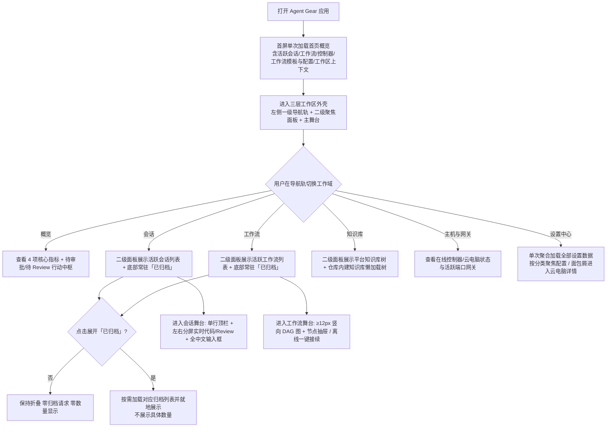

# 整体工作区 UI/UX 重构与视觉规范升级

**功能名称**: 整体工作区 UI/UX 重构与视觉规范升级
**PRD 版本**: v1.0
**创建日期**: 2026-11-26
**作者**: ZeroAsh Agent（需求来源：Deliay）

## 背景与目标

### 1.1 背景

随着产品功能历经多期高速演进（多租户与团队工作区、云电脑与容器规格计费、工作流竖向图表与 PR 联动、会话分屏预览与内建 Review、平台与仓库内建知识库、Valut 与自定义 MCP/工具），现有界面在**空间布局、信息密度、字体可读性与交互一致性**上暴露出显著瓶颈：

1. **单一侧边栏垂直堆叠过载（空间碎片化）**：
   - 左侧单一侧边栏内同时堆叠了「工作区切换器」以及「主机」「工作流」「会话」「知识库（含平台库与仓库内建三来源树）」「网关」「Review 待办」多达 6 个折叠手风琴分区，底部还挤有待办面板、主题切换、新建会话、费用中心、设置等 5 个小图标。
   - 当用户同时展开两个以上分区时，纵向空间迅速耗尽，导致高频的会话切换与知识库浏览陷入反复滚动与折叠寻路。
2. **微字号泛滥，损害长时间阅读体验**：
   - 侧边栏分区计数、知识库来源徽标、工作流图表节点标签、资源小卡片、分屏标签栏等数十处位置大量使用了 `9px`、`10px`、`11px` 的微字号，在高分屏或长时间开发场景下极易造成视觉疲劳。
3. **设置中心与主舞台顶栏认知负荷高**：
   - 设置中心将 12 个功能区块（帐号、外部登录、GitHub、Git、供应商、模型、控制器、MCP、Valut、自定义 MCP、自定义工具、工作流、云存储）平铺在单一超长滚动页面中；且点击某个控制器的配置时，整个设置视图被生硬替换为另一套二级侧栏结构，缺乏清晰的层级过渡。
   - 会话主舞台顶栏在单行内塞入控制器名、状态徽标、已归档徽标、工作工具类型、工作目录路径、Worktree 标识、完整时间戳及 8 个操作按钮，视觉焦点分散。
4. **残存中英混杂文案与暗色表面层次不足**：
   - 会话输入框仍残留英文按钮与占位文案（如 `"Send"`、`"Stop"`、`"Type your message..."`、`"New Session"`），与整体简体中文界面割裂；部分表面层级缺乏明度区分，过度依赖线条分割。
5. **需与进行中的「接口性能优化（#584 / PR #585）」无缝协同**：
   - 正在推进的接口性能优化明确要求：**取消归档数据的首屏加载与数量展示（改为点击展开时按需获取）**、**工作流配置/模板与工作区上下文并入首页概览定时刷新**、**项目工作区列表不再展示已删除或已离线控制器下的条目**、**设置页数据聚合为单次加载**。UI/UX 重构必须在交互架构上原生承载这四项设计约束。

### 1.2 目标

1. **重构为「三层工作区外壳（3-Tier Workspace Shell）」**：以「一级导航轨（Activity Rail）+ 二级聚焦上下文面板（Context Panel）+ 主工作舞台（Main Stage）」取代单一拥挤的六合一折叠侧边栏，让每个核心领域拥有充裕的纵向视野。
2. **确立全站「零微字号（≥ 12px）」可读性底线与视觉规范**：消除所有小于 `12px` 的字号，确立以 `14px` 为正文基准、语义化 OKLCH 表面明度层级与等宽数字对齐（`tabular-nums`）的现代耐久视觉体系。
3. **重塑核心舞台体验**：简化会话顶栏与一体化输入框（100% 简体中文），将设置中心由 12 区块长滚升级为「分类聚焦视图 + 面包屑嵌入式控制器配置」，将首页升级为高信噪比的「全局行动与待办中枢」。
4. **原生对齐接口性能优化（#584 / PR #585）交互口径**：常驻无计数的「已归档」按需懒加载分组、只展示在线可用控制器的工作区选择器、设置中心单次聚合加载秒开体验。

### 1.3 成功标准

| 指标 | 目标值 |
|------|--------|
| 最小字号底线 | 全站（含前台与管理后台）100% 界面文本与徽标字号 ≥ `12px`，零 `9px`/`10px`/`11px` 文字 |
| 导航与空间效率 | 一级导航轨一键切换「概览 / 会话 / 工作流 / 知识库 / 主机与环境」，二级列表栏一次聚焦一个领域，消除 6 分区同屏挤压 |
| 归档分组体验（对齐 #584） | 会话与工作流列表底部常驻「已归档」折叠分组，**标题与列表均不展示数量**，首次点击展开时按需加载并展示加载态/空态/列表 |
| 工作区可用性过滤（对齐 #584） | 所有新建会话、实例化工作流、设置工作区列表仅展示在线且未删除控制器下的项目工作区 |
| 设置中心体验（对齐 #584） | 打开设置中心一次聚合加载全部数据；左侧分类导航按分类聚焦展示，进入控制器配置采用面包屑平滑过渡 |
| 文案一致性 | 交互按钮、输入框占位提示、状态标识 100% 统一为简体中文（专有技术术语保留标准写法） |

## 用户分析

### 2.1 目标用户

- **高频重度开发者**：每日数小时驻留在产品中，同时并行推进多个 Agent 会话、审查代码 Diff 与 Review、监控多节点工作流并查阅仓库内建知识库。
- **团队管理员与多端使用者**：在团队租户与个人租户间切换工作区，管理云电脑规格、云存储、模型渠道、MCP 与 Valut 密钥，并在桌面宽屏、分屏与移动端浏览器间切换使用。

### 2.2 用户场景

| 场景 | 用户角色 | 目标 | 现有痛点 |
|------|----------|------|---------|
| 高频切换活跃会话与查阅知识库 | 开发者 | 在不同会话与知识库文档间秒级切换 | 单一侧边栏展开知识库树后把会话列表挤出屏幕，需反复折叠 |
| 长时间阅读工作流图表与代码评审 | 开发者 | 一眼看清节点模型、状态、产物与文件批注 | 徽标与辅助信息大量使用 `9px`~`10px` 微字号，久看费力 |
| 查阅历史归档会话或工作流 | 开发者 | 需要回溯旧记录时再展开归档列表 | 首屏预拉全量归档拖慢打开速度，括号数字跳动产生视觉噪音 |
| 创建新会话或实例化工作流 | 开发者 | 从当前可用的项目工作区中快速选定目标 | 列表混入已离线或已删除控制器的工作区，选中后启动失败 |
| 调整模型、MCP 或云电脑配置 | 开发者 / 管理员 | 快速定位并修改某类配置 | 设置页 12 个区块垂直堆叠过长，打开时十余次请求导致卡片逐个闪烁 |

## 功能需求

### 3.1 功能概述

本次重构涵盖整体工作区导航架构、全局视觉与排版规范落地、核心页面（概览工作台、会话舞台、工作流舞台、知识库视图、设置中心）布局重组，并在交互层完整落地接口性能优化（#584 / PR #585）的四项数据与展示约束。所有业务功能语义保持零退化。

### 3.2 功能列表

#### 功能点 1: 三层工作区外壳架构（Activity Rail + Context Panel + Main Stage）

- **描述**: 桌面端主界面由「双栏（拥挤侧栏 + 主区）」升级为「三层工作区外壳」：
  1. **一级导航轨（Activity Rail，固定窄轨）**：位于最左侧，顶部为租户/品牌标识，中部为五个核心工作域入口——**概览**、**会话**、**工作流**、**知识库**、**主机与网关**；当存在待用户处理的审批交互或待 Review 评审单时，在「会话」或「工作流」图标右上角展示高辨识度状态圆点提醒；底部固定收纳全局工具入口（**待办清单**、**我的费用**、**主题切换**、**设置中心**）。
  2. **二级聚焦上下文面板（Context Panel，可拖拽调宽 / 可一键收起）**：顶部常驻**租户工作区切换器**（随首页概览统一节奏自动保持最新）与当前列表快速筛选框 + 领域「+ 新建」主按钮；中部**根据当前选中的一级工作域，专注展示该领域的列表或树**（会话列表、工作流列表、知识库树、主机与网关树），不再将 6 个分区垂直挤压在同一滚动条内；支持快捷键或按钮一键收起二级面板，将全部水平空间让渡给主工作舞台。
  3. **主工作舞台（Main Stage）**：承载当前活动会话（含分屏预览）、工作流图表/列表、知识库阅读/编辑器、概览工作台或设置中心。
  4. **移动端自适应**：窄屏下自动收敛为底部核心导航栏 + 列表/详情推入式视图，确保多端心智模型一致。
- **用户价值**: 彻底根治侧边栏纵向爆炸问题，视野清爽，每次切换聚焦单一任务域，且随时可收起列表获得沉浸式全宽分屏画布。
- **验收标准**:
  - [ ] 一级导航轨清晰区分「概览 / 会话 / 工作流 / 知识库 / 主机与网关」五大主域及底部「待办 / 费用 / 主题 / 设置」入口。
  - [ ] 二级上下文面板随所选主域切换对应列表，支持拖拽调节宽度与一键折叠/展开，宽度与折叠偏好本地记忆。
  - [ ] 待处理的会话 Review 与待审批交互在一级导航轨与会话列表顶部有醒目的聚合提醒入口，点击直达对应会话分屏。
  - [ ] 移动端窄屏下导航与详情切换流畅，无横向溢出。

#### 功能点 2: 全局排版字号底线（≥ 12px）与 OKLCH 视觉层级统一

- **描述**: 全面升级界面排版、色彩表面与数字对齐规范：
  1. **严守 12px 最小字号底线**：全站移除所有 `9px`、`10px`、`11px` 的微字号样式；所有状态徽标、分组计数、快捷键提示、路径副标题、工作流节点标签、资源小卡片统一提升至至少 `12px`，正文与列表主标题统一为 `14px`。
  2. **表面明度层级（Surface Hierarchy）**：在亮色与暗色主题下，通过细腻的明度梯度区分「一级导航轨 → 二级列表面板 → 主工作画布 → 悬浮卡片/弹层」，确保暗色模式下所有卡片、画布与终端代码块对比度达标（WCAG AA ≥ 4.5:1），无刺眼白底残留。
  3. **等宽数字与全中文交互文案**：所有金额、Token 数量、倒计时与序号强制启用等宽数字对齐（`tabular-nums`）；会话输入区、空状态、加载提示等残存的英文操作文案（如 `Send`、`Stop`、`New Session`、`Type your message...`）100% 统一为自然准确的简体中文。
- **用户价值**: 视觉干净耐看，长时间编码与读图眼睛不累，产品呈现高度统一的现代工业级质感。
- **验收标准**:
  - [ ] 全站任意页面、弹窗、图表节点与徽标均不存在小于 `12px` 的文字。
  - [ ] 亮/暗双主题切换平滑，表面层次分明，无硬编码亮色残留。
  - [ ] 会话输入区、按钮、占位符与提示文案 100% 简体中文（专有技术名词除外）。

#### 功能点 3: 按需懒加载且无计数的「已归档」分组（对齐 #584 / PR #585）

- **描述**: 在二级上下文面板的「会话」列表与「工作流」列表底部，常驻提供「已归档」折叠分组：
  - **首屏零归档负担**：打开应用时不加载已归档会话或已归档工作流，仅渲染折叠的「已归档」标题行。
  - **取消数量展示**：无论折叠还是展开，「已归档」分组标题与列表均不展示归档条目数量。
  - **点击按需加载**：用户点击「已归档」展开时，就地展示轻量加载态并获取归档列表；若无归档记录则展示「暂无归档」空态文案；再次折叠与展开保持流畅，归档/取消归档操作后即时同步。
- **用户价值**: 首屏启动更迅速，界面不被庞大且极少变动立即可见的历史归档数字干扰。
- **验收标准**:
  - [ ] 打开应用首屏不请求归档数据，「已归档」分组默认折叠且无括号数字。
  - [ ] 点击展开「已归档」时才加载归档条目并就地渲染；为空时显示「暂无归档」。
  - [ ] 会话与工作流的归档、取消归档及点击回看行为保持完整。

#### 功能点 4: 会话舞台与工作流舞台界面精简

- **描述**: 优化高频工作的会话舞台与工作流舞台布局：
  1. **会话舞台单行紧凑顶栏**：顶栏高度收敛为统一单行（`48px`），左侧展示会话标题与核心状态徽标；控制器名称、工作目录路径、Worktree 分支、工作工具类型与创建时间收纳为紧凑的**环境信息胶囊**（悬停或点击可查看完整路径与能力清单）；右侧固定分屏模式切换器（仅对话 / 左右分屏 / 上下分屏）、实况跟随开关与导出/归档操作。
  2. **一体化浮岛输入区（Prompt Composer）**：将模式切换、模型切换、配置项、图片添加与批注片段（Prompt Parts）整合进圆角输入卡片内部底栏，右侧配以醒目的「发送消息 (`⌘↵`)」/「停止生成」中文主按钮。
  3. **工作流舞台与离线接续引导**：工作流竖向 DAG 图表的节点卡片、资源小卡片与状态徽标全面升级为 `≥ 12px` 易读排版；当工作流绑定的控制器已离线或已删除时，顶栏醒目展示不可用原因与「接续到在线环境」操作横幅；所有新建会话与工作流选择工作区时，**自动过滤已删除或已离线控制器下的项目工作区**（控制器恢复在线后自动重现）。
- **用户价值**: 对话与读图舞台干扰降到最低，核心内容区面积最大化，环境异常时有清晰可执行的恢复路径。
- **验收标准**:
  - [ ] 会话顶栏单行清爽，长路径与次要元信息不挤压标题与分屏工具栏。
  - [ ] 输入框片段、模型/模式切换与发送按钮布局紧凑一致，支持快捷键提示。
  - [ ] 新建会话/工作流及接续对话框的工作区列表中不出现离线或已删除控制器的工作区。

#### 功能点 5: 分类聚焦型设置中心与单次聚合加载（对齐 #584 / PR #585）

- **描述**: 重构设置中心的信息组织与加载体验：
  1. **一次聚合加载秒开**：进入设置中心时，全部设置区块的只读数据一次性聚合下发，控制器列表直接复用全局概览的实时在线状态，消除设置页内部重复请求与独立常驻轮询。
  2. **分类聚焦视图取代 12 区块超长滚动**：设置中心左侧提供清晰的分组导航（**帐号与登录**、**GitHub 与 Git 署名**、**供应商与可用模型**、**控制器与云电脑**、**MCP · Valut · 自定义工具**、**工作流模板与配置**、**云存储**），右侧主区按所选分类聚焦呈现对应配置面板（或平滑定位），告别 12 个大区块同屏堆叠的眩晕感。
  3. **面包屑嵌入式控制器/云电脑配置**：在「控制器管理」中点击某台主机或云电脑进入配置（工作区、可用工具、默认 MCP、工作负载、GitHub 联动、项目工作流）时，保持在设置中心外壳内，通过顶部**面包屑导航（`设置中心 / 控制器管理 / <主机名称>`）**与页签平滑切换，不再突兀替换整页骨架。
- **用户价值**: 设置中心打开即就绪，分类查找一目了然，配置云电脑后可随时沿面包屑一键返回。
- **验收标准**:
  - [ ] 打开设置中心请求收敛，无多卡片先后跳动闪烁；单区块降级不影响其余分类。
  - [ ] 各设置分类导航清晰，全部既有设置项（增删改查、绑定、升级、存储操作）零缺失。
  - [ ] 控制器/云电脑详细配置具备清晰的面包屑返回路径。

### 3.3 用户操作流程

### 3.4 页面/界面描述

| 页面 / 区域 | 描述 | 关键元素 |
|------------|------|---------|
| 一级导航轨（Activity Rail） | 固定于最左侧的全局域切换栏 | 租户标识、概览/会话/工作流/知识库/主机入口（含待介入圆点提醒）、底部待办/费用/主题/设置入口 |
| 二级聚焦面板（Context Panel） | 当前领域的专属列表栏（可调宽/可收起） | 租户工作区切换器、快速筛选框、领域新建按钮、两行式标准卡片列表、底部无计数「已归档」按需折叠组 |
| 概览工作台（Home Stage） | 产品门户与待办分流中枢 | 活跃会话/运行工作流/在线主机/已配置模板 4 项指标卡、待审批与待 Review 优先提醒区、最近活跃会话与工作流快捷列表 |
| 会话工作舞台（Session Stage） | 对话与代码预览分屏核心区 | `48px` 单行紧凑顶栏（含环境胶囊与分屏控制）、最大阅读宽度约束的消息流、深色终端渲染区、时间线审批卡片、一体化全中文 Prompt 输入框、右侧代码 Diff / Review 分屏面板 |
| 工作流工作舞台（Workflow Stage） | 多节点 DAG 编排与监控区 | 单行顶栏（含关联 PR 徽标与视图切换）、离线控制器接续横幅、`≥ 12px` 竖向 DAG 节点卡片与资源小卡片、右侧节点/产物详情抽屉 |
| 设置中心（Settings Stage） | 单次聚合加载的配置管理中心 | 工作区上下文只读提示横幅、左侧分类导航栏、右侧聚焦配置区、嵌入式控制器/云电脑面包屑详情页 |

### 3.5 异常与边界情况

| 情况 | 预期行为 |
|------|---------|
| 「已归档」分组点击展开时正在加载或为空 | 展开区就地展示「加载中…」提示；无归档数据时展示「暂无归档」文案；均不展示数量 |
| 归档列表或设置中心某一分支加载失败 | 仅在对应折叠区或对应设置分类卡片内展示错误提示与重试按钮，不阻塞页面其余部分 |
| 控制器离线或已删除 | 新建会话、实例化工作流、设置工作区列表中自动隐藏该控制器下的项目工作区；已绑定该控制器的工作流实例展示离线提示与「接续」按钮；控制器恢复在线后工作区自动重现 |
| 视口宽度不足 `1024px` 或用户收起二级面板 | 二级列表面板可一键折叠或转为抽屉；会话「左右分屏」在窄屏下自动平滑回退为「上下分屏」且不丢失用户偏好 |
| 超长会话标题、深层知识库路径或宽代码块 | 遵循弹性盒 `min-w-0` 与网格单列保底约束，长标题优雅截断并带悬停完整提示，代码块内聚滚动，整页零横向溢出 |

## 四、非功能需求

### 4.1 性能要求

- 首屏打开仅发起一次首页概览聚合加载（不含归档会话与归档工作流清单），首屏渲染时间与载荷显著优于重构前。
- 后台定时刷新（15s 首页概览 / 5s 工作流详情）期间，界面静默更新数据，**严禁卸载当前视图或打断用户正在输入的表单与焦点**。
- 打开设置中心的初始化请求由十余次收敛为单次聚合加载，切换左侧设置分类达到零等待瞬时响应。

### 4.2 安全性要求

- 界面重构与请求聚合不改变任何租户、工作区及角色权限边界；全局工作区对开发角色的只读限制、知识库四档权限门控保持不变。

### 4.3 兼容性与可访问性要求

- 桌面端（`≥ 1024px`）、平板端（`768px–1023px`）与移动端（`≥ 360px`）均完整适配。
- 全站最小字号 `≥ 12px`，亮/暗模式下核心文本对比度均满足 WCAG AA（`≥ 4.5:1`），所有图标按钮具备完整的键盘焦点环与 `aria-label` 无障碍标签。

## 五、依赖与约束

### 5.1 依赖

- 接口性能优化方案（GitHub Issue #584 / PR #585）：`homeOverview` 归档字段移除与三分支并入、`workspaces` 在线控制器过滤、`settingsOverview` 聚合查询。

### 5.2 约束

- 遵循 [`docs/engineering/ui-ux-standards.md`](../../engineering/ui-ux-standards.md) 设计规范，严禁在任何新增或重构组件中引入 `< 12px` 字号。
- 保持既有全部核心业务功能、路由深链（如 `/sessions/:id?review=xxx`、`/workflows/:id?continue=1`、`/settings?controllerId=xxx`）与测试锚点兼容。

## 六、相关文档

- UI/UX 设计规范：[[../../engineering/ui-ux-standards.md]]
- 技术提案：[[../../engineering/proposals/20261126-refactor-ui-ux-workspace-overhaul.md]]
- 协同方案（PR #585）：`docs/product/draft/20261126-api-performance-optimization.md`、`docs/engineering/proposals/20261126-feat-api-performance-optimization.md`
- 历史 UI 优化文档：[[../released/20260721-frontend-design-overhaul.md]]、[[20261030-ui-optimization-phase4.md]]
