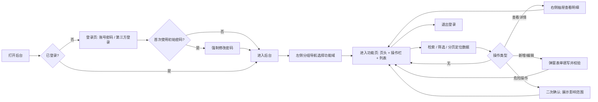

# 后台 UI 重构（管理后台全量 UI 升级）

**功能名称**: 后台 UI 重构（管理后台全量 UI 升级）
**PRD 版本**: v1.0
**创建日期**: 2026-11-27
**作者**: z-agent-bot

## 背景与目标

### 1.1 背景

管理后台是平台管理员与运营人员维护云资源、模型配置、租户与计费的核心工作界面。随着功能逐期迭代，后台界面在**布局、导航、表格、表单、弹窗与状态呈现**上积累了明显的不一致：

1. **导航扁平无分组**：十余个功能入口以单列平铺在左侧栏，缺少「云资源 / 模型 / 租户计费 / 系统安全」的心智分区，功能越加越多后定位效率下降；
2. **视觉语言不统一**：不同页面的表格密度、按钮样式、弹窗结构、状态标签配色各成一派，与产品最新的统一设计规范（OKLCH 表面层级、统一字号阶梯、语义状态色）存在差距；
3. **主题能力缺失**：界面只有亮色一套呈现，无法在弱光环境长时间工作，与前台工作台的亮/暗双主题体验不一致；
4. **详情与表单体验割裂**：账单收据等详情以居中弹窗呈现、破坏性操作的确认口径不一、错误/空态/加载态呈现各异，缺少统一的交互模式。

产品已建立统一的 UI 设计规范与交互原型（见「六、相关文档」），前台工作台已按该规范完成重构。本需求将**同一套设计语言完整落地到管理后台全部页面**，让管理员获得一致、耐久、高效的操作体验。

### 1.2 目标

- **完成管理后台全量 UI 重构**：覆盖后台全部页面（登录、改密、模型配置、基础镜像、云端容器、工作负载、容器规格、Harness 配置、租户管理、租户详情、费用中心、对账中心、登录认证、账号安全）与整体布局外壳。
- **导航分组化**：左侧导航按「云资源管理 / 模型与 Harness / 租户与计费 / 系统安全」四组呈现，新增功能可归入既有分组。
- **统一视觉语言**：色彩、字号、间距、圆角、阴影、状态配色全部对齐统一设计规范；亮色/暗色双主题可用且可切换。
- **统一交互模式**：表格、表单、弹窗、抽屉、二次确认、空态/加载态/错误态各只有一种规范呈现。
- **功能零回归**：本次为纯界面重构，不改变任何功能行为、数据口径、权限与刷新节奏。

### 1.3 成功标准

- 后台全部页面在新视觉语言下可用，管理员可完成重构前的全部操作路径，功能回归零差异。
- 左侧导航呈现四个分组，全部既有功能入口均可从分组中到达，默认落在「模型配置」页。
- 全站最小字号 ≥ 12px，正文基准 14px；金额、计数、时间等数字对齐不跳动。
- 亮色与暗色主题下文字对比度均达到 WCAG AA（≥ 4.5:1），主题切换即时生效并记住选择。
- 危险操作（销毁容器、删除规格/工作负载/镜像/模型等）一律二次确认并明确展示影响范围。
- 界面交互文案 100% 简体中文，专有名词（Harness、MCP、Credits、Worktree 等）保持标准写法。
- 既有自动化测试全部通过（组件测试与端到端回归），并新增界面规范守卫用例。

## 用户分析

### 2.1 目标用户

- **平台管理员（运维）**：维护云端容器、工作负载、基础镜像、容器规格、模型与 Harness 配置。
- **平台运营 / 计费管理员**：租户开户与成员管理、费用中心充值与账单核对、对账中心复核。
- **平台安全管理员**：登录认证供应商配置、账号安全管理。

### 2.2 用户场景

| 场景 | 用户角色 | 目标 | 痛点 |
|--|--|--|--|
| 每日巡检云端容器与工作负载 | 运维 | 快速定位「云资源」相关页面，看清容器状态并处置异常 | 功能入口平铺无分组，状态标签配色不统一，定位慢 |
| 为租户开通账户并充值 | 运营 | 从租户管理一路走到费用中心完成开户、加成员、充值 | 租户与计费入口分散，金额展示不齐整，核对费力 |
| 夜间弱光环境长时间值守 | 运维 | 暗色主题下舒适操作 | 只有亮色界面，长时间盯屏疲劳 |
| 核对账单与收据明细 | 计费管理员 | 查看账单的计费维度拆解并核对金额 | 详情弹窗局促，数字不对齐，异常差异不醒目 |
| 配置登录认证供应商 | 安全管理员 | 配置 OIDC / GitHub 登录并管理账号安全 | 表单与错误提示风格不一，密钥类字段安全感不足 |
| 处置危险操作 | 运维 | 明确知道删除/销毁会影响什么再确认 | 各页二次确认口径不一，影响范围不透明 |

## 功能需求

### 3.1 功能概述

按统一设计规范对管理后台进行完整 UI 重构：以「分组导航 + 数据工作台」的新布局承载全部功能页，统一表格、表单、弹窗、抽屉与状态呈现，补齐亮/暗双主题与可访问性，功能行为与数据口径保持不变。

### 3.2 功能列表

#### 功能点 1: 分组导航与工作台布局

- **描述**: 后台整体布局重构为「左侧固定宽分组导航 + 右侧自适应数据工作台」。左侧导航按以下四组分组呈现，组内为各功能入口：
  - **云资源管理**：云端容器、容器规格、工作负载、基础镜像
  - **模型与 Harness**：模型配置、Harness 配置
  - **租户与计费**：租户管理、费用中心、对账中心
  - **系统安全**：登录认证、账号安全
  导航底部保留当前登录管理员信息与「退出登录」。右侧工作台统一为「顶部页头（页面标题 + 说明）→ 操作栏（检索/主操作）→ 表格或卡片列表 → 右侧抽屉 / 弹窗表单」的结构。
- **用户价值**: 功能按心智分区直达，页面结构可预期，降低学习与定位成本。
- **验收标准**:
  - [ ] 四个分组及组内入口与上表一致，全部既有功能入口可达，无丢失、无重复。
  - [ ] 当前所在页在导航中高亮标识；默认进入「模型配置」页。
  - [ ] 各功能页呈现统一的「页头 → 操作栏 → 内容区」结构。

#### 功能点 2: 统一视觉语言与亮暗主题

- **描述**: 全站色彩、字号、间距、圆角、阴影统一应用设计规范：四级表面层级区分空间、品牌主色统一、语义状态色统一（成功/警告/信息/失败），正文 14px、辅助信息 12px、页面标题 20~24px 的字号阶梯，金额/计数/时间采用等宽数字对齐。提供**亮色 / 暗色 / 跟随系统**三种主题模式切换，选择被记住。
- **用户价值**: 视觉一致、长时间使用不易疲劳，弱光环境可用。
- **验收标准**:
  - [ ] 全站无小于 12px 的字号；页面标题、区块标题、正文、辅助信息符合字号阶梯。
  - [ ] 状态标签（如容器状态、账单状态）使用统一语义配色，同一状态全站同色。
  - [ ] 亮/暗主题可切换且即时生效，重新打开界面后保持所选主题；两主题下文字对比度均达 WCAG AA。

#### 功能点 3: 数据表格与列表统一

- **描述**: 全部列表页（云端容器、容器规格、工作负载、基础镜像、租户、账单、对账、模型等）采用统一的高密度表格规范：统一表头样式、统一单元格密度、操作列靠右并使用一致的轻量操作按钮；长文本截断并可查看完整内容；数值列右对齐。
- **用户价值**: 各页表格观感一致、扫读高效、操作列位置可预期。
- **验收标准**:
  - [ ] 各列表页表头、行密度、操作列位置与样式一致。
  - [ ] 状态列使用统一语义徽标；数值列右对齐且数字不跳动。
  - [ ] 超长文本截断展示且可查看完整值。

#### 功能点 4: 表单、弹窗与抽屉统一

- **描述**: 新增/编辑类操作统一使用同规格的弹窗表单（标题、说明、字段、错误提示、底部操作按钮位置一致）；表单校验错误就地提示并明确指出问题字段；**危险操作（销毁、删除、移除等）一律二次确认**，确认框明确展示影响范围（如连带影响的数量）；账单收据等详情类内容以**右侧抽屉**呈现，不离开当前列表上下文。
- **用户价值**: 表单与弹窗行为可预期，破坏性操作更安全，详情查看不打断工作流。
- **验收标准**:
  - [ ] 各页新增/编辑弹窗结构一致，校验错误就地提示。
  - [ ] 全部危险操作二次确认且展示影响范围文案。
  - [ ] 账单收据详情在右侧抽屉展示完整计费维度拆解（含分段/折算明细）。

#### 功能点 5: 空态、加载态与错误态统一

- **描述**: 数据加载中、加载失败、数据为空三种状态在全部列表与详情中使用统一呈现：加载中有明确的加载指示；失败展示错误提示与「重试」入口；空态展示简短说明与（如有）主操作引导，不堆叠占位卡片。
- **用户价值**: 状态一目了然，出错可自救，不误判为「没有数据」。
- **验收标准**:
  - [ ] 各列表与详情均有统一的加载中 / 错误 + 重试 / 空态呈现。
  - [ ] 加载失败不表现为空态；空态不显示误导性的「0」计数。

#### 功能点 6: 登录与账号安全场景升级

- **描述**: 登录页采用居中单卡片布局，提供账号密码登录与后台已启用的第三方登录（OIDC / GitHub）按钮组，失败原因清晰提示；强制修改初始密码页展示密码要求与就地错误提示；「登录认证」「账号安全」页的密钥类字段保持「已设置 / 未设置」状态展示、不回显明文。
- **用户价值**: 登录入口清晰安全，首登改密引导明确。
- **验收标准**:
  - [ ] 登录页居中卡片呈现，第三方登录按钮仅在后台启用时出现，失败给出明确原因。
  - [ ] 强制改密页展示密码要求与就地校验提示。
  - [ ] 密钥/密码类字段任何界面不回显明文。

#### 功能点 7: 计费与对账场景升级

- **描述**: 费用中心与对账中心的金额、单价、增减明细全部右对齐并采用等宽数字；充值（入账）以成功色标识、扣费为中性色、异常差异以警示色醒目展示；账单行点击后在右侧抽屉展示完整计费维度拆解；模型定价区块统一卡片呈现。
- **用户价值**: 金额核对省力、异常一眼可见。
- **验收标准**:
  - [ ] 全部金额与单价数字对齐、无跳动；入账/扣费/异常配色区分明确。
  - [ ] 点击账单行可在右侧抽屉查看完整计费拆解明细。
  - [ ] 对账结果中的差异项醒目可辨。

#### 功能点 8: 云资源管理场景升级

- **描述**: 云端容器、容器规格、工作负载、基础镜像四页按统一表格与表单规范重构：容器状态以统一语义徽标 + 状态文案呈现（含初始化中展示当前进度）；容器规格表单中的租户白名单多选、工作负载的参数设计器与依赖选择器、初始化日志查看器（等宽深色日志区）均按统一控件规范呈现。
- **用户价值**: 云资源四页操作一致、状态清晰、复杂表单好用。
- **验收标准**:
  - [ ] 四页表格/表单/删除确认统一规范，功能行为不变。
  - [ ] 容器状态徽标配色与文案符合统一状态映射。
  - [ ] 参数设计器、白名单选择器、日志查看器交互不回归。

#### 功能点 9: 模型与 Harness 场景升级

- **描述**: 模型配置页的供应商与模型分组、导入模型弹窗、自定义模型弹窗、改名整理记录等按统一控件规范重构；Harness 配置页逐行保存的输入与提示按统一表单规范呈现。
- **用户价值**: 模型管理扫读与批量操作更高效。
- **验收标准**:
  - [ ] 供应商/模型分组折叠、拖拽排序、批量操作等既有能力不回归。
  - [ ] 导入模型弹窗的过滤、全选、禁选与重试行为不回归。

#### 功能点 10: 租户管理场景升级

- **描述**: 租户列表、开户/创建团队租户弹窗、租户详情（概要、成员、工作区）、成员添加/移除/角色变更确认等按统一规范重构；角色与租户类型使用统一徽标；成员管理的风险提示（如最后一名管理员保护、角色变更影响）明确展示。
- **用户价值**: 租户与成员管理操作更安全、更清晰。
- **验收标准**:
  - [ ] 租户类型、成员角色徽标全站统一。
  - [ ] 移除成员、变更角色等操作有明确影响说明与二次确认。
  - [ ] 只读区域（个人租户成员、工作区列表）明确表达只读、不出现无效操作入口。

#### 功能点 11: 可访问性与键盘操作

- **描述**: 全部可交互元素支持键盘访问且焦点清晰可见；图标按钮附带可读名称；弹窗/抽屉支持 Esc 关闭并有正确的焦点管理；表单字段与标签正确关联；语义状态不仅靠颜色区分（同时有文字）。
- **用户价值**: 键盘流与辅助技术用户可用，操作更可靠。
- **验收标准**:
  - [ ] 主要操作路径可纯键盘完成，焦点态清晰可见。
  - [ ] 图标类按钮均具备可读名称；弹窗/抽屉可用 Esc 关闭。
  - [ ] 状态信息均有文字表达，不单靠颜色。

### 3.3 用户操作流程

### 3.4 页面/界面描述

| 页面 | 描述 | 关键元素 |
|------|------|---------|
| 登录页 | 居中单卡片登录入口 | 账号/密码表单、第三方登录按钮组、错误提示条 |
| 强制改密页 | 首次登录强制修改初始密码 | 密码要求说明、就地校验提示、错误提示条 |
| 模型配置页 | 供应商与可用模型管理 | 供应商分组折叠列表、导入/自定义模型弹窗、模型上下文编辑、改名整理记录 |
| 基础镜像页 | 基础镜像列表与管理 | 镜像表格、新增/编辑弹窗、删除确认 |
| 云端容器页 | 工作容器列表与运维操作 | 容器表格（状态徽标、进度）、启动弹窗、工作负载日志抽屉/弹窗、强制销毁确认 |
| 容器规格页 | 规格目录与租户白名单 | 规格表格、规格表单（白名单多选租户）、删除确认 |
| 工作负载页 | 工作负载定义与参数 | 工作负载表格、表单（脚本、参数设计器、依赖选择器）、删除确认 |
| Harness 配置页 | 各 Harness 压缩指令配置 | 逐行输入与保存、校验提示 |
| 租户管理页 | 租户列表与开户 | 租户表格（类型徽标）、检索分页、开户/创建团队租户弹窗 |
| 租户详情页 | 租户概要与成员管理 | 概要信息、成员列表（角色徽标）、添加/移除/变更角色、工作区只读列表 |
| 费用中心 | 计费账户与账单管理 | 检索操作栏、账户表格、账单表格（右对齐金额）、充值弹窗、收据右侧抽屉、费用趋势图、模型定价区块、API Key 管理 |
| 对账中心 | 账单对账与差异复核 | 对账表格、差异醒目标识、明细抽屉 |
| 登录认证页 | OIDC / GitHub 登录供应商配置 | 供应商列表/表单、回调地址展示、密钥「已设置」状态 |
| 账号安全页 | 管理员外部身份管理 | 外部身份列表、绑定/解绑操作与二次确认 |

### 3.5 异常与边界情况

| 情况 | 预期行为 |
|------|---------|
| 数据加载中 | 展示统一加载指示，不闪烁空白 |
| 数据加载失败 | 展示错误提示与「重试」按钮，不呈现为空列表 |
| 数据为空 | 展示统一空态说明（含主操作引导，如有），不误导为加载失败 |
| 表单校验失败 | 就地提示问题字段与原因，保留已填内容 |
| 服务端拒绝（重名、非法值、越权等） | 展示明确中文原因，弹窗保留现场可修正 |
| 危险操作 | 二次确认并展示影响范围，确认后方可执行 |
| 长文本/长列表 | 文本截断可看全量；列表分页或滚动，不破版 |
| 暗色主题下高饱和元素 | 保持可读对比度，不出现刺眼纯白/纯黑大块 |
| 会话过期 | 提示并跳转登录页，登录后回到可继续的入口 |
| 数值为空或零 | 统一以「-」或 0 呈现口径展示，不出现 `null`/`undefined` 等原始值 |

## 四、非功能需求

### 4.1 性能要求

- 界面重构不新增任何数据请求，不改变既有查询与刷新节奏（如容器列表轮询、模型清单加载）。
- 页面切换与弹窗打开保持即时响应；构建产物体积无明显增长。

### 4.2 安全性要求

- 不改变任何权限、鉴权与越权校验行为；只读限制的表达只做视觉强化，不放宽也不收紧。
- 密码、密钥、令牌等敏感值任何界面不回显明文；错误提示不泄露敏感内部信息。

### 4.3 兼容性要求

- 支持主流现代浏览器（Chrome / Edge / Safari 近两个大版本）。
- 以桌面端为主要使用形态（1280×800 及以上），常见宽屏与标准笔记本分辨率下不破版。
- 亮色与暗色主题均完整可用。

## 五、依赖与约束

### 5.1 依赖

- 产品统一 UI 设计规范与交互原型（见「六、相关文档」），为本次重构的唯一视觉蓝本。
- 前台工作台已落地的同规范重构，作为术语、状态色与交互口径的参照。

### 5.2 约束

- **功能行为、数据口径、权限与刷新节奏零变更**：本需求为纯界面重构，不新增、不修改任何业务能力。
- 全部交互文案使用简体中文，专有名词保持标准写法；禁止小于 12px 的字号。
- 危险操作必须二次确认；敏感值不回显明文。
- 重构期间既有功能可随时回归验证，按页面分批交付、随时可发布。

## 六、相关文档

- UI 设计规范与全场景组件化设计文档：`docs/engineering/prototypes/20261127-ui-specification.md`
- UI/UX 工作区重构交互式设计原型：`docs/engineering/prototypes/20261126-ui-ux-workspace-overhaul.html`
- UI 规范交互式演示手册：`docs/engineering/prototypes/20261127-ui-specification.html`
- UI/UX 设计规范（Design System & Guidelines）：`docs/engineering/ui-ux-standards.md`
- 相关 PRD：`docs/product/draft/20261126-ui-ux-workspace-overhaul.md`（前台工作区 UI/UX 重构）
