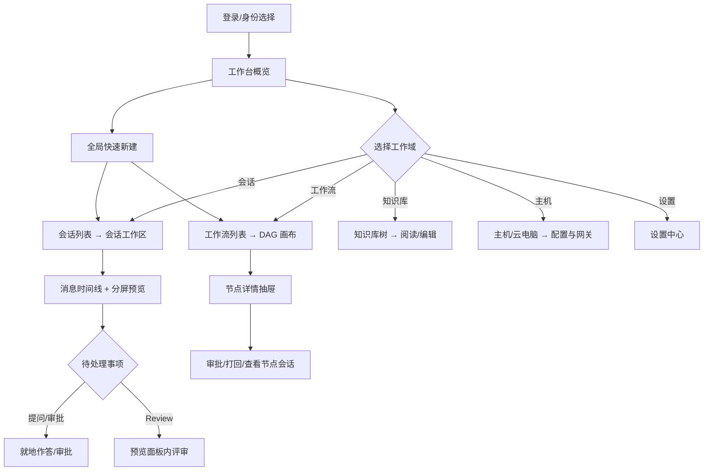

# Agent Web 全场景 UI 重构

**功能名称**: Agent Web 全场景 UI 重构
**PRD 版本**: v1.0
**创建日期**: 2026-11-27
**作者**: ZeroAsh Agent（需求来源：Deliay）

## 背景与目标

### 1.1 背景

产品已沉淀一套完整的界面设计基准，作为本次重构的唯一依据：

1. **交互原型**（[`docs/engineering/prototypes/20261126-ui-ux-workspace-overhaul.html`](../../engineering/prototypes/20261126-ui-ux-workspace-overhaul.html)）：以可交互演示的方式定义了工作台的目标形态——「一级导航轨 + 聚焦上下文列表栏 + 主工作舞台」三层工作区外壳、全局快速新建入口、概览工作台、会话分屏预览、工作流、知识库、主机与网关、费用中心与设置中心的目标交互。
2. **UI 规范文档**（[`docs/engineering/prototypes/20261127-ui-specification.md`](../../engineering/prototypes/20261127-ui-specification.md) 与其[交互式演示手册](../../engineering/prototypes/20261127-ui-specification.html)）：定义了整体视觉风格、排版与色彩体系、间距圆角与动效基准、基础组件与通用业务组件标准，以及九大业务场景的界面蓝图与交互、无障碍、质量守卫要求。

在此之前，一期工作区重构（[[20261126-ui-ux-workspace-overhaul.md|整体工作区 UI/UX 重构与视觉规范升级]]）已经落地了三层工作区外壳、全站「字号不低于 12px」底线、亮暗双主题的表面层级体系，并巩固了 [[20261126-api-performance-optimization.md|接口性能优化]] 的交互口径（已归档分组不计数、按需加载；设置页一次加载；离线工作区过滤）。

但对照行为期数月的使用反馈与规范逐条核对，工作台各业务场景仍存在系统性差距：

1. **场景覆盖不完整**：一期重构聚焦工作区外壳与排版底线，认证、概览、会话、工作流、云电脑与主机、知识库、设置中心、费用中心等场景内部的布局密度、信息层级、卡片与弹窗样式、空态与错误态尚未逐一对齐规范蓝图。
2. **状态表达不统一**：会话、云电脑、工作流节点等状态在不同页面的用色、圆点动效、徽标样式与中文文案存在多套写法并存，用户需要重新学习同一状态在不同页面的含义。
3. **零散视觉值残留**：部分界面仍有脱离统一设计基准的硬编码颜色、间距与数字排版，造成主题切换后对比度不达标、数值跳动、按钮与徽标风格漂移。
4. **交互与无障碍细节参差**：键盘可达性、焦点呈现、快捷键、危险操作二次确认、超长文本与极窄视口等边界体验在各页面表现不一。
5. **缺乏防回归手段**：设计基准尚未完全转化为自动化验收守卫，后续功能迭代容易再次引入微字号、硬编码色值等退化。

### 1.2 目标

1. **全场景对齐规范**：工作台全部业务场景（认证与身份绑定、工作台概览与多租户工作区、会话与实时分屏预览、工作流编排、云电脑/主机与 Git Worktree、知识库、设置中心、费用中心）逐场景完成界面重构，达到规范蓝图定义的布局、视觉与交互标准。
2. **设计基准单一事实来源**：全站颜色、字号、间距、圆角、阴影、动效均取自统一设计基准，零散硬编码视觉值清零，亮暗双主题下均满足可读性对比度要求。
3. **状态表达全域统一**：同一状态在任何页面使用相同的颜色语义、圆点动效、徽标样式与中文文案；界面文案 100% 简体中文（专有名词保持标准写法）。
4. **无障碍与键盘可达性达标**：全部可交互元素可键盘到达并有清晰焦点呈现；全局快捷键、焦点管理、危险操作确认符合规范。
5. **多端体验一致**：桌面宽屏、窄屏与移动端浏览器下布局正确收敛，无横向溢出，核心任务均可完成。
6. **质量守卫固化**：把设计基准固化为自动化检查与端到端验收，重构成果可被持续验证，后续迭代不再回退。

### 1.3 成功标准

| 指标 | 目标值 |
|------|--------|
| 场景覆盖率 | 九大业务场景全部完成界面重构并通过逐场景验收清单核对 |
| 设计基准一致性 | 全站不存在脱离统一设计基准的硬编码颜色/字号/间距；同一语义（按钮、徽标、卡片、弹窗、空态）全站同构 |
| 字号底线 | 全站任何界面文本 ≥ 12px，正文基准 14px，零微字号 |
| 状态语义统一 | 会话 / 云电脑 / 工作流节点状态的颜色、动效、徽标与文案全站唯一映射，逐状态验收通过 |
| 文案一致性 | 交互按钮、占位提示、状态标识、错误提示 100% 简体中文，专有名词（Session、Worktree、MCP、Harness、Valut、ACP、Credits）保持标准写法 |
| 数值稳定性 | 金额、Token 用量、倒计时、计数徽章、表格数值列呈现为等宽数字，动态刷新不引发布局跳动 |
| 键盘可达性 | 全部可交互元素支持键盘到达与清晰焦点呈现；快捷键（列表栏收起、命令唤起、关闭弹层、发送消息）行为符合规范 |
| 响应式 | 桌面（≥768px）与移动（<768px）两种布局形态均无横向溢出，列表/详情推入式导航完整可用 |
| 防回归 | 自动化守卫覆盖字号、状态色、关键布局与既有交互口径（归档无计数按需加载、设置一次加载、首屏零冗余请求），全量通过 |
| 功能零退化 | 重构前后所有业务功能语义、操作路径与数据展示口径一致，既有端到端用例零回归 |

## 用户分析

### 2.1 目标用户

- **高频重度开发者**：每日数小时驻留工作台，同时并行推进多个 Session、审阅代码 Diff 与 Review、监控多节点工作流、查阅知识库，对长时间阅读舒适度与信息定位效率最敏感。
- **团队管理员与多端使用者**：在个人/团队工作区间切换，管理云电脑、模型、MCP 与密钥，在桌面宽屏、外接屏与移动端浏览器之间切换使用，要求各端体验一致、状态一目了然。

### 2.2 用户场景

| 场景 | 用户角色 | 目标 | 现有痛点 |
|------|----------|------|---------|
| 全天候多会话并行开发 | 开发者 | 在会话、工作流、知识库间秒级切换并保持上下文 | 场景内部布局与视觉细节不统一，切换后需要重新适应信息层级 |
| 长时间阅读对话、Diff 与 DAG 图 | 开发者 | 久看不累，状态与关键信息一眼可辨 | 部分页面状态用色与徽标写法不一致、数值跳动、辅助信息可读性不足 |
| 审批提问、权限确认与 Review | 开发者 | 待办不遗漏，就地快速处理 | 待处理事项在不同页面的提醒样式与入口不一致 |
| 创建会话 / 实例化工作流 / 新建云电脑 | 开创者 | 一条最短路径完成创建并理解费用影响 | 各创建入口的表单风格、步骤引导、报价呈现不一致 |
| 回溯归档记录、排查失败状态 | 开发者 / 管理员 | 快速理解失败原因与恢复路径 | 错误与空态呈现参差，失败原因展示不统一 |
| 桌面 / 移动跨端使用 | 全体 | 任一设备都能完成核心任务 | 窄屏下部分页面存在溢出或控件不可达 |

## 功能需求

### 3.1 功能概述

本次重构是对工作台全部界面执行的一次完整、系统性的视觉与交互升级：以既定的 UI 规范与交互原型为唯一验收基准，先统一全局设计基准（排版、色彩、间距、动效、数字排版、文案），再逐场景重构九大业务场景的布局、组件与交互细节，最后以自动化守卫固化成果。所有业务功能语义、数据口径与操作路径保持零退化。

### 3.2 功能列表

#### 功能点 1: 全局设计基准落地（排版 · 色彩 · 空间 · 动效 · 文案）

- **描述**: 将规范定义的设计基准应用到全站每一个界面元素：
  1. **排版层级**：页面主标题、区块标题、正文与交互、元信息与徽标四级层级全站统一；正文基准 14px，最小字号 12px；长文与对话阅读区行高舒适。
  2. **色彩与表面层级**：亮暗双主题下以「导航轨 → 列表面板 → 主画布 → 弹层」四级表面明度区分空间层次，仅辅以低对比度细分割线；品牌主色与成功/警告/信息/危险四类语义色全站统一；所有文本对比度满足无障碍标准；图表与预览批注使用固定专色。
  3. **间距、圆角与阴影**：遵循统一的间距网格与圆角比例（标签、按钮、卡片、弹窗各有对应规格）；暗色模式以表面明度表达海拔，不叠加重阴影。
  4. **函数式微动效**：动效仅用于状态反馈与空间连续性（运行中脉冲、点击微沉、展开折叠平滑过渡），无无关装饰动画。
  5. **数字排版**：金额、Token 用量、倒计时、计数徽章、表格数值列统一等宽数字对齐。
  6. **文案与术语**：交互文案 100% 简体中文，专有名词保持标准写法，同一概念全站同一称呼。
- **用户价值**: 界面呈现统一的现代工业级质感，长时间使用不易视觉疲劳，学习成本降到最低。
- **验收标准**:
  - [ ] 任意页面、弹窗、图表节点与徽标均无小于 12px 的文字；正文与元信息层级符合规范。
  - [ ] 亮/暗主题切换后表面层次分明、文本对比度达标，无刺眼白底残留、无硬编码亮色残留。
  - [ ] 同一语义的按钮、徽标、卡片、弹窗、空态在全站任何位置呈现一致。
  - [ ] 金额、Token、倒计时与计数在动态刷新时不引发布局跳动。
  - [ ] 全站无脱离统一设计基准的硬编码颜色、字号与间距。

#### 功能点 2: 认证与身份绑定场景

- **描述**: 登录、OAuth 回调、身份选择与首次改密页面统一为居中单卡片形态：
  1. **登录页**：账号密码登录与后台配置的第三方登录按钮组（统一样式与图标），前台硬关闭公开注册（无注册入口）。
  2. **身份选择页**：第三方首次登录未命中既有账号时，以清晰的双选卡片分流「绑定已有账号」与「创建新账号」，并展示来源信息。
  3. **强制改密页**：初始密码首次登录后拦截，含密码强度校验与清晰的错误提示条。
- **用户价值**: 进入产品第一屏即建立一致的视觉与信任感，身份歧义场景有明确选择路径。
- **验收标准**:
  - [ ] 登录、身份选择、改密三类页面布局与视觉风格统一，第三方登录按钮样式一致。
  - [ ] 登录失败、校验不通过等错误以统一错误提示条呈现，文案简体中文。
  - [ ] 无任何公开注册入口。

#### 功能点 3: 工作台概览与多租户工作区场景

- **描述**:
  1. **概览工作台**：顶部欢迎区 + 核心统计卡（在线控制器、会话总数、控制器总数等，数值等宽对齐）+ 最近活跃会话列表卡片 + 工作流与协同动态区，信息高信噪比、可直达详情。
  2. **工作区上下文提示**：在设置等页面顶部常驻当前租户与工作区作用域提示；只读角色处于全局只读区时展示醒目只读徽标。
  3. **租户与成员管理**：角色徽标区分管理员与开发者，最后一位管理员保护有明确禁用态与提示。
  4. **工作区切换器**：按个人/团队分组展示，切换后全站数据随上下文自动刷新，新加入的工作区自动出现。
- **用户价值**: 打开产品即掌握全局状态，多租户切换无认知歧义。
- **验收标准**:
  - [ ] 概览页统计卡、列表卡片布局与数值排版符合规范，直达入口可用。
  - [ ] 当前工作区作用域与只读状态在相关页面有常驻、醒目的呈现。
  - [ ] 工作区切换器分组正确、切换即时生效，最后一位管理员保护可见可懂。

#### 功能点 4: Agent 会话与实时分屏预览场景

- **描述**: 使用时长最高的核心场景，按四大子模块重构：
  1. **会话顶栏**：单行紧凑顶栏，左侧会话标题 + 状态圆点 + 所属工作区/分支；右侧模型切换、模式切换、能力面板、归档/导出与分屏切换等操作入口收纳有序，悬停可见完整环境信息（工作目录、Worktree、Harness 等）。
  2. **消息时间线**：最大阅读宽度居中排布；用户消息浅色圆角气泡、AI 消息流式排布；思考块默认折叠可展开；代码块带语言标签、复制与自动换行；图表异步渲染并支持源码回退；智能跟随滚动与「回到底部」悬浮按钮。
  3. **工具调用与终端**：工具调用卡片多状态合并为单条（等待 → 运行 → 完成/失败），读文件、网络请求、子代理各有专属卡片；代码差异视图带行号与逐行高亮；终端输出仿真渲染为纯文本画面行（固定深色面板）；用量卡片展示消耗明细。
  4. **内联交互与输入区**：提问表单、权限审批、计划卡片直接呈现在时间线并带倒计时与状态留痕；底部一体化输入卡片整合模式/模型/配置/附件与批注片段，支持 `/` 命令面板唤起与快捷发送/停止；工作区删除或云电脑终态时输入区收敛为只读提示。
  5. **实时分屏预览**：支持「仅对话 / 对话+预览 / 仅预览」三态布局；写文件常开差异页签、读文件复用共享预览页签；代码预览支持目标行定位高亮，HTML 沙箱预览支持元素选取批注，文档预览支持源码映射批注；平台 Review 审批（通过/驳回/仅评论）在预览面板内承载。
- **用户价值**: 对话、执行过程与产出预览在同一工作面内流畅协同，长时间使用舒适、信息定位快。
- **验收标准**:
  - [ ] 顶栏单行收纳完整，环境信息可查、操作入口可达，状态圆点与徽标语义统一。
  - [ ] 时间线各类内容（消息、思考、代码、差异、终端、工具调用、交互卡片）排版统一、状态合并正确、留痕完整。
  - [ ] 三态分屏切换流畅，批注与行定位在各预览类型下可用。
  - [ ] 输入区各能力入口完整，命令面板、快捷发送/停止、只读态收敛符合规范。

#### 功能点 5: 工作流编排与 DAG 画布场景

- **描述**:
  1. **实例列表卡片**：两行式卡片——第一行实例名 + 状态圆点 + 待人工交互提醒徽标；第二行所属工作区与进度计数。
  2. **DAG 画布**：竖向自动布局、节点卡片统一不透明底色与顶部语义色状态条，内含节点名、角色标识、资源徽标（PR / Issue / Worktree）与实时动态行；执行中节点前后自动居中可视；连线与箭头清晰。
  3. **节点详情抽屉**：点击节点滑出详情，PR 联动信息前置展示；人类节点可就地审批/打回；AI 节点支持「立即失败」（二次确认）；可进入节点会话实时查看。
  4. **黑板与会话侧栏**：节点产物（黑板）与节点会话可在不离开画布的情况下查看。
  5. **模板配置与实例化**：模板编辑、工作流配置、实例化、接续（原控制器不可用时重新映射到在线环境）各对话框表单风格统一、步骤清晰、不可用项有明确标识。
- **用户价值**: 多节点长流程的执行状态一目了然，人工介入点处理高效，异常有清晰恢复路径。
- **验收标准**:
  - [ ] 列表卡片与画布节点的状态色、动效、徽标与全局状态映射表一致。
  - [ ] 执行中节点自动居中可视，待人工节点有醒目提醒且可就地处理。
  - [ ] 节点详情抽屉内审批、打回、失败、查看会话等操作完整且有二次确认。
  - [ ] 接续对话框对不可用控制器有明确标识与重新选择路径。

#### 功能点 6: 云电脑、本地控制器与 Git Worktree 场景

- **描述**:
  1. **云电脑创建**：按「规格选择（展示配置与实时报价）→ 可选云存储挂载 → 依赖环境与工具多选 → GitHub 账号锁定」分步编排，费用影响（一次性创建费、每小时运行费、存储费）实时列示。
  2. **停止与删除**：停止前列示影响范围（活动会话、存储归档选项与计费差异说明），删除仅限终态并二次确认，影响范围文案明确。
  3. **状态与恢复**：云电脑状态文案与状态色全站统一（启动中/运行中/停止中/已销毁/失败），失败附原因；终态条目置灰但保留历史可查。
  4. **依赖环境与工具设置**：按类别分组列出可安装项（预制徽标、依赖关系、参数表单），仅可安装状态可操作，安装进度统一对话框呈现。
  5. **Harness 登录引导**：逐字展示登录链接与验证码、一键复制、倒计时与结果提示。
  6. **端口转发网关**：独立分区展示转发端口与可达状态，新建/编辑对话框表单统一。
  7. **Worktree 与项目设置**：Worktree 列表与新建会话入口、Git 项目设置（账号/仓库/前缀地址与最终地址预览、进度步骤）表单风格统一。
- **用户价值**: 云端资源的创建、计费、停止、销毁全程透明可控，异常状态可理解、可恢复。
- **验收标准**:
  - [ ] 创建流程分步清晰，报价实时、口径与账单一致，余额不足有明确提示但不阻断了解流程。
  - [ ] 停止/删除前影响范围列示完整并二次确认。
  - [ ] 状态文案、颜色与动效与全局状态映射一致；失败原因可见。
  - [ ] 登录引导、网关、项目设置等对话框风格统一、操作可完成。

#### 功能点 7: 知识库与仓库内建文档场景

- **描述**:
  1. **双来源清晰区分**：平台托管知识库（可读写、权限分级、带编辑与历史）与仓库内建知识库（严格只读、按需展开、来源徽标、超限/截断标识）在列表与预览中视觉区分明确。
  2. **阅读与编辑**：文档预览渲染统一（含元信息表格化呈现）；分栏编辑器左侧源码、右侧实时预览，草稿自动保存；路径重命名/移动与标签编辑（回车创建徽章标签）交互顺滑。
  3. **历史与设置**：历史抽屉按时间倒序展示创建/更新/移动/删除事件流；知识库设置对话框表单统一。
- **用户价值**: 文档查找、阅读、编辑与回溯一条路径走通，只读与可写来源不混淆。
- **验收标准**:
  - [ ] 平台库与仓库内建库来源标识、只读/可写能力边界清晰。
  - [ ] 编辑器草稿不丢失，标签与路径编辑可用，历史事件可回溯。
  - [ ] 空态、加载态、截断与超限标识符合全局空态收敛原则。

#### 功能点 8: 设置中心与控制器配置场景

- **描述**:
  1. **设置中心导航**：桌面端左侧分组导航（分组标题、当前激活项高亮、可见主标题），右侧展示对应分组内容，一次加载全部设置数据。
  2. **控制器配置子页**：顶部固定面包屑（设置 / 控制器 / 当前配置分组），左侧分组切换（工作区配置、可用工具、默认 MCP、GitHub 设置、工作流配置、工作负载、版本升级等）；云端控制器自动隐藏本地专属危险操作。
  3. **各设置区块统一**：帐号、外部登录、GitHub、Git、供应商、模型、控制器、MCP、自定义 MCP、自定义工具、密钥库、工作流、云存储等区块的表单、开关、列表、空态风格统一。
  4. **密钥库视觉契约**：任何界面不回显密钥明文——列表仅展示名称、命名空间与引用计数，取值仅在创建/编辑时可填。
- **用户价值**: 配置类操作定位快、层级清晰，密钥安全契约在视觉上可被信任。
- **验收标准**:
  - [ ] 分组导航激活态、面包屑与层级过渡符合规范，进入控制器子页不丢失设置导航上下文。
  - [ ] 各区块表单控件、开关、空态、错误提示风格统一，保存反馈明确。
  - [ ] 密钥明文在任何界面不出现。

#### 功能点 9: 费用中心与计费对账场景

- **描述**:
  1. **我的费用**：余额、消耗趋势与明细列表呈现统一；金额、单价与增减明细全部等宽数字右对齐，充值正数、扣费、异常差异使用对应语义色。
  2. **账单明细**：点击账单行滑出明细抽屉，展示完整计费维度拆解（输入/输出/缓存/中断折算/存储等）。
- **用户价值**: 花费透明可核对，异常一眼可辨。
- **验收标准**:
  - [ ] 所有金额与数值列等宽对齐、语义配色正确。
  - [ ] 账单明细抽屉维度完整、口径与实际计费一致。

#### 功能点 10: 交互、无障碍与响应式收口

- **描述**:
  1. **焦点与键盘**：全部可交互元素键盘可达并有清晰焦点呈现；全局快捷键齐备（列表栏收起/展开、命令唤起、关闭弹层、输入框发送/停止）；跳转到主内容的无障碍入口保留。
  2. **危险操作防护**：删除/销毁/停止/失败等危险操作一律二次确认并展示影响范围文案。
  3. **响应式**：桌面三层工作区在窄屏收敛为列表/详情推入式导航，底部提供费用与设置直达入口；详情页顶部返回入口；两种形态均无横向溢出。
  4. **空态、加载态与错误态**：全站统一「空态收敛」原则（不堆叠占位卡片）、加载态轻量、错误态带重试入口与可读原因。
- **用户价值**: 键盘流用户效率翻倍，弱网与异常场景可恢复，小屏设备可用。
- **验收标准**:
  - [ ] 键盘完成「切换域 → 选择条目 → 处理操作」全流程演练通过。
  - [ ] 全部危险操作有二次确认与影响范围说明。
  - [ ] 移动端核心任务（进入会话、处理待办、查看费用、修改设置）全部可完成，无横向溢出。

#### 功能点 11: 自动化质量守卫与防回归

- **描述**: 把设计基准固化为可持续验证的自动化守卫：
  1. **静态守卫**：自动化扫描全部界面代码，拦截微字号、硬编码语义色、缺失焦点呈现等退化。
  2. **界面行为守卫**：端到端验证三层工作区外壳、快捷键、导航激活态、面包屑、归档按需加载、设置一次加载、首屏零冗余请求等关键口径。
  3. **逐场景验收清单**：每个场景重构完成后按规范蓝图逐条核对并留档。
- **用户价值**: 重构成果长期保持，后续迭代不再把老问题带回来。
- **验收标准**:
  - [ ] 静态守卫与界面行为守卫全量通过并纳入常规测试流程。
  - [ ] 既有端到端用例零回归，首屏请求量与轮询节奏不因重构增加。

### 3.3 用户操作流程

### 3.4 页面/界面描述

| 页面 | 描述 | 关键元素 |
|------|------|---------|
| 登录 / 身份选择 / 强制改密 | 认证与身份分流 | 居中单卡片、第三方登录按钮组、双选卡片、错误提示条 |
| 工作台概览 | 全局状态与快捷入口 | 欢迎区、统计卡、最近活跃会话、工作流与协同动态 |
| 会话工作区 | 对话 + 执行过程 + 实时预览 | 紧凑顶栏、消息时间线、工具调用卡片、交互卡片、一体化输入区、三态分屏预览、评审面板 |
| 工作流实例页 | 编排状态与人工介入 | 实例卡片、DAG 画布、节点卡片、资源徽标、节点详情抽屉、黑板/会话侧栏 |
| 云电脑与主机 | 资源生命周期管理 | 创建分步对话框、状态列表、收费详情、停止/删除确认、工具设置、登录引导、网关分区 |
| 知识库 | 双来源文档管理 | 来源徽标、文档树、阅读视图、分栏编辑器、标签编辑、历史抽屉 |
| 设置中心 | 全部配置入口 | 分组导航、控制器配置面包屑、各设置区块、密钥库 |
| 我的费用 | 计费透明化 | 余额与趋势、账单列表、明细抽屉 |

### 3.5 异常与边界情况

| 情况 | 预期行为 |
|------|---------|
| 数据加载中 | 轻量加载态就地呈现，不卸载已有内容、不整页闪烁 |
| 加载失败 / 网络异常 | 可读错误原因 + 重试入口，保留旧数据可继续查看 |
| 空列表 / 首次使用 | 统一空态收敛：简洁文案 + 主操作引导，不堆叠占位卡片 |
| 超长标题 / 超长路径 / 超长文本 | 截断展示 + 悬停可见完整内容，不撑破布局 |
| 极窄视口 / 移动端 | 收敛为推入式导航，无横向溢出，控件不重叠 |
| 控制器离线 / 工作区失效 | 明确不可用标识与原因，提供恢复/接续路径，不静默失败 |
| 云电脑终态 / 工作区只读 | 操作入口收敛为只读态并说明原因，历史可查 |
| 倒计时归零 / 审批过期 | 即时置为不可提交并展示「已过期」状态，留痕保留 |
| 权限不足 / 只读角色 | 无权限入口隐藏或置灰并提示，不出现提交后报错 |
| 危险操作 | 二次确认 + 影响范围文案（如连带归档数量），确认前不产生副作用 |

## 四、非功能需求

### 4.1 性能要求

- 重构不引入任何额外的数据请求与轮询；首屏请求量、轮询节奏与既有性能口径完全一致。
- 列表滚动、画布缩放、预览切换与主题切换保持流畅，不引入明显掉帧。
- 大量条目（长对话、大 DAG、大文档）渲染时维持可接受的交互响应。

### 4.2 安全性要求

- 密钥明文在任何界面不回显；危险操作必须二次确认；只读/无权限场景操作入口收敛。

### 4.3 兼容性要求

- 亮色 / 暗色 / 跟随系统三套主题行为一致；桌面（≥768px）与移动（<768px）两种布局形态完整可用；主流现代浏览器表现一致。

## 五、依赖与约束

### 5.1 依赖

- 既定设计基准文档：UI 规范（正文与交互式演示手册）与交互原型（本次重构的唯一验收基准）。
- 一期工作区重构与接口性能优化已落地的交互基线（三层工作区外壳、字号底线、色彩体系、归档按需加载、设置一次加载、离线工作区过滤）。

### 5.2 约束

- **零业务功能退化**：所有功能语义、操作路径、数据展示口径与既有交互基线保持不变。
- **零数据接口变更**：本次为纯界面重构，不改变任何数据接口与数据模型。
- **既有体验口径不得回退**：已归档分组不计数、按需加载；设置页一次加载；首屏零冗余请求；工作区选择器仅展示在线可用工作区。
- **界面文案 100% 简体中文**，专有名词保持标准写法。

## 六、相关文档

- 设计基准：[UI 规范与全场景组件化设计文档](../../engineering/prototypes/20261127-ui-specification.md) · [交互式演示手册](../../engineering/prototypes/20261127-ui-specification.html) · [工作区重构交互原型](../../engineering/prototypes/20261126-ui-ux-workspace-overhaul.html)
- 关联 PRD：[[20261126-ui-ux-workspace-overhaul.md|整体工作区 UI/UX 重构与视觉规范升级]] · [[20261126-api-performance-optimization.md|接口性能优化]]
- 设计规范：[`docs/engineering/ui-ux-standards.md`](../../engineering/ui-ux-standards.md)
- 技术提案：[`docs/engineering/proposals/20261127-refactor-agent-web-full-ui-rework.md`](../../engineering/proposals/20261127-refactor-agent-web-full-ui-rework.md)
