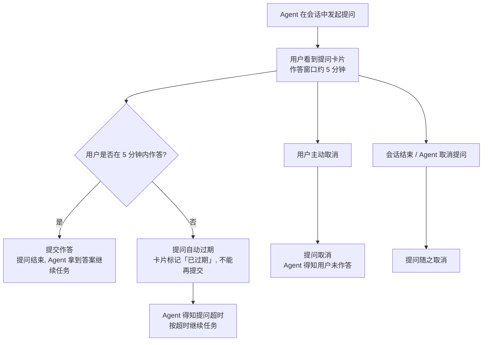

# 提问超时从 60 秒改为 300 秒

**功能名称**: 提问超时从 60 秒改为 300 秒
**PRD 版本**: v1.0
**创建日期**: 2026-11-27
**作者**: z-agent-bot

## 背景与目标

### 1.1 背景

Agent 在会话中向用户「提问」（表单填写、单选/多选、链接跳转等）时，用户必须在约 60 秒内完成作答，否则提问自动过期，Agent 只能按超时继续执行。来源：GitHub Issue [Deliay/z-agent-gear#602](https://github.com/Deliay/z-agent-gear/issues/602)「提问超时从60秒改为300秒」。

60 秒的作答窗口在实际使用中明显偏短：

1. **问题需要思考**：用户经常需要阅读问题、思考甚至查阅资料后再作答，60 秒内根本来不及；
2. **表单填写被腰斩**：提问表单字段稍多时，用户填到一半提问就过期，前面的输入作废；
3. **短暂离开即错过**：用户临时离开屏幕片刻，回来后提问已经过期，只能让 Agent 拿不到答案继续任务。

### 1.2 目标

- 会话内「提问」的用户可作答时限从 **60 秒延长到 300 秒（约 5 分钟）**。
- 全链路口径一致：提问卡片的倒计时、过期判定、过期提示文案都按 300 秒展示与生效。
- **权限审批的 60 秒时限保持不变**（见 3.5 范围边界）。

### 1.3 成功标准

- 提问卡片出现后，用户在 5 分钟内作答均视为有效作答，Agent 收到答案。
- 超过 5 分钟未作答，提问自动过期：卡片标记「已过期」，用户不能再提交，Agent 侧按超时继续。
- 提问的过期提示文案由「约 1 分钟后过期」改为「约 5 分钟后过期」，与实际时限一致。
- 权限审批仍在 60 秒未响应时自动超时，行为与现状完全一致，零回归。

## 用户分析

### 2.1 目标用户

- **会话用户（被提问的人）**：在会话中回答 Agent 提问的开发者/使用者。

### 2.2 用户场景

| 场景 | 用户角色 | 目标 | 痛点 |
|--|--|--|--|
| Agent 提问需要思考后作答 | 会话用户 | 有充足时间思考、查资料后再回答 | 60 秒太短，还没想好提问就过期 |
| 提问表单字段较多 | 会话用户 | 从容填写完整表单再提交 | 填到一半超时作废，前功尽弃 |
| 临时离开屏幕片刻 | 会话用户 | 回来后仍能作答 | 短暂离开就错过提问 |
| Agent 等待答案继续任务 | 会话用户 | 尽量拿到用户的真实答案 | 频繁超时导致 Agent 空转或按猜测继续 |

## 功能需求

### 3.1 功能概述

将会话内「提问」的用户可作答时限从 60 秒延长到 300 秒（约 5 分钟）：5 分钟内作答有效、5 分钟未作答自动过期，过期提示文案同步更新；超时后的收敛行为（卡片标记已过期、Agent 按超时继续）保持现状不变。

### 3.2 功能列表

#### 功能点 1: 提问作答时限延长为 300 秒

- **描述**: 提问出现后，用户有 **300 秒（约 5 分钟）** 的作答窗口。窗口内提交的作答正常生效；窗口结束仍未作答的，提问自动过期。时限对所有提问形式（表单、单选/多选、链接跳转）一致生效。
- **用户价值**: 用户有充足时间思考与填写，减少「还没来得及回答就过期」的挫败感。
- **验收标准**:
  - [ ] 提问出现后 5 分钟内作答，作答正常生效并被 Agent 接收。
  - [ ] 超过 5 分钟未作答，提问自动过期，卡片标记「已过期」，无法再提交。
  - [ ] 提问卡片的过期倒计时按 300 秒起算，与实际过期时刻一致。
  - [ ] 表单、单选/多选、链接跳转等提问形式的时限一致。

#### 功能点 2: 过期提示文案同步

- **描述**: 提问相关的过期提示文案由「该请求将在约 1 分钟后过期」改为「该请求将在约 **5 分钟**后过期」，与实际时限一致。
- **用户价值**: 文案与真实行为一致，用户对剩余作答时间有正确预期。
- **验收标准**:
  - [ ] 提问的过期提示展示「约 5 分钟后过期」，不再出现「约 1 分钟后过期」。
  - [ ] 过期后的「该提问已过期」提示保持现状。

#### 功能点 3: 超时收敛行为保持不变

- **描述**: 提问超时后的行为与现状一致：卡片自动标记已过期并禁止提交、会话时间线保留过期记录供回看、Agent 侧得知超时后继续任务；提问期间会话结束、Agent 取消等情形的取消行为也不变。
- **用户价值**: 仅调整时限，交互语义零变化，用户无需重新学习。
- **验收标准**:
  - [ ] 超时后卡片置灰/标记过期，重复提交被拒绝并提示已过期。
  - [ ] 超时瞬间前后的提交以「是否在时限内到达」为准，不出现既算成功又算过期的双态。
  - [ ] 会话结束、Agent 取消时提问随之取消，行为与现状一致。

### 3.3 用户操作流程

### 3.4 页面/界面描述

| 页面 | 描述 | 关键元素 |
|------|------|---------|
| 会话内提问卡片 | 会话时间线中的提问交互卡片 | 问题内容、表单/选项、提交按钮、剩余时间倒计时（约 5 分钟）、过期后置灰并标记「已过期」 |
| 提问提醒弹窗 | 无法内联展示时的降级提醒弹窗 | 问题摘要、跳转到会话内提问卡片、过期提示「该请求将在约 5 分钟后过期」 |

### 3.5 异常与边界情况

| 情况 | 预期行为 |
|------|---------|
| 用户在 5 分钟内作答 | 作答生效，Agent 收到答案 |
| 超过 5 分钟未作答 | 提问自动过期，卡片标记「已过期」，Agent 按超时继续 |
| 过期后尝试提交 | 提示已过期，提交不生效 |
| 超时瞬间并发提交 | 以「是否在时限内到达」为准，只产生一个终态，不出现双态 |
| 提问期间会话结束/断线/Agent 取消 | 提问随之取消，行为与现状一致 |
| **权限审批请求** | **仍为 60 秒超时，保持现状不变（非本次范围）** |
| 历史提问卡片 | 作答/过期记录照常回看，不受本次调整影响 |

### 3.6 范围边界（非目标）

- **仅「提问」的超时从 60 秒改为 300 秒**。「权限审批」（Agent 请求执行敏感操作前的授权确认）的 60 秒时限**不在本次范围，保持不变**——权限审批要求用户快速决策以避免 Agent 长时间挂起，与「提问需要思考」场景诉求不同。
- 不引入超时时长的用户/租户级自定义配置，本次为统一固定值调整。
- 不改变超时后的交互语义（过期标记、Agent 超时继续等行为均维持现状）。

## 四、非功能需求

### 4.1 性能要求

无新增性能要求；仅调整时限取值。

### 4.2 安全性要求

无变化。权限审批仍保持 60 秒快速超时的既有安全语义（超时默认不放行）。

### 4.3 兼容性要求

- 新时限对功能上线后新产生的提问生效；历史提问卡片的记录不受影响。
- 提问与权限审批的时限从此不同（300 秒 / 60 秒），所有相关提示文案需按各自时限展示，不得混用。

## 五、依赖与约束

### 5.1 依赖

- 会话内提问（表单/单选/多选/链接）与权限审批功能（已上线）。

### 5.2 约束

- 权限审批时限维持 60 秒不变（3.6 范围边界）。
- 提问卡片倒计时、过期判定、提醒文案必须使用同一时限口径，不允许各处口径不一致。

## 六、相关文档

- 需求来源：[Deliay/z-agent-gear#602](https://github.com/Deliay/z-agent-gear/issues/602)「提问超时从60秒改为300秒」
- 技术提案：[[../../engineering/proposals/20261127-fix-question-timeout-300s.md]]
