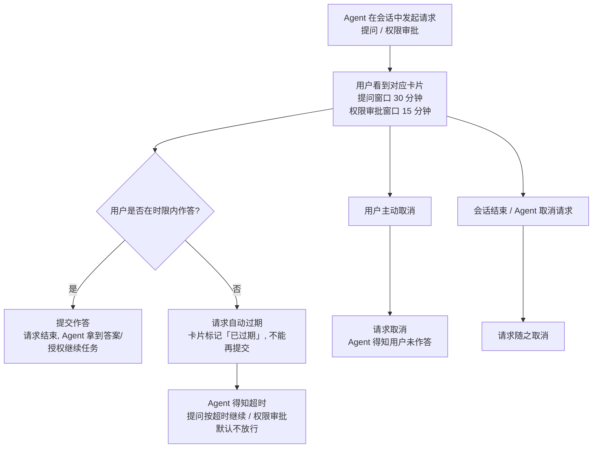

# 提问超时提升为 30 分钟、权限审批提升为 15 分钟

**功能名称**: 提问超时提升为 30 分钟、权限审批提升为 15 分钟
**PRD 版本**: v1.1
**创建日期**: 2026-11-27
**作者**: z-agent-bot

**修订记录**：

- **v1.1（2026-11-27）**：按 PR [#603](https://github.com/Deliay/z-agent-gear/pull/603) 评审意见修订——提问超时 60s → **30 分钟**、权限审批超时 60s → **15 分钟**（初版按 Issue [#602](https://github.com/Deliay/z-agent-gear/issues/602) 题面为「提问 300 秒」且权限审批不变，评审调整为两者均提升；文件名沿用 Issue #602 题面 slug）。
- **v1.0（2026-11-27）**：初版。

## 背景与目标

### 1.1 背景

Agent 在会话中向用户「提问」（表单填写、单选/多选、链接跳转等）或请求「权限审批」（执行敏感操作前的授权确认）时，用户必须在约 60 秒内完成作答，否则请求自动过期，Agent 只能按超时继续执行。来源：GitHub Issue [Deliay/z-agent-gear#602](https://github.com/Deliay/z-agent-gear/issues/602)「提问超时从60秒改为300秒」，经 PR #603 评审确认最终口径为**提问 30 分钟、权限审批 15 分钟**。

60 秒的作答窗口在实际使用中明显偏短：

1. **问题需要思考**：用户经常需要阅读问题、思考甚至查阅资料后再作答，60 秒内根本来不及；
2. **表单填写被腰斩**：提问表单字段稍多时，用户填到一半提问就过期，前面的输入作废；
3. **权限审批需要核对**：授权敏感操作前用户需要核对操作内容再决策，60 秒过短，容易因过期导致 Agent 拿不到授权；
4. **短暂离开即错过**：用户临时离开屏幕片刻，回来后请求已经过期，只能让 Agent 按超时继续任务。

### 1.2 目标

- 会话内「提问」的用户可作答时限从 **60 秒提升为 30 分钟**。
- 会话内「权限审批」的用户可作答时限从 **60 秒提升为 15 分钟**。
- 全链路口径一致：两类卡片的倒计时、过期判定、过期提示文案都按各自时限展示与生效，不混用。

### 1.3 成功标准

- 提问卡片出现后，用户在 **30 分钟**内作答均视为有效作答，Agent 收到答案；超过 30 分钟未作答自动过期。
- 权限审批卡片出现后，用户在 **15 分钟**内作答均视为有效；超过 15 分钟未作答自动过期，超时默认不放行的既有安全语义不变。
- 提问的过期提示文案为「约 30 分钟后过期」、权限审批为「约 15 分钟后过期」，与实际时限一致。
- 超时后的收敛行为（卡片标记已过期、禁止提交、Agent 按超时继续）与现状一致，零语义回归。

## 用户分析

### 2.1 目标用户

- **会话用户（被提问/被授权的人）**：在会话中回答 Agent 提问、审批敏感操作的开发者/使用者。

### 2.2 用户场景

| 场景 | 用户角色 | 目标 | 痛点 |
|--|--|--|--|
| Agent 提问需要思考后作答 | 会话用户 | 有充足时间思考、查资料后再回答 | 60 秒太短，还没想好提问就过期 |
| 提问表单字段较多 | 会话用户 | 从容填写完整表单再提交 | 填到一半超时作废，前功尽弃 |
| 审批敏感操作需要核对 | 会话用户 | 核对操作内容与影响后再授权 | 60 秒过短，仓促决策或过期 |
| 临时离开屏幕片刻 | 会话用户 | 回来后仍能作答 | 短暂离开就错过提问/审批 |
| Agent 等待答案继续任务 | 会话用户 | 尽量拿到用户的真实答案/授权 | 频繁超时导致 Agent 空转或按猜测继续 |

## 功能需求

### 3.1 功能概述

提升会话内两类交互请求的用户可作答时限：**提问从 60 秒提升为 30 分钟（1800 秒）**、**权限审批从 60 秒提升为 15 分钟（900 秒）**。时限窗口内作答有效，窗口结束未作答自动过期；过期提示文案按各自时限同步更新；超时后的收敛行为保持现状不变。

### 3.2 功能列表

#### 功能点 1: 提问作答时限提升为 30 分钟

- **描述**: 提问出现后，用户有 **30 分钟** 的作答窗口。窗口内提交的作答正常生效；窗口结束仍未作答的，提问自动过期。时限对所有提问形式（表单、单选/多选、链接跳转）一致生效。
- **用户价值**: 用户有充足时间思考与填写，减少「还没来得及回答就过期」的挫败感。
- **验收标准**:
  - [ ] 提问出现后 30 分钟内作答，作答正常生效并被 Agent 接收。
  - [ ] 超过 30 分钟未作答，提问自动过期，卡片标记「已过期」，无法再提交。
  - [ ] 提问卡片的过期倒计时按 30 分钟起算，与实际过期时刻一致。
  - [ ] 表单、单选/多选、链接跳转等提问形式的时限一致。

#### 功能点 2: 权限审批作答时限提升为 15 分钟

- **描述**: 权限审批出现后，用户有 **15 分钟** 的作答窗口。窗口内选择的授权/拒绝正常生效；窗口结束未作答的，权限审批自动过期，**超时默认不放行**的既有安全语义保持不变。
- **用户价值**: 用户有充足时间核对敏感操作内容后再决策，避免因过期导致操作拿不到授权。
- **验收标准**:
  - [ ] 权限审批出现后 15 分钟内作答，作答正常生效并被 Agent 接收。
  - [ ] 超过 15 分钟未作答，权限审批自动过期，超时默认不放行。
  - [ ] 权限审批卡片的过期倒计时按 15 分钟起算，与实际过期时刻一致。

#### 功能点 3: 过期提示文案同步

- **描述**: 过期提示文案与实际时限一致：提问为「该请求将在约 **30 分钟**后过期」，权限审批为「该请求将在约 **15 分钟**后过期」；两类文案各自对应，不混用。过期后的「已过期」提示保持现状。
- **用户价值**: 文案与真实行为一致，用户对剩余作答时间有正确预期。
- **验收标准**:
  - [ ] 提问的过期提示展示「约 30 分钟后过期」，不再出现「约 1 分钟后过期」。
  - [ ] 权限审批的过期提示展示「约 15 分钟后过期」，不再出现「约 1 分钟后过期」。
  - [ ] 过期后的已过期提示保持现状。

#### 功能点 4: 超时收敛行为保持不变

- **描述**: 超时后的行为与现状一致：卡片自动标记已过期并禁止提交、会话时间线保留过期记录供回看、Agent 侧得知超时后继续任务（权限审批超时默认不放行）；请求期间会话结束、Agent 取消等情形的取消行为也不变。
- **用户价值**: 仅调整时限，交互语义零变化，用户无需重新学习。
- **验收标准**:
  - [ ] 超时后卡片置灰/标记过期，重复提交被拒绝并提示已过期。
  - [ ] 超时瞬间前后的提交以「是否在时限内到达」为准，不出现既算成功又算过期的双态。
  - [ ] 会话结束、Agent 取消时请求随之取消，行为与现状一致。

### 3.3 用户操作流程

### 3.4 页面/界面描述

| 页面 | 描述 | 关键元素 |
|------|------|---------|
| 会话内提问卡片 | 会话时间线中的提问交互卡片 | 问题内容、表单/选项、提交按钮、剩余时间倒计时（约 30 分钟）、过期后置灰并标记「已过期」 |
| 提问提醒弹窗 | 无法内联展示时的降级提醒弹窗 | 问题摘要、跳转到会话内提问卡片、过期提示「该请求将在约 30 分钟后过期」 |
| 会话内权限审批卡片 | 会话时间线中的权限审批卡片 | 操作内容、授权选项、剩余时间倒计时（约 15 分钟）、过期后置灰并标记「已过期」 |
| 权限审批提醒弹窗 | 无法内联展示时的降级提醒弹窗 | 操作摘要、跳转到会话内权限审批卡片、过期提示「该请求将在约 15 分钟后过期」 |

### 3.5 异常与边界情况

| 情况 | 预期行为 |
|------|---------|
| 用户在时限内作答 | 作答生效，Agent 收到答案/授权 |
| 超过时限未作答 | 请求自动过期，卡片标记「已过期」，Agent 按超时继续（权限审批默认不放行） |
| 过期后尝试提交 | 提示已过期，提交不生效 |
| 超时瞬间并发提交 | 以「是否在时限内到达」为准，只产生一个终态，不出现双态 |
| 请求期间会话结束/断线/Agent 取消 | 请求随之取消，行为与现状一致 |
| 通知提醒先于作答窗口消失 | 仅通知提醒过期，卡片仍可正常作答（详见 3.6） |
| 历史提问/权限审批卡片 | 作答/过期记录照常回看，不受本次调整影响 |

### 3.6 范围边界（非目标）

- 提问 30 分钟、权限审批 15 分钟为**统一固定值**，不引入用户/租户级自定义配置。
- 不改变超时后的交互语义（过期标记、Agent 超时继续、权限审批超时默认不放行等行为均维持现状）。
- **通知提醒的保留窗口（5 分钟）不调整**：它只负责通知清理，与作答有效性无关；调整后通知提醒会先于作答窗口消失，但卡片仍可正常作答，属预期行为。

## 四、非功能需求

### 4.1 性能要求

无新增性能要求；仅调整时限取值。

### 4.2 安全性要求

权限审批超时**默认不放行**的既有安全语义不变；时限延长不改变授权判定逻辑。

### 4.3 兼容性要求

- 新时限对功能上线后新产生的请求生效；历史卡片的记录不受影响。
- 提问（30 分钟）与权限审批（15 分钟）时限不同，所有相关提示文案需按各自时限展示，不得混用。

## 五、依赖与约束

### 5.1 依赖

- 会话内提问（表单/单选/多选/链接）与权限审批功能（已上线）。

### 5.2 约束

- 提问卡片倒计时、过期判定、提醒文案必须使用同一时限口径（30 分钟）；权限审批同理（15 分钟），两类口径不得混用。
- 权限审批超时默认不放行的语义保持不变。

## 六、相关文档

- 需求来源：[Deliay/z-agent-gear#602](https://github.com/Deliay/z-agent-gear/issues/602)「提问超时从60秒改为300秒」；评审修订见 [PR #603](https://github.com/Deliay/z-agent-gear/pull/603)（提问 30 分钟、权限审批 15 分钟）
- 技术提案：[[../../engineering/proposals/20261127-fix-question-timeout-300s.md]]
