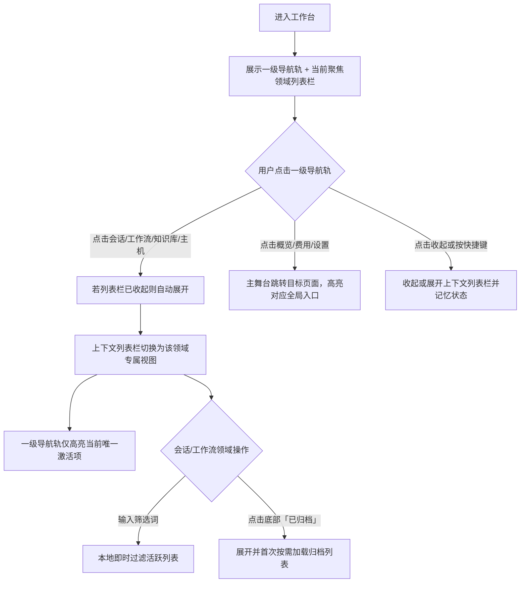
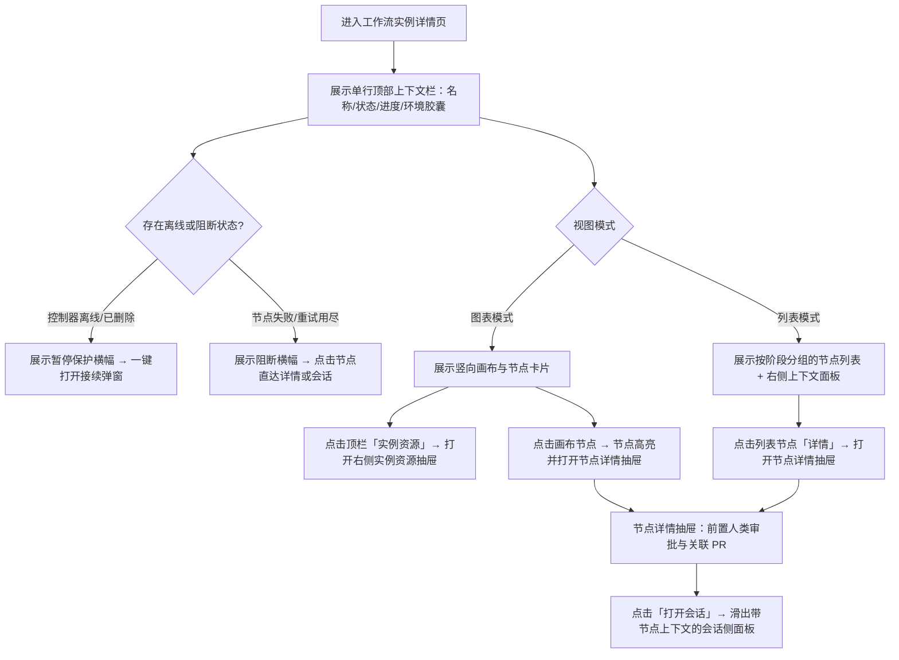

# 左侧导航面板与工作流实例详情重构

**功能名称**: 左侧导航面板与工作流实例详情重构
**PRD 版本**: v1.0
**创建日期**: 2026-11-27
**作者**: ZeroAsh Agent（需求来源：Deliay）

## 一、背景与目标

### 1.1 背景

工作台已完成基础视觉规范确立与一期外壳改造，形成了「一级导航轨 + 上下文列表栏 + 主工作舞台」的整体方向（参见 [[../../engineering/prototypes/20261127-ui-specification.md|UI 规范文档]] 与 [[../../engineering/prototypes/20261127-ui-specification.html|交互式规范演示手册]]）。但在实际高频使用与逐项对照设计规范时，以下两个最高频核心区域仍停留在旧有交互骨架上，存在明显体验落差：

1. **左侧导航面板仍为旧式纵向手风琴堆叠**：
   - 虽然已引入左侧 56px 一级导航轨，但右侧上下文列表栏仍将「主机」「工作流」「会话」「知识库」「网关」「Review」六个分区全部纵向堆叠在同一滚动区域内。点击一级导航轨图标仅展开对应折叠区并滚动定位，用户依然面临视野拥挤与滚动迷失。
   - 一级导航轨与上下文列表栏缺乏表面明度层级区分；切换路由时可能出现导航轨两个图标同时高亮的混乱状态。
   - 桌面端上下文列表栏底部重复堆叠了「费用」「设置」「新建会话」等入口，与一级导航轨底部功能重叠，视觉噪点高；部分默认文案仍残留英文（如 "New Session"、"Settings"）。
2. **工作流实例详情页信息层级松散、视图割裂**：
   - 顶部操作栏缺少统一的上下文栏规范，未展示实例整体节点完成进度与环境摘要，高频视图切换按钮与危险操作「删除实例」并排混放，易误触且视觉杂乱。
   - 切换至「图表（竖向画布）」模式时，工作流黑板、垃圾桶、关联 PR 与追加提示词等实例级资源面板被整体隐藏，用户必须切回列表模式才能查看黑板产物与上下文。
   - 节点卡片与列表卡片视觉层次不一致，进行中动态提示残留英文（如 "Concluding..."），当前选中检视的节点在画布中无高亮反馈；节点详情抽屉中「人类节点审批/打回」被压在长篇产物之后，操作路径过长；节点会话侧面板缺少所属节点上下文标识。

### 1.2 目标

1. **彻底重构左侧导航面板**：落地「一级导航轨（最深表面）+ 领域聚焦上下文列表栏（次级表面）」的清晰双层左侧架构，一次只聚焦展示一个主领域列表，消除纵向手风琴堆叠与重复底栏入口。
2. **全面升级工作流实例详情页**：建立统一单行顶部上下文栏、清晰异常引导横幅、全场景可访问的实例资源抽屉、视觉一致的竖向画布与节点列表，以及操作前置的节点详情抽屉与节点会话面板。
3. **100% 遵循 UI 规范基准**：亮暗双主题表面层级清晰、字号不低于 12px、全部计数与数值等宽对齐、界面文案 100% 简体中文（专有名词保持标准写法）、既有业务能力与性能口径（归档无计数按需加载、首屏零冗余请求）零退化。

### 1.3 成功标准

| 指标 | 目标值 |
|------|--------|
| 左侧领域聚焦 | 点击一级导航轨「会话 / 工作流 / 知识库 / 主机」后，上下文列表栏仅呈现该领域专属内容，不再同时渲染其余领域手风琴 |
| 导航唯一激活态 | 任意页面与交互下，一级导航轨至多高亮一个激活项（含左侧品牌色指示条），杜绝双高亮 |
| 入口零冗余 | 桌面端上下文列表栏底部不再重复展示「费用」「设置」「新建会话」入口；移动端保留全部直达入口不丢失 |
| 工作流顶栏收敛 | 工作流实例详情页具备单行顶部上下文栏，呈现名称、重命名、状态与进度（如 `3/10`）、环境摘要、视图切换、实例资源抽屉与收纳后的次要/危险操作 |
| 画布资源可达性 | 工作流「图表」模式下可随时一键打开实例资源面板查看黑板、垃圾桶、关联 PR 与追加提示词，无需切回列表 |
| 抽屉操作效率 | 节点详情抽屉内「人类节点审批/打回」与「关联 Pull Request」前置展示，无需滚动越过长篇产物 |
| 规范与文案合规 | 全量改动区域字号 ≥ 12px、数值等宽对齐、交互文案 100% 简体中文（无 "New Session" / "Settings" / "Concluding..." 等残留） |
| 性能与功能零退化 | 归档分组仍常驻折叠、无计数、点击按需加载；首屏与详情轮询无新增冗余请求，既有核心操作路径全部通过验收 |

## 二、用户分析

### 2.1 目标用户

- **日常高频研发用户**：同时并行推进多个 Agent 会话与自动化工作流，需要在会话、工作流、知识库与主机环境之间高频切换，并在工作流详情页追踪节点进展、审阅 PR、审批人类节点与排查失败节点。
- **团队协作者与多端用户**：在不同租户/项目工作区间切换，在桌面宽屏、笔记本窄屏及移动端浏览器下查看会话与审批工作流。

### 2.2 用户场景

| 场景 | 用户角色 | 目标 | 现有痛点 |
|------|----------|------|---------|
| 在多领域间高频切换 | 开发者 | 在会话、工作流、知识库、主机之间一键切换，只看当前关心的列表 | 六个折叠区堆叠在一栏中，滚动长、定位慢，导航轨图标与列表状态容易错位 |
| 快速定位某个会话或工作流 | 开发者 | 通过关键词即时筛选活跃列表，或展开已归档记录回溯历史 | 列表无内置筛选，条目多时只能肉眼翻找 |
| 监控工作流整体推进 | 开发者 | 在工作流详情页一眼看清总进度、当前运行节点、关联 PR 与环境信息 | 顶栏缺少总进度与环境摘要，操作按钮杂乱 |
| 在画布视图中查阅黑板与上下文 | 开发者 | 停留在竖向画布视图中，边看节点拓扑边查黑板产物与追加提示词 | 画布模式下右侧黑板与上下文面板被完全隐藏，只能来回切换视图 |
| 审批工作流人类节点或排查失败节点 | 开发者 / 审阅者 | 点击节点快速查看关联 PR 并直接通过/打回，或进入节点会话处理失败 | 抽屉中人类操作按钮沉底在长篇产物之后，进入会话时看不清对应节点信息 |

## 三、功能需求

### 3.1 功能概述

本次重构聚焦工作台的两个核心界面模块：
1. **左侧导航面板整体重构**：将原有堆叠式侧边栏升级为「一级导航轨 + 领域聚焦上下文列表栏」，明确表面层级、统一顶部工作区切换与快捷筛选、精简底部状态栏、清理重复入口与残留英文文案。
2. **工作流实例详情页重构**：统一顶部上下文栏、优化离线/阻断警示横幅、升级竖向画布节点卡片与节点列表视图、补齐画布模式下的实例资源抽屉、优化节点详情抽屉信息优先级与节点会话侧面板体验。

### 3.2 功能列表

#### 模块一：左侧导航面板整体重构

##### 功能点 1：一级导航轨表面层级与唯一激活态
- **描述**：
  - 一级导航轨采用最深层表面底色，与次级表面的上下文列表栏、主内容画布形成清晰的三级明度递进，辅以 1px 低对比度分割线。
  - 顶部区域依次放置「概览」及四大核心工作域「会话」「工作流」「知识库」「主机」；存在待处理评审或待办交互时，在「会话」图标右上角展示高对比度警告圆点。
  - 底部区域统一收纳「在线主机计数」「收起/展开列表栏（同步支持快捷键）」「我的费用」「设置中心」。
  - 激活态唯一收敛：访问概览/费用/设置页时高亮对应全局入口；访问会话/工作流/知识库详情页或点击对应领域图标时，仅高亮当前唯一激活领域（左侧显示品牌色指示条），不再出现两个图标同时激活的情况。
- **用户价值**：一眼辨识当前所处领域与空间层级，消除导航状态错乱。
- **验收标准**：
  - [ ] 亮色与暗色模式下，一级导航轨与上下文列表栏底色存在清晰明度差。
  - [ ] 任意路由切换或点击领域图标后，一级导航轨仅存在一个激活指示条。
  - [ ] 点击收起按钮或按下收起快捷键，上下文列表栏平滑收起/展开，且折叠状态可跨刷新记忆；收起状态下点击任意领域图标自动展开列表栏并切换至该领域。

##### 功能点 2：领域聚焦上下文列表栏（终结纵向手风琴堆叠）
- **描述**：
  - 上下文列表栏由顶部固定区、领域标题栏、领域专属列表区、底部状态栏四段组成，桌面端支持 220px–420px 拖拽调宽（默认 280px）并记忆宽度。
  - **顶部固定区**：常驻租户/工作区切换器（含只读权限标识）；在「会话」「工作流」领域下提供轻量本地关键词筛选框（即时过滤当前列表，不触发服务端请求）及全局快速新建入口提示。
  - **领域标题栏**：展示当前领域标题、活跃条目计数（等宽数字对齐）与该领域的主「+ 新建」按钮（如新建会话、实例化工作流、新建云电脑、新建知识库）。
  - **四大领域专属视图**（每次仅渲染当前激活领域，不再同时堆叠其余领域）：
    1. **会话领域**：顶部在存在待审记录时置顶展示「待 Review / 已 Review」分组（空时不占空间）；主区展示按最近更新排序的活跃会话两行卡片（状态圆点 + 标题 + 所属工作区）；底部常驻「已归档」折叠行（无计数、默认折叠、点击按需加载）。
    2. **工作流领域**：主区展示按最近更新排序的活跃工作流实例两行卡片（实例名 + 状态圆点与徽标 + 不可用接续入口 + 所属工作区）；底部常驻「已归档」折叠行（无计数、默认折叠、点击按需加载）。
    3. **知识库领域**：展示平台托管知识库目录树（按权限提供新建知识库、新建子文档与知识库设置入口）及仓库内建知识库只读分区（默认折叠、按需扫描）。
    4. **主机领域**：上半区展示云电脑与本地控制器树（主机 → 项目工作区 → Worktree 分支与会话，保留新建云电脑、新建会话、GitHub 项目设置与控制器配置入口）；下半区展示端口转发网关列表（仅展示在线主机的网关，支持新增网关）。
- **用户价值**：大幅提升单领域信息视野与扫描效率，彻底告别多层手风琴来回滚动。
- **验收标准**：
  - [ ] 切换一级导航轨领域图标时，上下文列表栏立即切换为对应领域专属视图，不展示其他领域的折叠手风琴。
  - [ ] 会话与工作流领域内输入筛选关键词，活跃列表即时过滤；清空后完整恢复；无匹配时展示紧凑空态提示。
  - [ ] 会话与工作流领域底部的「已归档」分组始终不显示计数、默认折叠，仅在首次点击展开时加载数据。
  - [ ] 切换到非知识库领域时，不展示知识库树；切换到主机领域时，控制器树与网关列表完整可用。

##### 功能点 3：精简底栏与多端适配收口
- **描述**：
  - 桌面端上下文列表栏底部仅保留当前用户标识、全局待办提醒入口与主题切换控件，移除与一级导航轨重复的「费用」「设置」「新建会话」按钮。
  - 移动端（窄屏）保留底部主导航栏，并在列表页全屏展示上下文列表栏时保留领域切换与直达「我的费用」「设置」入口，确保窄屏下所有功能可达且无横向溢出。
  - 全量清理左侧面板残留英文文案：无标题会话统一显示「未命名会话」，所有按钮与无障碍标签统一使用简体中文。
- **用户价值**：消除冗余操作按钮带来的视觉干扰，确保桌面与移动双端体验一致。
- **验收标准**：
  - [ ] 桌面端上下文列表栏底部不再出现重复的费用、设置与新建会话按钮。
  - [ ] 移动端窄屏下可顺畅切换领域、访问费用与设置，无横向滚动条。
  - [ ] 左侧面板所有可见文本与无障碍标签均为简体中文，字号均 ≥ 12px。

#### 模块二：工作流实例详情页重构

##### 功能点 4：统一单行顶部上下文栏与状态横幅
- **描述**：
  - **单行顶部上下文栏**：置于页面最上方，高度紧凑、底部分割线清晰：
    - 左侧：移动端返回按钮、实例名称（支持内联触发重命名）、当前状态徽标、节点完成进度胶囊（如 `已完成 3/10`，等宽数字）、环境信息胶囊（悬停或点击展开查看控制器名称、所属工作区、关联分支等环境摘要）、关联 PR 数量/快捷徽标。
    - 右侧：分段式视图切换器（「图表」/「列表」，记忆用户选择）、实例资源抽屉按钮（展示黑板/PR/追加提示词汇总入口，画布模式下尤为关键）、以及收纳次要与危险操作的「更多操作」菜单（归档/取消归档、删除实例，删除操作以危险样式区分并保留二次确认弹窗）。
  - **状态警示横幅**：
    - 控制器离线/已删除横幅：置于顶栏下方，清晰说明暂停保护态与产物保留，突出「接续到在线主机」主操作按钮。
    - 节点失败/重试用尽阻断横幅：使用规范警示图标替代原始表情符号，逐条列出阻断节点与原因，支持点击节点直接打开其详情抽屉或节点会话。
- **用户价值**：关键状态与进度一目了然，高频操作触手可及，危险操作安全隔离。
- **验收标准**：
  - [ ] 顶栏展示实例名、重命名入口、当前状态、节点完成进度（等宽数字）、环境信息胶囊、分段视图切换器、实例资源按钮与更多操作菜单。
  - [ ] 归档/取消归档与删除实例功能完整保留，删除操作触发二次确认弹窗。
  - [ ] 控制器离线或节点阻断时，横幅展示清晰且支持一键接续或直达失败节点详情/会话。

##### 功能点 5：竖向画布与节点卡片升级
- **描述**：
  - 画布节点卡片采用统一的不透明卡片底色 + 左侧 4px 语义状态色条，精简视觉密度并保持信息完整：节点标题、类型标识、返工次数（等宽数字）、状态徽标、AI 节点的工具与模型标签、待处理交互提醒按钮、PR 与检查项徽标、资源小卡片及人类节点就地操作。
  - 进行中动态提示全面中文化（如「思考中…」「执行中：{工具}」「正在汇总结果…」），消除英文残留；完成态 Token 消耗采用等宽数字排版。
  - 当用户点击某个节点打开右侧详情抽屉时，画布中对应节点呈现清晰的选中高亮边框，关闭抽屉后恢复。
  - 保持自动定位执行中节点能力（首次进入直接定位，状态切换平滑过渡，不打断用户手动拖拽与缩放），并确保画布背景、缩放控件与缩略图在亮暗双主题下均清晰可读。
- **用户价值**：画布信息更易扫描，选中节点与抽屉状态一一对应，暗色与亮色模式下长时间观察不疲劳。
- **验收标准**：
  - [ ] 画布节点卡片在亮暗双主题下均为不透明卡片底色，无英文状态文案残留。
  - [ ] 点击节点打开详情抽屉时，画布对应节点呈现选中高亮态。
  - [ ] 5 秒轮询刷新期间，用户手动平移或缩放画布不会被强制重置。

##### 功能点 6：节点列表视图与全模式实例资源面板
- **描述**：
  - **节点列表视图**：按阶段分组展示，每个节点卡片对齐统一表面层级（不透明卡片底色 + 左侧语义状态色条 + 统一状态徽标 + 等宽数字），折叠态展示核心摘要与快捷操作，展开态清晰分区展示节点说明、提示词副本、失败/打回说明、节点产物与人类操作。
  - **全模式实例资源面板**：
    - 列表模式下，右侧上下文栏以结构化卡片容器呈现「工作流黑板」「垃圾桶」「关联 Pull Request」「追加提示词」，支持一键展开/折叠与条数徽标。
    - 图表（画布）模式下，点击顶栏「实例资源」按钮从右侧滑出实例资源抽屉，展示完全一致的黑板、垃圾桶、关联 PR 与追加提示词内容，彻底消除画布模式下无法查看黑板与追加提示词的断层。
- **用户价值**：无论偏好画布还是列表，均可随时查看完整实例上下文，双视图视觉与信息口径完全一致。
- **验收标准**：
  - [ ] 列表视图节点卡片具备统一的卡片底色与左侧语义状态条，折叠/展开交互与编辑/重启/详情/会话操作全部可用。
  - [ ] 图表模式下点击顶栏「实例资源」可打开右侧抽屉，完整查看工作流黑板、垃圾桶、关联 PR 与追加提示词。

##### 功能点 7：节点详情抽屉与节点会话侧面板重构
- **描述**：
  - **节点详情抽屉**按操作优先级重新编排内容区块：
    1. 顶部操作与状态条：节点类型、状态徽标、返工次数、以及「打开会话」「重启节点」「立即失败」快捷按钮。
    2. **人类节点操作前置**：当节点处于可审批状态时，将「完成 / 打回」操作区前置至抽屉上半区，无需滚动越过长篇产物。
    3. **关联 Pull Request 前置**：紧随其后展示 PR 链接、检查项状态、同步提交与同步异常。
    4. 基础元信息与异常说明：阶段、说明、开始时间、最近返工、自动重试进度（等宽数字）及失败/打回原因高亮提示条。
    5. 节点产物列表：采用柔和内嵌区块展示产物标题与 Markdown 内容，避免多层重边框卡片嵌套。
  - **节点会话侧面板**：采用标准侧滑抽屉呈现，顶部清晰展示当前节点名称、节点状态徽标与「在新页面打开完整会话」快捷入口，内部完整承载节点会话交互。
- **用户价值**：大幅缩短人类节点审批与 PR 审阅的操作路径，在工作流内查看节点会话时上下文清晰不迷失。
- **验收标准**：
  - [ ] 人类节点处于待操作状态且包含多个产物时，打开节点详情抽屉无需滚动即可看到审批/打回操作区。
  - [ ] 关联 Pull Request 区块位于基础元信息与产物之前。
  - [ ] 打开节点会话侧面板时，顶栏清晰显示所属节点名称与状态，关闭后工作流视图滚动与缩放位置保持不变。

### 3.3 用户操作流程

#### 流程一：左侧导航面板领域切换与归档按需加载

#### 流程二：工作流实例详情页双视图与抽屉协同

### 3.4 页面/界面描述

| 区域 | 描述 | 关键元素 |
|------|------|---------|
| 一级导航轨 | 桌面端左侧最深表面窄轨，负责一级领域切换与全局入口 | 概览、会话（含待办警告点）、工作流、知识库、主机、在线主机计数、收起/展开开关、费用、设置 |
| 上下文列表栏 | 次级表面可调宽列表栏，一次仅聚焦展示一个主领域 | 工作区切换器、本地筛选框、领域标题与计数、主「+ 新建」按钮、领域专属列表、已归档按需折叠区、精简底部用户状态栏 |
| 工作流顶部上下文栏 | 工作流实例详情页顶部单行栏，汇聚状态与高频操作 | 实例名与重命名按钮、状态与进度胶囊、环境信息胶囊、关联 PR 徽标、图表/列表分段切换、实例资源抽屉开关、更多操作菜单 |
| 工作流画布与列表主区 | 承载工作流执行拓扑或按阶段分组的节点列表 | 节点卡片（左状态色条、状态徽标、模型标签、中文动态行、等宽 Token 统计、PR 徽标、人类就地操作）、选中高亮态 |
| 实例资源与节点详情抽屉 | 右侧滑出抽屉，不打断主画布视角 | 实例资源抽屉（黑板/垃圾桶/关联 PR/追加提示词）；节点详情抽屉（操作栏、前置人类审批、前置关联 PR、元信息、产物） |
| 节点会话侧面板 | 右侧宽抽屉，用于就地查看并介入节点会话 | 所属节点名称与状态标识、完整会话交互区、跳转完整会话页入口 |

### 3.5 异常与边界情况

| 情况 | 预期行为 |
|------|---------|
| 列表筛选无匹配项 | 在当前领域列表区展示紧凑空态「未找到匹配项」与一键清空筛选按钮，不影响底部「已归档」展开 |
| 归档分组加载失败 | 在归档展开区就地提示「加载失败」并提供「重试」按钮，不阻塞活跃列表 |
| 控制器离线或已删除 | 工作流详情页顶栏下方展示警示横幅并提供「接续」入口；节点重启、立即失败、人类节点审批操作置灰并提示原因 |
| 节点不存在或已被删除 | 节点详情抽屉展示明确提示文案，关闭后不影响画布或其他节点 |
| 超长实例名、节点名或无空格产物文本 | 标题单行截断并悬停显示完整名称，详情抽屉与产物文本自动换行，不产生横向溢出 |
| 后台轮询刷新期间正在输入审批意见或筛选词 | 轮询静默更新数据，不卸载页面、不清空输入框内容、不打断焦点与画布缩放位置 |

## 四、非功能需求

### 4.1 性能要求

- 领域切换在客户端即时完成（复用已加载的聚合概览数据），不因切换领域触发额外全量刷新。
- 「已归档」分组维持按需加载策略：默认折叠、首屏不请求、不展示计数。
- 工作流实例详情页 5 秒轮询期间不重新挂载节点树与画布，不导致闪烁或输入丢失。

### 4.2 安全性要求

- 严格遵守现有工作区与租户权限边界：只读工作区不展示越权新建/修改入口；不可用控制器工作区按既有口径过滤。
- 危险操作（删除工作流实例、AI 节点立即失败）必须经过明确二次确认。

### 4.3 兼容性与响应式要求

- 桌面端（≥ 768px）：完整呈现三层布局（一级导航轨 + 可调宽/可收起上下文列表栏 + 主工作舞台）；工作流详情支持图表与列表双模式及右侧抽屉。
- 移动端（< 768px）：保留底部主导航栏与全屏列表/详情切换；工作流顶栏自适应换行或收敛次要操作，抽屉全宽滑出，全页面无横向溢出。
- 亮色与暗色主题均满足 WCAG AA 文本对比度（≥ 4.5:1），全部可交互元素支持键盘导航与清晰的焦点环呈现。

## 五、依赖与约束

### 5.1 依赖

- 依赖已发布的 [[../../engineering/prototypes/20261127-ui-specification.md|UI 规范文档]] 与 [[../../engineering/ui-ux-standards.md|UI/UX 设计规范]] 作为视觉与交互的唯一验收基准。
- 复用现有数据聚合与实时推送能力，不依赖后端新增接口或数据结构变更。

### 5.2 约束

- 本次重构严格限定为表现层与交互层重构，不改变既有业务领域概念、状态流转规则与权限口径。
- 严禁引入小于 12px 的微字号，严禁在亮暗主题下出现硬编码低对比度色值，严禁残留未中文化交互文案。

## 六、相关文档

- [[../../engineering/prototypes/20261127-ui-specification.md|UI 规范与全场景组件化设计文档]]
- [[../../engineering/prototypes/20261127-ui-specification.html|UI 规范交互式演示手册]]
- [[../../engineering/prototypes/20261126-ui-ux-workspace-overhaul.html|工作区 UI/UX 重构交互原型]]
- [[../../engineering/ui-ux-standards.md|UI/UX 设计规范]]
- [[20261127-agent-web-full-ui-rework.md|Agent Web 全场景 UI 重构 PRD]]
- [[../../engineering/proposals/20261127-refactor-sidebar-and-workflow-detail.md|左侧导航面板与工作流实例详情重构 - 技术提案]]
