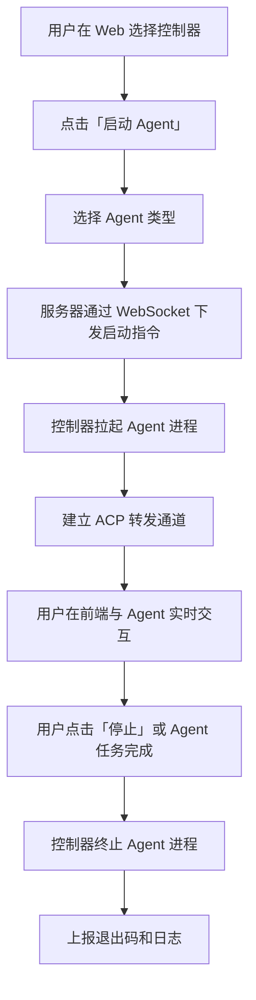

# Agent控制器管理 v2 产品草案

**功能名称**: Agent控制器管理
**PRD 版本**: v2.0
**创建日期**: 2026-05-17
**作者**: ZeroAsh

## 背景与目标

### 1.1 背景

v1 已完成控制器注册、绑定、心跳检测功能，用户可以在 Web 界面统一查看所有控制器的在线状态。但用户仍然需要 SSH 登录到远程机器手动管理 Agent 进程，无法在浏览器中直接与 Agent 交互。

### 1.2 目标

- 用户可以通过 Web 界面远程拉起、停止、重启控制器上的 Agent 实例
- Agent 实例的 stdio 流量通过 ACP（Agent Context Provider）协议实时转发到用户前端
- 用户在前端与远程 Agent 交互的体验与本地一致

### 1.3 成功标准

- Agent 实例拉起时间不超过 10s
- ACP 通信延迟在正常网络下不超过 500ms
- 控制器支持同时运行至少 5 个 Agent 实例
- 连接中断后 5s 内自动重连

## 用户分析

### 2.1 目标用户

- 已部署 v1 控制器、需要远程运行 Agent 的开发者
- 需要在后台运行长时间 Agent 任务（如代码重构、批量处理）的用户

### 2.2 用户场景

| 场景 | 用户角色 | 目标 | 痛点 |
|--|--|--|--|
| 远程运行 Agent | 个人开发者 | 在远程机器上按需运行 OpenCode/Codex | 需要 SSH 登录手动启动，操作繁琐 |
| 长时间运行任务 | 高级开发者 | 在后台运行长时间 Agent 任务 | 本地终端关闭后 Agent 就失联 |
| 按需释放资源 | 个人开发者 | 不需要 Agent 时释放远程机器资源 | Agent 常驻内存，浪费服务器资源 |

## 功能需求

### 3.1 功能概述

在 v1 的基础上，控制器新增 Agent 进程管理能力和 ACP 协议转发能力。用户通过 Web 界面可以远程管理控制器上的 Agent 实例，并通过 ACP 协议实时与 Agent 交互。

### 3.2 功能列表

#### 功能点 1: Agent 实例生命周期管理

- **描述**: 用户通过 Web 界面向指定控制器下发指令，拉起/停止/重启特定类型的 Agent 实例
- **用户价值**: 无需 SSH 登录，浏览器即可远程管理 Agent
- **验收标准**:
  - [ ] 用户可以选择 Agent 类型（如 OpenCode、Codex）并下发启动指令
  - [ ] 控制器收到指令后在本地拉起对应的 Agent 进程
  - [ ] 用户可以在 Web 界面上停止或重启正在运行的 Agent 实例
  - [ ] Agent 进程退出后，控制器上报退出码和日志到服务器

#### 功能点 2: ACP 协议实时通信

- **描述**: 控制器将 Agent 实例的 stdio 通过 ACP 协议封装，经由 WebSocket 实时转发到用户前端
- **用户价值**: 远程使用 Agent 如同本地一样流畅
- **验收标准**:
  - [ ] 用户可以在前端实时看到 Agent 的 stdout/stderr 输出
  - [ ] 用户可以在前端向 Agent 的 stdin 发送输入
  - [ ] 通信延迟在正常网络下不超过 500ms
  - [ ] 连接中断后支持自动重连

#### 功能点 3: Agent 实例列表与监控

- **描述**: 用户在控制器详情页查看该控制器上所有 Agent 实例的运行状态、资源占用和日志
- **用户价值**: 统一掌握每个 Agent 实例的运行情况
- **验收标准**:
  - [ ] 控制器详情页展示 Agent 实例列表（类型、状态、运行时长、CPU/内存占用）
  - [ ] 支持查看 Agent 实例的实时日志流
  - [ ] Agent 异常退出时前端展示错误信息和退出码

### 3.3 用户操作流程

### 3.4 页面/界面描述

| 页面 | 描述 | 关键元素 |
|------|------|---------|
| 控制器详情页 | 展示控制器上的 Agent 实例 | Agent 实例列表、启动/停止按钮、实时日志面板 |
| Agent 交互面板 | 用户与 Agent 实时交互的终端界面 | 输入框、输出区域、连接状态指示器 |

### 3.5 异常与边界情况

| 情况 | 预期行为 |
|------|---------|
| Agent 进程异常退出 | 控制器捕获退出码，上报服务器，前端展示错误信息和日志 |
| 同时启动多个 Agent 资源不足 | 控制器检测资源，返回资源不足错误，前端展示提示 |
| ACP 连接中断 | 自动重连，重连期间用户操作暂存，恢复后发送 |
| 控制器离线时下发启动指令 | 提示控制器离线，暂不执行 |
| Agent 类型不支持 | 服务器返回该控制器不支持此 Agent 类型 |

## 四、非功能需求

### 4.1 性能要求

- 每个 Agent 实例的 ACP 转发额外内存开销不超过 20MB
- 控制器支持同时运行至少 5 个 Agent 实例
- ACP 通信延迟在正常网络下不超过 500ms

### 4.2 安全性要求

- Agent 实例的 ACP 通信内容不落盘
- Agent 实例的运行权限受控制器进程权限约束
- 用户只能操作自己账号下控制器的 Agent 实例

### 4.3 兼容性要求

- Agent 类型支持通过插件机制扩展
- 支持 ACP 协议版本协商（兼容未来协议升级）

## 五、依赖与约束

### 5.1 依赖

- v1 控制器注册与心跳功能
- ACP（Agent Context Provider）协议定义
- Agent 运行时环境由目标机器提供（如 Node.js、Python 等）

### 5.2 约束

- Agent 实例在控制器所在机器本地运行，由控制器管理进程生命周期
- Agent 的运行时依赖由目标机器自行提供

## 六、相关文档

- [Agent控制器管理 v1 产品草案](./agent-controller-v1.md)
- [ACP 协议文档（待编写）]
