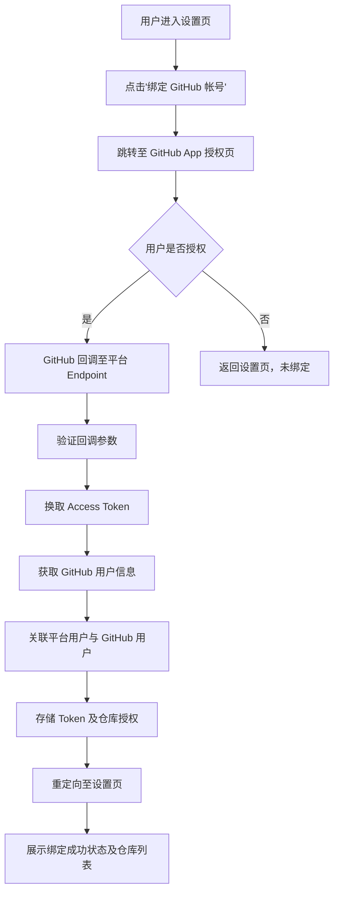
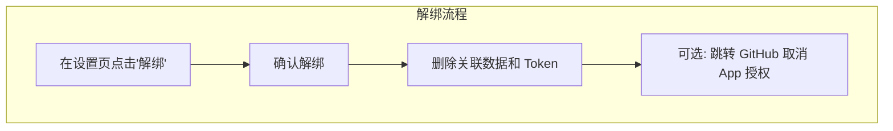
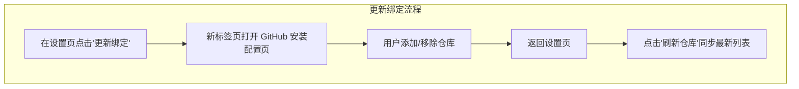

# GitHub 帐号绑定

**功能名称**: GitHub 帐号绑定
**PRD 版本**: v1.0
**创建日期**: 2026-07-09
**作者**: ZeroAsh Agent

## 背景与目标

### 1.1 背景

用户目前无法将个人 GitHub 帐号与平台关联，导致以下问题：
- 无法在平台内直接访问用户的 GitHub 仓库
- 无法基于 GitHub 仓库触发自动化工作流（CI/CD、代码审查等）
- 无法在平台内管理 GitHub PR、Issue 等开发资源

需要一个统一的 GitHub 帐号绑定机制，为用户后续的 GitHub 集成功能奠定基础。

### 1.2 目标

- 支持用户在设置页中通过 GitHub App OAuth 完成帐号绑定
- 支持绑定多个 GitHub 帐号
- 每个已绑定帐号支持选择若干个仓库
- 每个仓库至少具备 read + write 权限

### 1.3 成功标准

- 用户可在 3 次点击内进入 GitHub 绑定流程
- OAuth 绑定成功率 > 99%（排除用户主动取消）
- 绑定后可立即在设置页看到已绑定的帐号和仓库列表
- 解绑操作后，关联数据在 1 分钟内完成清理

## 用户分析

### 2.1 目标用户

所有需要将 GitHub 仓库与平台功能集成的注册用户。

### 2.2 用户场景

| 场景 | 用户角色 | 目标 | 痛点 |
|--|--|--|--|
| 首次绑定 GitHub | 注册用户 | 授权平台访问自己的 GitHub 仓库 | 需要手动在 GitHub 和平台之间切换，操作路径长 |
| 绑定多个 GitHub 帐号 | 拥有个人 + 工作 GitHub 帐号的用户 | 在一个平台内管理多个 GitHub 身份的仓库 | 切换身份繁琐，无法集中管理 |
| 选择特定仓库授权 | 项目维护者 | 只授权需要的仓库，不暴露所有仓库 | 担心过度授权，隐私和安全顾虑 |
| 解绑已绑定的 GitHub 帐号 | 离职或更换帐号的用户 | 移除旧帐号的授权关联 | 找不到解绑入口，或解绑后数据残留 |

## 功能需求

### 3.1 功能概述

在平台设置页中增加 GitHub 绑定模块，用户通过 GitHub App OAuth 流程完成授权，绑定后可管理已授权的 GitHub 帐号及其关联仓库。

### 3.2 功能列表

#### 功能点 1: 设置页 GitHub 绑定入口

- **描述**: 在用户设置页面新增 "GitHub 绑定" section，展示已绑定的 GitHub 帐号列表，并提供 "绑定 GitHub 帐号" 的入口按钮。
- **用户价值**: 用户可以在统一的设置入口完成所有 GitHub 绑定相关操作，无需跳转到其他页面。
- **验收标准**:
  - [ ] 设置页可见 "GitHub 绑定" 区域
  - [ ] 未绑定任何帐号时，显示空状态和 "绑定 GitHub 帐号" 按钮
  - [ ] 已绑定时，展示所有已绑定帐号列表
  - [ ] 每个已绑定帐号可展开查看关联的仓库列表

#### 功能点 2: GitHub App OAuth 授权流程

- **描述**: 用户点击 "绑定 GitHub 帐号" 后，跳转至 GitHub App 授权页面。用户确认授权后，GitHub 回调到平台预留的 redirect endpoint，完成用户身份关联和 token 存储。
- **用户价值**: 使用标准的 OAuth 流程，用户信任度高，操作透明。
- **验收标准**:
  - [ ] 点击绑定按钮跳转至 `https://github.com/apps/{appName}/installations/new`
  - [ ] 用户可选择授权给指定仓库或所有仓库
  - [ ] 授权完成后，回调到平台后端 endpoint
  - [ ] 回调后将 GitHub 用户 ID 与平台用户 ID 建立关联
  - [ ] 存储 access token 用于后续 API 调用

#### 功能点 3: 多 GitHub 帐号支持

- **描述**: 用户可绑定多个不同的 GitHub 帐号（如个人帐号 + 公司帐号），每个帐号独立管理。
- **用户价值**: 满足拥有多个 GitHub 身份的用户需求，无需反复解绑/绑定。
- **验收标准**:
  - [ ] 支持绑定 2 个及以上不同 GitHub 帐号
  - [ ] 每个帐号在列表中独立展示
  - [ ] 每个帐号可单独解绑

#### 功能点 4: 仓库选择与展示

- **描述**: 绑定后，以 "GitHub 帐号 → 仓库列表" 的层级结构展示已授权的仓库。每个仓库展示名称、权限级别（read/write）。
- **用户价值**: 清晰了解每个帐号下有哪些仓库被授权，以及对应的权限范围。
- **验收标准**:
  - [ ] 页面按帐号分组展示仓库
  - [ ] 每个仓库显示名称和权限标识
  - [ ] 仓库列表与 GitHub 实际授权保持一致

#### 功能点 6: 更新绑定（仓库权限管理）

- **描述**: 绑定后，用户可随时通过 "更新绑定" 按钮跳转到 GitHub 的安装配置页面，在该页面中添加或移除授权仓库，无需手动查找 GitHub 设置入口。
- **用户价值**: 减少操作路径，用户无需离开平台即可导航到正确的 GitHub 配置页。
- **验收标准**:
  - [ ] 每个已绑定的安装旁显示 "更新绑定" 按钮
  - [ ] 点击按钮在新标签页打开 GitHub 安装配置页
  - [ ] 用户安装账号为个人时，URL 为 `https://github.com/settings/installations/{installationId}`
  - [ ] 用户安装账号为组织时，URL 为 `https://github.com/organizations/{org}/settings/installations/{installationId}`
  - [ ] 返回平台后，点击 "刷新仓库" 可同步最新的仓库列表

#### 功能点 5: 绑定回调 Endpoint

- **描述**: 提供一个 HTTP endpoint，用于接收 GitHub App 安装回调。在该 endpoint 中完成：
  1. 验证回调参数（installation_id、setup_action 等）
  2. 使用临时 code 换取 access token
  3. 获取 GitHub 用户信息
  4. 将 GitHub 用户与平台用户建立关联
  5. 存储 token 与仓库授权信息
- **用户价值**: 无缝完成 OAuth 回调处理，用户无需手动干预。
- **验收标准**:
  - [ ] Endpoint 正确验证回调参数
  - [ ] 成功换取 access token
  - [ ] 正确关联平台用户与 GitHub 用户
  - [ ] 回调失败时有明确的错误页面提示
  - [ ] 回调成功后重定向至设置页并显示成功状态

### 3.3 用户操作流程

### 3.4 页面/界面描述

| 页面 | 描述 | 关键元素 |
|------|------|---------|
| 设置页 - GitHub 绑定区域 | 设置页中的独立 section | 标题 "GitHub 绑定"、已绑定帐号列表、绑定/解绑按钮、仓库列表 |
| 帐号卡片 | 每个已绑定 GitHub 帐号的展示卡片 | GitHub 头像、用户名、绑定时间、"更新绑定" 按钮、"解绑" 按钮、展开/收拢仓库列表 |
| 仓库列表项 | 单个仓库信息展示 | 仓库名称、权限标识（read/write）、仓库 URL 链接 |
| 绑定成功页 | 回调成功后展示 | 成功提示、"返回设置" 按钮 |
| 绑定失败页 | 回调失败时展示 | 错误信息、"重试" 按钮、"返回设置" 按钮 |

### 3.5 异常与边界情况

| 情况 | 预期行为 |
|------|---------|
| 用户取消 GitHub 授权 | 跳转回设置页，无绑定变化，无错误提示 |
| 回调参数无效或缺失 | 显示绑定失败页面，提示用户重试 |
| Token 换取失败 | 显示绑定失败页面，记录错误日志 |
| 网络超时 | 显示加载状态，超时后提示"操作超时，请重试" |
| 已绑定相同 GitHub 帐号 | 检测重复，提示"该 GitHub 帐号已绑定" |
| 解绑时 GitHub API 不可用 | 先清理本地数据，提示用户手动前往 GitHub 取消授权 |
| GitHub App 权限变更 | 提示用户重新授权以获取新权限 |
| 更新绑定后仓库列表未同步 | 提供"刷新仓库"功能，手动同步仓库列表 |

## 四、非功能需求

### 4.1 性能要求

- OAuth 回调处理全程应在 5 秒内完成
- 设置页 GitHub 绑定区域加载时间不超过 2 秒

### 4.2 安全性要求

- Access Token 必须加密存储
- Token 不得在客户端明文传输
- OAuth state 参数必须校验以防止 CSRF
- 所有 GitHub API 调用通过后端代理，不暴露 Token 给前端

### 4.3 兼容性要求

- 支持 GitHub.com（GitHub Enterprise 暂不支持）
- 支持主流浏览器最新两个版本

## 五、依赖与约束

### 5.1 依赖

- GitHub App 需提前在 GitHub 上注册并配置
- GitHub App 需拥有 `Contents` (read/write) 和 `Metadata` (read) 权限
- 后端需支持 OAuth 2.0 回调处理
- 前端设置页需预留扩展点

### 5.2 约束

- 必须使用 GitHub App (GitHub OAuth App 不支持 Installation 级别的仓库选择)
- 必须遵循 GitHub API 速率限制
- GitHub App 的 Private Key 必须安全保管

## 六、相关文档

- [GitHub App 开发文档](https://docs.github.com/en/apps)
- [GitHub App Installation OAuth 流程](https://docs.github.com/en/apps/creating-github-apps/authenticating-with-a-github-app/making-authenticated-api-requests-with-a-github-app-in-github-actions)
