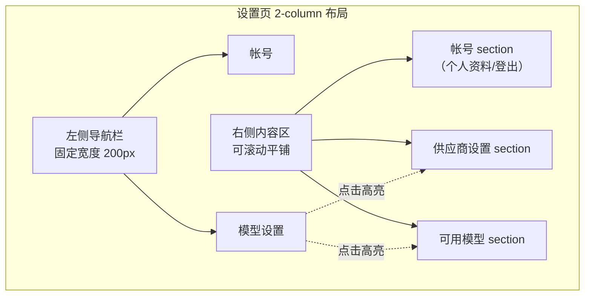
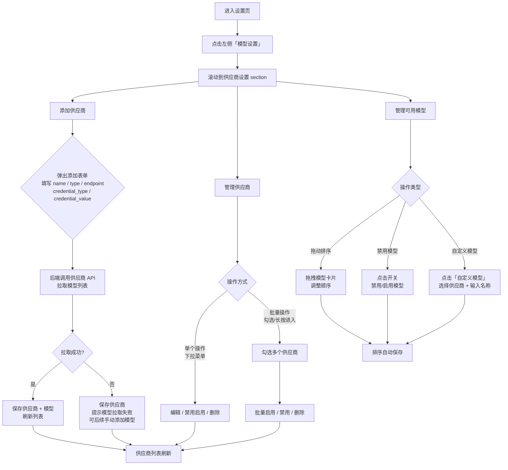

# 设置页 LLM 供应商与模型管理

**功能名称**: 设置页 LLM 供应商与模型管理
**PRD 版本**: v1.0
**创建日期**: 2026-05-17
**作者**: ZeroAsh

## 背景与目标

### 1.1 背景

z-agent-gear 作为一站式个人多端管理 Agent 解决方案，核心能力依赖于与各大 LLM 供应商（如 OpenAI、Anthropic）的对接。当前系统没有任何 LLM 供应商账号绑定和模型管理能力，用户无法配置自己的 API 凭据，也无法管理可用的模型列表。

### 1.2 目标

在设置页中增加 LLM 供应商账号绑定功能，支持用户添加/管理 OpenAI、Anthropic 等供应商账号，自动拉取可用模型列表，并支持自定义模型和模型排序/禁用等管理操作。

### 1.3 成功标准

- 用户可在设置页中完成供应商账号的新增、编辑、禁用/启用、删除
- 新增/编辑供应商时自动拉取其模型列表
- 用户可在模型列表中拖动排序、禁用模型
- 支持用户自定义模型
- 禁用/删除供应商时同步移除其关联模型

## 用户分析

### 2.1 目标用户

所有使用 z-agent-gear 系统并需要接入 LLM 能力的终端用户。

### 2.2 用户场景

| 场景 | 用户角色 | 目标 | 痛点 |
|------|----------|------|------|
| 首次配置 LLM 供应商 | 新用户 | 绑定 OpenAI/Anthropic 账号以使用 AI 能力 | 不知道在哪里配置 API 凭据 |
| 更换 API Key | 已绑定用户 | 更新过期的 API Key | 找不到修改入口 |
| 新增第二个供应商 | 高级用户 | 同时使用多家供应商的模型 | 无法在一个地方集中管理 |
| 管理模型列表 | 所有用户 | 只保留自己需要的模型，调整模型顺序 | 模型列表杂乱，无法自定义 |
| 添加自定义模型 | 高级用户 | 使用供应商新发布的模型 | 等待系统更新模型列表太慢 |
| 批量操作供应商 | 管理员 | 快速启用/禁用多个供应商 | 逐个操作效率低 |

## 功能需求

### 3.1 功能概述

在设置页的 2-column 布局中，新增「模型设置」导航分类，包含「供应商设置」和「可用模型」两个 section（与「帐号」同级且平铺排列）。支持供应商账号的 CRUD、多选批量操作、模型自动拉取、模型自定义、拖动排序和禁用功能。

### 3.2 设置页布局结构

关键交互说明：

- 左侧导航栏仅用于导航和当前高亮指示，点击导航项时右侧内容区滚动到对应 section
- 右侧内容区所有 section 垂直平铺在一个可滚动容器中，用户可自由滚动浏览所有设置项
- 点击左侧「帐号」时，高亮「帐号」并滚动到帐号 section
- 点击左侧「模型设置」时，高亮「模型设置」并滚动到供应商设置 section

### 3.3 功能列表

#### 功能点 1: 供应商设置 - 新增供应商

- **描述**: 用户点击「添加供应商」按钮，弹出添加表单，填写供应商信息后保存
- **用户价值**: 用户可以绑定自己的 LLM 供应商 API 账号
- **验收标准**:
  - [ ] 点击「添加供应商」弹出对话框表单
  - [ ] 表单字段：供应商名称(name)、API 类型(type: OpenAI / Anthropic)、接口地址(endpoint)、凭据类型(credential_type，默认 api_key)、凭据值(credential_value)
  - [ ] API 类型为下拉选择，选中后 endpoint 自动填入对应的默认地址（如 OpenAI: `https://api.openai.com/v1`，Anthropic: `https://api.anthropic.com`），用户仍可编辑
  - [ ] 凭据类型目前仅支持 `api_key`，预留扩展能力
  - [ ] 保存时，后端调用该供应商 API 拉取模型列表，存入可用模型表
  - [ ] 保存成功后关闭对话框，供应商列表刷新

#### 功能点 2: 供应商设置 - 编辑供应商

- **描述**: 每个供应商条目尾部有操作下拉菜单，点击「编辑」弹出编辑表单回填已有数据
- **用户价值**: 用户可以更新过期的 API Key 或修改供应商配置
- **验收标准**:
  - [ ] 操作下拉菜单位于每个供应商条目的尾部，包含「编辑」「启用/禁用」「删除」
  - [ ] 点击「编辑」弹出编辑表单，回填所有已有字段
  - [ ] 修改后保存，后端重新拉取模型列表并更新可用模型（覆盖更新）
  - [ ] 保存成功后关闭对话框，供应商列表刷新

#### 功能点 3: 供应商设置 - 禁用/启用

- **描述**: 通过操作下拉菜单或批量操作，切换供应商的启用/禁用状态
- **用户价值**: 用户临时停用某个供应商而不删除配置
- **验收标准**:
  - [ ] 单个操作：下拉菜单中根据当前状态显示「禁用」或「启用」
  - [ ] 禁用供应商时，其关联的模型在可用模型列表中变为不可用（但不删除模型记录）
  - [ ] 启用供应商时，其关联的模型恢复可用状态
  - [ ] 供应商条目上应有视觉标识区分启用/禁用状态（如禁用时变灰 + 标签）

#### 功能点 4: 供应商设置 - 删除供应商

- **描述**: 通过操作下拉菜单或批量操作，删除供应商及其关联模型
- **用户价值**: 用户可以移除不再使用的供应商
- **验收标准**:
  - [ ] 点击「删除」弹出确认对话框
  - [ ] 确认后删除供应商及其关联的所有模型（从可用模型表中移除）
  - [ ] 删除后供应商列表刷新

#### 功能点 5: 供应商设置 - 多选批量操作

- **描述**: 用户可以通过勾选模式或长按进入多选模式，批量对供应商进行操作
- **用户价值**: 快速管理多个供应商
- **验收标准**:
  - [ ] 两种进入多选模式的方式：
    - **勾选框模式**：每个供应商条目前方有 checkbox，勾选任意 checkbox 后页面顶部出现批量操作按钮栏
    - **长按进入**：长按某个供应商条目进入多选模式，所有条目前方显示 checkbox
  - [ ] 多选模式下，顶部批量操作按钮栏包含：「启用」「禁用」「删除」
    - **「启用」和「禁用」是分开的两个按钮**，不是切换
  - [ ] 勾选部分条目后批量操作仅影响已勾选的条目
  - [ ] 点击批量「删除」需弹出确认对话框
  - [ ] 退出多选模式：点击「取消」按钮或按 Escape 键

#### 功能点 6: 可用模型 - 自动拉取

- **描述**: 新增/编辑供应商时，后端自动调用供应商 API 拉取模型列表
- **用户价值**: 用户无需手动录入模型，减少操作步骤
- **验收标准**:
  - [ ] 新增供应商保存后：后端调用该供应商的模型列表 API，将返回的模型名称添加到可用模型中
  - [ ] 编辑供应商保存后：后端重新拉取模型列表，覆盖更新该供应商关联的所有模型
  - [ ] 模型字段：id（自动生成）、provider_id（关联供应商）、name（模型名称）
  - [ ] 拉取失败时不阻塞供应商保存，但需提示用户模型拉取状态

#### 功能点 7: 可用模型 - 自定义模型

- **描述**: 在模型列表中提供「自定义模型」按钮，用户可手动添加模型
- **用户价值**: 当供应商发布了新模型但系统尚未拉取时，用户可以手动添加
- **验收标准**:
  - [ ] 模型列表顶部或底部有「自定义模型」按钮
  - [ ] 点击后弹出对话框，表单包含：选择供应商（下拉，只显示已启用且有模型的供应商）、模型名称（文本框）
  - [ ] 保存后新的自定义模型出现在可用模型列表中
  - [ ] 自定义模型的 provider_id 指向所选供应商
  - [ ] 自定义模型可以被拖动排序和禁用

#### 功能点 8: 可用模型 - 拖动排序

- **描述**: 用户可以通过拖拽调整模型的显示顺序
- **用户价值**: 用户可以将常用模型放在列表前面，方便快速选择
- **验收标准**:
  - [ ] 模型列表支持拖拽排序（drag and drop）
  - [ ] 拖拽时有视觉反馈（如拖拽中的卡片阴影、放置位置的占位提示）
  - [ ] 排序结果持久化保存（拖拽完成后自动保存或点击保存按钮）

#### 功能点 9: 可用模型 - 模型禁用

- **描述**: 用户可以在模型列表中单独禁用某个模型
- **用户价值**: 用户可以在不删除模型的情况下，屏蔽不需要的模型
- **验收标准**:
  - [ ] 每个模型条目上有切换开关或禁用按钮
  - [ ] 禁用后的模型在列表中变灰，并带有「已禁用」标识
  - [ ] 已禁用的模型可通过切换开关重新启用
  - [ ] 当关联供应商被禁用时，该供应商的所有模型自动变为禁用状态（不可单独启用），并显示提示「供应商已禁用」

### 3.4 用户操作流程

### 3.5 页面/界面描述

| 页面 | 描述 | 关键元素 |
|------|------|---------|
| 设置页-模型设置 | 左侧导航「模型设置」高亮，右侧平铺「供应商设置」和「可用模型」两个 section | 供应商列表卡片、模型列表卡片、添加按钮、操作下拉菜单、多选 checkbox |
| 添加/编辑供应商对话框 | 表单弹出层，用于新增或编辑供应商信息 | 名称输入、API 类型下拉、endpoint 输入、凭据类型下拉、凭据值输入、保存/取消按钮 |
| 供应商列表 | 展示所有已添加的供应商 | 供应商卡片（名称/类型/状态）、尾部操作菜单、前方 checkbox、添加按钮 |
| 模型列表 | 展示当前所有可用模型 | 模型卡片（名称/供应商/状态）、拖动手柄、禁用开关、「自定义模型」按钮 |
| 自定义模型对话框 | 手动添加模型 | 供应商下拉选择、模型名称输入、保存/取消按钮 |
| 批量操作栏 | 多选时顶部浮现的操作栏 | 已选数量、「启用」「禁用」「删除」按钮、「取消」按钮 |
| 删除确认对话框 | 确认删除操作 | 删除提示文字、确认/取消按钮 |

### 3.6 异常与边界情况

| 情况 | 预期行为 |
|------|---------|
| 添加供应商时 API 调用失败 | 供应商保存成功但模型列表为空，提示「模型拉取失败，可稍后手动添加」 |
| 编辑供应商时 API 调用失败 | 供应商信息更新成功，模型列表保留原有数据，提示「模型更新失败」 |
| 供应商名称重复 | 表单校验提示「供应商名称已存在」 |
| 供应商正在被使用（有关联的会话/Agent）时被禁用 | 允许禁用，关联会话在使用模型时提示「该模型已不可用」 |
| 删除供应商后已有会话引用其模型 | 保留会话历史记录，但模型状态标记为已删除 |
| 模型名称在同一个供应商下重复 | 自动去重，不添加重复模型 |
| 供应商被禁用后对其模型的操作 | 模型自动禁用，禁用开关失效（不可单独启用），显示「供应商已禁用」提示 |
| 没有可用供应商时点击自定义模型 | 供应商下拉列表为空，提示「请先添加供应商」 |
| 网络异常导致拖拽排序保存失败 | 客户端保存失败时提示用户重试 |

## 四、非功能需求

### 4.1 性能要求

- 供应商列表加载应在 1 秒内完成
- 模型列表加载应在 1 秒内完成
- 拖拽排序操作应无感知延迟（乐观更新 + 异步保存）

### 4.2 安全性要求

- credentials（API Key）必须加密存储，不得明文存储在数据库中
- credentials 不应在前端完整展示，应脱敏显示（如 `sk-****1234`）
- 供应商 API 调用走后端代理，避免前端直连暴露 API Key

### 4.3 兼容性要求

- 支持主流现代浏览器（Chrome、Firefox、Safari、Edge 最新两个版本）
- 拖拽排序同时支持鼠标和触屏操作

## 五、依赖与约束

### 5.1 依赖

- 后端：新增 Provider 和 Model 数据模型及 GraphQL CRUD 接口
- 后端：需要实现调用 OpenAI/Anthropic 模型列表 API 的代理逻辑
- 前端：需要引入拖拽排序库（如 `@dnd-kit/core`）
- 前端：设置页 2-column 布局保持现有结构

### 5.2 约束

- 使用 monorepo 结构，前端在 `apps/agent-web`，后端在 `servers/agent-api`
- 保持现有技术栈（React + Tailwind + shadcn/ui 前端，Node.js + Express + GraphQL-Yoga + Mongoose 后端）
- API 契约存放在 `contracts/` 目录
- credentials 加密存储，推荐使用后端环境变量配置的加密密钥

## 六、相关文档

- [用户认证与设置页 PRD](../reviewed/user-auth-and-settings.md)
- [用户认证与设置页技术方案](../../engineering/proposals/user-auth-and-settings.md)
