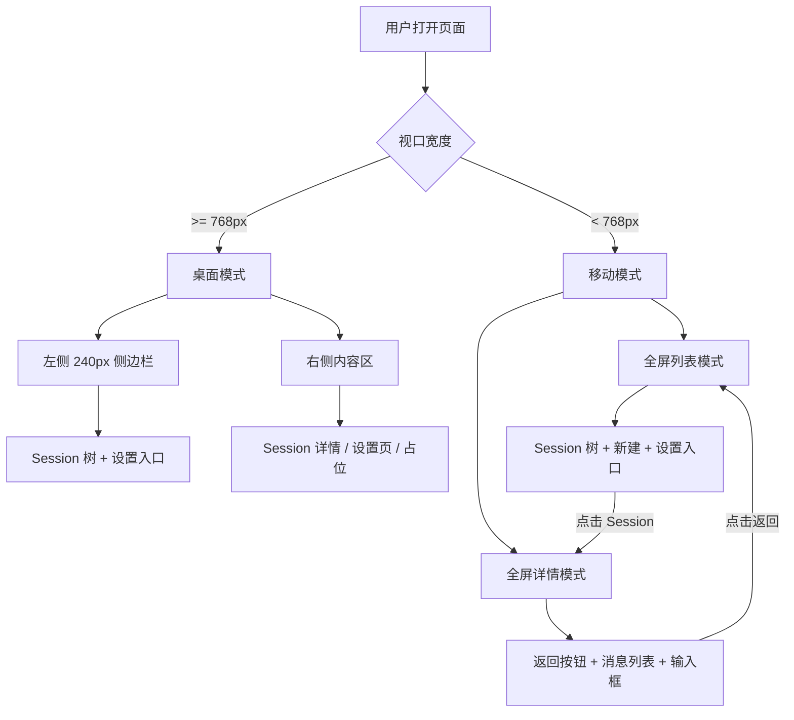
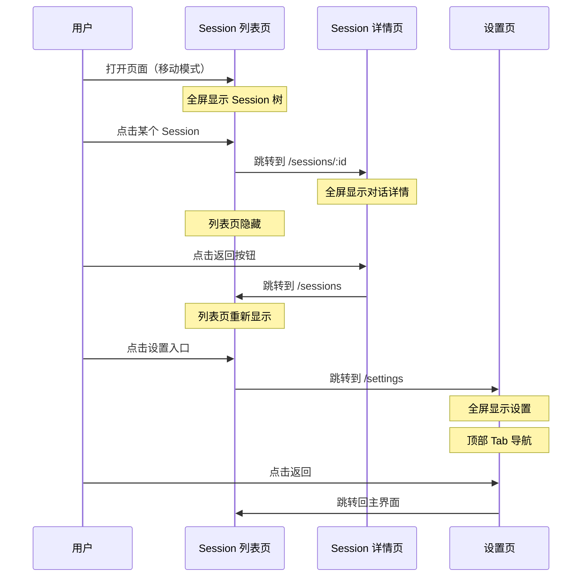

# Web 端移动端布局适配

**功能名称**: 移动端布局
**PRD 版本**: v1.0
**创建日期**: 2026-05-27
**作者**: ZeroAsh Agent

## 背景与目标

### 1.1 背景

当前 Web 端采用桌面优先的固定侧边栏布局：`MainLayout` 使用 `grid-cols-[240px_1fr]`，在 375px 宽的移动端屏幕上，240px 的侧边栏占据 64% 的可视区域，仅剩 135px 给内容区，完全无法使用。`SettingsPage` 和 `ControllerConfigPage` 还有内嵌的 200px 导航栏，形成"双侧边栏"叠加，移动端更加不可用。

当前系统完全没有任何响应式设计：无 media query、无侧边栏开关状态、无移动端导航模式。

### 1.2 目标

1. 在移动端（宽度 < 768px）设备上，Web 端可正常使用核心功能：浏览 Session 列表、进入 Session 对话、发送/接收消息、切换设置。
2. 移动端采用"列表-详情"两级导航模式：左侧 Session 列表为主界面，点击后右侧内容变为二级详情页。
3. 桌面端布局保持不变，完全向后兼容。
4. Session 树中的每个节点保持单行展示，并实时同步状态。

### 1.3 成功标准

- 在 375px 宽度设备上，Session 列表页完整可见，无水平滚动。
- 点击 Session 后，详情页以全屏方式展示，可通过返回按钮回到列表。
- Session 树中每个节点（Controller、Workspace、Session）均为单行，状态实时更新。
- 设置页面在移动端以全屏方式展示，内嵌导航变为顶部 Tab 或可折叠面板。
- 桌面端（>= 768px）布局与现有完全一致，无任何视觉变化。

## 用户分析

### 2.1 目标用户

在手机或平板上使用 Agent Web 界面查看 Session 状态、进行简单对话的开发者。

### 2.2 用户场景

| 场景 | 用户角色 | 目标 | 痛点 |
|------|---------|------|------|
| 手机上查看 Session 状态 | 开发者 | 快速查看各 Session 的运行状态 | 当前 240px 侧边栏占满屏幕，内容区不可见 |
| 手机上与 Agent 对话 | 开发者 | 发送简单消息并查看回复 | 当前无法在移动端操作 |
| 手机上切换设置 | 开发者 | 查看或修改基本设置 | 当前双侧边栏布局在移动端完全不可用 |
| 平板上使用 | 开发者 | 较宽屏幕但仍需触屏友好 | 当前布局在 768px 左右体验差 |

## 功能需求

### 3.1 功能概述

采用移动端"列表-详情"（List-Detail）导航模式：Session 列表为主界面占满屏幕，点击 Session 后以二级页面方式展示对话详情，支持返回。设置页面同理。

### 3.2 功能列表

#### 功能点 1: 响应式布局壳

- **描述**: `MainLayout` 根据视口宽度切换布局模式。桌面端（>= 768px）保持现有的 240px 侧边栏 + 内容区双栏布局。移动端（< 768px）采用单栏全屏布局，同一时刻只显示列表或详情。
- **用户价值**: 移动端可以正常使用应用。
- **验收标准**:
  - [ ] 视口宽度 < 768px 时，侧边栏不显示，内容区占满屏幕
  - [ ] 视口宽度 >= 768px 时，布局与现有完全一致
  - [ ] 视口宽度变化时，布局平滑切换，无闪烁

#### 功能点 2: 移动端 Session 列表主界面

- **描述**: 移动端默认显示 Session 列表作为主界面。列表包含现有的树形结构（Controller → Workspace → Session），每个节点保持单行展示。顶部显示"Sessions"标题和新建按钮，底部显示用户名和设置入口。
- **用户价值**: 移动端用户打开页面即可看到所有 Session 及其状态。
- **验收标准**:
  - [ ] Session 列表占满移动端屏幕宽度
  - [ ] 树形结构（Controller → Workspace → Session）完整保留
  - [ ] 每个节点单行展示，不换行
  - [ ] Session 状态圆点实时更新
  - [ ] 点击 Session 跳转到详情页
  - [ ] 新建按钮可用
  - [ ] 设置入口可用

#### 功能点 3: 移动端 Session 详情二级页面

- **描述**: 点击 Session 后，以全屏二级页面方式展示 Session 详情（消息列表 + 输入框 + 状态栏）。页面顶部显示返回按钮和 Session 名称/状态。
- **用户价值**: 移动端用户可以查看完整对话并发送消息。
- **验收标准**:
  - [ ] 点击 Session 后，列表页隐藏，详情页全屏展示
  - [ ] 详情页顶部显示返回按钮
  - [ ] 点击返回按钮回到 Session 列表
  - [ ] 消息列表、输入框、状态栏正常显示
  - [ ] 流式消息正常渲染
  - [ ] 输入框可正常发送消息

#### 功能点 4: 移动端设置页面

- **描述**: 设置页面在移动端采用全屏模式，左侧 200px 导航栏变为顶部 Tab 栏或可折叠的手风琴面板。Controller 配置页面同理。
- **用户价值**: 移动端用户可以正常访问和修改设置。
- **验收标准**:
  - [ ] 设置页在移动端全屏展示
  - [ ] 导航栏变为 Tab 栏或手风琴面板
  - [ ] 点击导航项滚动到对应 section
  - [ ] Controller 配置页同样适配
  - [ ] 返回按钮可回到主界面

#### 功能点 5: Session 树节点状态同步

- **描述**: 移动端 Session 树中每个节点（Controller、Workspace、Session）保持单行展示，状态信息（Controller 在线状态、Session 运行状态）实时同步更新。
- **用户价值**: 用户在列表页即可实时看到各 Session 的工作状态。
- **验收标准**:
  - [ ] Controller 状态圆点反映在线/离线状态
  - [ ] Session 状态圆点反映 creating/connecting/idling/running/ended 状态
  - [ ] 状态变化后 15 秒内更新（轮询间隔）
  - [ ] 单行展示：名称过长时截断并显示省略号

### 3.3 布局模式切换

### 3.4 移动端导航流程

### 3.5 页面/界面描述

#### 移动端 Session 列表页

| 区域 | 内容 | 说明 |
|------|------|------|
| 顶部栏 | "Sessions" 标题 + 新建按钮 | 固定在顶部 |
| 内容区 | Controller → Workspace → Session 树 | 可滚动，占满剩余空间 |
| 底部栏 | 用户名 + 设置齿轮 | 固定在底部 |

#### 移动端 Session 详情页

| 区域 | 内容 | 说明 |
|------|------|------|
| 顶部栏 | ← 返回 + Session 名称 + 状态徽章 | 固定在顶部 |
| 内容区 | 消息列表 | 可滚动，flex-1 |
| 底部栏 | Mode/Model 切换 + 输入框 + 发送按钮 | 固定在底部 |

#### 移动端设置页

| 区域 | 内容 | 说明 |
|------|------|------|
| 顶部栏 | ← 返回 + "设置" 标题 | 固定在顶部 |
| 导航区 | 水平 Tab 栏（可横向滚动） | 固定在顶部导航下方 |
| 内容区 | 各设置 section | 可滚动 |

### 3.6 断点定义

| 断点 | 宽度 | 布局模式 | 说明 |
|------|------|---------|------|
| 移动端 | < 768px | 单栏（列表/详情切换） | 手机竖屏 |
| 桌面端 | >= 768px | 双栏（侧边栏 + 内容） | 现有布局 |

### 3.7 异常与边界情况

| 情况 | 预期行为 |
|------|---------|
| 用户在详情页时旋转屏幕（竖→横） | 如果宽度跨过 768px 断点，自动切换布局模式 |
| 用户在移动端直接访问 /sessions/:id | 先显示详情页（全屏），返回按钮回到列表 |
| 用户在移动端直接访问 /settings | 全屏设置页，返回按钮回到主界面 |
| SSE 连接在后台标签页 | 保持连接，切回前台时消息补全 |
| 长 Session 名称 | 截断显示省略号，不换行 |

## 四、非功能需求

### 4.1 性能要求

- 移动端首屏渲染时间不超过 2 秒（3G 网络）。
- 布局模式切换无闪烁或跳变。
- 触摸操作响应延迟不超过 100ms。

### 4.2 兼容性要求

- 支持 iOS Safari 15+、Android Chrome 100+。
- 支持 PWA 添加到主屏幕（viewport meta 已配置）。
- 桌面端布局完全不变，无任何回归。

### 4.3 可访问性要求

- 触摸目标最小尺寸 44x44px（Apple HIG 推荐）。
- 返回按钮可通过键盘和屏幕阅读器访问。

## 五、依赖与约束

### 5.1 依赖

| 依赖项 | 说明 |
|--------|------|
| Tailwind CSS v4 | 现有 UI 框架，支持响应式断点 |
| React Router v7 | 现有路由方案，支持嵌套布局 |
| 现有 Session 树组件 | 移动端复用，需调整为单行展示 |

### 5.2 约束

- 不引入新的 UI 框架或状态管理库。
- 不改变现有的路由结构（/sessions, /sessions/:id, /settings）。
- 使用 Tailwind CSS 的 `md:` 断点（768px）作为分界线。
- 移动端不使用侧边栏 overlay/drawer 模式，而是采用路由级别的页面切换。

## 六、相关文档

- [contracts/agent-session.graphql](../../contracts/agent-session.graphql) - Session 数据结构
- [contracts/agent-controller.graphql](../../contracts/agent-controller.graphql) - Controller 数据结构
