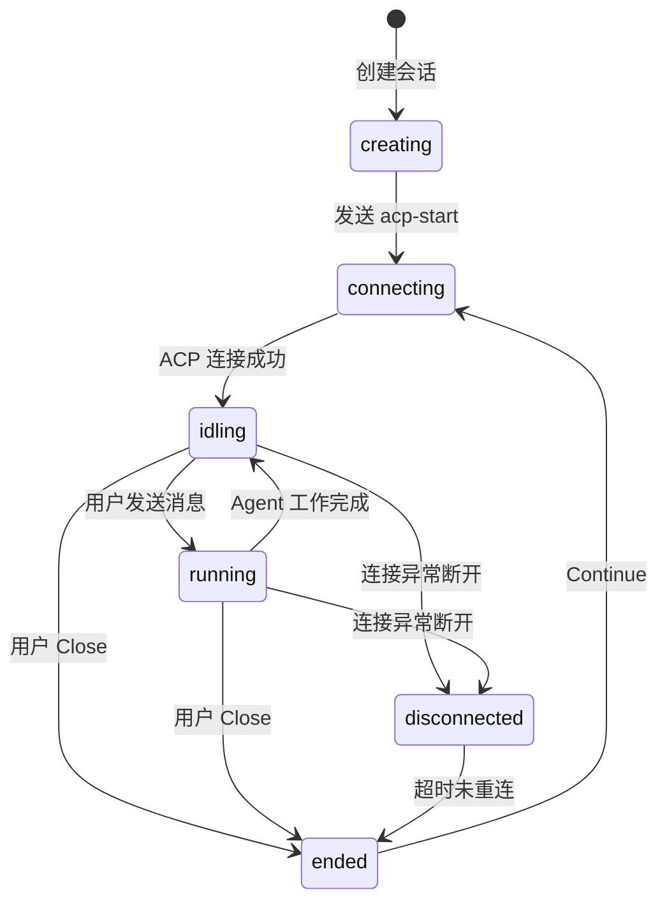
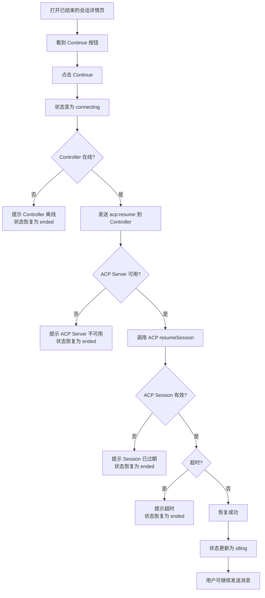

# Session Re-open（会话恢复）功能

**功能名称**: Session Re-open / Continue Session
**PRD 版本**: v1.0
**创建日期**: 2026-05-20
**作者**: AI Agent

## 背景与目标

### 1.1 背景

当前用户结束（end）一个会话后，该会话的历史消息仍然保留，但无法继续对话。用户只能查看历史内容，无法基于已有上下文继续交流。用户需要重新创建新会话并重新描述上下文，体验割裂且效率低。

### 1.2 目标

允许用户在已结束的会话上点击「Continue」，重新拉起该会话对应的 ACP session，使会话恢复到可对话状态（`idling`），保留全部历史消息。

### 1.3 成功标准

- 用户可以在已结束的会话详情页点击「Continue」按钮发起恢复
- 恢复成功后，会话状态变为 `idling`，用户可正常发送消息
- 恢复失败时，用户能收到明确的失败原因提示
- 历史消息在恢复后完整保留

## 用户分析

### 2.1 目标用户

所有使用会话功能进行 Agent 对话的用户。

### 2.2 用户场景

| 场景 | 用户角色 | 目标 | 痛点 |
|--|--|--|--|
| 用户结束会话后，想继续询问 Agent | 普通用户 | 基于已有上下文继续对话 | 当前只能新建会话重新描述，浪费时间 |
| 会话因网络问题断开后用户重连 | 普通用户 | 恢复断开的会话继续工作 | 无法恢复，只能重新开始 |
| 用户想复用之前的会话结果继续深入 | 高级用户 | 利用已有对话历史 | 手动复制粘贴历史内容，体验差 |

## 对话生命周期重定义

配合 Continue 功能，会话状态生命周期需新增 `idling` 状态，并调整原有状态语义。

完整状态集保持不变：`creating`、`connecting`、`idling`（新增）、`running`、`disconnected`、`ended`



### 状态定义

| 状态 | 含义 | 用户操作 |
|------|------|---------|
| `creating` | 会话创建中 | - |
| `connecting` | ACP 连接建立中（含恢复时） | - |
| `idling` | Agent 已就绪，空闲等待输入 | 可发送消息，显示 InputBox |
| `running` | Agent 正在工作中（生成中） | 显示 Cancel / Stop 按钮 |
| `disconnected` | 连接异常断开 | 等待自动重连或用户手动恢复 |
| `ended` | 会话已结束 | 显示 Continue 按钮，InputBox 禁用 |

### 变更要点

- **新增 `idling` 状态** — 从原 `running` 中拆分而来，`idling` = Agent 就绪可交互，`running` 专指 Agent 正在执行中
- **`ended → connecting` 恢复流转** — Continue 点击后先进入 `connecting`，ACP resume 成功后再进入 `idling`，复用现有连接流程
- 其余状态（`creating`、`connecting`、`disconnected`、`ended`）保持不变

## 功能需求

### 3.1 功能概述

在会话详情页的 SessionHeader 中，当会话状态为 `ended` 时，在「Delete」按钮旁边增加一个「Continue」按钮。点击后调用后端 `resumeSession` 接口重新拉起 ACP session，并在 UI 上展示恢复结果。

### 3.2 功能列表

#### 功能点 1: Continue 按钮

- **描述**: 在 SessionHeader 组件中，当 session 状态为 `ended` 时，在 Delete 按钮左侧增加「Continue」按钮。按钮的启用状态取决于 session 所属 Controller 是否在线。
- **用户价值**: 用户能直观地发现恢复入口，Controller 离线时提前知晓无法恢复
- **前置条件**: SessionHeader 需感知 Controller 在线状态（可通过现有 `GET_CONTROLLERS` 查询或 GraphQL 扩展获取）
- **交互行为**:
  - Controller 在线 → 按钮正常可点击（蓝色/主色调）
  - Controller 离线 → 按钮置灰禁用，hover 提示 "Controller is offline"
  - 点击后按钮进入 loading 状态（显示旋转动画或文字变为 "Continuing..."），状态变为 `connecting`
  - 恢复期间禁用按钮，防止重复点击
  - 恢复成功后按钮消失（状态变为 `idling`，Close 按钮重新出现）
  - 恢复失败时按钮恢复可点击状态，状态回到 `ended`
- **验收标准**:
  - [ ] 仅在状态为 `ended` 时显示 Continue 按钮
  - [ ] Controller 离线时按钮置灰禁用，有 hover 提示
  - [ ] Controller 在线时按钮可点击
  - [ ] 点击后进入 loading 状态，状态变为 `connecting`
  - [ ] 恢复成功后按钮消失，Close 按钮出现


#### 功能点 2: 恢复成功流程

- **描述**: 后端 `resumeSession` 成功后，前端更新会话状态为 `idling`，用户可继续在 InputBox 中发送消息
- **用户价值**: 无缝衔接历史会话
- **验收标准**:
  - [ ] 恢复后会话状态变为 `idling`
  - [ ] 历史消息完整保留
  - [ ] SSE 重新连接，可接收新的消息流
  - [ ] InputBox 从禁用变为可输入

#### 功能点 3: 恢复失败处理

- **描述**: 当 `resumeSession` 失败时，前端需展示失败原因 Toast/Alert
- **用户价值**: 用户了解原因后可采取对应措施
- **失败场景**:

| 失败场景 | 后端返回 | 前端提示 |
|---------|---------|---------|
| Controller 离线 | `CONTROLLER_OFFLINE` | "Controller is offline. Please check your controller connection." |
| ACP Server 不可用 | `ACP_SERVER_UNAVAILABLE` | "ACP server is not available on the controller. The capability may have been disabled." |
| ACP Session 已过期/无效 | `ACP_SESSION_EXPIRED` | "The remote session has expired. Please start a new session." |
| CWD 路径不存在 | `WORKSPACE_PATH_INVALID` | "The workspace path no longer exists on your controller." |
| 恢复超时 | `RESUME_TIMEOUT` | "Resume timed out. Please try again or start a new session." |
| 未知错误 | `RESUME_FAILED` | "Failed to resume session. Please try again." |

- **验收标准**:
  - [ ] 每个失败场景都有对应的中文用户提示
  - [ ] 失败后按钮恢复可点击，允许用户重试
  - [ ] 失败不影响已有历史消息和会话数据

### 3.3 用户操作流程



### 3.4 页面/界面描述

| 页面 | 描述 | 关键元素 |
|------|------|---------|
| 会话详情页 SessionHeader | 顶部信息栏，显示会话元信息和操作按钮 | Controller 名、状态标签、ACP 类型、CWD 路径、创建时间、Close 按钮（非 ended 时显示）、**Continue 按钮（ended 时显示）**、Delete 按钮 |

按钮位置示意：

```
[session info...]            [Continue] [Delete]
```

- Continue 按钮样式：蓝色/主色调按钮（与 Close 的红色区分）
- Loading 状态时文案变为 "Continuing..."，按钮禁用
- 恢复成功后，SessionHeader 重新渲染，Continue 消失，Close 出现

### 3.5 异常与边界情况

| 情况 | 预期行为 |
|------|---------|
| 用户连续快速点击 Continue | 按钮在第一次点击后立即 disabled，防止重复请求 |
| 恢复过程中用户刷新页面 | 会话状态不变（仍为 `ended`），刷新后可再次点击 Continue |
| 恢复成功后 SSE 连接断开 | 走现有 SSE 重连逻辑，不影响 |
| 恢复成功后用户再次 End 会话 | 正常关闭，状态回到 `ended`，Continue 按钮重新出现 |
| 会话没有 externalSessionId（旧数据） | 后端返回 `ACP_SESSION_EXPIRED` 错误，前端提示 Session 不可恢复 |
| 网络请求失败（无响应） | 前端 Apollo 错误捕获，提示 "Network error，请检查连接" |

## 四、非功能需求

### 4.1 性能要求

- Continue 操作的响应时间取决于 Controller 的 ACP resume 速度，期待在 5s 内完成
- 超过 30s 视为超时

### 4.2 安全性要求

- `resumeSession` 需校验用户身份和会话所有权（后端已实现）
- Continue 按钮仅在用户自己的会话详情页可见

### 4.3 兼容性要求

- 支持 Web 端所有现代浏览器
- 与现有 SSE、GraphQL、Socket.IO 协议兼容

## 五、依赖与约束

### 5.1 依赖

- 后端 `resumeSession` GraphQL mutation 已存在，需确认其错误分类是否完整
- `sessionService.resume()` 中的失败场景需补充详细的错误码/错误信息

### 5.2 约束

- 仅 `ended` 状态的会话可恢复
- 恢复操作不会清除或影响历史消息
- 前端不引入新依赖

## 六、相关文档

- [Session GraphQL Contract](../../../contracts/agent-session.graphql)
- [Session WebSocket Protocol](../../../contracts/agent-session-websocket.md)
- [SessionHeader 组件](../../../apps/agent-web/src/components/session/SessionHeader.tsx)
- [Session Resolver](../../../servers/agent-api/src/graphql/resolvers/session.ts)
- [Session Service](../../../servers/agent-api/src/services/session.ts)
- [ACP Session Manager](../../../servers/controller-api/src/services/acp-session-manager.ts)
