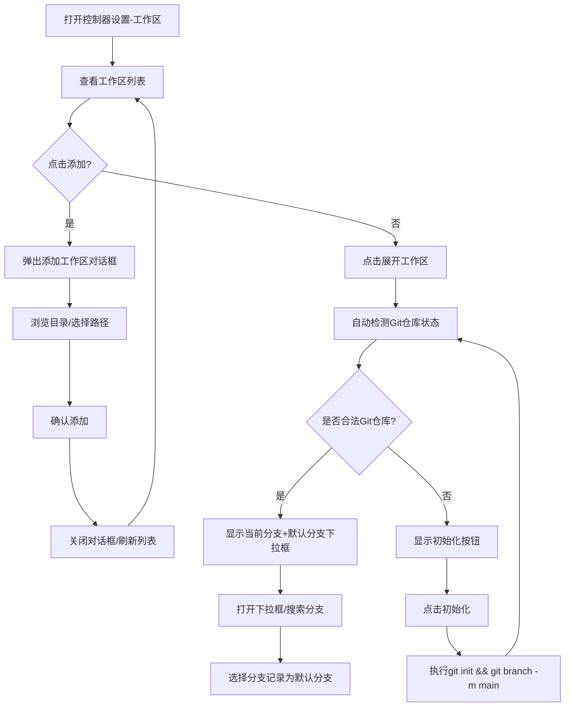

# 工作区设置页与 Git 能力支持

**功能名称**: 工作区设置页与 Git 能力支持
**PRD 版本**: v1.0
**创建日期**: 2026-05-23
**作者**: AI

## 背景与目标

### 1.1 背景

当前工作区功能仅支持添加本地目录路径和管理历史会话，但缺少对 Git 仓库的集成能力。用户在工作区中操作代码时，需要手动初始化仓库、查看分支等，这些操作完全脱离了当前系统。此外，工作区的添加操作当前以行内表单形式呈现，交互不够沉浸，需要改为统一对话框模式。

### 1.2 目标

- 将工作区添加操作统一为对话框（Dialog）模式，提升交互一致性
- 工作区卡片支持展开/折叠，以承载更多信息
- 打通工作区与 Git 的集成，让用户在工作区即可完成 Git 仓库检测、初始化和分支查看

### 1.3 成功标准

- 工作区添加对话框中可完成目录选择并创建工作区
- 工作区列表中的每个卡片可展开查看详情
- 展开后的工作区能自动检测是否为合法 Git 仓库
- 合法 Git 仓库可展示分支列表并标识当前所在分支
- 非 Git 目录可一键初始化 Git 仓库
- 分支信息缓存至服务端，减少重复扫描

## 用户分析

### 2.1 目标用户

使用控制器（agent-controller）连接本地开发环境的开发者，特别是需要在工作区中管理代码仓库的用户。

### 2.2 用户场景

| 场景 | 用户角色 | 目标 | 痛点 |
|------|---------|------|------|
| 在工作区目录中初始化 Git 仓库 | 开发者 | 快速将工作区目录变为 Git 仓库 | 需要手动在终端中执行 `git init` |
| 查看工作区当前 Git 分支 | 开发者 | 在工作区设置中查看当前所在分支 | 需要跳转到终端执行 `git branch` 查看 |
| 添加新的工作区路径 | 开发者 | 通过对话框完成目录浏览和创建工作区 | 当前行内表单交互不够直观 |
| 管理多个工作区 | 开发者 | 展开查看工作区详情（Git 状态等） | 当前卡片信息密度低，无法承载更多内容 |

## 功能需求

### 3.1 功能概述

改造工作区管理交互，将添加操作改为对话框模式，支持工作区卡片展开/折叠，并引入 Git 仓库检测、初始化与分支查看能力。Controller（agent-controller）与 Controller-API 之间通过 WebSocket 事件传递 Git 操作指令与结果，Controller-API 对分支信息进行缓存。

### 3.2 功能列表

#### 功能点 1: 工作区添加改为对话框

- **描述**: 将当前行内内嵌的 DirectoryPicker 提取为独立的对话框。用户点击"添加"按钮后，弹出对话窗口，在其中浏览目录并选择目标路径，确认后创建新的工作区。
- **用户价值**: 统一交互模式，与系统中其他对话框操作一致，体验更沉浸。
- **验收标准**:
  - [ ] "添加"按钮点击后弹出对话框，而非行内展开目录浏览器
  - [ ] 对话框中包含目录浏览、选择、确认功能
  - [ ] 选择完成后关闭对话框并自动刷新工作区列表
  - [ ] 取消按钮或点击外部区域可关闭对话框

#### 功能点 2: 工作区卡片支持展开/折叠

- **描述**: 工作区列表中的每个卡片默认仅显示概要信息（名称、路径、开关状态、操作按钮）。点击展开按钮（如箭头图标）后，卡片展开显示更多内容区域，包括 Git 状态信息。可同时展开多个工作区。
- **用户价值**: 在不增加页面拥挤度的前提下，承载更多工作区细节信息。
- **验收标准**:
  - [ ] 每个工作区卡片有展开/折叠按钮
  - [ ] 展开后显示 Git 信息区域（合法仓库或非仓库提示）
  - [ ] 展开/折叠动画流畅
  - [ ] 历史会话功能保持不变，在已展开区域中可见

#### 功能点 3: Git 仓库检测

- **描述**: 工作区展开时，前端发送请求至后端，由 Controller-API 通过 agent-controller 在本地执行 `git rev-parse --git-dir`（或其他等效检测命令），判断该路径是否为合法的 Git 仓库。同时获取所有本地分支列表，根据规则确定默认分支（优先 `main` > `master` > 按字母排序第一个）。检测结果连同默认分支记录一并返回给前端展示。
- **用户价值**: 自动感知工作区状态，省去用户手动判断。
- **验收标准**:
  - [ ] 展开工作区时自动检测 Git 仓库状态
  - [ ] 合法仓库显示"默认分支"字段（main/master/按字母排序第一个）
  - [ ] 非仓库目录显示"初始化 Git 仓库"按钮
  - [ ] 检测结果实时显示在展开区域

#### 功能点 4: Git 仓库初始化

- **描述**: 对于非 Git 仓库的工作区目录，用户点击"初始化 Git 仓库"按钮后，前端发送初始化指令，经由 Controller-API 转发至 agent-controller 执行 `git init && git branch -m main`。初始化成功后更新界面显示。
- **用户价值**: 无需离开页面即可完成 Git 初始化。
- **验收标准**:
  - [ ] 非仓库目录显示"初始化 Git 仓库"按钮
  - [ ] 点击后发送初始化指令
  - [ ] 初始化成功后刷新为合法仓库视图（自动检测，默认分支为 main）
  - [ ] 初始化失败时显示错误提示

#### 功能点 5: 默认分支设置与展示

- **描述**: 对于合法 Git 仓库，展开后显示当前分支及"默认分支"下拉框。下拉框点开后展示所有分支列表，支持搜索过滤分支名称。选择分支后记录该分支为工作区的默认分支。默认分支的检测规则为：`main` > `master` > 按字母排序的第一个分支。Controller-API 将分支列表缓存到 Redis 中，避免重复请求。
- **用户价值**: 在工作区设置中即可直观查看和设置工作区的默认分支，无需打开终端。
- **验收标准**:
  - [ ] 默认检测 main/master 分支，按规则确定默认分支
  - [ ] 下拉框展示所有本地分支，支持搜索过滤
  - [ ] 选择分支后记录为工作区的默认分支
  - [ ] 当前所在分支有醒目标识
  - [ ] Controller-API 对分支列表进行 Redis 缓存（TTL 可配置）

### 3.3 用户操作流程

### 3.4 页面/界面描述

| 页面 | 描述 | 关键元素 |
|------|------|---------|
| 控制器设置-工作区 | 工作区列表页，每个卡片可展开 | 添加按钮、工作区卡片列表（含展开按钮、开关、名称、路径、历史会话按钮、删除按钮）、展开区域（Git 信息） |
| 添加工作区对话框 | 弹出对话框，选择目录并创建 | 目录浏览器（DirectoryPicker）、确认按钮、取消按钮 |
| 工作区展开区域 - 合法仓库 | 展示 Git 分支信息 | 当前分支标签、"默认分支"下拉框（支持搜索） |
| 工作区展开区域 - 非仓库 | 提示非 Git 仓库 | "初始化 Git 仓库"按钮 |

### 3.5 异常与边界情况

| 情况 | 预期行为 |
|------|---------|
| 工作区目录不存在或已删除 | 检测失败，显示错误提示，禁用 Git 相关操作 |
| Git 检测命令执行超时 | 显示加载中状态，超时后提示"检测超时，请稍后重试" |
| Controller 离线 | 禁用所有 Git 操作按钮，显示"控制器离线"提示 |
| 工作区路径无权限访问 | 显示"无权限访问该目录"提示 |
| 同时展开多个工作区 | 允许同时展开，每个工作区独立检测和操作 |
| 添加目录时选择非目录项 | 仅允许选择目录，选择按钮在非目录时禁用 |

## 四、非功能需求

### 4.1 性能要求

- Git 仓库检测应在 3 秒内给出结果（网络正常条件下）
- 分支列表加载应在 5 秒内完成

### 4.2 安全性要求

- 所有 Git 操作指令通过 WebSocket 加密通道（wss）传输
- 分支信息缓存仅存储在服务端 Redis 中，不持久化到数据库
- 不传输代码内容，仅传输 Git 元数据（分支名、检测结果）

### 4.3 兼容性要求

- 支持 Git 2.x 版本
- 支持 Windows/Linux/macOS 三种操作系统下的 Git 命令差异
- 前端展开/折叠动画支持现代浏览器（Chrome/Firefox/Safari/Edge）

## 五、依赖与约束

### 5.1 依赖

- Controller-API 依赖 Redis 进行分支缓存
- agent-controller 宿主机需安装 Git（版本 >= 2.0）
- 前端需依赖现有 base-ui Dialog 组件模式

### 5.2 约束

- 每次工作区展开后需重新获取分支列表以更新状态
- Git 命令通过 agent-controller 在用户本地执行，不涉及服务端 Git 操作

## 六、相关文档

- [控制器 WebSocket 协议文档](../../contracts/agent-controller-websocket.md)
- [工作区契约](../../contracts/controller-workspace.graphql)
- [当前工作区实现 - WorkspaceSection.tsx](../../apps/agent-web/src/components/settings/WorkspaceSection.tsx)
- [当前工作区管理器对话框 - WorkspaceManagerDialog.tsx](../../apps/agent-web/src/components/settings/WorkspaceManagerDialog.tsx)
