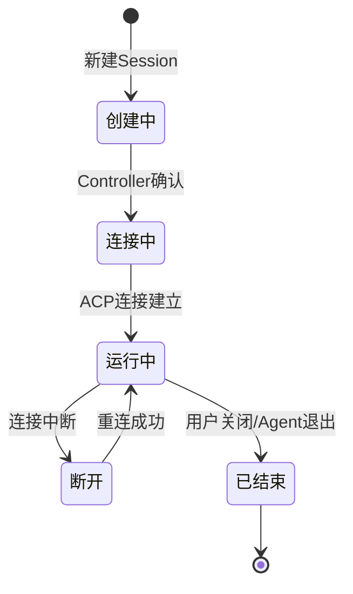
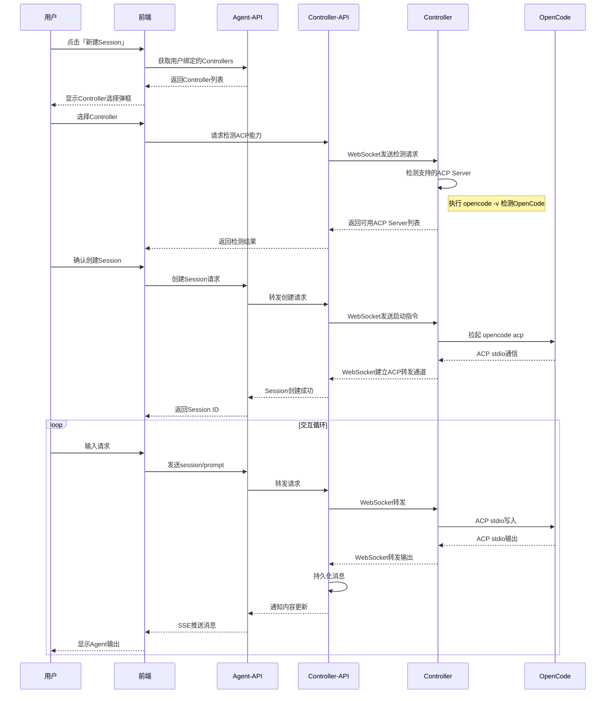

# Agent拉起与交互

**功能名称**: Agent拉起与交互
**PRD 版本**: v1.0
**创建日期**: 2026-05-18
**作者**: ZeroAsh

## 背景与目标

### 1.1 背景

v1 已完成控制器注册、绑定、心跳检测功能，用户可以在 Web 界面统一查看所有控制器的在线状态。但用户仍然需要 SSH 登录到远程机器手动管理 Agent 进程，无法在浏览器中直接与 Agent 交互。需要在 v1 基础上增加 Session 管理机制和 ACP 协议转发能力，实现完整的 Agent 拉起与交互流程。

### 1.2 目标

- 用户可以通过 Web 界面创建 Session 并选择目标控制器
- 控制器能够检测并拉起 OpenCode ACP 模式
- 前端能够实时显示 ACP 协议消息并支持用户输入
- 所有 ACP 通信内容持久化存储，支持历史查看

### 1.3 成功标准

- Session 创建到 ACP 连接建立不超过 5s
- ACP 消息从前端发送到 Agent 响应的端到端延迟不超过 1s
- 支持同时管理至少 10 个活跃 Session
- Session 断开后支持重连，历史消息不丢失

## 用户分析

### 2.1 目标用户

- 已部署控制器并绑定到账号的开发者
- 需要远程与 AI Agent 交互进行代码编写、调试的用户
- 需要同时管理多个 Agent Session 的高级开发者

### 2.2 用户场景

| 场景 | 用户角色 | 目标 | 痛点 |
|--|--|--|--|
| 远程编码 | 个人开发者 | 在浏览器中使用远程机器上的 OpenCode | 需要 SSH 登录手动启动，无法在 Web 界面交互 |
| 多任务并行 | 高级开发者 | 同时运行多个 Agent 处理不同任务 | 缺乏统一的 Session 管理界面 |
| 历史回溯 | 个人开发者 | 查看之前的 Agent 交互记录 | Agent 输出不持久化，无法回看 |

## 功能需求

### 3.1 功能概述

实现完整的 Agent Session 管理和交互能力，包括 Session 创建、控制器选择、ACP 协议转发、内容持久化、实时展示和用户输入。

### 3.2 功能列表

#### 功能点 1: 新建 Session 弹框

- **描述**: 在侧边栏设置区域增加「新建 Session」按钮，点击后弹出新建 Session 弹框
- **用户价值**: 快速创建新的 Agent 交互会话
- **验收标准**:
  - [ ] 侧边栏设置区域显示「新建 Session」按钮
  - [ ] 点击按钮弹出新建 Session 弹框
  - [ ] 弹框显示用户已绑定的控制器列表
  - [ ] 选择控制器后，获取该控制器支持的 ACP Server 列表
  - [ ] 本期仅支持 OpenCode，检测方式为执行 `opencode -v` 命令
  - [ ] 用户确认后创建 Session 并建立 ACP 连接

#### 功能点 2: Controller ACP 能力检测

- **描述**: Controller 通过 WebSocket 接收检测请求，检测本地支持的 ACP Server（本期仅 OpenCode）
- **用户价值**: 自动发现控制器可用的 ACP Server，无需手动配置
- **验收标准**:
  - [ ] Controller-API 通过 WebSocket 向 Controller 发送检测请求
  - [ ] Controller 检测支持的 ACP Server 列表，其中 OpenCode 的检测方式为执行 `opencode -v`
  - [ ] Controller 返回检测结果和可用的 ACP Server 列表
  - [ ] 检测结果缓存，避免重复检测

#### 功能点 3: ACP 协议转发

- **描述**: Controller 收到启动指令后拉起 OpenCode ACP 模式，通过 WebSocket 转发 ACP 协议消息。前端所有输入输出均通过 Agent-API 中转
- **用户价值**: 实现前端与远程 OpenCode 的实时通信，Agent-API 作为统一入口负责持久化和推送
- **验收标准**:
  - [ ] Controller 拉起 OpenCode ACP 模式（`opencode acp`）
  - [ ] Controller 与 OpenCode 通过 stdio 进行 JSON-RPC 通信
  - [ ] Controller 通过 WebSocket 将 ACP 消息转发到 Controller-API
  - [ ] 输入路径：前端 → Agent-API → Controller-API → Controller → OpenCode
  - [ ] 输出路径：OpenCode → Controller → Controller-API → Agent-API → 前端

#### 功能点 4: 内容持久化

- **描述**: Controller-API 收到 ACP 转发内容后持久化到存储
- **用户价值**: 交互历史可追溯，支持断线重连后恢复
- **验收标准**:
  - [ ] Controller-API 将 ACP 消息存储到数据库
  - [ ] 消息包含：Session ID、消息类型、内容、时间戳、方向（输入/输出）
  - [ ] 存储格式支持后续查询和展示
  - [ ] 持久化完成后通知 Agent-API 内容有更新

#### 功能点 5: Agent-API SSE 接口

- **描述**: Agent-API 增加 `/session/{id}` SSE 接口，用于实时推送 ACP 消息给前端
- **用户价值**: 前端实时接收 Agent 输出，无需轮询
- **验收标准**:
  - [ ] Agent-API 提供 `/session/{id}` SSE 端点
  - [ ] 连接时返回该 Session 的历史消息
  - [ ] 有新消息时实时推送
  - [ ] 推送内容包含消息类型、内容、时间戳
  - [ ] 支持连接断开后自动重连

#### 功能点 6: Session 展示

- **描述**: 前端展示 Session 的完整交互内容和状态信息
- **用户价值**: 直观查看 Agent 交互过程和结果
- **验收标准**:
  - [ ] 显示 ACP 消息列表（用户输入和 Agent 输出）
  - [ ] 显示 Session 状态（创建中、连接中、运行中、断开、已结束）
  - [ ] 显示 Session 元信息（创建时间、关联控制器、ACP Server 类型）
  - [ ] 消息内容支持 Markdown 渲染和代码高亮
  - [ ] 支持消息滚动加载历史记录

#### 功能点 7: 前端 ACP 请求发送

- **描述**: 前端通过输入框发送 ACP 请求，经 Agent-API 转发到后端
- **用户价值**: 在浏览器中与远程 Agent 交互，如同本地使用
- **验收标准**:
  - [ ] Session 页面底部显示输入框
  - [ ] 用户输入后发送 `session/prompt` 请求到 Agent-API
  - [ ] Agent-API 转发请求到 Controller-API，再由 Controller-API 转发到 Controller
  - [ ] Controller 将请求写入 OpenCode 的 stdin
  - [ ] 支持发送文本内容和资源引用（如文件路径）
  - [ ] 发送后等待 Agent 响应，显示处理状态

#### 功能点 8: Session 生命周期管理

- **描述**: 支持 Session 的关闭、删除和断开重连
- **用户价值**: 灵活管理 Session，支持异常恢复
- **验收标准**:
  - [ ] 用户可手动关闭 Session（调用 `session/close`）
  - [ ] 用户可删除 Session 及其历史记录
  - [ ] Session 断开后支持重新连接
  - [ ] Agent 异常退出时 Session 状态自动更新
  - [ ] ACP 是多 Session 的，不同 Session 独立管理

### 3.3 Session 状态流转

### 3.4 用户操作流程

### 3.5 页面/界面描述

| 页面 | 描述 | 关键元素 |
|------|------|---------|
| 侧边栏 | 显示Session列表和新建入口 | 「新建Session」按钮、Session列表 |
| 新建Session弹框 | 选择Controller和ACP Server | Controller下拉框、ACP Server列表、确认/取消按钮 |
| Session页面 | 展示交互内容和状态 | 消息列表、输入框、状态指示器、元信息面板 |
| Session状态栏 | 显示当前Session状态 | 状态图标、连接时长、Controller信息 |

### 3.6 异常与边界情况

| 情况 | 预期行为 |
|------|---------|
| Controller 离线 | 提示 Controller 离线，无法创建 Session |
| OpenCode 未安装 | 提示该 Controller 未安装 OpenCode，无法使用 |
| ACP 连接中断 | 自动重连，重连期间消息暂存，恢复后发送 |
| Agent 异常退出 | Session 状态更新为「已结束」，显示退出原因 |
| 同时创建多个 Session | 支持，每个 Session 独立管理 |
| Session 消息过多 | 支持分页加载，前端虚拟滚动优化性能 |
| 网络延迟高 | 显示处理中状态，支持用户取消请求 |

## 四、非功能需求

### 4.1 性能要求

- Session 创建到 ACP 连接建立不超过 5s
- ACP 消息端到端延迟不超过 1s
- 支持同时管理至少 10 个活跃 Session
- 单个 Session 消息历史支持 10000+ 条

### 4.2 安全性要求

- ACP 通信内容加密传输（WSS）
- 用户只能操作自己账号下的 Session
- Controller 只能被绑定的用户操作
- 敏感信息（如 API Key）不落盘

### 4.3 兼容性要求

- 支持 ACP 协议版本协商，兼容未来升级
- Controller 支持多种 Agent 类型扩展（本期仅 OpenCode）

## 五、依赖与约束

### 5.1 依赖

- Agent 控制器管理 v1（Controller 注册、绑定、心跳）
- Controller-API Socket.IO 长连接能力
- Agent-API SSE 推送能力
- OpenCode ACP 模式支持
- MongoDB 存储（Session 和消息持久化）

### 5.2 约束

- Agent 实例在 Controller 所在机器本地运行
- ACP 通信使用 stdio 传输（本地模式）
- 本期仅支持 OpenCode 作为 ACP Server

## 六、相关文档

- [Agent控制器管理 v1 产品草案](./agent-controller-v1.md)
- [Agent 控制器管理 v1 技术提案](../engineering/proposals/20260517-proposal-agent-controller-v1.md)
- [ACP 协议文档](https://agentclientprotocol.com)
- [OpenCode ACP 支持](https://opencode.ai/docs/acp/)
