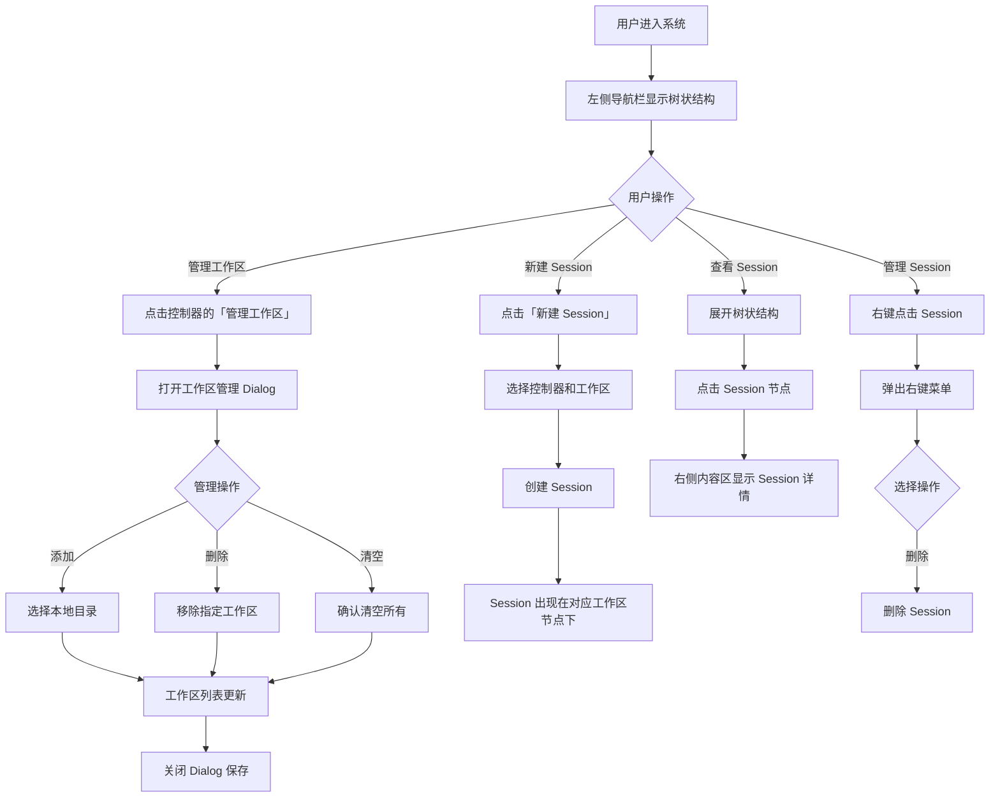

# 本地控制器工作区管理

**功能名称**: 本地控制器工作区管理
**PRD 版本**: v1.0
**创建日期**: 2026-05-19
**作者**: ZeroAsh

## 背景与目标

### 1.1 背景

在 v1 版本中，用户已经可以通过 Web 界面创建 Session 并选择目标控制器与 AI Agent 进行交互。然而，本地控制器运行在用户自有机器上，Agent 需要访问本地文件系统才能执行代码编写、调试等任务。目前缺乏统一的工作区管理机制，用户每次创建 Session 时都需要手动指定工作目录（cwd），操作繁琐且容易出错。

此外，左侧导航栏采用扁平的 Session 列表，当用户拥有多个控制器和工作区时，难以快速区分 Session 的归属关系，查找和管理效率低下。

需要为本地控制器增加工作区授权管理功能，并优化导航结构，让用户可以预先配置控制器可访问的本地目录，在创建 Session 时自动加载关联的工作区，同时通过树状结构清晰展示资源层级，提升用户体验和操作安全性。

### 1.2 目标

- 用户可以在设置界面为每个本地控制器管理一个或多个工作区目录
- 工作区管理提供直观的增删改查界面
- 创建 Session 时自动加载控制器关联的工作区，无需手动输入 cwd
- 确保控制器只能访问用户明确授权的目录，保障文件系统安全
- 左侧导航栏采用 Controller → 工作区 → Session 的三级树状结构，清晰展示资源归属关系

### 1.3 成功标准

- 用户管理工作区的操作步骤不超过 3 步
- 创建 Session 时工作区加载时间不超过 1s
- 用户误操作率降低 50%（相比手动输入 cwd）
- 左侧导航栏树状结构加载时间不超过 1s
- 用户通过树状结构定位 Session 的时间缩短 30%（相比扁平列表）

## 用户分析

### 2.1 目标用户

- 已部署本地控制器并绑定到账号的开发者
- 需要频繁在不同项目目录间切换的用户
- 对文件系统安全性有要求的团队用户

### 2.2 用户场景

| 场景 | 用户角色 | 目标 | 痛点 |
|--|--|--|--|
| 多项目并行开发 | 个人开发者 | 同时处理多个项目的代码任务 | 每次创建 Session 都要手动输入项目路径 |
| 团队协作 | 团队负责人 | 为不同项目配置不同的工作目录 | 缺乏统一的工作区管理界面 |
| 安全管控 | 安全敏感用户 | 限制 Agent 只能访问特定目录 | 无法预定义可访问的目录范围 |
| Session 管理 | 多任务开发者 | 快速定位和切换不同项目/控制器的 Session | 扁平列表难以区分 Session 归属 |

## 功能需求

### 3.1 功能概述

为本地控制器增加工作区授权管理功能，允许用户为每个控制器配置多个本地工作目录，在创建 Session 时自动加载关联的工作区，提升操作便捷性和安全性。同时优化左侧导航栏，采用三级树状结构组织 Controller、工作区和 Session，提供更清晰的资源层级视图。

### 3.2 功能列表

#### 功能点 1: 控制器设置界面增加工作区管理入口

- **描述**: 在设置界面的控制器管理区域，为每个本地控制器增加「管理工作区」按钮
- **用户价值**: 快速进入工作区管理界面，无需离开当前页面
- **验收标准**:
  - [ ] 设置页面控制器列表中，每个本地控制器项显示「管理工作区」按钮
  - [ ] 按钮点击后弹出工作区管理 Dialog
  - [ ] 按钮显示当前控制器已关联的工作区数量（如：管理工作区 (3)）

#### 功能点 2: 工作区管理 Dialog

- **描述**: 提供完整的工作区管理界面，支持添加、删除、清空工作区操作
- **用户价值**: 集中管理控制器可访问的本地目录
- **验收标准**:
  - [ ] Dialog 顶部为工具栏，包含「添加」按钮和「清空」按钮
  - [ ] 工具栏下方为工作区列表，显示已添加的工作区路径
  - [ ] 每个工作区项尾部显示「删除」按钮
  - [ ] 点击「添加」按钮弹出文件夹选择框
  - [ ] 文件夹选择框默认定位规则：
    - Windows：显示所有盘符列表（C:\、D:\ 等）
    - Linux/macOS：显示根目录 `/` 的文件夹列表，默认定位到用户 home 目录（如 `/home/username` 或 `/Users/username`）
  - [ ] 文件夹选择框支持导航浏览子目录
  - [ ] 选中目录后显示完整路径预览
  - [ ] 点击「清空」按钮弹出确认对话框，确认后清空所有工作区
  - [ ] 点击「删除」按钮移除对应的工作区
  - [ ] Dialog 支持拖拽排序工作区顺序
  - [ ] Dialog 关闭时自动保存变更

#### 功能点 3: 新建 Session 时加载关联工作区

- **描述**: 在新建 Session 弹框中，选择控制器后自动加载该控制器关联的工作区列表
- **用户价值**: 无需手动输入工作目录，一键选择已有工作区
- **验收标准**:
  - [ ] 选择控制器后，自动获取并显示该控制器关联的工作区列表
  - [ ] 工作区列表以下拉框或单选按钮形式展示
  - [ ] 默认选中第一个工作区
  - [ ] 显示「管理工作区」link，点击可打开工作区管理 Dialog（复用）
  - [ ] 工作区加载时间不超过 1s

#### 功能点 4: 禁止手动填写 cwd

- **描述**: 新建 Session 时移除手动输入 cwd 的功能，强制使用工作区选择
- **用户价值**: 避免输入错误，确保 Agent 只能访问授权目录
- **验收标准**:
  - [ ] 新建 Session 弹框中不再显示 cwd 输入框
  - [ ] 工作区选择为必填项，未选择时无法创建 Session
  - [ ] 创建 Session 时自动将选中的工作区路径作为 cwd 传递给控制器

#### 功能点 5: 左侧导航栏树状结构

- **描述**: 将左侧导航栏从扁平 Session 列表改为 Controller → 工作区 → Session 的三级树状结构
- **用户价值**: 清晰展示 Session 与控制器、工作区的归属关系，便于快速定位和管理
- **验收标准**:
  - [ ] 左侧导航栏显示三级树状结构：Controller → 工作区 → Session
  - [ ] 第一级：控制器节点，显示控制器名称和在线状态图标
  - [ ] 第二级：工作区节点，显示工作区目录名称（取路径最后一级目录名）
  - [ ] 第三级：Session 节点，显示 Session 标题或创建时间
  - [ ] 支持展开/折叠各级节点
  - [ ] 控制器离线时，其下工作区和 Session 显示为灰色
  - [ ] 点击 Session 节点在右侧内容区打开对应 Session
  - [ ] 支持右键菜单操作（删除 Session、管理工作区等）

### 3.3 用户操作流程

### 3.4 页面/界面描述

| 页面 | 描述 | 关键元素 |
|------|------|---------|
| 左侧导航栏 | 三级树状结构展示所有资源 | 控制器节点（含状态图标）、工作区节点（含目录名）、Session 节点（含标题）、展开/折叠按钮、右键菜单 |
| 设置页 - 控制器列表 | 显示所有控制器及管理入口 | 控制器列表、「管理工作区」按钮、工作区数量显示 |
| 工作区管理 Dialog | 集中管理工作区 | 工具栏（添加/清空）、工作区列表、删除按钮、拖拽手柄 |
| 新建 Session 弹框 | 选择控制器和工作区 | 控制器下拉框、工作区下拉框、「管理工作区」link |

### 3.5 异常与边界情况

| 情况 | 预期行为 |
|------|---------|
| 控制器离线 | 工作区管理按钮仍可点击，但提示控制器离线状态；树状结构中控制器及下属节点显示为灰色 |
| 选择的目录不存在 | 提示目录不存在，建议重新选择 |
| 目录无读取权限 | 提示权限不足，建议选择其他目录 |
| 工作区数量达到上限 | 提示已达到最大数量（建议上限 10 个） |
| 控制器解绑 | 删除该控制器的所有工作区配置，树状结构中移除该控制器节点 |
| 新建 Session 时控制器无工作区 | 提示请先管理工作区，提供快捷入口 |
| 树状结构节点过多 | 支持搜索功能，可按名称快速定位节点 |
| Session 无标题 | 显示创建时间作为默认标题 |

## 四、非功能需求

### 4.1 性能要求

- 工作区列表加载时间不超过 500ms
- 创建 Session 时工作区加载时间不超过 1s
- 工作区管理 Dialog 打开响应时间不超过 300ms
- 左侧树状结构初始加载时间不超过 1s
- 树状结构节点展开/折叠响应时间不超过 200ms
- 树状结构搜索结果返回时间不超过 300ms

### 4.2 安全性要求

- 控制器只能访问用户明确授权的工作区目录
- 工作区路径不得包含 `..` 或其他路径遍历攻击
- 目录选择时进行路径合法性校验
- 控制器离线状态下禁止修改工作区配置

### 4.3 兼容性要求

- 支持 Linux、macOS 的本地路径格式
- 支持绝对路径和相对路径（相对于控制器运行目录）

## 五、依赖与约束

### 5.1 依赖

- Agent 控制器管理 v1（Controller 注册、绑定、心跳）
- 本地控制器文件系统访问能力
- 设置页面 UI 框架

### 5.2 约束

- 每个控制器最多关联 10 个工作区目录
- 工作区路径必须为控制器所在机器的本地路径
- 工作区配置持久化存储到服务器数据库

## 六、相关文档

- [Agent控制器管理 v1 产品草案](../released/agent-controller-v1.md)
- [Agent拉起与交互](../reviewed/agent-session-interaction.md)
- [用户认证与设置页](../released/user-auth-and-settings.md)
