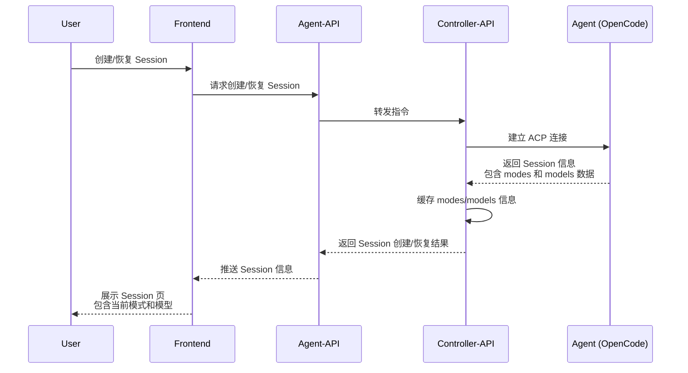
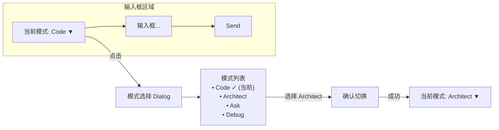
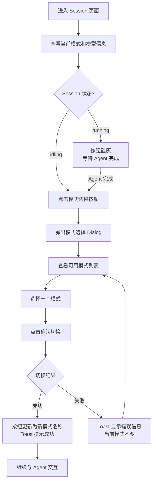

# 可用模型展示与 Agent 模式切换

**功能名称**: 可用模型展示与 Agent 模式切换
**PRD 版本**: v1.0
**创建日期**: 2026-05-22
**作者**: ZeroAsh

## 背景与目标

### 1.1 背景

Agent 会话建立后，用户无法直观地了解当前 Agent 支持哪些工作模式（如 Code、Architect、Ask、Debug），也不知道当前正在使用哪个 LLM 模型。模式（mode）决定了 Agent 的行为策略，但用户只能在启动 Agent 时通过环境变量预设，运行中无法调整。同时，当前 Session 页面也没有展示正在使用的模型信息，用户在需要切换策略或确认配置时缺乏可见性。

### 1.2 目标

- 用户在 Session 界面中可随时查看当前 Agent 支持的工作模式和正在使用的模型
- 用户在 Session 闲置时（idling）可切换工作模式，切换后 Agent 的行为策略立即生效
- 已缓存的模式和模型信息在 Session 生命周期内保持一致，避免重复拉取

### 1.3 成功标准

- Session 创建/恢复后，页面能立即展示当前模式和可用模型信息
- 模式切换操作在 3 秒内完成（取决于 ACP 响应速度）
- 仅允许在 idling 状态下切换，running 状态下切换入口不可用
- 切换模式后，Agent 下一轮交互即采用新模式

## 用户分析

### 2.1 目标用户

- 使用 Agent 进行多类型开发任务的用户（需要根据任务切换工作模式）
- 关心 Agent 当前配置状态的高级用户

### 2.2 用户场景

| 场景 | 用户角色 | 目标 | 痛点 |
|--|--|--|--|
| 任务中切换策略 | 开发者在编码过程中需要临时提问 | 从 Code 模式切换到 Ask 模式快速咨询 | 当前不知道如何切换模式，只能关闭会话重建 |
| 调试时切换模式 | 开发者遇到 Bug 需要分析 | 切换到 Debug 模式获得精细化分析 | 启动时预设的模式不适用所有场景，运行中无法调整 |
| 确认当前配置 | 重度用户查看 Session 运行时状态 | 确认 Agent 当前工作模式和使用的模型 | 页面没有展示这些信息，需要猜测 |

## 功能需求

### 3.1 功能概述

在 Session 界面中增加 Agent 模式和模型信息的展示与交互能力。模式的可用列表和当前选中状态在 Session 创建或恢复时获取并缓存，在输入框左侧提供模式切换入口，仅在 Session 闲置（idling）时可操作。当前使用的模型信息同步展示，但暂不做切换（模型切换的 ACP 协议尚未稳定）。

### 3.2 功能列表

#### 功能点 1: Session 模式与模型信息缓存

- **描述**: 在用户创建新 Session 或恢复已结束的 Session 时，系统自动获取该 Session 支持的 Agent 模式列表、可用的 LLM 模型列表，以及当前使用的模式 ID 和模型 ID。这些信息随 Session 状态一起缓存，在 Session 生命周期内保持可用。
- **用户价值**: 用户无需手动查询即可在进入 Session 后立即看到相关信息，操作流畅。
- **验收标准**:
  - [ ] 新建 Session 成功后，页面展示当前工作模式和可用模式列表
  - [ ] 恢复已结束的 Session 成功后，页面同样展示这些信息
  - [ ] 模式和模型信息在 Session 活跃期间保持一致
  - [ ] 信息更新（如 Agent 自动切换模式）时，页面同步刷新

#### 功能点 2: 输入框左侧模式切换入口

- **描述**: 在 Session 对话输入框的左侧，增加一个显示当前模式名称的切换按钮。按钮内容格式为 `<当前模式图标> <当前模式名称>`。点击该按钮弹出模式选择对话框，列出所有可用模式。每个模式项显示名称和描述。用户选择一个模式后，系统请求切换模式，切换成功后按钮上的当前模式名称更新。
- **用户价值**: 用户可在不离开对话界面的情况下，直观地查看和切换 Agent 工作模式。
- **验收标准**:
  - [ ] 输入框左侧显示当前模式名称按钮
  - [ ] 每个模式包含名称和描述信息
  - [ ] 当前选中的模式在列表中高亮标记
  - [ ] 选择新模式后，按钮文字更新为新模式名称
  - [ ] 操作过程中有加载状态提示

#### 功能点 3: Idling 状态下允许模式切换

- **描述**: 模式切换操作仅允许在 Session 状态为「idling」时进行。当 Agent 正在生成回复（running）或 Session 处于其他状态（connecting、creating、disconnected、ended）时，切换入口不可用。在 idling 状态下，用户选择新模式后，系统发起模式切换请求，切换成功后新模式立即生效。
- **用户价值**: 避免在 Agent 正在工作时打断其生成过程，确保切换操作的安全性。
- **验收标准**:
  - [ ] idling 状态下，模式切换按钮可点击
  - [ ] running 状态下，模式切换按钮置灰或隐藏
  - [ ] 切换过程中按钮显示加载状态
  - [ ] 切换失败时显示明确的错误提示，当前模式保持不变
  - [ ] 切换成功后，后续的 Agent 交互基于新模式进行

#### 功能点 4: 当前模型信息展示

- **描述**: 在 Session 页面的合适位置（如输入框左侧模式按钮附近，或 Session 头部信息区域），展示当前 Session 正在使用的 LLM 模型名称。模型信息为只读展示，不可切换操作。
- **用户价值**: 用户可确认 Agent 当前使用的模型，辅助判断 Agent 的行为和输出质量。
- **验收标准**:
  - [ ] Session 页面上展示当前使用的模型名称
  - [ ] 模型名称随 Session 创建/恢复时一起返回
  - [ ] 模型信息为只读，无可交互元素

### 3.3 用户操作流程

### 3.4 页面/界面描述

| 页面 | 描述 | 关键元素 |
|------|------|---------|
| Session 页面 - 输入框区域 | 输入框左侧新增模式切换按钮 | 当前模式名称 + 下拉箭头图标；点击弹出 Dialog |
| 模式选择 Dialog | 展示 Agent 支持的所有工作模式 | Dialog 标题「切换工作模式」；模式列表（名称 + 描述 + 选中态）；确认/取消按钮；加载状态 |
| Session 页面 - 信息区域 | 展示当前使用的 LLM 模型 | 模型名称展示（只读文本）；位于模式按钮附近或头部区域 |

### 3.5 异常与边界情况

| 情况 | 预期行为 |
|------|---------|
| Agent 不支持模式切换 | 模式切换按钮隐藏或置灰，提示「当前 Agent 不支持切换工作模式」 |
| 切换模式时 Agent 断连 | 显示连接失败提示，当前模式保持不变；Session 重连后重新拉取当前模式 |
| 模式切换请求超时 | 显示「切换超时，请重试」，模式不变 |
| Session 状态在切换过程中变化（如 Agent 开始生成） | 切换请求正常发出但可能被 Agent 拒绝；以实际返回结果为准 |
| 可用模式列表为空 | 模式切换按钮置灰，提示「无可用的工作模式」 |
| Agent 自主切换了模式 | 页面自动刷新当前模式显示，同步到最新状态 |
| 模型信息不可用 | 模型展示区域显示「未知」或隐藏 |

## 四、非功能需求

### 4.1 性能要求

- 模式切换操作应在 3 秒内完成
- 模式和模型信息应尽量缓存，避免每次操作重新获取

### 4.2 安全性要求

- 用户只能切换自己 Session 的模式
- 模式和模型信息仅在当前 Session 上下文中可查看

### 4.3 兼容性要求

- 需要 Agent 端支持 `session/set_mode` RPC 方法
- 需要 Agent 端在 Session 创建时返回 `modes` 和 `models` 数据
- 若 Agent 不支持上述协议，功能应优雅降级（隐藏或置灰）

## 五、依赖与约束

### 5.1 依赖

- Agent（OpenCode）需要在 `session/new` 和 `session/resume` 的返回结果中包含 `modes` 和 `models` 字段
- Agent 需要支持 `session/set_mode` RPC 方法
- Session 创建/恢复流程需确保返回 modes 和 models 数据

### 5.2 约束

- 模型切换功能本期不做（ACP 模型切换协议仍在 draft 阶段），仅展示当前模型
- 模式切换仅在 idling 状态下可用
- 可用模式列表和当前模式信息以 ACP 协议返回的为准

## 六、相关文档

- [Agent 拉起与交互 (released)](../released/20260518-agent-session-interaction.md)
- [LLM 供应商与模型管理 (released)](../released/20260517-llm-provider-settings.md)
- [Session 信息展示 PRD (released)](../released/20260520-session-reopen-prd.md)
- ACP 协议文档: `session/new`, `session/resume`, `session/set_mode` 方法定义
