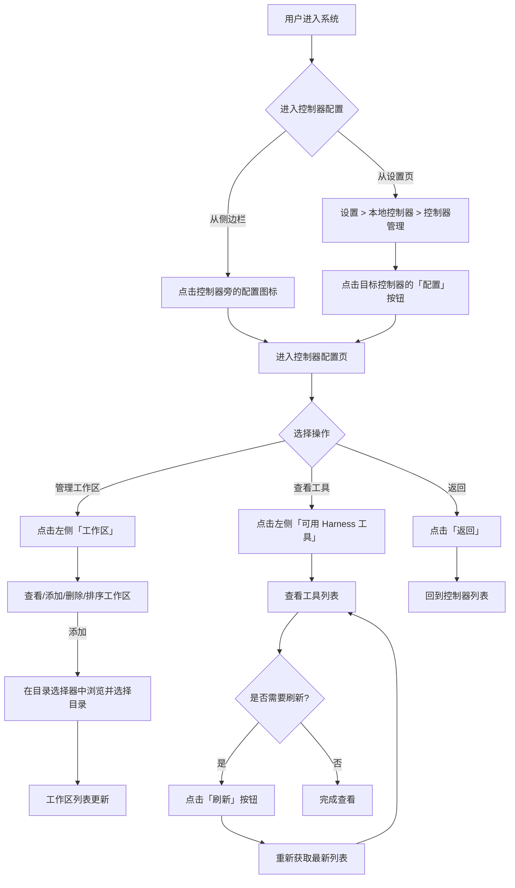

# 本地控制器配置页

**功能名称**: 本地控制器配置页
**PRD 版本**: v1.0
**创建日期**: 2026-05-22
**作者**: ZeroAsh

## 背景与目标

### 1.1 背景

目前本地控制器的配置功能分散在设置页的「控制器」板块中，工作区管理以 Dialog 形式呈现，无法直观地展示每个控制器的完整配置信息。用户需要频繁在多个控制器之间切换配置时，操作路径较长。

此外，用户希望在 Web 界面中直观看到控制器上可用的 Harness 工具（即 ACP 服务器，如 OpenCode、Claude Code），以便在创建 Session 前就能了解每个控制器的能力，而不是只能在创建过程中临时发现。

### 1.2 目标

- 将「控制器」更名为「本地控制器」，更准确地反映当前支持的控制器类型
- 为每个本地控制器提供独立的配置页面，集中展示工作区管理和 Harness 工具列表
- 将工作区管理从 Dialog 形式改为页面内 Section，提升操作体验
- 提供 Harness 工具列表的展示与刷新能力，让用户实时了解控制器的可用工具

### 1.3 成功标准

- 用户进入单个控制器的配置页操作步骤不超过 2 步
- 工作区管理操作路径减少 50%（从弹窗改为页面内 Section）
- Harness 工具列表刷新响应时间不超过 3s
- 用户可直观地看到每个控制器支持哪些 ACP 服务器

## 用户分析

### 2.1 目标用户

- 已绑定多个本地控制器的用户
- 需要为不同控制器配置不同工作区目录的用户
- 希望了解控制器支持哪些 AI Agent 工具的用户

### 2.2 用户场景

| 场景 | 用户角色 | 目标 | 痛点 |
|--|--|--|--|
| 多控制器配置管理 | 多机用户 | 分别管理每台机器的控制器配置 | 在设置页的控制器列表中来回操作 Dialog 效率低 |
| 工作区批量管理 | 项目开发者 | 快速调整某台机器的可用工作区 | Dialog 空间有限，无法同时查看全局工作区信息 |
| 工具能力预览 | 新用户 | 了解每个控制器支持哪些 AI Agent | 创建 Session 时才能知道，缺乏前置查看入口 |
| 工具列表刷新 | 运维用户 | 验证控制器上是否已安装新工具 | 不知道当前缓存的工具列表是否是最新的 |

## 功能需求

### 3.1 功能概述

在设置页中将原「控制器」板块更名为「本地控制器」，并为其下的「控制器管理」增加独立配置页入口。每个控制器的配置页采用与设置页相同的双栏布局，包含「工作区」和「可用 Harness 工具」两个 Section。在左侧侧边栏的控制器节点上增加配置入口，同时在设置页原位置保留快捷跳转链接。

### 3.2 功能列表

#### 功能点 1: 将「控制器」更名为「本地控制器」

- **描述**: 设置页左侧导航栏中，将「控制器」分类标签改为「本地控制器」
- **用户价值**: 准确反映 v1 支持的控制器类型，为未来其他类型扩展预留空间
- **验收标准**:
  - [ ] 设置页左侧导航「控制器」显示为「本地控制器」
  - [ ] 子项「控制器管理」名称保持不变
  - [ ] 页面内 Section 标题同步更新

#### 功能点 2: 增加控制器配置页入口

- **描述**: 在设置页的控制器列表中和左侧侧边栏的控制器节点上增加配置入口，点击进入该控制器的独立配置页
- **用户价值**: 快速进入目标控制器的配置页
- **验收标准**:
  - [ ] 设置页「控制器管理」列表中，每个已绑定的控制器项显示「配置」图标按钮
  - [ ] 左侧侧边栏的控制器节点上显示「配置」图标按钮
  - [ ] 点击「配置」进入该控制器的配置页（设置页内的二级视图）
  - [ ] 配置页顶部显示控制器名称和在线状态，并有「返回」按钮回到控制器列表

#### 功能点 3: 控制器配置页 - 工作区 Section

- **描述**: 将原有工作区管理 Dialog 改为控制器配置页内的独立 Section，支持添加、删除、清空、启用/禁用工作区
- **用户价值**: 在同一页面内完成所有工作区管理操作，无需弹窗切换
- **验收标准**:
  - [ ] 配置页左侧导航显示「工作区」Section 项
  - [ ] 工作区 Section 包含：
    - 当前已配置工作区数量统计
    - 「添加」按钮，点击后展开目录选择器
    - 「清空」按钮，点击后确认清空所有工作区
    - 工作区列表：显示启动状态（切换开关）、工作区名称、完整路径
    - 每个工作区项的「删除」按钮
    - 拖拽排序能力
  - [ ] 操作行为与原有 Dialog 保持一致
  - [ ] 设置页「控制器管理」列表中保留「管理工作区」快捷链接，点击后跳转到该控制器的配置页并定位到工作区 Section

#### 功能点 4: 控制器配置页 - 可用 Harness 工具 Section

- **描述**: 展示控制器上可用的 Harness 工具列表（即检测到的 ACP 服务器，如 OpenCode、Claude Code），并提供刷新按钮
- **用户价值**: 在创建 Session 前即可了解每个控制器支持哪些 AI Agent 工具
- **验收标准**:
  - [ ] 配置页左侧导航显示「可用 Harness 工具」Section 项
  - [ ] Harness 工具 Section 包含：
    - 工具列表，每项显示工具名称（如 OpenCode、Claude Code）、运行状态（在线/离线）、版本号（如有）
    - 空状态提示：当前控制器未检测到可用工具
    - 「刷新」按钮，点击后重新从控制器获取最新工具列表
  - [ ] 刷新按钮在有正在进行的刷新请求时显示加载状态，不可重复点击
  - [ ] 刷新完成后更新列表，并显示上次刷新时间
  - [ ] 数据通过缓存读取，刷新时主动使缓存失效

#### 功能点 5: 侧边栏控制器节点增加配置入口

- **描述**: 在左侧主侧边栏中，每个控制器节点上增加配置图标入口
- **用户价值**: 无需进入设置页，直接从侧边栏进入控制器配置
- **验收标准**:
  - [ ] 侧边栏控制器名称旁显示配置图标
  - [ ] 点击后直接进入该控制器的配置页
  - [ ] 图标在控制器离线时保持可见和可用（仅查看历史配置）

### 3.3 用户操作流程

### 3.4 页面/界面描述

| 页面 | 描述 | 关键元素 |
|------|------|---------|
| 设置页 - 左侧导航 | 更新后的设置导航菜单 | 「帐号」「模型设置」「本地控制器」分类标签、子项「控制器管理」 |
| 设置页 - 控制器管理 | 所有控制器列表，含配置入口 | 控制器列表、状态标签、「配置」图标按钮、「管理工作区」快捷链接、生成 Key、重命名、解绑 |
| 控制器配置页 | 单个控制器的完整配置页，双栏布局 | 左侧 Section 导航（工作区、可用 Harness 工具）、右侧内容区、顶部控制器名称/状态、「返回」按钮 |
| 工作区 Section | 工作区管理内容 | 添加/清空按钮、工作区列表（开关、名称、路径、删除）、目录选择器 |
| Harness 工具 Section | 可用 ACP 工具展示 | 工具列表（名称、状态、版本号）、刷新按钮、上次刷新时间 |
| 侧边栏控制器节点 | 侧边栏中的控制器项 | 控制器名称、在线状态点、展开/折叠箭头、Session 数量、配置图标 |

### 3.5 异常与边界情况

| 情况 | 预期行为 |
|------|---------|
| 控制器离线 | 配置页可正常打开，工作区展示已配置的列表但提示控制器离线无法浏览目录；Harness 工具列表展示上次缓存数据，刷新时提示控制器离线 |
| 控制器解绑 | 跳转回控制器列表，该控制器的配置页不可再访问 |
| 没有已绑定的控制器 | 控制器管理列表为空，配置页无可进入的控制器 |
| Harness 工具列表为空 | 显示空状态提示「当前控制器未检测到可用工具」 |
| 刷新时网络错误 | 保留旧列表不变，提示「刷新失败，请稍后重试」 |
| 多个控制器 | 每个控制器有独立的配置页，互不干扰 |
| 工作区数量超限 | 添加时提示已达上限（不超过 10 个） |

## 四、非功能需求

### 4.1 性能要求

- 控制器配置页加载时间不超过 1s
- 工作区列表加载时间不超过 500ms
- Harness 工具列表刷新响应时间不超过 3s（含控制器网络延迟）
- 侧边栏配置图标响应时间不超过 100ms

### 4.2 安全性要求

- 用户只能查看和管理自己账号下的控制器配置
- 工作区操作需验证控制器归属关系
- Harness 工具列表仅包含工具元信息，不涉及敏感数据

### 4.3 兼容性要求

- 与现有设置页 UI 风格保持一致
- 工作区 Section 的行为需与原有 Dialog 行为完全一致

## 五、依赖与约束

### 5.1 依赖

- 现有设置页 UI 框架及布局
- 控制器管理工作区 CRUD 能力（已有）
- 控制器 ACP 能力检测接口（已有 `acpCapabilities`）
- 控制器列表与状态展示（已有）

### 5.2 约束

- 页面设计需服从事先定义的设置页视觉风格
- 工作区最大数量限制保持 10 个不变
- Harness 工具仅展示 ACP Server 类型，不涉及工具内部细节

## 六、相关文档

- [用户认证与设置页](../released/20260517-user-auth-and-settings.md)
- [Agent控制器管理 v1](../released/20260517-agent-controller-v1.md)
- [本地控制器工作区管理](../released/20260519-local-controller-workspace-management.md)
- [Agent拉起与交互](../released/20260518-agent-session-interaction.md)
