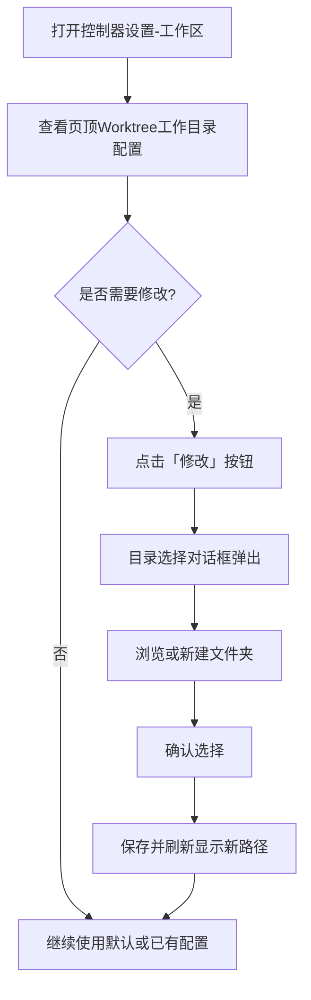
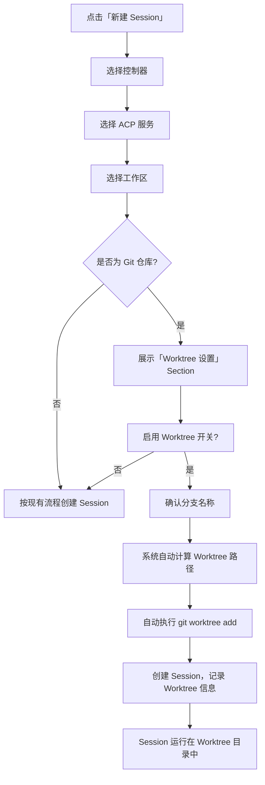
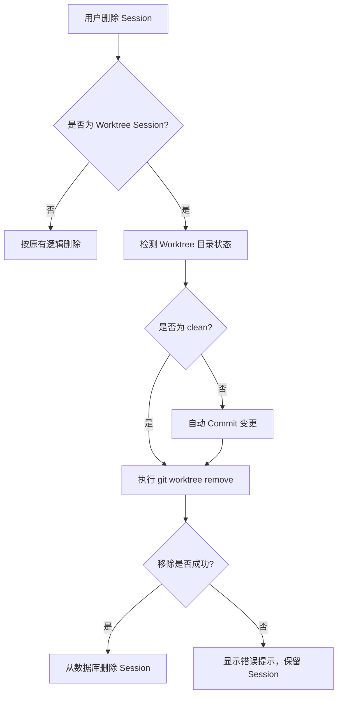

# Git Worktree 集成支持

**功能名称**: Git Worktree 集成支持
**PRD 版本**: v1.0
**创建日期**: 2026-05-23
**作者**: AI

## 背景与目标

### 1.1 背景

当前系统已经支持了工作区（Workspace）的 Git 仓库检测和分支查看，用户可以在设置页中初始化仓库和设置默认分支。但用户在新建 Session 进行代码开发时，仍然直接在工作区的原始目录中操作。这带来了两个问题：

1. **分支污染**: 多个 Session 共享同一个工作目录，彼此之间的文件修改、依赖安装、构建产物等相互影响
2. **并行受限**: 无法在同一个仓库的不同分支上同时开启多个独立的 Session

Git Worktree 是 Git 官方提供的功能，允许在一个仓库中同时检出多个分支到独立的目录。将此能力集成到系统中，可以让每个 Session 拥有独立的隔离工作目录，互不干扰。

### 1.2 目标

- 支持为每个控制器配置全局的 Worktree 存储根目录
- 在新建 Session 时，如果工作区是 Git 仓库，允许用户选择启用 Worktree 模式
- 为启用了 Worktree 的 Session 自动创建独立的工作目录，并在独立的 Git 分支上操作
- Session 销毁时自动清理 Worktree（暂存变更后删除）
- 目录选择器支持「新建文件夹」功能，提升易用性

### 1.3 成功标准

- 工作区设置页顶部显示 Worktree 工作目录配置，可修改
- 目录选择器支持新建文件夹
- Session 新建流程在 Git 仓库场景下展示 Worktree 设置选项
- 启用 Worktree 的 Session 运行在独立的 Git 分支和目录中
- Session 列表中 Worktree Session 有独立图标标识
- Session 销毁时自动完成代码暂存和 Worktree 清理
- 所有操作对用户透明，无需手动执行 Git 命令

## 用户分析

### 2.1 目标用户

使用 Git 仓库作为工作区的开发者，特别是需要在同一仓库上并行开展多个独立开发任务的高级用户。

### 2.2 用户场景

| 场景 | 用户角色 | 目标 | 痛点 |
|------|---------|------|------|
| 在同一个 Git 仓库的不同分支上开启多个 Session | 开发者 | 并行处理多个任务，互不干扰 | 当前只能在一个分支上工作，切换分支需要手动处理 |
| 开启新功能开发的 Session | 开发者 | 自动创建独立的分支和目录，直接开始编码 | 需要手动创建分支和切换目录 |
| 关闭 Session 后自动清理 | 开发者 | Session 结束时自动保存代码并清理工作目录 | 需要手动处理未提交的变更，再删除目录 |
| 配置 Worktree 存储位置 | 开发者 | 将 Worktree 目录统一存储到指定位置 | 当前没有统一的 Worktree 管理入口 |

## 功能需求

### 3.1 功能概述

在现有工作区和 Session 管理的基础上，集成 Git Worktree 能力。用户可以为控制器配置全局 Worktree 目录，在新建 Session 时选择是否启用 Worktree 模式。启用后，系统自动创建 Git 分支和隔离的工作目录，Session 结束时自动清理。同时优化目录选择器，增加新建文件夹功能。

### 3.2 功能列表

#### 功能点 1: Worktree 工作目录全局设置

- **描述**: 在控制器的「工作区」设置页顶部增加「Git Worktree 工作目录」配置项。未配置时默认使用系统配置文件所在目录下的 `worktrees` 子文件夹（如 `~/.zag/worktrees`）。已配置时显示当前路径。点击「修改」按钮打开目录选择对话框（复用现有的目录选择器），选择新的路径。
- **用户价值**: 统一管理所有 Worktree 目录的位置，方便用户按需调整存储位置。
- **验收标准**:
  - [ ] 工作区设置页顶部显示「Git Worktree 工作目录」及当前路径和「修改」按钮
  - [ ] 未配置时默认显示 `~/.zag/worktrees`
  - [ ] 点击「修改」弹出目录选择对话框
  - [ ] 选择新路径后保存并更新显示
  - [ ] 注册工作区时自动创建该目录

#### 功能点 2: 目录选择器增加「新建文件夹」功能

- **描述**: 在目录选择对话框中增加「新建文件夹」按钮。点击后弹出输入框 Dialog，用户输入文件夹名称后，在当前浏览的目录下创建新的文件夹，创建完成后自动进入该文件夹。
- **用户价值**: 用户无需通过外部工具创建目录，在系统中即可直接新建文件夹并选择。
- **验收标准**:
  - [ ] 目录选择器底部或顶部区域显示「新建文件夹」按钮
  - [ ] 点击后弹出 Dialog，包含文件夹名称输入框
  - [ ] 输入名称后点击确认，在当前目录下创建文件夹
  - [ ] 创建成功后自动进入该文件夹并刷新列表
  - [ ] 创建失败时显示错误提示（如名称冲突、无权限等）
  - [ ] 取消或点击外部区域关闭 Dialog

#### 功能点 3: Session 创建时启用 Worktree

- **描述**: 在新建 Session 的对话框中，用户完成「Working Directory」选择后，检测该目录是否为 Git 仓库。如果是 Git 仓库，则展示「Worktree 设置」Section。用户可以选择是否启用 Worktree。启用后展示「分支名称」输入框，该输入框为两段式设计：左侧为 `<工作区名称>/`（禁止编辑），右侧为分支后缀（可编辑，默认随机生成）。最终分支名为 `<工作区名称>/<分支后缀>`。
- **用户价值**: 在熟悉的 Session 创建流程中无缝集成 Worktree 能力，用户按需决定是否启用。
- **验收标准**:
  - [ ] 选择 Working Directory 后自动检测是否为 Git 仓库
  - [ ] 非 Git 仓库不显示 Worktree 设置 Section
  - [ ] 检测为 Git 仓库时显示「Worktree 设置」Section
  - [ ] Section 中有一个「启用 Worktree」开关
  - [ ] 开关打开后显示分支名称输入框
  - [ ] 输入框左段显示 `<工作区名称>/`，禁止编辑
  - [ ] 输入框右段为可编辑的文本输入，默认随机生成
  - [ ] 最终分支名合并为 `<工作区名称>/<分支后缀>`
  - [ ] 启用 Worktree 的 Session 创建时自动执行 `git worktree add`

#### 功能点 4: Worktree Session 信息持久化

- **描述**: 为启用了 Worktree 的 Session 记录关联信息：Worktree 完整路径和分支名称。在 Session 列表中，这类 Session 有特殊的图标标识（Git 分支分叉图标）。Session 顶部标题栏显示当前工作地址为 Worktree 路径，并附加「Worktree」标记。
- **用户价值**: 用户能清晰区分哪些 Session 使用了 Worktree 模式，并在界面中获得一致的上下文感知。
- **验收标准**:
  - [ ] Session 列表中的 Worktree Session 显示 Git 分叉图标
  - [ ] Session 标题栏显示 Worktree 的完整工作目录路径
  - [ ] 标题栏路径旁边显示「Worktree」标记
  - [ ] Worktree 路径和分支信息持久化存储

#### 功能点 5: Session 销毁时自动清理 Worktree

- **描述**: 删除启用了 Worktree 的 Session 时，自动执行清理流程：首先检测 Worktree 目录的工作状态，如果有未提交的变更（非 clean），则自动执行一次 Git 提交，提交信息为「chore: 工作区销毁代码暂存」。然后执行 `git worktree remove` 命令移除 Worktree 工作区。
- **用户价值**: 无需手动清理 Git Worktree，系统自动保存变更并清理，避免残留目录和孤立分支。
- **验收标准**:
  - [ ] 删除 Worktree Session 时自动触发清理流程
  - [ ] 清理前检测 Worktree 是否为 clean 状态
  - [ ] 非 clean 状态时自动提交，提交信息为「chore: 工作区销毁代码暂存」
  - [ ] 提交后执行 `git worktree remove` 移除工作区
  - [ ] 清理成功后才从数据库中删除 Session 记录
  - [ ] 清理失败时显示错误提示，不删除 Session 记录
  - [ ] 非 Worktree Session 不受影响，按原有逻辑删除

### 3.3 用户操作流程

#### 流程一：配置 Worktree 工作目录

#### 流程二：新建 Worktree Session

#### 流程三：销毁 Worktree Session

### 3.4 页面/界面描述

| 页面 | 描述 | 关键元素 |
|------|------|---------|
| 控制器设置-工作区 | 工作区设置页面顶部增加 Worktree 工作目录配置行 | 配置标题、当前路径文本、「修改」按钮 |
| 目录选择对话框 | 在现有目录浏览器的基础上增加「新建文件夹」功能 | 目录树/列表、「新建文件夹」按钮、文件夹名称输入 Dialog |
| 新建 Session 对话框 | 选择工作区后，在 Git 仓库场景下增加 Worktree 设置 Section | 启用 Worktree 开关、分支名称输入框（两段式） |
| Session 列表 | Session 树列表中标识 Worktree Session | Git 分叉图标 |
| Session 页面 | Session 详情页的标题栏 | 工作目录路径、「Worktree」标记 |

### 3.5 异常与边界情况

| 情况 | 预期行为 |
|------|---------|
| 工作区不是 Git 仓库 | 不显示 Worktree 设置 Section |
| 控制器未配置 Worktree 目录 | 使用默认路径 `~/.zag/worktrees` |
| Worktree 目录不存在或无法创建 | 显示错误提示，禁止启用 Worktree |
| Worktree 分支名冲突（已存在同名分支） | 检测冲突并提示用户修改分支后缀 |
| `git worktree add` 执行失败 | 显示错误详情，Session 创建失败，回滚 |
| Session 删除时 Worktree 目录已被手动删除 | 跳过 Worktree 移除步骤，继续删除 Session |
| `git worktree remove` 执行失败 | 显示错误提示，保留 Session 记录不删除 |
| 自动 Commit 失败（如无 Git 用户配置） | 显示错误提示，引导用户解决后重试 |
| 多个 Session 指向同一仓库 | 允许，每个 Worktree 使用独立分支和目录 |
| 目录选择器中新建文件夹重名 | 提示「文件夹已存在」 |
| 目录选择器中新建文件夹名称非法 | 提示合法命名规则 |

## 四、非功能需求

### 4.1 性能要求

- Git 仓库检测应在 3 秒内完成
- `git worktree add` 应在 5 秒内完成
- Worktree 状态检测（clean/dirty）应在 2 秒内完成

### 4.2 安全性要求

- Git 操作指令通过加密通道传输
- Worktree 目录路径和分支信息仅存储必要元数据
- 自动提交仅产生一次 commit，不会覆盖用户已有提交
- Worktree 目录权限与原始仓库保持一致

### 4.3 兼容性要求

- 支持 Git 2.5+（Git Worktree 引入版本）
- 支持 Windows/Linux/macOS 三种操作系统下的 Git worktree 命令差异
- 工作区名称中的特殊字符在分支名中自动处理（替换非字母数字字符为连字符）

## 五、依赖与约束

### 5.1 依赖

- 用户宿主机需安装 Git（版本 >= 2.5）
- 控制器需支持文件浏览能力（现有能力）
- 控制器需支持 Git 命令执行能力（现有能力）
- 控制器设置页的 Worktree 目录配置信息需要持久化存储

### 5.2 约束

- Worktree 目录配置为全局控制器级别，影响该控制器下所有 Session
- 一个分支只能被一个 Worktree 检出，系统需确保分支名唯一
- Worktree 删除后原始仓库不受影响
- 自动提交使用系统的默认 Git 用户配置（user.name / user.email），若无配置则提示用户

## 六、相关文档

- 工作区设置页与 Git 能力支持
- 本地控制器工作区管理
- Agent Session 交互
