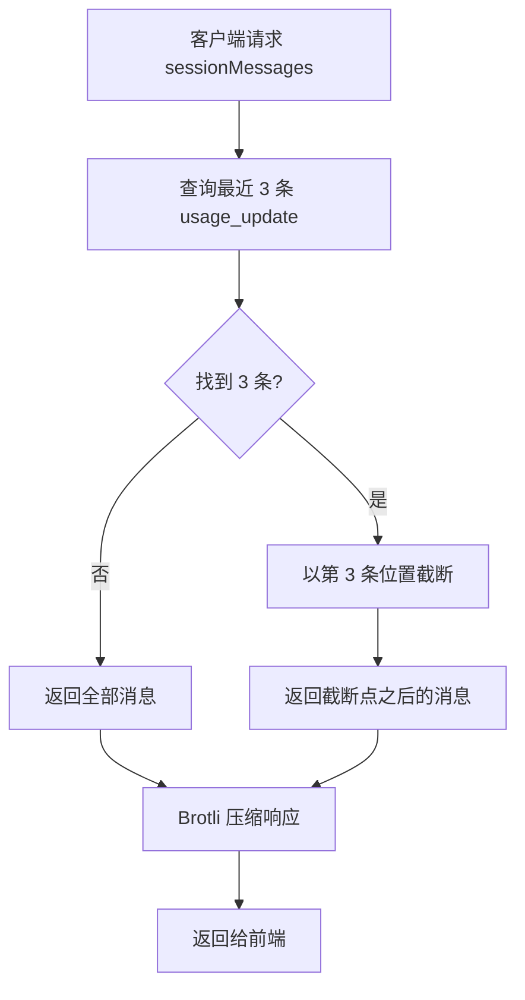
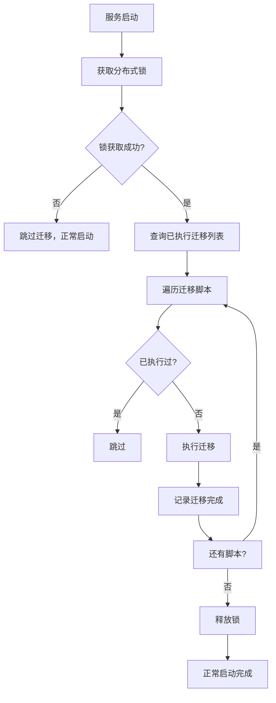
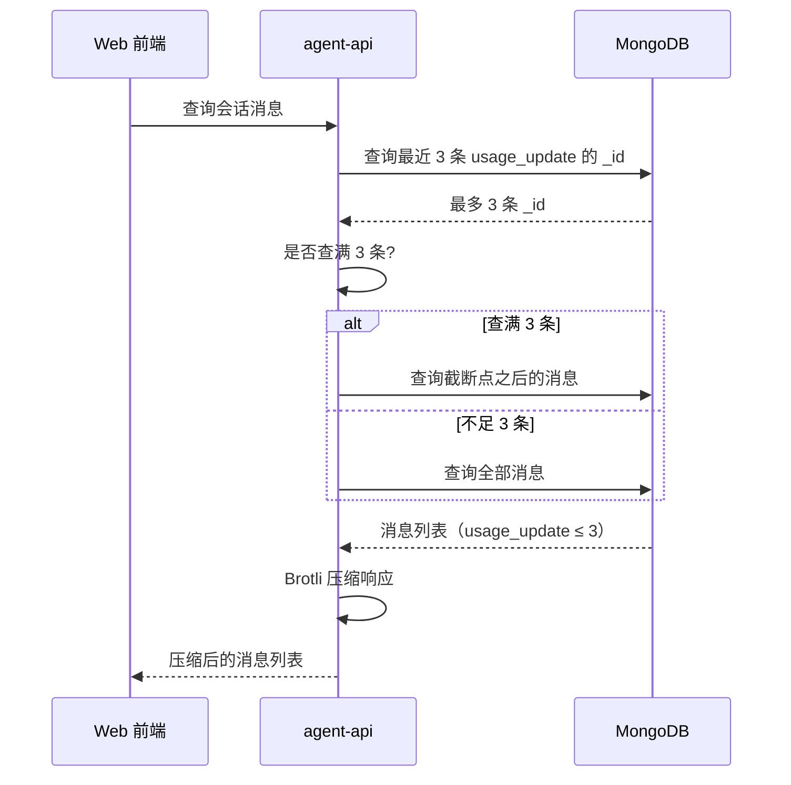

# 会话消息历史优化 & 响应压缩

**功能名称**: 会话消息历史优化 & 响应压缩
**PRD 版本**: v1.0
**创建日期**: 2026-05-24
**作者**: ZeroAsh

## 背景与目标

### 1.1 背景

在 Agent 长时间运行后，会话消息数量会急剧增长。当前系统会将所有消息（包括大量系统自动生成的 usage_update 消息）全部返回给前端，导致：

1. 前端接收大量无用数据，渲染性能下降
2. SSE 重连时全量历史拉取耗时过长，带宽浪费
3. 用户实际关心的对话消息被淹没在系统消息中

同时，agent-api 服务目前所有响应均为明文 JSON 传输，未启用任何压缩。在长会话场景下，GraphQL 响应体动辄数 MB，进一步加剧了网络传输延迟。

### 1.2 目标

- 消息历史返回中，usage_update 消息不超过 3 条，从尾部（最新）开始保留
- agent-api 所有 API 响应开启 Brotli 压缩，减少传输体积

### 1.3 成功标准

| 指标 | 目标 |
|------|------|
| 单次消息历史响应中 usage_update 数量 | ≤ 3 条 |
| 压缩后响应体体积 | 降低 ≥ 70%（实测） |
| 后端处理耗时 | 不因过滤逻辑显著增加（< 50ms） |
| 前端消息列表渲染性能（长会话 1000+ 条） | 无明显卡顿 |

## 用户分析

### 2.1 目标用户

所有使用 Web 端与 Agent 对话的用户，尤其是长时间会话的重度用户。

### 2.2 用户场景

| 场景 | 用户角色 | 目标 | 痛点 |
|--|--|--|--|
| 打开已有长会话的历史记录 | 日常用户 | 快速加载历史，继续对话 | 加载慢，浏览器卡顿 |
| SSE 断线重连 | 日常用户 | 快速恢复会话状态 | 重连耗时久，等待时间长 |
| 查看会话中的用量信息 | 开发者用户 | 了解本次会话 token 消耗趋势 | 希望看到最近的几次用量，而非全部 |

## 功能需求

### 3.1 功能概述

在后端消息查询服务中增加 usage_update 智能过滤逻辑，并在 agent-api 整体响应链路中启用 Brotli 压缩，在不影响用户正常查看用量信息的前提下，显著减少传输数据量和前端渲染压力。

### 3.2 功能列表

#### 功能点 1: 消息历史 usage_update 过滤

- **描述**: 会话消息查询时自动识别 usage_update 消息，保留最近 3 条，超出部分在后端截断。usage_update 通过消息内容中的 `sessionUpdate` 字段识别，保存时 `type` 字段保持不变（仍为 `text`）。
- **用户价值**: 历史消息加载速度显著提升，UI 不再因为大量用量卡片导致渲染卡顿；用户仍可看到最近几次用量趋势。
- **验收标准**:
  - [ ] ≤ 3 条 usage_update 时，返回所有消息不变
  - [ ] > 3 条 usage_update 时，从倒数第 3 条之后的消息开始返回
  - [ ] 过滤后返回的消息时间线连续（序号/时间无断层）
  - [ ] 非 usage_update 类型的消息不受影响

**过滤规则**：

先查找当前会话中最近的 3 条 usage_update。若查满 3 条，则以第 3 条的位置为截断点，仅返回截断点之后的所有消息；若不足 3 条，则返回全部消息。

**示例**：500 条消息中有 5 条 usage_update（位于消息序列的第 0、100、200、300、400 位）
- 最近 3 条从最新往前查，找到第 400、300、200 位
- 以第 200 位为截断点，返回第 200 位之后的消息（共 300 条）
- 最终包含 2 条 usage_update（第 300、400 位），≤ 3 ✓

#### 功能点 2: 响应 Brotli 压缩

- **描述**: 对所有 API 响应（包括 GraphQL 查询/变更、REST SSE、健康检查）启用 Brotli 压缩，不支持的客户端自动回退到 gzip。
- **用户价值**: API 响应体积大幅减小，网络传输时间缩短，页面加载/数据刷新更快。
- **验收标准**:
  - [ ] 浏览器收到 `Content-Encoding: br` 响应头
  - [ ] 压缩率 ≥ 70%（实测 1MB JSON 压缩后 < 300KB）
  - [ ] 不支持 Brotli 的客户端正常回退到 gzip 或 identity
  - [ ] SSE 流使用流式压缩，浏览器 EventSource 可正常解码

#### 功能点 3: 老数据迁移框架

- **描述**: 服务启动时自动检查并执行未运行的数据迁移脚本。迁移脚本需支持幂等性（同名不重复执行），多实例并发时通过分布式锁保证只有一个执行。
- **用户价值**: 老数据可逐步转换到新格式，对用户完全无感知。
- **验收标准**:
  - [ ] 启动时自动检查未运行的迁移并执行
  - [ ] 同名迁移仅执行一次（幂等）
  - [ ] 多实例同时启动时只有一个执行迁移（分布式锁）
  - [ ] 迁移失败不影响服务正常启动
  - [ ] 迁移执行有日志记录

迁移内容：扫描所有 `type: text` 且 content 为字符串格式的老消息，将 content 从 JSON 字符串转换为 JSON 对象，使所有消息的 content 格式统一。

### 3.3 处理流程

### 3.4 页面/界面描述

无前端 UI 变更。消息列表渲染逻辑保持不变，原有 usage_update 卡片（UsageCard）正常展示。

### 3.5 异常与边界情况

| 情况 | 预期行为 |
|------|---------|
| 消息不足 3 条 | 直接返回，不过滤 |
| 消息中无 usage_update | 直接返回，不过滤 |
| 所有消息均为 usage_update | 仅返回最后 2 条（截断后保留 ≤ 3） |
| 过滤后返回 0 条消息 | 返回空数组 |
| 客户端不支持 Brotli | 自动降级为 gzip 或不压缩 |
| SSE 长连接 | 流式压缩，浏览器 EventSource 自动解码 |

## 四、非功能需求

### 4.1 性能要求

- usage_update 查询仅获取 `_id` 字段 + limit 3，避免全表扫描，单次查询 < 20ms
- 压缩中间件仅压缩响应体，不缓存，不影响业务逻辑本身
- Brotli 选择合适压缩级别（level 4-6），平衡 CPU 开销与压缩率

### 4.2 兼容性要求

- Brotli 压缩在所有现代浏览器中支持（Chrome/Firefox/Safari/Edge 近 5 个主要版本）
- Node.js 原生支持 Brotli（>= v11.7，当前项目 Node 版本应满足）

### 4.3 可观测性

- 建议在响应头中添加 `x-compression-ratio` 或在日志中记录压缩前后体积和压缩耗时，方便调试

## 五、依赖与约束

### 5.1 依赖

- Node.js 原生 `zlib` 模块（Brotli + gzip）

### 5.2 约束

- usage_update 通过 `content.sessionUpdate` 字段识别，不新增消息类型枚举
- content 字段在后端存储为 JSON 对象（非 JSON 字符串）

## 六、相关文档

- [ACP SDK types - UsageUpdate](https://github.com/anomalyco/agent-client-protocol)
- [技术方案](../../engineering/proposals/20260524-feat-session-message-history-optimization.md)
- [实现计划](../../engineering/plan/20260524-feat-session-message-history-optimization.md)
