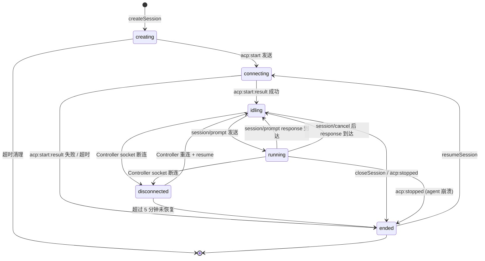
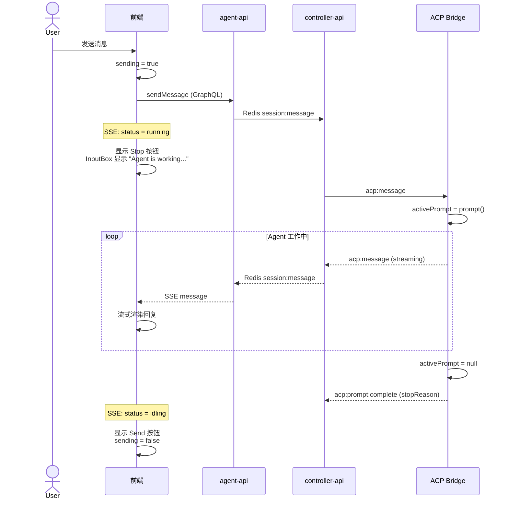

# Agent 状态统一方案

**功能名称**: Agent 状态统一
**PRD 版本**: v1.0
**创建日期**: 2026-05-27
**作者**: ZeroAsh Agent

## 背景与目标

### 1.1 背景

当前系统定义了 6 种 Session 状态：`creating`、`connecting`、`idling`、`running`、`disconnected`、`ended`，但存在严重的状态定义与实际行为不一致的问题：

- **`running` 状态从未被设置**：虽然在数据模型和 GraphQL Schema 中定义了 `running`，但生产代码中没有任何地方会将 Session 状态更新为 `running`。前端通过 `isWorking = status === 'running'` 判断 agent 是否在工作，但这个条件永远不会为 true。
- **`disconnected` 状态从未被使用**：当 Controller socket 断连时，系统直接将状态设为 `ended` 而非 `disconnected`，导致用户无法区分"临时断连"和"正常结束"。
- **前端状态展示不一致**：Sidebar 中 `idling` 状态没有定义颜色（回退为灰色，与 `ended` 相同），而 SessionHeader 中 `idling` 是绿色。`running` 在 Sidebar 中是绿色，在 SessionHeader 中是蓝色。
- **ACP 协议信息丢失**：Controller daemon 通过 ACP 协议的 `session/prompt` 请求可以判断 agent 是否在工作（`activePrompt` 是否为 null），但这个信息没有传递给 controller-api。

### 1.2 目标

1. 让 `running` 状态真正生效：当 agent 正在处理用户消息时，Session 状态应为 `running`；当 agent 完成处理后，状态回到 `idling`。
2. 让 `disconnected` 状态真正生效：Controller 临时断连时，Session 状态应为 `disconnected`（而非 `ended`），重连后可恢复。
3. 统一前端所有组件的状态颜色和展示逻辑。
4. 让用户能实时感知 agent 的工作状态（空闲、工作中、断连、已结束）。

### 1.3 成功标准

- 当用户发送消息后，Session 状态在 1 秒内变为 `running`，前端展示 agent 正在工作的视觉反馈。
- 当 agent 完成回复后，Session 状态在 1 秒内回到 `idling`，前端恢复输入能力。
- Controller 临时断连时，Session 状态变为 `disconnected`，前端展示橙色状态标识。
- Sidebar 和 SessionHeader 中相同状态使用一致的颜色。

## 用户分析

### 2.1 目标用户

使用 Agent Web 界面与 AI agent 交互的开发者。

### 2.2 用户场景

| 场景 | 用户角色 | 目标 | 痛点 |
|------|---------|------|------|
| 发送消息后等待回复 | 开发者 | 知道 agent 是否正在处理 | 当前无法区分 agent 是空闲还是在工作（`running` 状态未生效） |
| Controller 网络波动 | 开发者 | 区分临时断连和永久结束 | 当前断连直接变为 `ended`，用户以为 session 彻底结束 |
| 查看多个 Session | 开发者 | 快速识别各 Session 状态 | Sidebar 状态颜色与 Header 不一致，`idling` 显示为灰色 |
| 长时间任务 | 开发者 | 知道 agent 仍在工作中 | 没有持续的工作状态指示器 |

## 功能需求

### 3.1 功能概述

基于 ACP v1 协议的 `session/prompt` 生命周期，统一 Session 状态的定义、流转和前端展示，让用户能准确感知 agent 的实时工作状态。

### 3.2 功能列表

#### 功能点 1: 激活 `running` 状态

- **描述**: 当 agent 正在处理用户的 prompt 时（ACP `session/prompt` 请求处于 pending 状态），Session 状态应更新为 `running`。当 prompt 处理完成（收到 `session/prompt` response）后，状态回到 `idling`。
- **用户价值**: 用户可以明确知道 agent 正在工作，避免重复发送消息或误以为 agent 无响应。
- **验收标准**:
  - [ ] 用户发送消息后，Session 状态从 `idling` 变为 `running`
  - [ ] Agent 完成回复后，Session 状态从 `running` 回到 `idling`
  - [ ] 用户取消操作后，Session 状态从 `running` 回到 `idling`
  - [ ] Agent 处理过程中发生错误时，Session 状态从 `running` 回到 `idling`（而非 `ended`）

#### 功能点 2: 激活 `disconnected` 状态

- **描述**: 当 Controller 的 socket 连接断开时，如果 Session 处于 `idling` 或 `running` 状态，应先将状态更新为 `disconnected`（而非直接 `ended`）。当 Controller 重新连接后，可以通过 `session/resume` 恢复 Session。
- **用户价值**: 用户可以区分"Controller 临时断连"和"Session 正常结束"，临时断连时不必重新创建 Session。
- **验收标准**:
  - [ ] Controller socket 断连时，活跃 Session 状态变为 `disconnected`
  - [ ] 前端展示 `disconnected` 状态标识（橙色）
  - [ ] `disconnected` 状态的 Session 支持 resume 操作
  - [ ] 如果 `disconnected` 状态持续超过 5 分钟未恢复，自动转为 `ended`

#### 功能点 3: 统一前端状态展示

- **描述**: 统一 Sidebar、SessionHeader、InputBox 等所有组件中 Session 状态的颜色、图标和文案。
- **用户价值**: 用户在不同位置看到的状态视觉表现一致，降低认知负担。
- **验收标准**:
  - [ ] Sidebar 中 `idling` 状态显示为绿色圆点
  - [ ] 所有组件中 `running` 状态使用统一的蓝色
  - [ ] `disconnected` 状态在所有组件中使用橙色
  - [ ] InputBox 在 `running` 状态下显示 "Agent is working..." 占位文案

#### 功能点 4: Agent 工作状态实时指示

- **描述**: 在 Session 页面中提供持续可见的 agent 工作状态指示器，不仅限于状态徽章。
- **用户价值**: 用户在阅读 agent 回复时也能感知 agent 仍在工作（如正在调用工具）。
- **验收标准**:
  - [ ] 当状态为 `running` 时，SessionHeader 的状态徽章显示脉冲动画
  - [ ] 当状态为 `running` 时，InputBox 区域显示停止按钮
  - [ ] 当状态为 `connecting` 或 `creating` 时，显示加载指示器

### 3.3 状态定义

| 状态 | 含义 | ACP 对应 | 用户感知 |
|------|------|----------|----------|
| `creating` | Session 记录已创建，等待 ACP 进程启动 | `session/new` 请求中 | 加载中 |
| `connecting` | ACP 进程已启动，等待 `acp:start:result` | `session/new` pending | 加载中 |
| `idling` | ACP Session 就绪，等待用户输入 | `session/prompt` 未发起 | 空闲 |
| `running` | Agent 正在处理用户消息 | `session/prompt` pending | 工作中 |
| `disconnected` | Controller socket 断连，Session 暂时不可用 | N/A（非 ACP 状态） | 断连 |
| `ended` | Session 已结束（用户关闭/agent 退出/错误） | `session/close` 或 `acp:stopped` | 已结束 |

### 3.4 状态流转图

### 3.5 前端状态颜色规范

| 状态 | 颜色 | Sidebar 圆点 | SessionHeader 徽章 | 说明 |
|------|------|-------------|-------------------|------|
| `creating` | 黄色 | `bg-yellow-500` | `bg-yellow-100 text-yellow-800` | 加载中 |
| `connecting` | 黄色 | `bg-yellow-500` | `bg-yellow-100 text-yellow-800` | 加载中 |
| `idling` | 绿色 | `bg-green-500` | `bg-green-100 text-green-800` | 空闲就绪 |
| `running` | 蓝色 | `bg-blue-500` | `bg-blue-100 text-blue-800 animate-pulse` | 工作中 |
| `disconnected` | 橙色 | `bg-orange-500` | `bg-orange-100 text-orange-800` | 断连 |
| `ended` | 灰色 | `bg-gray-500` | `bg-gray-100 text-gray-800` | 已结束 |

### 3.6 用户操作流程

### 3.7 异常与边界情况

| 情况 | 预期行为 |
|------|---------|
| Agent 处理中 Controller socket 断连 | 状态变为 `disconnected`，前端展示断连提示 |
| Agent 处理中进程崩溃 | 状态从 `running` 直接变为 `ended` |
| 用户快速连续发送多条消息 | 消息入队，状态保持 `running`，逐条处理 |
| Resume 一个 `disconnected` 的 Session | 状态变为 `connecting`，成功后变为 `idling` |
| Resume 一个 `ended` 的 Session | 正常流程，状态 `ended` -> `connecting` -> `idling` |
| `running` 状态下用户关闭 Session | 状态变为 `ended`，发送 `acp:stop` |

## 四、非功能需求

### 4.1 性能要求

- 状态变更从 ACP Bridge 到前端 SSE 推送的端到端延迟不超过 1 秒。
- `running` 状态的设置不应阻塞消息的正常流转。

### 4.2 兼容性要求

- 保持现有 GraphQL Schema 向后兼容，不删除任何状态枚举值。
- 保持 SSE 事件格式兼容。
- 现有的 `session/prompt` response 处理逻辑需要适配新的 `acp:prompt:complete` 事件。

## 五、依赖与约束

### 5.1 依赖

| 依赖项 | 说明 |
|--------|------|
| ACP v1 协议 | `session/prompt` 的 request/response 生命周期是判断 agent 工作状态的核心依据 |
| Socket.IO | Controller daemon 与 controller-api 之间的通信通道 |
| Redis Pub/Sub | controller-api 与 agent-api 之间的状态同步通道 |

### 5.2 约束

- 不修改 ACP 协议本身，仅在现有协议基础上增加状态同步逻辑。
- `disconnected` 状态仅用于 Controller socket 断连场景，不用于 ACP 进程崩溃（崩溃仍为 `ended`）。
- 5 分钟超时自动转为 `ended` 是可配置的。

## 六、相关文档

- [ACP 协议规范 - Prompt Turn](https://agentclientprotocol.com/protocol/prompt-turn)
- [ACP 协议规范 - Session Setup](https://agentclientprotocol.com/protocol/session-setup)
- [ACP v2 Prompt Lifecycle 提案](https://agentclientprotocol.com/rfds/v2/prompt)
- [contracts/agent-session.graphql](../../contracts/agent-session.graphql) - Session 状态枚举定义
- [contracts/agent-session-websocket.md](../../contracts/agent-session-websocket.md) - Socket.IO 协议定义
