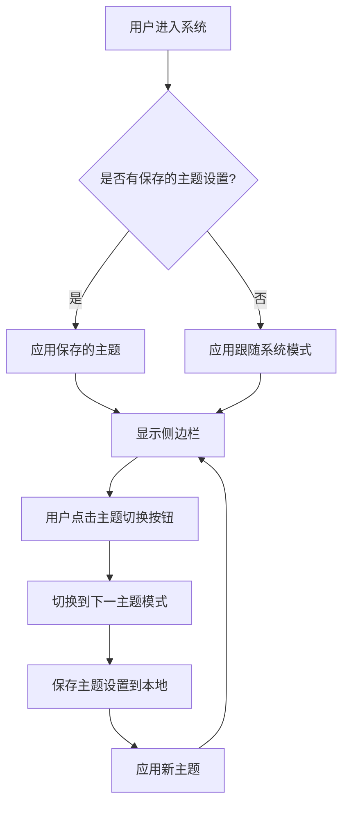

# 黑暗模式

**功能名称**: 黑暗模式切换
**PRD 版本**: v1.0
**创建日期**: 2026-05-29
**作者**: Agent

## 背景与目标

### 1.1 背景
用户在不同光照环境下使用系统，长时间在明亮界面下工作容易造成视觉疲劳。系统需要支持黑暗模式，让用户根据环境和个人偏好选择合适的显示主题。

### 1.2 目标
- 提供黑暗/明亮/跟随系统三种主题模式
- 默认跟随系统设置，减少用户配置成本
- 在侧边栏提供便捷的主题切换入口

### 1.3 成功标准
- 用户可以在三种主题模式间无缝切换
- 主题切换后界面立即生效，无需刷新页面
- 用户的选择被持久化，下次访问时保持上次设置

## 用户分析

### 2.1 目标用户
所有使用 Agent Web 的用户，特别是：
- 夜间工作的开发者
- 偏好暗色界面的用户
- 在不同光照环境间切换的用户

### 2.2 用户场景

| 场景 | 用户角色 | 目标 | 痛点 |
|------|---------|------|------|
| 夜间工作 | 开发者 | 减少屏幕亮度对眼睛的刺激 | 明亮界面在暗环境下刺眼 |
| 日间办公 | 普通用户 | 清晰可读的界面 | 暗色模式在强光下对比度不足 |
| 环境切换 | 移动办公用户 | 自动适应环境变化 | 手动切换主题繁琐 |

## 功能需求

### 3.1 功能概述
在侧边栏底部设置按钮左侧提供主题切换控件，支持黑暗、明亮、跟随系统三种模式，默认跟随系统。

### 3.2 功能列表

#### 功能点 1: 主题切换控件
- **描述**: 在侧边栏底部用户信息栏的设置按钮左侧，添加月亮/太阳图标按钮，点击后循环切换三种主题模式
- **用户价值**: 快速切换主题，无需进入设置页面
- **验收标准**:
  - [ ] 控件位于设置按钮左侧
  - [ ] 图标随当前主题变化：黑暗模式显示太阳、明亮模式显示月亮、跟随系统显示自动图标
  - [ ] 点击控件在三种模式间循环切换：明亮 → 黑暗 → 跟随系统 → 明亮
  - [ ] 切换后界面主题立即生效

#### 功能点 2: 主题持久化
- **描述**: 用户选择的主题模式保存在本地存储中
- **用户价值**: 下次访问时保持上次的主题设置
- **验收标准**:
  - [ ] 主题选择保存到 localStorage
  - [ ] 页面加载时读取并应用保存的主题设置
  - [ ] 若无保存设置，默认使用"跟随系统"模式

#### 功能点 3: 跟随系统模式
- **描述**: 自动检测系统主题偏好并应用
- **用户价值**: 无需手动配置，自动适应系统设置
- **验收标准**:
  - [ ] 使用 `prefers-color-scheme` 媒体查询检测系统主题
  - [ ] 系统主题变化时自动切换
  - [ ] 跟随系统模式下，用户手动操作系统主题时界面同步变化

### 3.3 用户操作流程



### 3.4 页面/界面描述

| 页面 | 描述 | 关键元素 |
|------|------|---------|
| 侧边栏底部 | 主题切换控件所在位置 | 用户名、主题切换按钮、设置按钮 |
| 全局 | 主题应用范围 | 所有页面的背景、文字、组件颜色 |

**控件布局（侧边栏底部）**：
```
┌─────────────────────────────────────┐
│  [用户名]          [🔔] [🌙] [⚙️]  │
└─────────────────────────────────────┘
```

**图标状态说明**：
| 当前模式 | 显示图标 | 点击后切换到 |
|---------|---------|-------------|
| 明亮模式 | 🌙 月亮 | 黑暗模式 |
| 黑暗模式 | ☀️ 太阳 | 跟随系统 |
| 跟随系统 | 🔄 自动 | 明亮模式 |

### 3.5 异常与边界情况

| 情况 | 预期行为 |
|------|---------|
| 浏览器不支持 `prefers-color-scheme` | 降级为明亮模式 |
| localStorage 不可用 | 使用内存状态，刷新后重置为跟随系统 |
| 系统主题检测失败 | 降级为明亮模式 |

## 四、非功能需求

### 4.1 性能要求
- 主题切换响应时间 < 100ms
- 不应引起页面重排或闪烁

### 4.2 安全性要求
- 主题设置仅存储在本地，不涉及敏感信息

### 4.3 兼容性要求
- 支持主流现代浏览器（Chrome、Firefox、Safari、Edge）
- 移动端和桌面端均需支持

## 五、依赖与约束

### 5.1 依赖
- 前端框架需支持主题变量系统（亮色/暗色两套颜色方案）
- 前端组件库需支持主题切换

## 六、相关文档

- [多 ACP Server 支持 PRD](./20260526-multi-acp-server-support.md)
- [前端界面优化 PRD](./20260526-ui-optimization.md)
