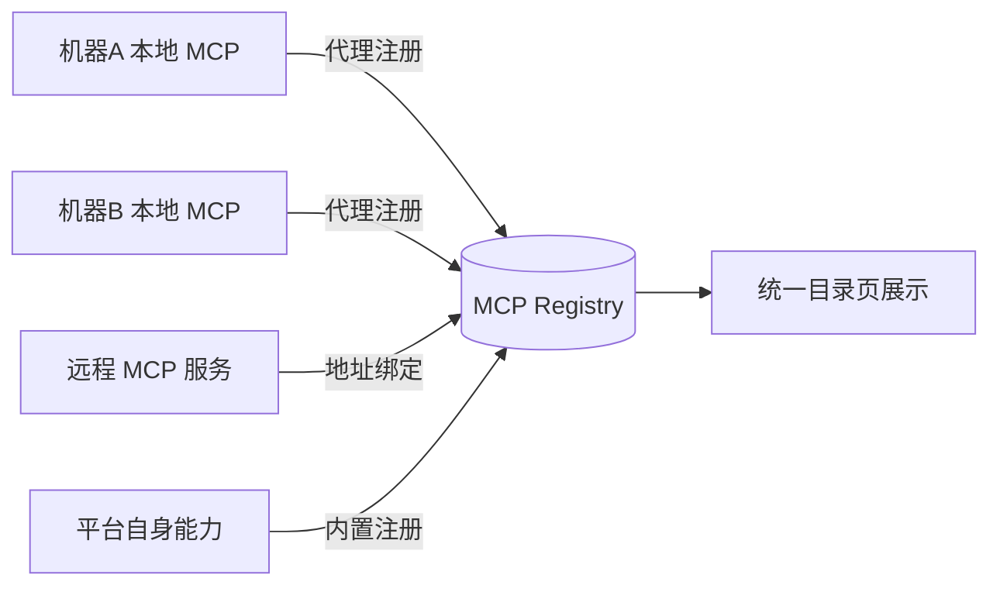
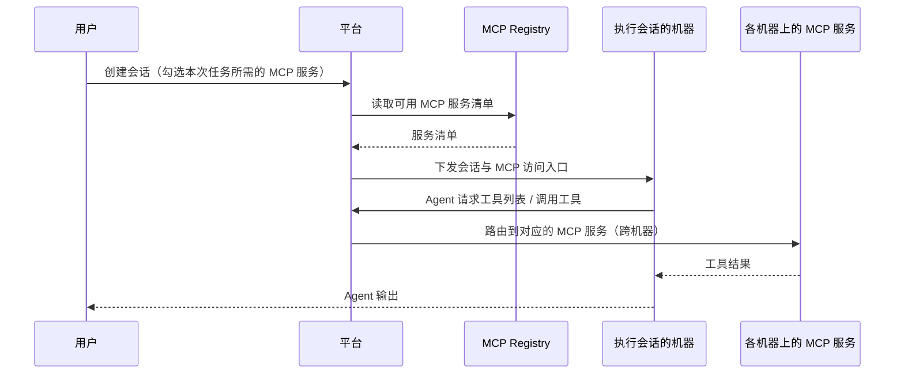

# 集成式 MCP 注册中心（Integrated MCP Registry）

**功能名称**: 集成式 MCP 注册中心
**PRD 版本**: v1.1
**创建日期**: 2026-08-04
**作者**: ZeroAsh

## 一、背景与目标

### 1.1 背景

平台已上线「MCP 代理服务配置」能力（见 [[20260530-mcp-proxy-config]]），用户可以在任意机器上通过代理命令将本地 MCP 服务注册到平台。但在实际使用中暴露出以下问题：

1. **能力来源单一**：目前仅支持「代理注册」一种接入方式，无法绑定互联网上已有的远程 MCP 服务，平台自身的业务能力也无法作为 MCP 对外提供。
2. **缺少统一视图**：已注册的 MCP 服务散落在设置页中，没有统一的「能力目录」视角，用户无法直观看到每个 MCP 服务提供了哪些工具、来自哪里、当前是否可用。
3. **会话装配不完整**：创建会话时无法真正选择并下发 MCP 服务，已注册的能力无法送达实际执行会话的 Agent，MCP 调用链路存在已知问题（前一期 PRD 已声明遗留）。
4. **无自动注入机制**：Agent 创建会话时不能自动获得平台上可用的 MCP 能力，需要人工逐一配置。

### 1.2 目标

建设**集成式 MCP 注册中心（Integrated MCP Registry）**，作为平台统一的 MCP 能力枢纽，达成四个最终目标：

1. **多源接入**：不同机器上的本地 MCP 服务可通过代理接入平台；远程 MCP 服务可直接绑定；形成统一的能力目录。
2. **统一分发**：平台将目录中的 MCP 能力按需分发到实际执行会话的各台机器上，Agent 在执行地即可调用分布在任意机器上的 MCP 服务。
3. **平台能力开放**：平台自身的业务能力（如会话管理）可以注册到 MCP Registry，与外部 MCP 服务同等对待。
4. **会话按需装配**：创建会话时，用户可按任务需要勾选本次所需的 MCP 服务，Agent 通过 Integrated MCP Registry 获得所选能力，无需关心 MCP 服务实际运行在哪台机器上，也无需将全部能力装入上下文。

### 1.3 成功标准

- 三种来源（代理注册、远程绑定、平台内置）的 MCP 服务均能在统一目录中展示并被正确标识来源与状态。
- 创建会话时选中的 MCP 能力 100% 下发到执行会话的 Agent，Agent 能列出并调用其中的工具；未选中的能力不出现在会话中。
- 分布在两台不同机器上的 MCP 服务，可被同一会话同时调用成功。
- 会话关闭后，该会话的 MCP 访问令牌与访问地址立即失效，继续调用返回未授权。
- MCP 调用端到端成功率可观测，失败时有明确的错误提示。

## 二、用户分析

### 2.1 目标用户

- **个人开发者**：在自己多台设备（工作站、服务器、NAS）上运行不同的 MCP 服务，希望在任何一台设备发起的会话都能使用全部 MCP 能力。
- **进阶 Agent 用户**：希望组合使用互联网上的远程 MCP 服务（如 GitHub、数据库、搜索类 MCP）与本地私有 MCP 服务。
- **自动化编排用户**：希望通过 MCP 工具调用平台自身能力（如创建会话、查询状态），构建 Agent 编排 Agent 的工作流。

### 2.2 用户场景

| 场景 | 用户角色 | 目标 | 痛点 |
|--|--|--|--|
| 在笔记本上发起的会话调用家里服务器上的文件系统 MCP | 个人开发者 | 跨机器调用 MCP 工具 | MCP 服务绑定在单台机器，离开该机器即不可用 |
| 绑定第三方远程 MCP 服务（如云端 GitHub MCP） | 进阶用户 | 直接使用现成的远程 MCP 服务 | 平台只支持本地代理注册，无法绑定远程服务 |
| 让一个「管理 Agent」创建并管理其他会话 | 编排用户 | 通过 MCP 工具操作平台能力 | 平台能力没有 MCP 化，无法被 Agent 调用 |
| 创建会话时按需组合本次任务所需的 MCP 能力 | 所有用户 | 只把任务相关的 MCP 工具注入会话 | 注册能力一多，全量装配浪费 Agent 上下文 |

## 三、功能需求

### 3.1 功能概述

建设统一的 MCP Registry：所有 MCP 服务（无论来自哪台机器的代理、远程绑定、还是平台内置）都登记在同一目录中；创建会话时，平台从目录装配 MCP 能力并分发到会话的执行机器，Agent 通过统一入口获得全部能力。

### 3.2 功能列表

#### 功能点 1: MCP 服务统一目录（MCP Registry）

- **描述**: 提供一个统一的 MCP 服务目录页，集中展示所有已登记的 MCP 服务。每个服务条目包含：名称、来源类型（代理注册 / 远程绑定 / 平台内置）、运行状态（在线 / 离线 / 已停用）、来源机器（代理注册时）、能力清单（该服务提供的工具列表）以及最近心跳时间。支持启用 / 停用单个服务。
- **用户价值**: 用户对所有 MCP 能力一目了然，能快速判断某个工具是否可用、来自哪里。
- **验收标准**:
  - [ ] 目录页展示全部已登记 MCP 服务，来源类型标识清晰
  - [ ] 在线服务可查看其工具清单（工具名与描述）
  - [ ] 停用后的服务不再被装配进新会话，目录中状态同步变更
  - [ ] 代理注册的服务离线时，目录中实时反映离线状态

#### 功能点 2: 远程 MCP 服务绑定

- **描述**: 用户可通过填写远程 MCP 服务的访问地址（以及必要的访问凭证），将其登记到 MCP Registry。登记时平台自动探测该服务的可用性与工具清单。支持解绑、编辑与停用。
- **用户价值**: 无需在本地运行任何代理进程，即可使用互联网上现成的远程 MCP 服务。
- **验收标准**:
  - [ ] 填写地址与凭证后可成功绑定，绑定结果（成功 / 失败原因）明确反馈
  - [ ] 绑定成功后服务出现在统一目录中，来源类型为「远程绑定」
  - [ ] 绑定失败（地址不可达、协议不兼容、凭证无效）时给出具体原因
  - [ ] 可解绑服务，解绑后不再装配进新会话

#### 功能点 3: 平台能力注册为内置 MCP 服务

- **描述**: 平台将自身业务能力封装为内置 MCP 服务并自动登记到 MCP Registry，首期提供「平台会话管理」能力（查询会话列表、查看会话状态等只读能力）。内置服务默认启用、不可删除，但可停用；与其他服务一样在创建会话时按需勾选。
- **用户价值**: Agent 可以通过 MCP 工具感知和操作平台，为「Agent 编排 Agent」的自动化场景打下基础；新用户零配置即可体验。
- **验收标准**:
  - [ ] 内置 MCP 服务自动出现在统一目录中，来源类型为「平台内置」
  - [ ] 创建会话时勾选内置服务后，Agent 可调用其提供的工具
  - [ ] 内置服务不可删除，可停用，停用后不可再被勾选装配
  - [ ] 工具调用结果与平台实际数据一致

#### 功能点 4: 会话创建按需装配 MCP 能力

- **描述**: 创建会话时，用户从 MCP Registry 中勾选本次任务需要的 MCP 服务（默认不装配任何服务，避免无关工具占用 Agent 上下文），平台将所选能力下发到实际执行该会话的机器。Agent 侧无感知，直接获得所选工具。
- **用户价值**: 用户可以按任务精确组合 MCP 能力——即使 Registry 中积累了大量服务，每次会话也只装载任务相关的一小部分，上下文开销可控；同时无需关心服务运行位置与连接方式。
- **验收标准**:
  - [ ] 创建会话时可勾选 MCP 服务子集，默认不装配任何服务
  - [ ] 仅被选中的服务工具注入会话，未选中服务的工具不出现在 Agent 工具列表中
  - [ ] 会话关闭后，该会话的 MCP 访问令牌与访问地址立即失效，继续调用返回未授权
  - [ ] 同一会话可同时调用分布在不同机器上的多个选中服务
  - [ ] 所选服务在会话期间离线时，工具调用返回明确错误而非无响应

#### 功能点 5: MCP 调用链路与状态可见性

- **描述**: 修复现有 MCP 调用链路的已知问题，使「注册 → 装配 → 调用」全流程端到端可用；调用失败（服务离线、超时、凭证失效）时，用户能在会话上下文或目录页感知到明确的状态与原因。
- **用户价值**: MCP 能力从「注册了但用不上」变为「真正可用、出问题可定位」。
- **验收标准**:
  - [ ] 从注册代理到会话内工具调用的全链路端到端可用
  - [ ] 会话续期（重开、恢复）后 MCP 能力仍然可用
  - [ ] 调用失败时返回明确的错误原因（离线 / 超时 / 未授权）
  - [ ] 目录页中服务状态与实际可用性一致

### 3.3 用户操作流程

**多源接入与统一目录：**

**会话装配与调用：**

### 3.4 页面/界面描述

| 页面 | 描述 | 关键元素 |
|------|------|---------|
| MCP Registry 目录页 | 统一展示全部 MCP 服务 | 服务列表（名称/来源类型/状态/工具数/最近心跳）、来源筛选、启用/停用开关、详情抽屉（工具清单） |
| 远程服务绑定弹窗 | 绑定远程 MCP 服务 | 地址输入、凭证输入、连通性测试结果反馈 |
| 会话创建对话框 | 创建会话时勾选 MCP 装配 | MCP 服务多选列表（默认不勾选）、按来源分组展示、服务较多时可搜索 |
| 设置页-代理密钥区 | 保留现有代理密钥管理 | 与现有一致 |

### 3.5 异常与边界情况

| 情况 | 预期行为 |
|------|---------|
| 代理机器在会话进行中离线 | 该服务的工具调用返回「服务离线」错误，目录页状态实时更新，其余服务不受影响 |
| 远程 MCP 服务地址不可达 | 绑定时提示具体失败原因；已绑定的服务标记为离线，不阻塞会话创建 |
| 同一会话装配的多个服务中存在同名工具 | 工具名以服务名作为前缀区分，Agent 侧无冲突 |
| 停用了正在被执行中会话使用的服务 | 不影响进行中的会话，仅不再装配进新会话 |
| 会话关闭后原访问地址继续被调用 | 令牌随会话关闭吊销，调用返回未授权 |
| 会话异常中断（执行机器掉线） | 令牌停止续期后自然过期失效 |
| 平台内置服务异常 | 仅内置服务不可用并在目录页标记异常，外部服务不受影响 |
| 会话长时间运行超过凭证有效期 | 凭证自动续期，用户无感知 |

## 四、非功能需求

### 4.1 性能要求

- 目录页加载不超过 2 秒（50 个服务以内）。
- 会话创建时的 MCP 装配不显著增加会话创建耗时（额外耗时 < 1 秒）。
- 单次 MCP 工具调用的平台转发额外延迟不超过 200ms（不含 MCP 服务自身执行时间）。

### 4.2 安全性要求

- 远程绑定的访问凭证加密存储，界面上不可回显。
- 平台内置 MCP 服务首期仅提供只读能力，不提供修改类操作。
- 所有 MCP 访问统一经过平台做会话级别鉴权；访问凭证按会话隔离，**会话关闭即自动吊销**，访问地址同步失效；凭证在会话活跃期间自动续期，用户无感知；支持手动吊销并即时生效。

### 4.3 兼容性要求

- 存量通过代理注册的 MCP 服务无需重新注册，自动纳入统一目录。
- 不支持 MCP 的 Agent 创建会话时行为与现状一致（静默降级）。

## 五、依赖与约束

### 5.1 依赖

- 已发布的「MCP 代理服务配置」能力（代理注册、密钥管理）。
- 会话执行机器上的 Agent 支持 MCP 工具调用。

### 5.2 约束

- 分期交付：第一期交付功能点 1（基础目录与状态）、4、5，打通端到端链路；第二期交付功能点 2、3（远程绑定与平台能力注册）及目录能力清单展示。
- 平台能力开放首期仅限只读能力，写操作能力需单独评审后开放。
- 兼容存量已注册服务与用户数据，不允许破坏性变更。

## 六、相关文档

- [[20260530-mcp-proxy-config]] — MCP 代理服务配置（已发布，本方案的前置能力）
- [[20260803-acp-v1-completion]] — ACP v1 协议补全（声明了 MCP 链路遗留问题）
