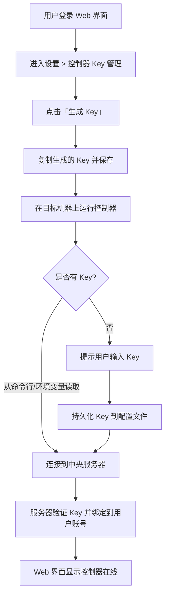

# Agent控制器管理 v1 产品草案

**功能名称**: Agent控制器管理
**PRD 版本**: v1.0
**创建日期**: 2026-05-17
**作者**: ZeroAsh

## 背景与目标

### 1.1 背景

用户经常需要在多台远程机器上运行 AI Agent 实例（如 OpenCode、Codex 等），但目前缺乏统一的管理入口。每台机器需要单独 SSH 登录、手动启动 Agent，无法集中查看 Agent 控制器的运行状态。

需要一个控制器程序，与中央服务器保持连接，向服务器报告自身状态，使用户能够统一查看所有控制器的在线状态。控制器的部署方式有多种：用户可以自托管安装，未来也可以使用我们提供的云 VPS 或在 GitHub Pipeline 中拉起。

### 1.2 目标

- 定义控制器类型体系，v1 先支持「本地控制器」（用户自托管），为后续类型扩展打好基础
- 用户可以在中央服务器 Web 界面统一管理所有绑定到其账号下的 Agent 控制器
- 控制器状态可监控，离线可感知

### 1.3 成功标准

- 用户首次绑定控制器流程不超过 2 步
- 控制器心跳检测在 2 次心跳周期内（约 60s）感知离线

## 用户分析

### 2.1 目标用户

- 拥有多台远程开发机/服务器的开发者
- 需要使用 AI Agent 进行自动化开发、代码审查的用户
- 需要在多个环境中统一管理 Agent 的团队

### 2.2 用户场景

| 场景 | 用户角色 | 目标 | 痛点 |
|--|--|--|--|
| 远程开发机统一管理 | 个人开发者 | 查看多台开发机上控制器的在线状态 | 每台机器需要单独 SSH，无法集中查看状态 |
| 团队共享控制器资源 | 团队负责人 | 团队成员了解各服务器控制器的可用状态 | 无法统一查看各机器是否在线可用 |

## 功能需求

### 3.1 功能概述

Agent 控制器是一个守护进程，与中央服务器保持长连接。不同类型的控制器对应不同的部署环境。v1 支持「本地控制器」——用户在自己的机器上安装运行。用户通过中央服务器的 Web 界面查看所有控制器的在线状态。

### 3.2 功能列表

#### 功能点 1: Key 生成与管理

- **描述**: 用户在 Web 设置页面中生成一个或多个控制器 Key，用于在目标机器上注册控制器
- **用户价值**: 无需接触服务器后台，浏览器即可生成安全的控制器凭据
- **验收标准**:
  - [ ] 用户在设置页面可以通过「生成 Key」按钮直接创建一个新的控制器 Key（自动生成名称）
  - [ ] 未绑定的 Key 在页面上显示完整 rawKey，支持随时复制
  - [ ] 每个帐号同时只能有一个未绑定的 Key，生成新 Key 时自动替换旧的
  - [ ] 已绑定的 Key 不展示 rawKey，仅显示控制器信息
  - [ ] 支持解绑控制器，解绑后 Key 和控制器记录均被永久删除

#### 功能点 2: 控制器注册与绑定

- **描述**: 用户在目标机器上安装并启动控制器，控制器使用已生成的 Key 向中央服务器注册，绑定到用户账号
- **用户价值**: 一次注册，永久可用，后续无需重复认证
- **验收标准**:
  - [ ] v1 的本地控制器以守护进程方式运行在用户自有的机器上
  - [ ] 控制器启动时按优先级读取 Key：命令行参数 `--key` > 环境变量 `ZAG_CONTROLLER_KEY` > 配置文件 `~/.zag/config.toml`
  - [ ] 如果以上均未找到 Key，提示用户输入 Key 并持久化到 `~/.zag/config.toml`
  - [ ] 首次注册时控制器发送 hostname 和控制器类型（v1 为 `local`），服务器记录并关联到用户和对应的 Key
  - [ ] 一个 Key 只能绑定一台机器，绑定后该 Key 不可用于其他机器
  - [ ] 控制器与服务器建立 WebSocket 长连接

#### 功能点 3: 控制器列表与管理

- **描述**: 用户在 Web 界面查看所有绑定到其账号的控制器列表，包括在线状态、hostname、最后活跃时间等
- **用户价值**: 一目了然掌握所有远程机器的 Agent 状态
- **验收标准**:
  - [ ] 用户可以在设置页面查看所有绑定过的控制器
  - [ ] 列表展示：控制器名称/hostname、类型、在线状态、最后心跳时间
  - [ ] 支持按类型筛选控制器
  - [ ] 支持解绑控制器，解绑后服务器通知控制器自行退出进程
  - [ ] 解绑后 Key 和控制器记录均被永久删除
  - [ ] 支持对控制器重命名（方便区分多台机器）

#### 功能点 4: 心跳与健康检测

- **描述**: 控制器定期向服务器发送心跳，服务器检测控制器是否在线
- **用户价值**: 及时感知机器宕机或网络故障
- **验收标准**:
  - [ ] 控制器每隔 30 秒发送一次心跳
  - [ ] 服务器连续 2 次未收到心跳（60s）则标记控制器离线
  - [ ] 控制器恢复连接后自动恢复在线状态

### 3.3 用户操作流程

### 3.4 页面/界面描述

| 页面 | 描述 | 关键元素 |
|------|------|---------|
| 控制器列表页 | 展示用户所有控制器的概览 | 控制器列表、类型标签、在线/离线状态、操作按钮、类型筛选器 |
| 控制器详情页 | 展示单个控制器的详细信息 | 控制器信息（名称、类型、hostname）、绑定 Key、最后心跳时间 |
| 控制器管理页 | 合并 Key 管理和控制器列表 | 未绑定 Key 列表（名称、rawKey、复制按钮）、控制器列表（名称、类型、在线状态、最后心跳）、生成 Key 按钮、重命名、解绑 |
| 控制器设置页 | 管理控制器绑定关系 | 解绑按钮、重命名输入框、绑定信息展示 |

### 3.6 控制器类型规划

| 类型 | 标识 | 部署方式 | v1 支持 | 备注 |
|------|------|---------|---------|------|
| 本地控制器 | `local` | 用户在自有机器上安装控制器守护进程 | ✅ | v1 唯一支持的控制器类型 |
| 云端控制器 | `cloud` | 由平台提供 VPS，用户一键创建 | 未来版本 | 无需用户准备机器 |
| GitHub 控制器 | `github` | 在 GitHub Actions Pipeline 中拉起临时环境 | 未来版本 | 适用于 CI/CD 场景 |

### 3.7 异常与边界情况

| 情况 | 预期行为 |
|------|---------|
| 控制器所在机器网络断开 | 60s 后标记离线，前端展示离线状态 |
| 重复 Key 注册 | 服务器提示 Key 已被绑定，拒绝注册，引导用户生成新 Key |
| 生成 Key 后未保存就离开页面 | 未绑定 Key 的 rawKey 可随时通过「生成 Key」重新获取（旧 Key 自动替换） |
| 用户主动解绑控制器 | 服务器通知控制器自行退出进程，Key 和控制器记录均被永久删除 |
| 控制器版本过低不兼容 | 服务器检测版本号，返回升级提示，拒绝连接 |

## 五、非功能需求

### 5.1 性能要求

- 控制器内存占用不超过 30MB（空闲状态）
- 心跳流量每 30s 约 1KB，带宽占用极小
- Web 端控制器列表加载不超过 2s

### 5.2 安全性要求

- 控制器 Key 在传输和存储时需加密
- 控制器与服务器之间的通信必须使用 TLS/WSS
- 用户只能操作自己账号绑定的控制器
- 解绑控制器后，旧 Key 立即失效，已绑定的控制器自行退出

### 5.3 兼容性要求

- 控制器支持主流 Linux 发行版（Ubuntu 20.04+、CentOS 7+、Debian 11+）
- 控制器支持 macOS（Intel & Apple Silicon）

## 六、依赖与约束

### 6.1 依赖

- 中央服务器 WebSocket 服务
- 用户认证系统（已有）

### 6.2 约束

- 每个控制器绑定唯一 Key，Key 不可共享

## 七、相关文档

- [控制器安装部署指南（待编写）]
- [用户操作手册（待编写）]
