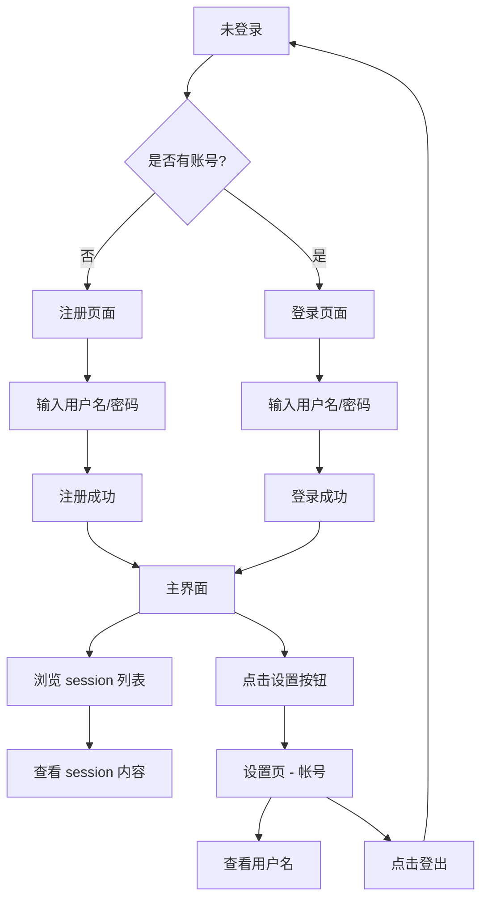

# 用户认证与设置页

**功能名称**: 用户认证与设置页
**PRD 版本**: v1.0
**创建日期**: 2026-05-17
**作者**: ZeroAsh

## 背景与目标

### 1.1 背景
z-agent-gear 作为一站式个人多端管理 Agent 解决方案，需要一个统一的用户认证入口以及个人设置页面。目前系统没有任何身份验证机制，无法区分用户会话和数据归属。

### 1.2 目标
提供用户名/密码的注册和登录能力，并在登录后提供导航布局和设置页面，让用户可以管理自己的账号信息。

### 1.3 成功标准
- 用户可完成注册、登录、登出的完整流程
- 登录后的 2-column 布局清晰可用
- 设置页可正常展示账号信息并支持登出

## 用户分析

### 2.1 目标用户
所有使用 z-agent-gear 系统的终端用户。

### 2.2 用户场景

| 场景 | 用户角色 | 目标 | 痛点 |
|------|----------|------|------|
| 首次使用注册账号 | 新用户 | 创建账号以便使用系统 | 没有账号入口无法使用任何功能 |
| 已有账号登录 | 老用户 | 快速登录进入系统 | 每次使用都需要重新输入凭证 |
| 查看个人账号信息 | 已登录用户 | 确认当前登录身份 | 不知道当前登录的是哪个账号 |
| 退出登录 | 已登录用户 | 安全退出当前会话 | 找不到退出入口 |

## 功能需求

### 3.1 功能概述
实现基于用户名/密码的用户注册与登录，登录后采用 2-column 布局展示导航和内容，并提供账号设置页面支持登出操作。

### 3.2 功能列表

#### 功能点 1: 用户注册
- **描述**: 用户输入用户名和密码进行账号注册
- **用户价值**: 首次使用的用户可以创建自己的账号
- **验收标准**:
  - [ ] 注册页面包含用户名输入框、密码输入框、注册按钮
  - [ ] 用户名不能为空，长度不少于 2 个字符
  - [ ] 密码不能为空，长度不少于 6 个字符
  - [ ] 用户名不能重复，重复时给出错误提示
  - [ ] 注册成功后自动登录进入主界面

#### 功能点 2: 用户登录
- **描述**: 用户使用已注册的用户名和密码登录系统
- **用户价值**: 已有账号的用户可以快速进入系统
- **验收标准**:
  - [ ] 登录页面包含用户名输入框、密码输入框、登录按钮、切换到注册页的链接
  - [ ] 输入错误的用户名或密码时给出友好错误提示
  - [ ] 登录成功后跳转到主界面

#### 功能点 3: 主界面 2-column 布局
- **描述**: 登录后呈现 2-column 布局，左侧为导航菜单，右侧为内容区域
- **用户价值**: 清晰的结构化导航，方便用户在会话间切换
- **验收标准**:
  - [ ] 左侧导航区宽度固定，可垂直滚动展示 session 列表
  - [ ] 右侧内容区自适应填充剩余宽度
  - [ ] 左侧底部固定区域展示当前登录用户名和设置按钮

#### 功能点 4: 设置页面
- **描述**: 点击设置按钮进入设置页，2-column 布局，左侧为设置分类，右侧为分类内容
- **用户价值**: 统一的设置入口，方便管理个人配置
- **验收标准**:
  - [ ] 设置页为 2-column 布局，左侧列出设置分类
  - [ ] 当前版本仅有一个分类「帐号」
  - [ ] 点击「帐号」分类，右侧展示用户名（只读）和登出按钮
  - [ ] 点击登出按钮立即登出，返回登录页

### 3.3 用户操作流程

### 3.4 页面/界面描述

| 页面 | 描述 | 关键元素 |
|------|------|---------|
| 注册页 | 全屏注册表单 | 用户名输入框、密码输入框、注册按钮、跳转登录链接 |
| 登录页 | 全屏登录表单 | 用户名输入框、密码输入框、登录按钮、跳转注册链接 |
| 主界面 | 2-column 布局 | 左侧 session 导航列表 + 底部用户信息/设置按钮，右侧内容区 |
| 设置页 | 2-column 布局 | 左侧设置分类列表，右侧分类详情内容 |

### 3.5 异常与边界情况

| 情况 | 预期行为 |
|------|---------|
| 用户名已存在 | 注册时提示「用户名已被注册」 |
| 用户名或密码错误 | 登录时提示「用户名或密码错误」 |
| 用户名/密码为空 | 表单校验提示对应字段不能为空 |
| 未登录直接访问主界面 | 重定向到登录页 |
| session token 过期 | 自动跳转到登录页 |

## 四、非功能需求

### 4.1 性能要求
- 登录/注册请求应在 2 秒内返回结果

### 4.2 安全性要求
- 密码不得明文存储，必须哈希后存储
- 使用 JWT 或 session token 管理登录态

### 4.3 兼容性要求
- 支持主流现代浏览器（Chrome、Firefox、Safari、Edge 最新两个版本）

## 五、依赖与约束

### 5.1 依赖
- 后端用户数据存储（数据库）
- 认证中间件/服务

### 5.2 约束
- 使用 monorepo 结构，前端在 `apps/agent-web`，后端在 `servers/agent-api`
- 尽可能复用现有技术栈

## 六、相关文档

- N/A（首个 PRD）
