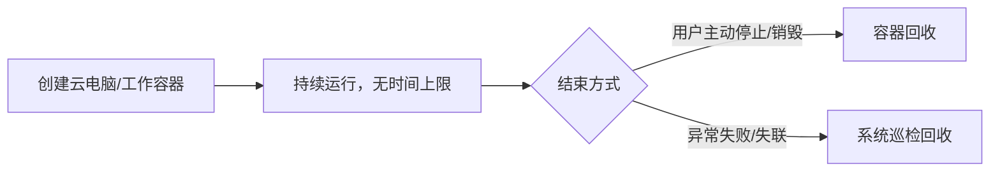

# 云电脑取消最长运行时间限制

**功能名称**: 云电脑最长运行时间无限制
**PRD 版本**: v1.0
**创建日期**: 2026-10-25
**作者**: ZeroAsh

## 背景与目标

### 1.1 背景

云端工作容器（含云电脑）当前被设置了最长运行时间上限（缺省 24 小时，云电脑按创建时约定的到期时刻换算）。到达上限后，运行中的容器会被平台强制销毁，用户正在进行的会话与工作现场被意外中断，造成数据与上下文丢失。

### 1.2 目标

- 云端工作容器的最长运行时间设为无限制，不再因到达时间上限被平台强制销毁。
- 容器生命周期回归由用户操作（主动停止/销毁）与系统状态机（异常失败、失联巡检等）管理。

### 1.3 成功标准

- 云电脑与工作容器可持续运行超过原先的最长时间上限而不被销毁。
- 用户主动停止/销毁、异常失败回收等既有生命周期行为不受影响。

## 用户分析

### 2.1 目标用户

使用云电脑与云端工作容器的终端用户。

### 2.2 用户场景

- 用户在云电脑中执行长时间任务（如大型仓库构建、长时间运行的 Agent 会话），任务跨越原先的时间上限后仍可继续，不会被意外中断。

## 功能需求

### 3.1 功能概述

取消云端工作容器的最长运行时间限制：创建容器时不再附带时间上限，容器不会因「运行时间到期」被平台销毁。

### 3.2 功能列表

| 编号 | 功能 | 说明 |
|------|------|------|
| F1 | 取消最长运行时间 | 所有云端工作容器（idle 与云电脑）均无最长运行时间上限 |
| F2 | 保留既有生命周期 | 主动销毁、异常失败、失联巡检回收等行为不变 |

### 3.3 用户操作流程

### 3.4 页面/界面描述

无界面变更。

### 3.5 异常与边界情况

- 创建云电脑时约定的到期时刻仍照常记录与传递（供计费凭证到期等业务使用），但不再用于销毁容器。
- 容器异常退出、失联等场景仍由既有巡检与状态机兜底回收，不会出现失控残留。

## 四、非功能需求

- 不引入新的资源配置项；行为变更对调用方透明。

## 五、依赖与约束

- 无新增依赖。

## 六、相关文档

- [[../../engineering/proposals/20261025-fix-cloud-container-active-deadline.md]]
