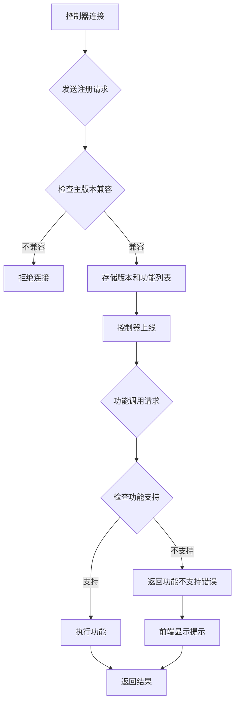

# 控制器功能管理版本化

**功能名称**: 控制器功能管理版本化
**PRD 版本**: v1.0
**创建日期**: 2026-05-25
**作者**: ZeroAsh

## 背景与目标

### 1.1 背景

当前线上控制器版本为 1.0.0，支持的功能有 `agent/session-v1`、`fs/explorer-v1`、`git/default-branch-v1`。main 分支尚未上线 1.0.1 的功能有 `git/worktree-v1`。随着控制器功能迭代，需要支持同一版本控制器共存，以及按功能特性进行版本控制和功能限制。

### 1.2 目标

1. 控制器在注册时上报自己的版本和支持的功能列表
2. controller-api 和 agent-api 针对控制器做版本控制以及功能限制
3. 新增 session 界面，在 worktree 功能检测时增加功能是否支持的判断

### 1.3 成功标准

- [ ] 控制器注册时能够上报版本号和支持的功能列表
- [ ] agent-api 和 controller-api 能够根据控制器版本和支持的功能列表进行权限控制
- [ ] 当控制器不支持某个功能时，前端能够正确提示用户
- [ ] 版本兼容性检查能够正确拒绝不支持的控制器连接

## 用户分析

### 2.1 目标用户

- 运维人员：需要管理多个控制器版本，确保兼容性
- 开发人员：需要根据控制器能力调用相应功能
- 最终用户：使用 session 界面时不受限于不支持的功能

### 2.2 用户场景

| 场景 | 用户角色 | 目标 | 痛点 |
|-----|---------|-----|-----|
| 控制器升级 | 运维人员 | 在不升级控制器的情况下禁用某些功能 | 当前无法细粒度控制功能 |
| 混合版本环境 | 开发人员 | 兼容不同版本的控制器 | 无法区分控制器能力 |
| 功能降级 | 最终用户 | 使用 session 时明确知道哪些功能可用 | 无法感知功能限制 |

## 功能需求

### 3.1 功能概述

通过对控制器注册流程的改造，实现版本化的功能管理，使得不同版本的控制器能够按需启用或禁用特定功能，同时前端能够感知并提示功能可用性。

### 3.2 功能列表

#### 功能点 1: 控制器注册功能列表上报

- **描述**: 控制器在注册时上报自己的版本号和支持的功能列表，格式为 `features: ['agent/session-v1', 'fs/explorer-v1', 'git/default-branch-v1', 'git/worktree-v1']`
- **用户价值**: 后端能够准确获知控制器的功能支持情况
- **验收标准**:
  - [ ] 控制器注册时发送 `features` 字段
  - [ ] 支持的功能列表能够被正确解析和存储
  - [ ] 默认功能列表包含基础功能 `agent/session-v1`

#### 功能点 2: 控制器版本与功能存储

- **描述**: 在 Controller 模型中增加 `features` 字段，存储控制器支持的功能列表
- **用户价值**: 便于后续查询和控制
- **验收标准**:
  - [ ] Controller 模型包含 `features` 数组字段
  - [ ] agent-api 和 controller-api 的 Controller 模型保持一致
  - [ ] 注册时能够更新 `features` 字段

#### 功能点 3: 功能可用性检查

- **描述**: 在调用控制器功能前，检查控制器是否支持该功能，不支持时返回明确错误
- **用户价值**: 防止调用不支持的功能导致错误
- **验收标准**:
  - [ ] 存在统一的 `isFeatureSupported(controllerId, feature)` 检查函数
  - [ ] 不支持的功能调用返回明确的错误信息
  - [ ] 错误信息包含功能名称和控制器版本

#### 功能点 4: 前端功能可用性感知

- **描述**: session 界面在执行 worktree 操作前，检查控制器是否支持 `git/worktree-v1` 功能
- **用户价值**: 用户能够明确知道哪些功能不可用
- **验收标准**:
  - [ ] worktree 相关的 UI 操作前检查功能可用性
  - [ ] 不支持时显示友好的提示信息
  - [ ] 提示信息包含需要的功能名称

#### 功能点 5: 版本兼容性检查

- **描述**: 注册时检查控制器主版本是否与服务端兼容，不兼容时拒绝连接
- **用户价值**: 确保基本版本兼容性
- **验收标准**:
  - [ ] 主版本号不匹配时拒绝连接
  - [ ] 拒绝连接时返回明确的错误信息

### 3.3 用户操作流程

### 3.4 页面/界面描述

| 页面 | 描述 | 关键元素 |
|-----|-----|---------|
| Session 页面 | 控制器功能状态展示 | 工作目录状态、worktree 操作按钮 |
| 新建 Session 对话框 | 创建新会话 | 控制器选择、工作目录选择 |

### 3.5 异常与边界情况

| 情况 | 预期行为 |
|-----|---------|
| 控制器注册时不提供 features | 使用默认功能列表，仅包含 `agent/session-v1` |
| 控制器版本过旧 | 拒绝连接，提示版本不兼容 |
| 功能调用时控制器离线 | 返回控制器离线错误 |
| 控制器不支持 worktree | 前端禁用 worktree 相关操作按钮并提示 |

## 四、非功能需求

### 4.1 性能要求

- 功能可用性检查应在 10ms 内完成
- 缓存控制器功能列表减少查询开销

### 4.2 安全性要求

- 控制器注册信息不可被伪造
- 功能调用权限不可越界

### 4.3 兼容性要求

- 1.0.0 版本控制器应能继续正常连接
- 新增 features 字段不影响旧版本控制器的注册流程

## 五、依赖与约束

### 5.1 依赖

- 现有 Controller 模型结构
- 现有 Socket.IO 注册流程
- 现有 Redis 缓存机制

### 5.2 约束

- 必须向后兼容 1.0.0 版本控制器
- 功能列表格式遵循 `feature/category-vN` 命名规范

## 六、相关文档

- [[20260101-controller-versioning-contract]] - API 契约文档